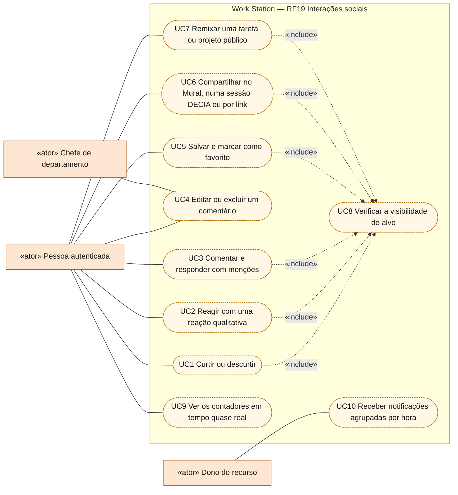
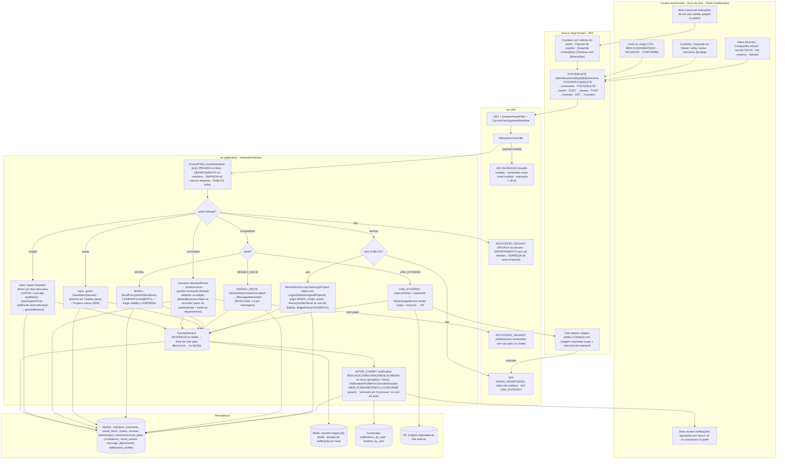
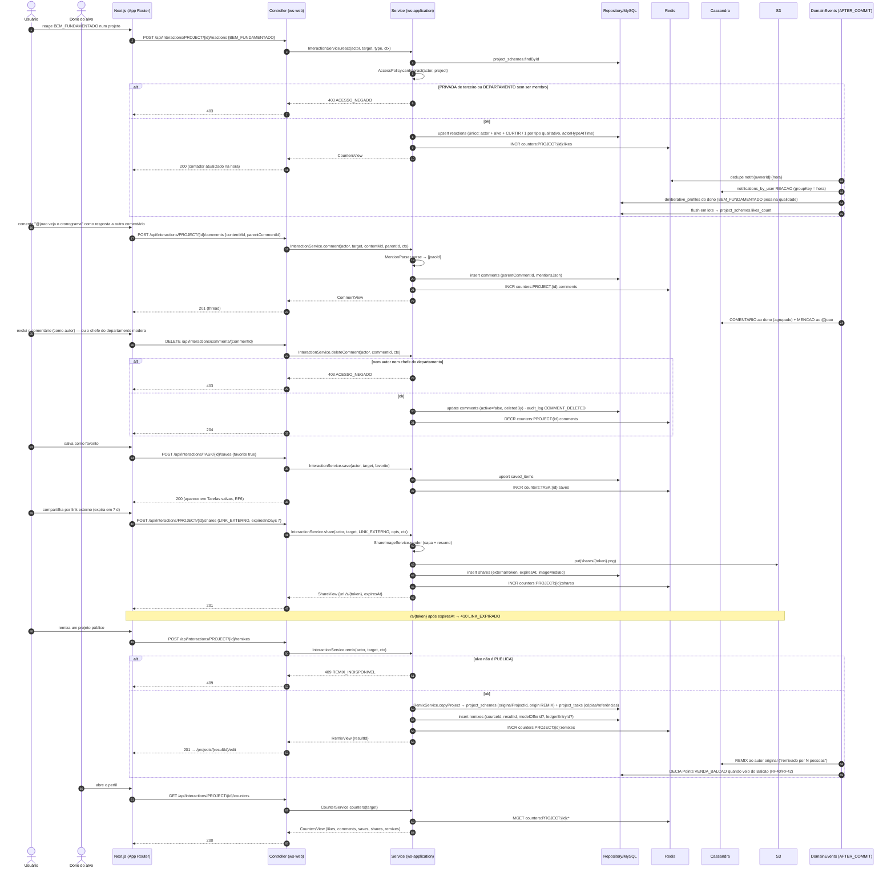
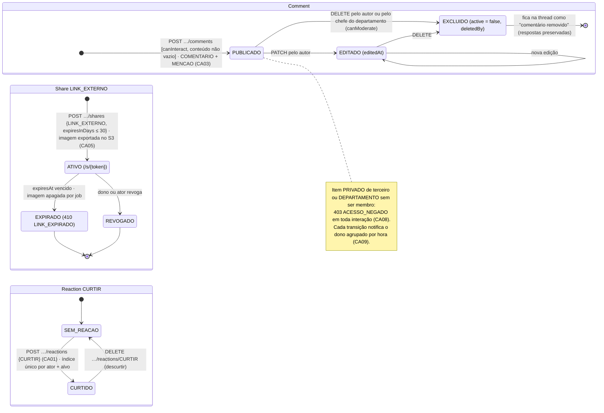
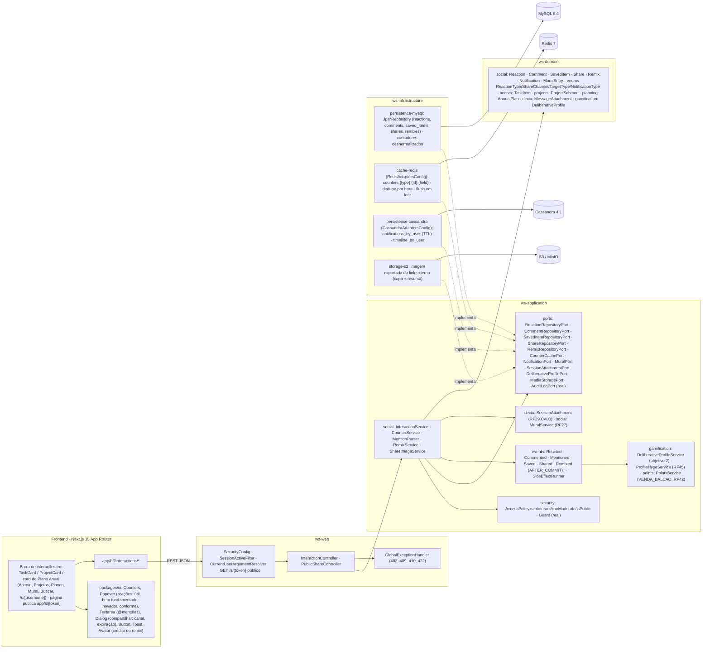
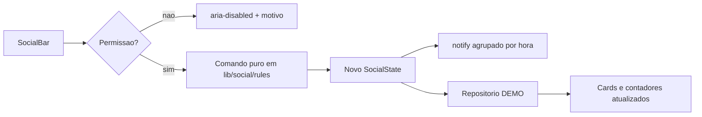

# RF19 — Curtir, comentar, salvar, compartilhar, retornar, atribuir e remixar tarefas, esquemas de projeto e planos anuais (interações sociais)
**HU:** HU19 · **Sprint (board Work Station):** a confirmar (card renomeado em 2026-10-02; origem `_anterior/RF26` = Sprint 4, "HU26 / RF26 Interações sociais"; a HU19 do Product Backlog remete a "RF26 — critérios no card RF26") · **Equivalente FAI:** RF19 Interações sociais (alvo polimórfico PIECE/SCHEME/DNA) · **Aba/rota:** ações inline em todos os cards (Acervo RF6, Projetos, Planos Anuais RF24, Mural RF27, Buscar RF17, perfil RF16) · **API:** `/api/interactions/{type}/{id}/reactions|comments|saves|shares|remixes|counters`
**Critérios de aceite cobertos:** RF26.CA01 · RF26.CA02 · RF26.CA03 · RF26.CA04 · RF26.CA05 · RF26.CA06 · RF26.CA07 · RF26.CA08 · RF26.CA09 — citados como estão escritos no card (**corpo do card = antigo RF26**, ver `RENUMERACAO.md`). As interações **retornar** e **atribuir** constam só no título, sem CA no corpo: estão modeladas no **RF18** (CA03–CA06) e aqui aparecem só como remissão. Todas as classes do RF são **(planejado)**; reais: `Guard`, `AuditLogPort`, `SecurityConfig`, `RedisAdaptersConfig`, `CassandraAdaptersConfig`.

> **HU19** — COMO usuário autenticado POSSO curtir, reagir, comentar, salvar, compartilhar e remixar tarefas, esquemas de projeto e planos anuais PARA colaborar, dar retorno de qualidade e reaproveitar o trabalho dos colegas.

Alvos: `TargetType` TASK · PROJECT · PLAN (TAXONOMIA §8). Entidades: `Reaction` (CURTIR + 4 reações qualitativas), `Comment` (thread, menções), `SavedItem`, `Share` (MURAL · SESSAO_DECIA · LINK_EXTERNO), `Remix` (cópia com crédito). Contadores desnormalizados nas entidades-alvo (`likesCount` … `remixesCount`) com Redis para tempo quase real; toda interação gera `Notification` agrupada por hora e alimenta o `DeliberativeProfile` (objetivo 2).

## Critérios de aceite (card RF19, escritos como RF26)

| CA | Enunciado |
|---|---|
| **RF26.CA01** | Curtir/descurtir tarefa, projeto ou plano (1 reação por usuário e alvo, índice único). |
| **RF26.CA02** | Reações qualitativas: ÚTIL, BEM FUNDAMENTADO, INOVADOR, CONFORME (substituem TREND/ELEGANTE/CRIATIVO). |
| **RF26.CA03** | Comentários com resposta (thread), edição, exclusão pelo autor ou pelo chefe do departamento; menções @usuário geram notificação. |
| **RF26.CA04** | Salvar em *Tarefas salvas* / *Projetos salvos* com marcador de favorito. |
| **RF26.CA05** | Compartilhar: no **Mural** da empresa (RF27), **dentro de uma sessão DECIA** (RF29) ou por **link externo** com imagem exportada (capa + resumo) e controle de expiração. |
| **RF26.CA06** | **Remixar** um projeto ou tarefa pública: cria cópia com `originalId` e crédito visível; o autor original vê "remixado por N pessoas". |
| **RF26.CA07** | Contadores (curtidas, comentários, salvos, compartilhamentos, remixes) em tempo quase real nos cards e no perfil. |
| **RF26.CA08** | Interações respeitam a visibilidade: item PRIVADO não recebe interações de terceiros; item DEPARTAMENTO só de membros do departamento. |
| **RF26.CA09** | Toda interação gera notificação ao dono (agrupada por hora) e alimenta o perfil deliberativo (objetivo 2) — reações BEM FUNDAMENTADO e CONFORME pesam na métrica de qualidade. |

## 0. Diagrama de casos de uso

As interações sociais sobre tarefas, projetos e planos anuais (CAs do card escritos como RF26). Atribuir e retornar estão no RF18. Pílulas cheias existem no código hoje; tracejadas são planejadas.

| Caso de uso | Ator(es) | CAs | Situação |
|---|---|---|---|
| UC1 Curtir ou descurtir | Pessoa autenticada | RF26.CA01, RF26.CA07 | planejado — front DEMO (`lib/social/rules.ts`), sem API |
| UC2 Reagir com uma reação qualitativa | Pessoa autenticada | RF26.CA02, RF26.CA09 | planejado — front DEMO (`lib/social/rules.ts`), sem API |
| UC3 Comentar e responder com menções | Pessoa autenticada | RF26.CA03, RF26.CA09 | planejado — front DEMO (`lib/social/rules.ts`), sem API |
| UC4 Editar ou excluir um comentário | Pessoa autenticada · Chefe de departamento | RF26.CA03 | planejado — o autor edita e exclui; o chefe do departamento só exclui; front DEMO (`lib/social/rules.ts`), sem API |
| UC5 Salvar e marcar como favorito | Pessoa autenticada | RF26.CA04 | planejado — front DEMO (`lib/social/rules.ts`), sem API |
| UC6 Compartilhar no Mural, numa sessão DECIA ou por link | Pessoa autenticada | RF26.CA05 | planejado — front DEMO (`lib/social/rules.ts`), sem API |
| UC7 Remixar uma tarefa ou projeto público | Pessoa autenticada | RF26.CA06 | planejado — front DEMO (`lib/social/rules.ts`), sem API |
| UC8 Verificar a visibilidade do alvo | (incluído por UC1, UC2, UC3, UC5, UC6, UC7) | RF26.CA08 | planejado — `canInteract` no front DEMO (`lib/social/rules.ts`), sem API |
| UC9 Ver os contadores em tempo quase real | Pessoa autenticada | RF26.CA07 | planejado — no DEMO os contadores são derivados dos registros, sem Redis |
| UC10 Receber notificações agrupadas por hora | Dono do recurso | RF26.CA09 | planejado — `notify` com `groupKey` no front DEMO (`lib/social/rules.ts`), sem API |

## 1. Diagrama de classes

```mermaid
classDiagram
  direction LR

  class InteractionController {
    <<controller>>
    +react(type, id, ReactionRequest, CurrentUser, ctx) CountersView
    +unreact(type, id, reactionType, CurrentUser) CountersView
    +listComments(type, id, page) Page~CommentView~
    +comment(type, id, CommentRequest, CurrentUser, ctx) CommentView
    +editComment(commentId, CommentRequest, CurrentUser) CommentView
    +deleteComment(commentId, CurrentUser, ctx) void
    +save(type, id, SaveRequest, CurrentUser) CountersView
    +unsave(type, id, CurrentUser) CountersView
    +share(type, id, ShareRequest, CurrentUser, ctx) ShareView
    +remix(type, id, CurrentUser, ctx) RemixView
    +counters(type, id) CountersView
  }
  class InteractionService {
    <<service>>
    +react(actor, target, ReactionType, ctx) Counters
    +unreact(actor, target, ReactionType) Counters
    +comment(actor, target, contentMd, parentId, ctx) Comment
    +editComment(actor, commentId, contentMd) Comment
    +deleteComment(actor, commentId, ctx) void
    +save(actor, target, favorite) Counters
    +unsave(actor, target) Counters
    +share(actor, target, ShareChannel, opts, ctx) Share
    +remix(actor, target, ctx) Remix
  }
  class CounterService {
    <<service>>
    +increment(target, field) long
    +decrement(target, field) long
    +counters(target) Counters
    +flushToMysql() void
  }
  class MentionParser {
    <<service>>
    +parse(contentMd) List~UUID~
  }
  class RemixService {
    <<service>>
    +copyTask(source, actor) TaskItem
    +copyProject(source, actor) ProjectScheme
  }
  class ShareImageService {
    <<service>>
    +render(target) MediaObject
  }
  class AccessPolicy {
    <<service>>
    +canInteract(viewer, target) boolean
    +canModerate(viewer, comment) boolean
    +isPublic(target) boolean
  }
  class ReactionRepositoryPort {
    <<port>>
    +upsert(Reaction) Reaction
    +delete(actorId, target, type) void
  }
  class CommentRepositoryPort {
    <<port>>
    +save(Comment) Comment
    +findByTarget(target, page) Page
  }
  class SavedItemRepositoryPort {
    <<port>>
    +upsert(SavedItem) SavedItem
    +delete(userId, target) void
  }
  class ShareRepositoryPort {
    <<port>>
    +save(Share) Share
    +findByToken(token) Optional
  }
  class RemixRepositoryPort {
    <<port>>
    +save(Remix) Remix
    +countBySource(sourceId) long
  }
  class CounterCachePort {
    <<port>>
    +incr(key) long
    +decr(key) long
    +get(keys) Map
  }
  class NotificationPort {
    <<port>>
    +notify(Notification) void
  }
  class MuralPort {
    <<port>>
    +publish(MuralEntry) void
  }
  class SessionAttachmentPort {
    <<port>>
    +attach(sessionId, target, actor) MessageAttachment
  }
  class DeliberativeProfilePort {
    <<port>>
    +recordInteraction(ownerId, ReactionType) void
  }

  class Reaction {
    <<entity>>
    +UUID id
    +UUID actorId
    +TargetType targetType
    +UUID targetId
    +ReactionType reactionType
    +Instant at
    +int actorHypeAtTime
    +String ignoredReason
  }
  class Comment {
    <<entity>>
    +UUID id
    +UUID authorId
    +TargetType targetType
    +UUID targetId
    +UUID parentCommentId
    +String contentMd
    +JSON mentionsJson
    +Instant editedAt
    +UUID deletedBy
    +boolean active
  }
  class SavedItem {
    <<entity>>
    +UUID id
    +UUID userId
    +TargetType targetType
    +UUID targetId
    +boolean favorite
    +Instant savedAt
  }
  class Share {
    <<entity>>
    +UUID id
    +UUID actorId
    +TargetType targetType
    +UUID targetId
    +ShareChannel channel
    +UUID sessionId
    +String externalToken
    +Instant expiresAt
    +UUID imageMediaId
  }
  class Remix {
    <<entity>>
    +UUID id
    +UUID actorId
    +TargetType sourceType
    +UUID sourceId
    +TargetType resultType
    +UUID resultId
    +UUID modelOfferId
    +UUID ledgerEntryId
    +Instant at
  }
  class TaskItem {
    <<entity>>
    +UUID id
    +UUID ownerId
    +UUID departmentId
    +Visibility visibility
    +UUID originalTaskId
    +long likesCount
    +long commentsCount
    +long savesCount
    +long sharesCount
    +long remixesCount
  }
  class ProjectScheme {
    <<entity>>
    +UUID id
    +UUID ownerId
    +Visibility visibility
    +UUID originalProjectId
    +SchemeOrigin origin
    +long likesCount
    +long remixesCount
  }
  class AnnualPlan {
    <<entity>>
    +UUID id
    +UUID ownerId
    +Visibility visibility
    +long likesCount
  }
  class Notification {
    <<entity>>
    +UUID recipientId
    +UUID actorId
    +NotificationType type
    +String category
    +String groupKey
  }
  class MuralEntry {
    <<entity>>
    +String kind
    +UUID companyId
    +String targetType
    +UUID targetId
  }
  class MessageAttachment {
    <<entity>>
    +UUID messageId
    +String targetType
    +UUID targetId
    +boolean usedInDecision
  }
  class DeliberativeProfile {
    <<entity>>
    +UUID userId
    +BigDecimal evidenceUse
    +BigDecimal consistency
    +JSON badgesJson
  }
  class ReactionType {
    <<enum>>
    CURTIR
    UTIL
    BEM_FUNDAMENTADO
    INOVADOR
    CONFORME
  }
  class ShareChannel {
    <<enum>>
    MURAL
    SESSAO_DECIA
    LINK_EXTERNO
  }
  class TargetType {
    <<enum>>
    TASK
    PROJECT
    PLAN
    KIT
    PROJECT_TASK
    MESSAGE
    RECOGNITION
  }
  class NotificationType {
    <<enum>>
    REACAO
    COMENTARIO
    MENCAO
    REMIX
  }

  InteractionController --> InteractionService
  InteractionController --> CounterService
  InteractionService --> AccessPolicy
  InteractionService --> CounterService
  InteractionService --> MentionParser
  InteractionService --> RemixService
  InteractionService --> ShareImageService
  InteractionService --> ReactionRepositoryPort
  InteractionService --> CommentRepositoryPort
  InteractionService --> SavedItemRepositoryPort
  InteractionService --> ShareRepositoryPort
  InteractionService --> RemixRepositoryPort
  InteractionService --> NotificationPort
  InteractionService --> MuralPort
  InteractionService --> SessionAttachmentPort
  InteractionService --> DeliberativeProfilePort
  CounterService --> CounterCachePort
  Reaction --> ReactionType
  Reaction --> TargetType
  Share --> ShareChannel
  Notification --> NotificationType
  Reaction "0..*" --> "1" TaskItem : alvo TASK
  Reaction "0..*" --> "1" ProjectScheme : alvo PROJECT
  Reaction "0..*" --> "1" AnnualPlan : alvo PLAN
  Comment "0..*" --> "0..1" Comment : parentCommentId (thread)
  SavedItem "0..*" --> "1" TaskItem
  Share "0..*" --> "0..1" MessageAttachment : SESSAO_DECIA
  Share ..> MuralEntry : MURAL
  Remix "1" --> "1" TaskItem : resultId (originalTaskId = sourceId)
  Remix "1" --> "1" ProjectScheme : resultId (originalProjectId, origin REMIX)
  InteractionService ..> Notification
  InteractionService ..> DeliberativeProfile : BEM_FUNDAMENTADO e CONFORME pesam
  note for Reaction "Único (actorId, targetType, targetId, reactionType = CURTIR). actorHypeAtTime: peso PageRank (RF45.CA04). ignoredReason: antifraude (RF45.CA03)."
```

## 2. Diagrama de atividades

## 3. Diagrama de sequência

## 4. Máquina de estados

Entidade central: as entidades sociais não têm enum de status na TAXONOMIA; o ciclo relevante é o de **`Comment`** (`active`/`deletedBy`/`editedAt`, CA03) e o de **`Share` LINK_EXTERNO** (`expiresAt`, CA05). `Reaction`/`SavedItem` existem ou não (CA01/CA04); `Remix` é imutável (CA06). "Retornar" e "atribuir" seguem `AssignmentStatus` no RF18 §4.

## 5. Diagrama de componentes

## 6. Rastreabilidade

| CA (card RF19, escrito como RF26) | Classe (§1) | Passo da atividade (§2) | Mensagem da sequência (§3) | Transição de estado (§4) | Componente (§5) | Situação |
|---|---|---|---|---|---|---|
| RF26.CA01 | `InteractionService.react/unreact`, `Reaction` (único actor+alvo+CURTIR), `ReactionRepositoryPort.upsert/delete` | `A2`→`F2`→`R1`→`CT` | 1–4, 8–11 | `RC`: `SEM`→`CUR`→`SEM` | `SOC`, `MY` (índice único), `RDS` | planejado |
| RF26.CA02 | `ReactionType` (UTIL · BEM_FUNDAMENTADO · INOVADOR · CONFORME), `Reaction.actorHypeAtTime/ignoredReason` | `R1` | 1, 8 | — | `UI` (`Popover`) | planejado (RF45.CA03/CA04) |
| RF26.CA03 | `InteractionService.comment/editComment/deleteComment`, `Comment` (`parentCommentId`, `mentionsJson`, `editedAt`, `deletedBy`), `MentionParser`, `AccessPolicy.canModerate` | `A3`→`C1`, `E403M` | 17–32 | `CM`: `PUB`→`EDT`→`EXC` | `SOC`, `UI` (`Textarea`), `CAS` (MENCAO) | planejado |
| RF26.CA04 | `InteractionService.save/unsave`, `SavedItem.favorite`, `SavedItemRepositoryPort` | `A4`→`SV1` | 33–38 | — | `SOC`, `MY` | planejado (RF6.CA05) |
| RF26.CA05 | `InteractionService.share`, `Share`, `ShareChannel`, `MuralPort`, `SessionAttachmentPort`, `ShareImageService`, `PublicShareController` | `SH1`→`SH2`/`SH3`/`SH4`, `F3`, `E409` (410) | 39–47 | `SH`: `ATV`→`EXP`/`REV` | `SOC`, `DEC`, `S3`, `SEC` (`/s/{token}`) | planejado (RF27, RF29.CA03) |
| RF26.CA06 | `InteractionService.remix`, `RemixService.copyTask/copyProject`, `Remix`, `TaskItem.originalTaskId`, `ProjectScheme.originalProjectId/origin REMIX`, `AccessPolicy.isPublic` | `RX1`→`RX2`, `E409` | 48–59 | — (imutável) | `SOC`, `GAM` (`PointsService`), `UI` (`Avatar` crédito) | planejado (RF40/RF42) |
| RF26.CA07 | `CounterService.increment/decrement/counters/flushToMysql`, `CounterCachePort`, contadores em `TaskItem`/`ProjectScheme`/`AnnualPlan` | `CT` | 10–11, 15, 60–64 | — | `RDS`, `MY` | planejado |
| RF26.CA08 | `AccessPolicy.canInteract` | `S1`→`S2`→`E403` | 5–7 | nota de `PUB` | `SECU`, `GEH` | planejado |
| RF26.CA09 | eventos `Reacted`/`Commented`/`Mentioned`/`Remixed`, `NotificationPort`, `Notification.groupKey`, `DeliberativeProfilePort.recordInteraction` | `EV`→`A5` | 12–14, 23, 57 | nota de `PUB` | `EVT`, `GAM`, `CAS` | planejado (objetivo 2) |
| (título) retornar · atribuir | `AssignmentService`, `Assignment` | — | — | `AssignmentStatus` (RF18 §4) | `ASG` no RF18 | modelado no RF18.CA03–CA06 (remissão) |

## 7. Front implementado (onda Social, DEMO)

Barra social e diálogos em `components/social/` (SocialBar, ReactionPicker, CommentThread, ShareSheet, RemixDialog, DelegateDialog/GiveBackDialog, AssignmentInbox) sobre regras puras em `lib/social/rules.ts` e o repositório **DEMO** em memória (`SocialRepository`, mesmo padrão do DECIA; a API `/api/interactions/...` vem depois dos Blocos 4–5). Tipos espelham `domain/social/*` (V16) e `domain/mensageria/Assignment` (V20) — `lib/social/types.test.ts` compara os enums com os `.java`.

| CA | Implementação |
|---|---|
| RF26.CA01 | `react(…, "CURTIR")` liga/desliga; contador `countersOf`. |
| RF26.CA02 | Qualitativas excludentes entre si, CURTIR independente (D-90); reação do dono grava `ignoredReason AUTO_INTERACAO`. |
| RF26.CA03 | `addComment` (resposta de 1 nível, D-91), `editComment` (só autor, `editedAt`), `deleteComment` (autor ou chefe do departamento; lógica `active=false`, `deletedBy`), @menções → `MENCAO` só para quem vê o item; limite 1000 caracteres. |
| RF26.CA04 | `toggleSave` / `toggleFavorite`; sub-abas Tarefas/Projetos salvos com "indisponível" quando o alvo saiu da visibilidade. |
| RF26.CA05 | `share` nos três `ShareChannel`: MURAL (cria `MuralEntry COMPARTILHAMENTO`), SESSAO_DECIA (exige sessão), LINK_EXTERNO (token + validade 1–30 dias). Classificação e visibilidade limitam os canais (D-94). |
| RF26.CA06 | `remix`: cópia RASCUNHO/PRIVADA no Acervo do ator com `originalTaskId`/`originalProjectId`, `reuseCount+1`, `Remix`, notificação ao autor e ao autor do original; remix de remix mantém a cadeia (`remixChain`); RESTRITO/SIGILOSO nunca (D-92). |
| RF26.CA07 | Contadores derivados dos registros a cada mudança (sem Redis no DEMO). |
| RF26.CA08 | `canInteract` = login + `canView`; toda ação indisponível fica `aria-disabled` com o motivo no nome acessível. |
| RF26.CA09 | `notify`: nunca para si mesmo; agrupada por tipo + alvo + hora (`groupKey`); atribuições individuais (uma por `Assignment`). |
| retornar · atribuir | "Delegar" = `Assignment PROPOSTA` (RF18.CA03); "Retornar" = ACEITA → DEVOLVIDA com motivo ≥ 20 (RF18.CA05). Ver RF18 §7. |

Rotas: `/tasks/[id]` (layout ampliado + comentários), `/mural`, perfis. Capturas `44`–`48`.
