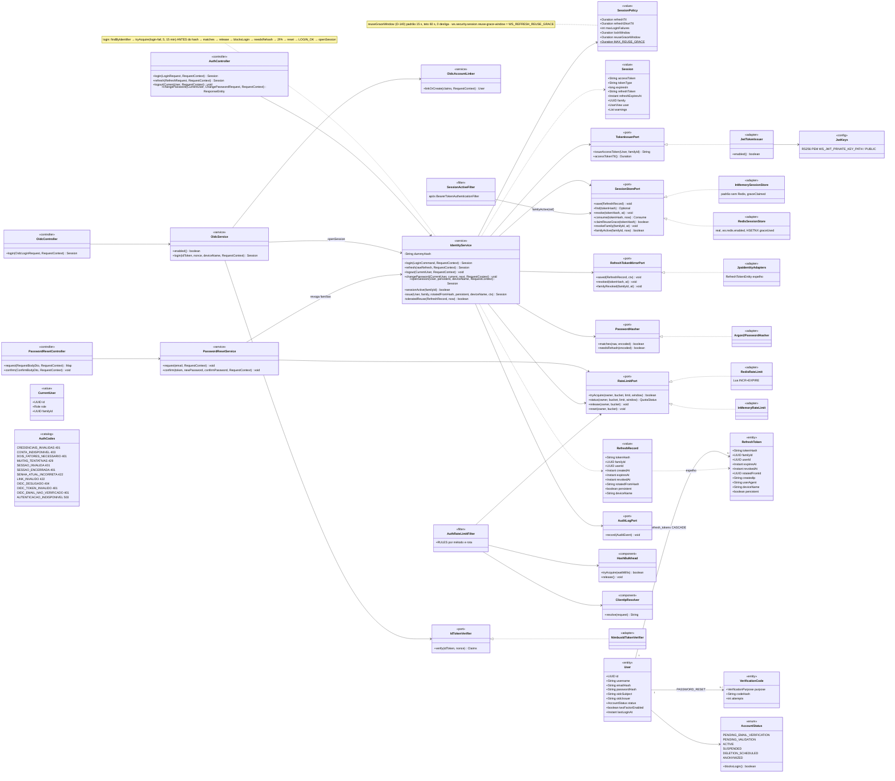
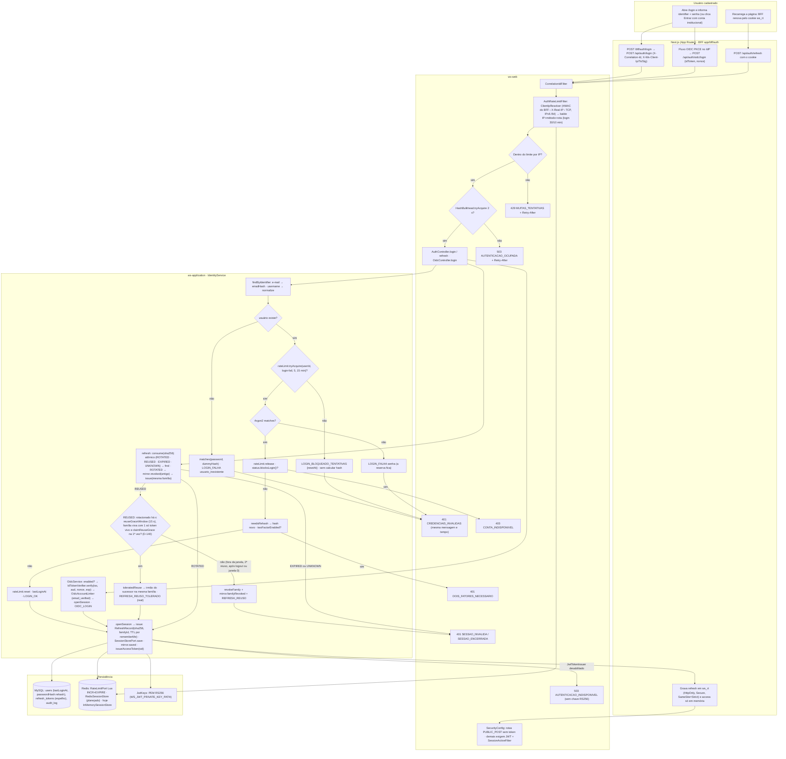
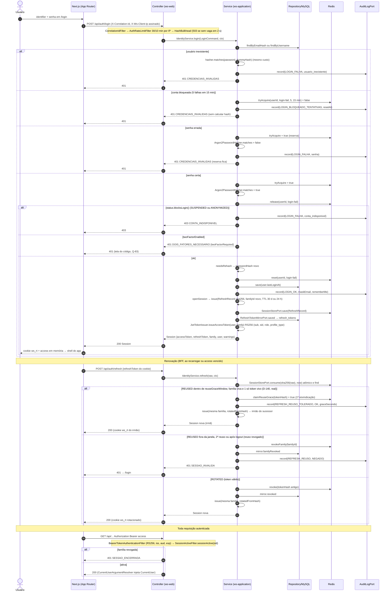
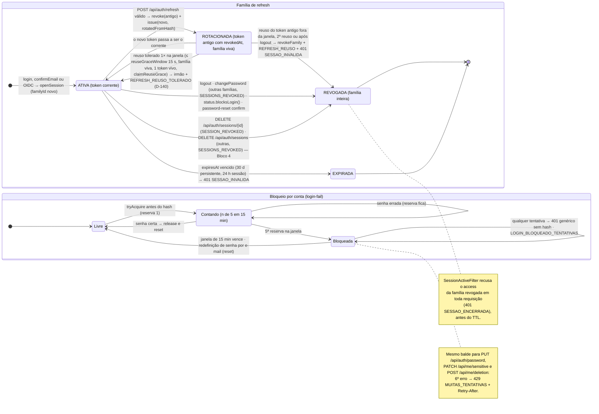
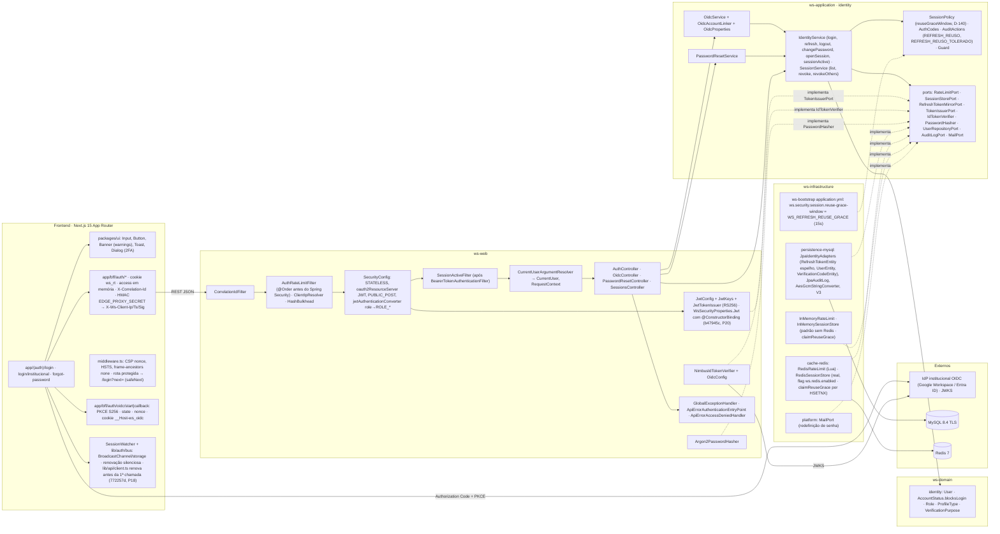
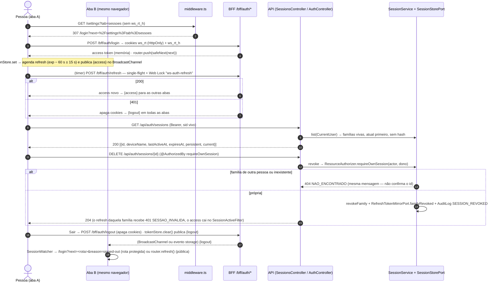

# RF2 — Autenticar usuário na plataforma com credenciais de acesso
**HU:** HU2 · **Sprint (board Work Station):** 1 (card "SPRINT 1 — Cadastro, autenticação, perfil e abertura de sessão") · **Equivalente FAI:** RF2 Login (`AuthController POST /api/auth/login|refresh|logout`, `IdentityService.login/refresh`, família de refresh em Redis) · **Aba/rota:** `/login` (BFF `app/bff/auth/login` → `POST /api/auth/login`), `/login/institucional` (`POST /api/auth/oidc/login`), `/forgot-password` (`POST /api/auth/password-reset/request|confirm`); todas as rotas autenticadas passam pelo `SessionActiveFilter`
**Critérios de aceite cobertos:** RF2.CA01 … RF2.CA06 (corpo do card vazio → derivados do título + HU2, todos "(CA a confirmar)") · RF2.CA07 … RF2.CA14 (§7, controles de segurança D-14) — regra: o título do card define o RF; CAs alinhados ao código real do Bloco 3 (`AuthController`, `IdentityService`, `AuthRateLimitFilter`, `HashBulkhead`, `SessionActiveFilter`, `JwtTokenIssuer`, `OidcService`, `PasswordResetService`)

> **HU2** — COMO usuário cadastrado no sistema POSSO autenticar-me na plataforma com minhas credenciais de acesso PARA acessar minha área pessoal de forma segura.

Classes **(real)** existem em `origin/main` (Bloco 3, PR #16); `RedisSessionStore` (`ws-infrastructure/cache-redis`, ativo com `ws.redis.enabled=true`; Q-85 resolvida) é **(real)** e o `InMemorySessionStore` fica como padrão sem Redis, ambos com espelho JPA `refresh_tokens`; **(planejado)**: conferência TOTP do 2FA (Q-83), SMTP real (Q-84), `PolicyGateFilter` (D-16). Números adotados: D-25 (TTLs), D-26 (Argon2id e bulkhead), D-27 (cadastro sem oráculo). **Bloco 4 (real, D-60–D-64):** proteção de rotas no `middleware.ts`, renovação silenciosa e logout entre abas, OIDC Authorization Code + PKCE S256/`state`/`nonce` no BFF e `GET/DELETE /api/auth/sessions` com a aba Sessões — §8.

**Atualização 17/10/2026 (real):** tolerância ao reuso do refresh (**D-140**, Q-237, achado **P18** de `docs/auditoria/2026-10-17/PROBLEMAS.md`) — `SessionPolicy.reuseGraceWindow` (padrão 15 s, teto `MAX_REUSE_GRACE` = 60 s, `0s` desliga; `ws.security.session.reuse-grace-window` / `WS_REFRESH_REUSE_GRACE` em `ws-bootstrap/src/main/resources/application.yml`), `SessionStorePort.claimReuseGrace(tokenHash)` atômico (`InMemorySessionStore`, `RedisSessionStore` por `HSETNX graceUsed`) e `IdentityService.refresh` → `toleratedReuse(...)` no `case REUSED`; no front, `lib/api/client.ts` aguarda a renovação única (`refreshOnce`) antes da 1ª chamada da página (`772257d`, `lib/api/client.restore.test.ts`; P18 mitigado). **P20** corrigido: `WsSecurityProperties.Jwt` ganhou `@ConstructorBinding` (`b47945c`, `WsSecurityPropertiesBindingTest`) — sem isso as chaves RS256 ficavam vazias e o login respondia `503 AUTENTICACAO_INDISPONIVEL`.

## Critérios de aceite derivados da HU2 (todos "CA a confirmar")

| CA | Enunciado (Dado / Quando / Então) |
|---|---|
| **RF2.CA01** (CA a confirmar) | Dado `identifier` (username ou e-mail) e `password`, quando faço `POST /api/auth/login`, então a senha é conferida contra o hash **Argon2id** (`PasswordHasher.matches`, re-hash transparente por `needsRehash`) e recebo `Session {accessToken RS256 15 min (D-25; claims iss, aud, sub, sid=familyId, role, profile_type, username, jti), tokenType Bearer, expiresIn, refreshToken opaco, refreshExpiresAt, family, user, warnings}`; o refresh (30 d se `rememberMe`, 24 h se não — `SessionPolicy`) é guardado só como SHA-256 (`RefreshRecord.tokenHash`) com espelho em `refresh_tokens`; o BFF devolve o refresh **só** no cookie `ws_rt` (HttpOnly, Secure, SameSite=Strict). |
| **RF2.CA02** (CA a confirmar) | Dado conta inexistente, senha errada ou conta bloqueada, então `401 CREDENCIAIS_INVALIDAS` com a mesma mensagem e tempo (hash falso `dummyHash`); conta `SUSPENDED`/`ANONYMIZED` (`AccountStatus.blocksLogin`) → `403 CONTA_INDISPONIVEL` **depois** da senha certa; `PENDING_VALIDATION` e `DELETION_SCHEDULED` entram com `warnings` (Q-82; `PENDING_EMAIL_VERIFICATION` só tem sessão após confirmar o código, D-27); `twoFactorEnabled` → `401 DOIS_FATORES_NECESSARIO {twoFactorRequired}` (conferência TOTP é a Q-83). |
| **RF2.CA03** (CA a confirmar) | Dado "Entrar com conta institucional", então o front faz OIDC Authorization Code + PKCE e envia `POST /api/auth/oidc/login {idToken, nonce}`; `OidcService` exige `ws.oidc.enabled` (`404 OIDC_DESLIGADO`), `IdTokenVerifier` (Nimbus) valida assinatura JWKS, `iss`, `aud`, `nonce`, `exp` (`401 OIDC_TOKEN_INVALIDO`); `OidcAccountLinker` vincula `oidcSubject/oidcIssuer` ao `User` de mesmo `emailHash` só com `email_verified=true` (`401 OIDC_EMAIL_NAO_VERIFICADO`, `AuditLog OIDC_LINK_RECUSADO`) ou cria conta `ACTIVE` sem senha; emite a mesma `Session` (`AuditLog OIDC_LOGIN`). |
| **RF2.CA04** (CA a confirmar) | Dado um refresh válido, quando o BFF chama `POST /api/auth/refresh`, então ocorre **rotação**: novo token da mesma `familyId`, o anterior recebe `revokedAt`/`rotatedFromHash`; reuso de token já rotacionado **revoga a família inteira**, grava `AuditLog REFRESH_REUSO` e responde `401 SESSAO_INVALIDA`; expirado ou desconhecido → `401 SESSAO_INVALIDA`; conta que passou a `blocksLogin()` → família revogada. **Exceção (real, D-140, 17/10/2026):** o consumo é atômico (`SessionStorePort.consume` → `ROTATED · REUSED · EXPIRED · UNKNOWN`); no `REUSED`, se o token foi rotacionado há no máximo `SessionPolicy.reuseGraceWindow` (padrão 15 s, teto 60 s, `0s` desliga), a família segue viva com **um só** token vivo e `claimReuseGrace(tokenHash)` é a 1ª reivindicação, o `IdentityService.toleratedReuse` emite um **irmão** do sucessor na mesma família e audita `REFRESH_REUSO_TOLERADO` (resposta perdida na navegação, P18); 2º reuso, fora da janela ou após logout → revogação da família e `REFRESH_REUSO` como acima. |
| **RF2.CA05** (CA a confirmar) | Dado o usuário autenticado, então `POST /api/auth/logout` revoga a família (`AuditLog LOGOUT`); `PUT /api/auth/password` exige a senha atual (mesmo bloqueio do login), grava `PASSWORD_CHANGED` e revoga as **outras** famílias (`SESSIONS_REVOKED`); o `SessionActiveFilter` recusa a cada requisição access tokens cuja família foi revogada (`sid` → `401 SESSAO_ENCERRADA`). `GET /api/auth/sessions` e `DELETE /api/auth/sessions/{familyId}` são **planejados** (aba Sessões do RF3 §7). |
| **RF2.CA06** (CA a confirmar) | Dado tentativas repetidas, então há limite por IP (`AuthRateLimitFilter`) e por conta (`RateLimitPort` `login-fail`), `AuditLog LOGIN_OK / LOGIN_FALHA / LOGIN_BLOQUEADO_TENTATIVAS / REFRESH_REUSO / LOGOUT` com `correlationId`, e-mail mascarado e sem senha ou token; `User.lastLoginAt` é atualizado; mensagens i18n (pt-BR/en/es). Redefinição por e-mail: `POST /api/auth/password-reset/request` (resposta igual exista ou não a conta, 5/h por pessoa) e `/confirm {token, newPassword}` (`422 LINK_INVALIDO`), que tira a conta do bloqueio. |

## 1. Diagrama de classes

## 2. Diagrama de atividades

## 3. Diagrama de sequência

## 4. Máquina de estados

Entidade central: a **família de refresh** (`RefreshRecord`/`refresh_tokens`, TAXONOMIA §1.3, estados derivados de `revokedAt`/`rotatedFromHash`/`expiresAt` — não há enum) e, abaixo, o **balde de bloqueio por conta** (`RateLimitPort` `login-fail`). `User.status` é o do RF1 §4.

## 5. Diagrama de componentes

## 6. Rastreabilidade

| CA | Classe (§1) | Passo da atividade (§2) | Mensagem da sequência (§3) | Transição de estado (§4) | Componente (§5) | Situação |
|---|---|---|---|---|---|---|
| RF2.CA01 | `IdentityService.login/openSession/issue`, `SessionPolicy`, `RefreshRecord`, `JwtTokenIssuer`, `Session` | `S1`→`S10`→`S11`→`F2` | 4–5, 27–38 | `[*]`→`ATIVA` | `AC`, `IS`, `JWT`, `BFF` (`ws_rt`) | real |
| RF2.CA02 | `IdentityService.dummyHash`, `AccountStatus.blocksLogin`, `AuthCodes` | `S2`→`S3`→`E401`, `S6`→`S7`→`E401`, `S8`→`E403`, `S9`→`E2FA` | 6–9, 15–19, 22–26 | nota de `BLOQ` | `IS`, `GEH` | real (TOTP: Q-83) |
| RF2.CA03 | `OidcController`, `OidcService`, `IdTokenVerifier`/`NimbusIdTokenVerifier`, `OidcAccountLinker` | `F4`→`O1`→`S11` | — (mesma emissão 32–38) | `[*]`→`ATIVA` | `OS`, `NIM`, `IDP`, BFF `oidc/*` | real (`OidcTest`, `OidcWebTest`, `app/bff/auth/oidc.test.ts` — §8, D-63) |
| RF2.CA04 | `IdentityService.refresh/toleratedReuse`, `SessionPolicy.reuseGraceWindow`, `SessionStorePort.consume/claimReuseGrace/revoke/revokeFamily`, `RefreshTokenMirrorPort` | `A2`→`F3`→`R1`→`R2`→`R3`→`S11` (tolerado) · `R2`→`R4`→`E401S` (revogado) · `R1`→`S11` (ROTATED) | 37–54 (alt tolerado 40–44 · revogado 45–49 · ROTATED 50–54) | `ATIVA`→`ROT`→`ATIVA`, `ROT`→`ATIVA` (reuso tolerado 1× na janela), `ROT`→`REV`, `ATIVA`→`EXP` | `IS`, `SP`, `CFG`, `RDS`/`MEM`, `MY`, `SW` | real; tolerância D-140 (17/10/2026): `IdentityServiceTest.reusoDentroDaJanelaEhToleradoUmaVezESemFamiliaVivaNunca`, `IdentityServiceTest.janelaDeToleranciaTemTetoEZeroDesliga`; front `772257d` (`lib/api/client.restore.test.ts`) — P18 |
| RF2.CA05 | `IdentityService.logout/changePassword/revokeOtherSessions/activeSessions/sessionActive`, `SessionActiveFilter`, `CurrentUser` | `W6` | 55–57 | `ATIVA`→`REV` | `SAF`, `CUR`, `AC` | real; `SessionService` + `SessionsController` `GET/DELETE /api/auth/sessions[/{id}]` e aba Sessões (Bloco 4, §8, D-62) |
| RF2.CA06 | `AuthRateLimitFilter`, `RateLimitPort`, `AuditActions`, `PasswordResetService` (`clearLockout`), `Masking` | `W2`→`E429`, `S5`, `S7`, `S10` | 3, 8, 12–13, 17, 30, 44 | `LOCK` inteiro | `ARL`, `RDS`, `PR`, `PLT` | real |
| RF2.CA07 | `IdentityService.login` (ordem das checagens), `dummyHash` | `S3`, `S5`, `S7`, `S8`→`E403`, `S9`→`E2FA` | 6–26 | nota de `BLOQ` | `IS` | real (§7) |
| RF2.CA08 | `RateLimitPort.tryAcquire/release/reset`, `RedisRateLimit` (Lua), `SessionPolicy.maxLoginFailures/lockWindow` | `S4`→`S5`, `S8`, `S10` | 11, 16, 21, 29 | `LIVRE`→`CONT`→`BLOQ`→`LIVRE` | `RDS`, `MEM` | real |
| RF2.CA09 | `IdentityService.changePassword`, `AccountService.updateSensitive/requestDeletion` | — | — | nota de `BLOQ` | `AC`, `IS` | real (mesmo balde) |
| RF2.CA10 | `AuthRateLimitFilter.RULES`, `ClientIpResolver` | `W2`→`W3`→`E429` | 3 | — | `ARL`, `BFF` | real |
| RF2.CA11 | `HashBulkhead` | `W4`→`E503` | 3 | — | `ARL` | real |
| RF2.CA12 | `OidcAccountLinker` (`email_verified`), `AuthCodes.OIDC_EMAIL_NAO_VERIFICADO` | `O1` | — | — | `OS`, `NIM` | real |
| RF2.CA13 | `JwtTokenIssuer`, `JwtKeys`, `WsSecurityProperties.Jwt` (`@ConstructorBinding`), `SessionActiveFilter`, BFF `ws_rt` | `F2`, `W6`, `E503J` | 33–36, 55–57 | nota de `REV` | `JWT`, `SAF`, `BFF`, `MW` | real (D-24, D-25); P20 corrigido em `b47945c` (`WsSecurityPropertiesBindingTest`) |
| RF2.CA14 | `AuditActions.LOGIN_OK/LOGIN_FALHA/LOGIN_BLOQUEADO_TENTATIVAS/REFRESH_REUSO/REFRESH_REUSO_TOLERADO/LOGOUT`, `AuditEvent`, `Masking` | `S3`, `S5`, `S7`, `S10`, `R3`, `R4` | 6, 10, 15, 21, 29, 41, 47 | — | `MY` (`audit_log` RESTRICT), `CIF` | real |

## 7. Controles de segurança (D-14)

Herdados do RF49 do FAI pela **D-14**; camadas de defesa e rastreabilidade RN/CA → bloco → classe em [`../SEG/README.md`](../SEG/README.md). Todos "(CA a confirmar)" até a Q-48. Onde um CA abaixo refina o CA01–CA06, vale o de baixo. Coluna **Código**: o que já existe em `origin/main` (Bloco 3, PR #16).

| CA | Enunciado (Dado / Quando / Então) | Código |
|---|---|---|
| **RF2.CA07** (CA a confirmar) | **Login sem oráculo.** Dado conta inexistente, senha errada ou conta bloqueada (mesmo com a senha certa), então a resposta é a mesma `401 CREDENCIAIS_INVALIDAS`, com o mesmo tempo (conta inexistente avalia `dummyHash`). `403 CONTA_INDISPONIVEL` (`blocksLogin`: SUSPENDED/ANONYMIZED) e `401 DOIS_FATORES_NECESSARIO` só aparecem **depois da senha certa e fora do bloqueio**. | `IdentityService.login`, `IdentityServiceTest` |
| **RF2.CA08** (CA a confirmar) | **Bloqueio por conta.** Dado 5 tentativas em 15 min (`SessionPolicy`), então a tentativa é reservada **atomicamente antes do hash** (`RateLimitPort.tryAcquire`, INCR+EXPIRE em Lua no `RedisRateLimit`); bloqueada → nem o hash é calculado; senha errada deixa a reserva; senha certa faz `release` e o login completo `reset`; a redefinição por e-mail tira a conta do bloqueio. 40 pedidos paralelos com senha errada avaliam no máximo 5 hashes. | `RateLimitPort`, `RedisRateLimit`, `InMemoryRateLimit`, `RedisRateLimitIT`, `InMemoryRateLimitTest` |
| **RF2.CA09** (CA a confirmar) | **Reconferência de senha.** Dado troca de senha (`PUT /api/auth/password`), dados sensíveis (`PATCH /api/me/sensitive`) ou exclusão (`POST /api/me/deletion`), então o mesmo balde `login-fail` vale e o 6º erro recebe `429 MUITAS_TENTATIVAS` + `Retry-After`. | `IdentityService.changePassword`, `AccountService`, `AccountServiceTest` |
| **RF2.CA10** (CA a confirmar) | **Limite por IP + método + rota** (`AuthRateLimitFilter`, antes do Spring Security): `POST /api/auth/login` 30/10 min · `register` 10/h · `refresh` 120/10 min · `password-reset/request` 10/h · `password-reset/confirm` 20/h · `PUT /api/auth/password` 20/h · `oidc/login` 30/10 min · `two-factor/verify` 20/10 min · `email-verification/*` · `username-suggestions` 60/10 min · `uploads` 40/h. IP = `X-Ws-Client-Ip` assinado (HMAC-SHA256 `EDGE_PROXY_SECRET`, `X-Ws-Proxy-Ts` 60 s) › `X-Real-IP` › TCP; **nunca** `X-Forwarded-For`; IPv6 por /64. | `AuthRateLimitFilter.RULES`, `ClientIpResolver`, `RequestPaths`, `AuthRateLimitFilterTest`, `ClientIpResolverTest` |
| **RF2.CA11** (CA a confirmar) | **Bulkhead de hashes.** Dado um pico de logins, então o `HashBulkhead` (`Semaphore` justo, permits = `max(1, min(max(2, núcleos), pool/2))`, espera `ws.security.auth-hash-wait-ms` = 2 s) devolve `503 AUTENTICACAO_OCUPADA` + `Retry-After` ao excedente; 60 logins paralelos geram zero HTTP 500. | `HashBulkhead`, regras com `hashes=true` |
| **RF2.CA12** (CA a confirmar) | **OIDC.** Dado o `id_token` válido (PKCE, `state`, `nonce`, `iss`, `aud`, `exp`), então ele só é **vinculado a conta existente** de mesmo `emailHash` se o IdP marcar `email_verified=true`; sem isso `401 OIDC_EMAIL_NAO_VERIFICADO` e `AuditLog OIDC_LINK_RECUSADO` (evita takeover). Instância sem OIDC → `404 OIDC_DESLIGADO`. | `OidcService`, `OidcAccountLinker`, `NimbusIdTokenVerifier`, `OidcTest` |
| **RF2.CA13** (CA a confirmar) | **Tokens.** Access JWT RS256 com `iss`, `aud`, `sub`, `sid`, `role`, `profile_type`, `username`, `jti`; TTL **15 min** (`WS_JWT_ACCESS_TTL_MINUTES`, D-25 — padrão da Q-49); chaves por caminho **ou** conteúdo PEM (`JwtKeys`, D-24); sem chave privada configurada → `503 AUTENTICACAO_INDISPONIVEL` (nunca token sem assinatura). `SessionActiveFilter` recusa token de família revogada. Refresh só no cookie `ws_rt`; access só em memória (teste do front falha se aparecer em `localStorage`/`sessionStorage`). | `JwtTokenIssuer`, `JwtKeys`, `JwtKeysAndIssuerTest`, `SessionActiveFilter`, `SessionActiveFilterTest`; `WsSecurityProperties.Jwt` com `@ConstructorBinding` + `WsSecurityPropertiesBindingTest` (`b47945c`, P20) |
| **RF2.CA14** (CA a confirmar) | **Auditoria.** Eventos `LOGIN_OK`, `LOGIN_FALHA` (`reason` usuario_inexistente · senha · conta_indisponivel · 2fa), `LOGIN_BLOQUEADO_TENTATIVAS` (`resetAt`), `REFRESH_REUSO`, `REFRESH_REUSO_TOLERADO` (`graceSeconds`, D-140 — real em 17/10/2026), `LOGOUT`, `PASSWORD_CHANGED`, `SESSIONS_REVOKED`, `OIDC_LOGIN`, todos com `correlationId`, e-mail mascarado e sem senha, token ou código. | `AuditActions`, `AuditEvent`, `JpaAuditLog`, `AuditEventTest` |

Tela/aba: `/login` (esqueleto em `app/(auth)/login/page.tsx`) · `/password-reset` (esqueleto em `app/(auth)/password-reset/page.tsx`)

## 8. Sessão no front (Bloco 4, D-60–D-64)

**Proteção de rotas** (`middleware.ts` + `lib/auth/guard.ts`): rota cuja célula VISITANTE é "O" em `lib/pages/registry.ts` exige o cookie-sinal `ws_rt_h=1` (o `ws_rt` HttpOnly tem path=/bff/auth e o middleware não o vê); sem ele → `307 /login?next=<caminho>`. `next` passa por `safeNext` (só caminho relativo da própria origem; recusa `//`, `/\`, esquemas, barra invertida, controle e as formas codificadas). Rotas do visitante (Mural, Buscar, `/u/[username]`, `/tasks/[id]` — D-93) seguem públicas. `WS_ROUTE_GUARD=off` desliga só no lab sem backend (Q-160). **Cabeçalhos**: CSP com nonce por requisição, HSTS, X-Frame-Options e Referrer-Policy em toda resposta do middleware (inclusive o redirect); Permissions-Policy, nosniff e COOP em `next.config.ts`.

**OIDC no BFF** (`app/bff/auth/oidc/*`, atrás de `WS_OIDC_ENABLED`, padrão desligado → `404 OIDC_DESLIGADO`):

```mermaid
sequenceDiagram
  autonumber
  actor U as Navegador
  participant O as BFF /bff/auth/oidc
  participant I as IdP institucional
  participant C as API POST /api/auth/oidc/login
  U->>O: GET /start?next=/x
  O->>O: state, nonce, code_verifier = 32 bytes aleatórios cada · cookie __Host-ws_oidc HttpOnly, SameSite=Lax, 10 min, uso único
  O-->>U: 302 authorization_endpoint?response_type=code&state&nonce&code_challenge=B64URL(SHA256(verifier))&code_challenge_method=S256
  U->>I: autentica
  I-->>U: 302 /bff/auth/oidc/callback?code&state
  U->>O: GET /callback (cookie) — o cookie é apagado em toda resposta
  alt sem code_verifier válido
    O-->>U: 400 OIDC_PKCE_AUSENTE (nenhuma troca de código)
  else state diferente (tempo constante) ou vencido
    O-->>U: 400 OIDC_ESTADO_INVALIDO
  else ok
    O->>I: POST token_endpoint (code, redirect_uri, client_id, code_verifier[, client_secret_basic])
    I-->>O: id_token
    alt nonce do id_token ≠ guardado
      O-->>U: 400 OIDC_NONCE_INVALIDO (a API nem é chamada)
    else nonce confere
      O->>C: {idToken, nonce} — NimbusIdTokenVerifier confere assinatura/iss/aud/exp e o nonce (≠ → 400 OIDC_NONCE_INVALIDO)
      C-->>O: Session (refresh token)
      O-->>U: 303 safeNext(next) + cookies ws_rt/ws_rt_h
    end
  end
```

| Controle | Teste-guarda (falha sem o controle) |
|---|---|
| Rota protegida sem sessão → `/login?next=` | `middleware.test.ts` "rota protegida sem sessão redireciona…", `e2e/sessao.spec.ts` "rota protegida redireciona…" |
| `next` externo ignorado | `lib/auth/next.test.ts` "recusa … e cai no padrão" (21 formas), `e2e/sessao.spec.ts` "next externo é ignorado", `oidc.test.ts` "next externo no start é descartado" |
| CSP com nonce, HSTS, frame-ancestors, Referrer/Permissions-Policy | `middleware.test.ts` (resposta do middleware e `next.config.ts`), `e2e/sessao.spec.ts` "cabeçalhos de segurança" |
| `state`/`nonce` inválidos → 400 | `oidc.test.ts` "state inválido → 400", "nonce … → 400"; `OidcWebTest.verificadorNimbusConfereNonceEClaimsSemVazarOToken` (400) |
| PKCE obrigatório | `oidc.test.ts` "PKCE obrigatório…", "start manda ao IdP com code_challenge S256…" |
| Revogar sessão derruba o refresh | `SessionServiceTest.encerrarUmaSessaoDerrubaORefreshDaquelaSessaoEMantemAsOutras`, `SessionsControllerWebTest.encerrarSessaoPropriaRevogaAFamiliaEAlheiaDa404` |
| Sessão de outra pessoa → 404 (D-65) | `SessionServiceTest.sessaoDeOutraPessoaResponde404IgualAIdInexistenteENaoEEncerrada`, `SessionsControllerWebTest` |
| Logout entre abas | `lib/auth/bus.test.ts` (BroadcastChannel, fallback `storage`, cliente), `e2e/sessao.spec.ts` "logout numa aba encerra a sessão nas outras abas" |
