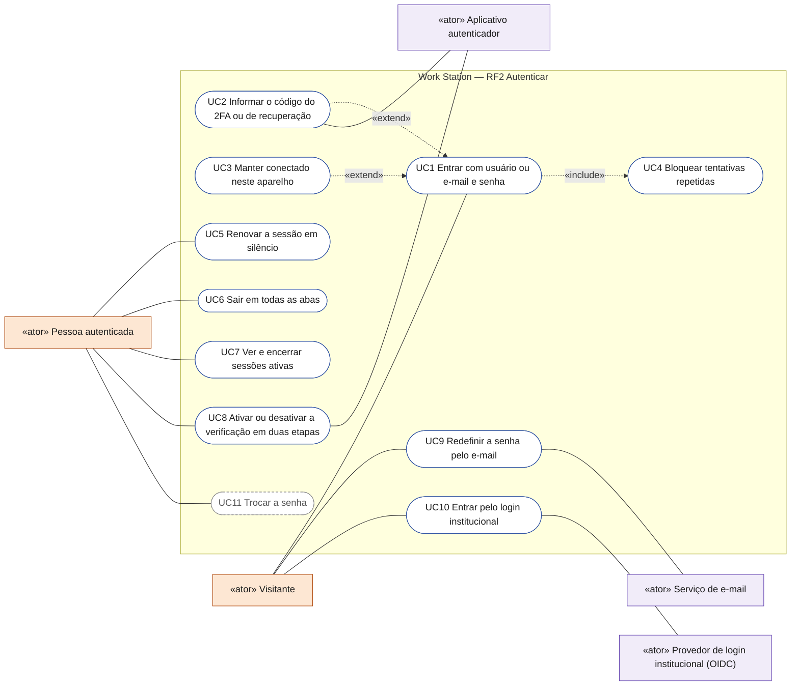
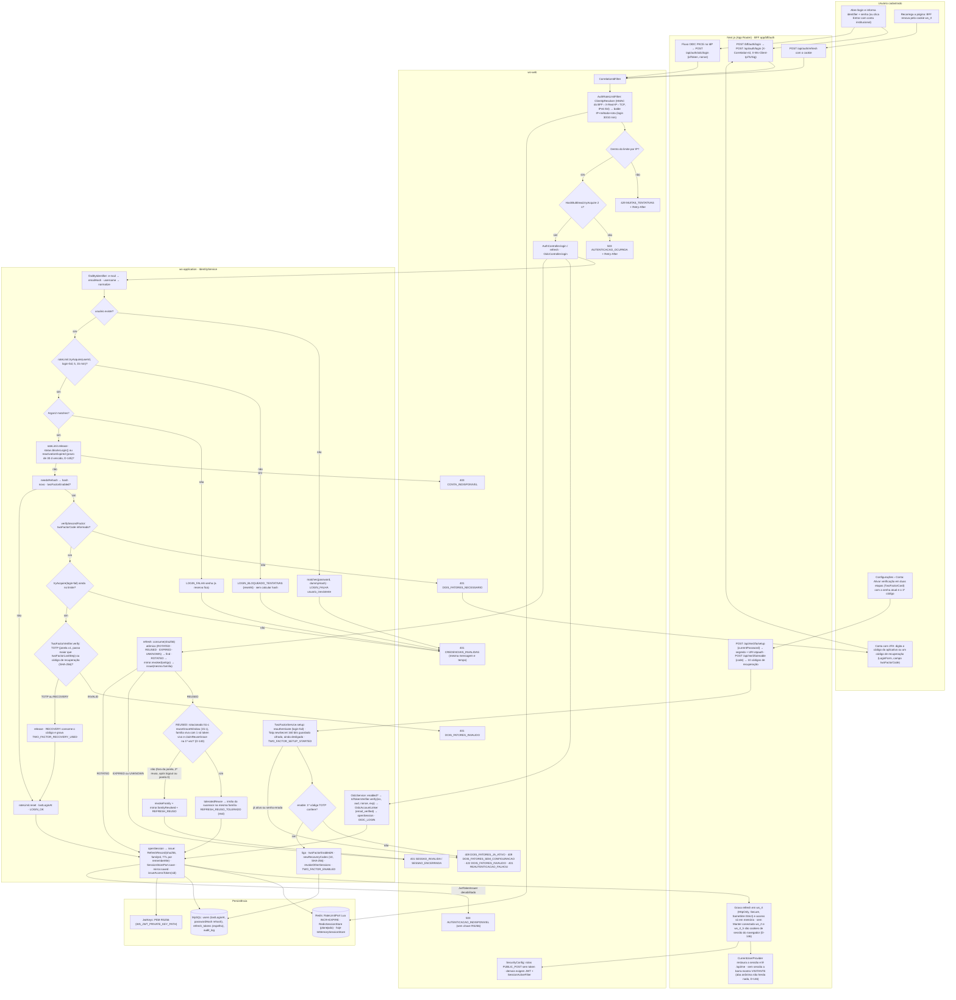
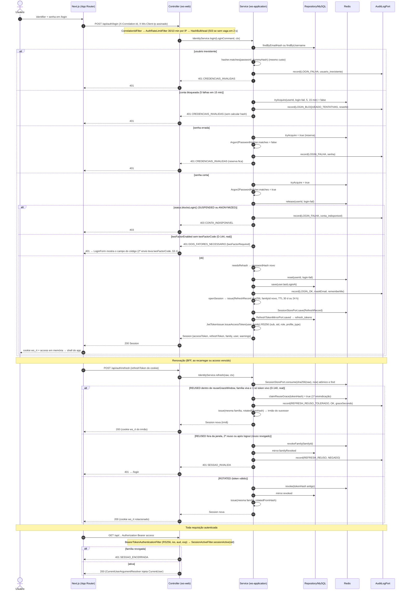
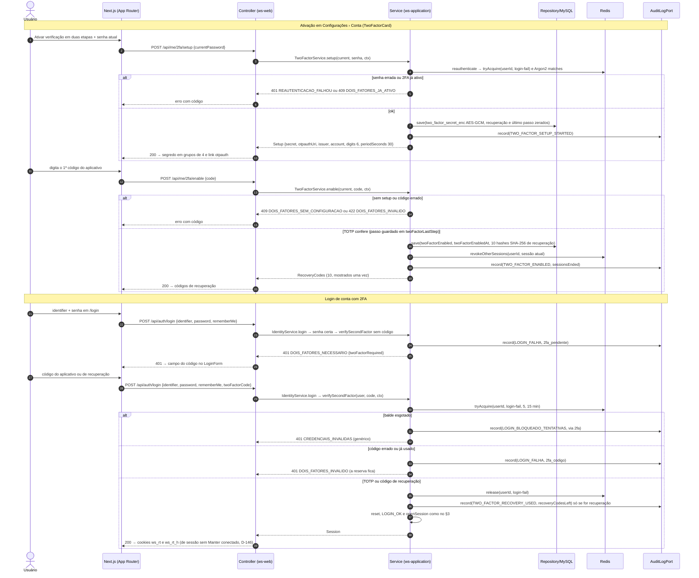
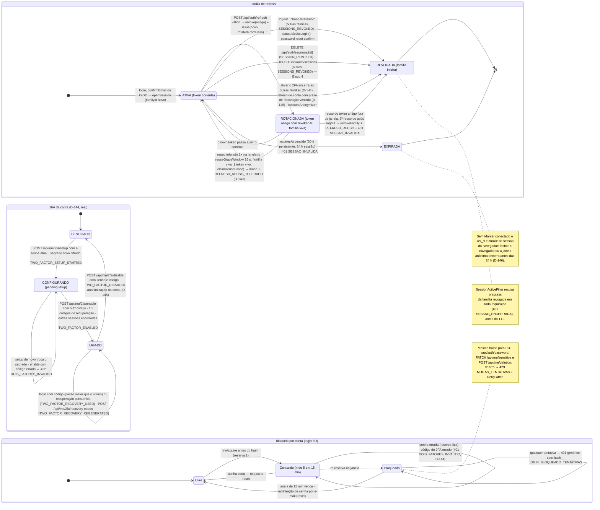
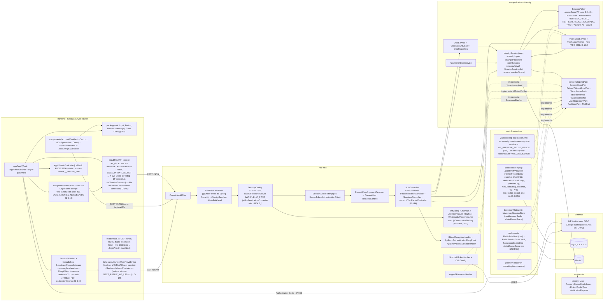
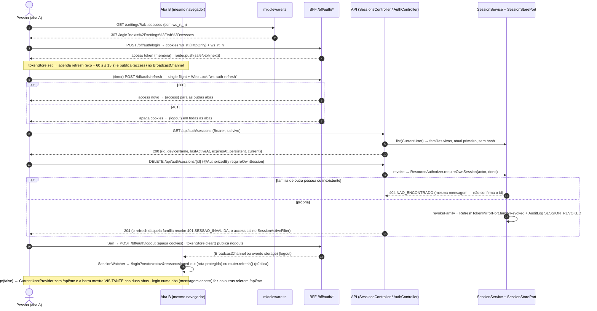
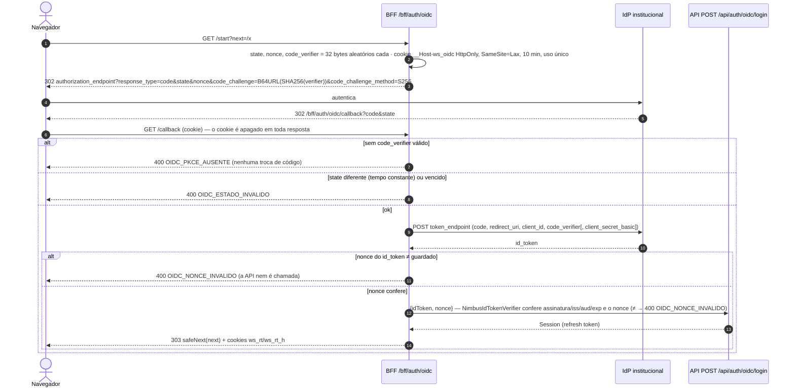

# RF2 — Autenticar usuário na plataforma com credenciais de acesso
**HU:** HU2 · **Sprint (board Work Station):** 1 (card "SPRINT 1 — Cadastro, autenticação, perfil e abertura de sessão") · **Equivalente FAI:** RF2 Login (`AuthController POST /api/auth/login|refresh|logout`, `IdentityService.login/refresh`, família de refresh em Redis) · **Aba/rota:** `/login` (BFF `app/bff/auth/login` → `POST /api/auth/login`), `/login/institucional` (`POST /api/auth/oidc/login`), `/forgot-password` (`POST /api/auth/password-reset/request|confirm`); todas as rotas autenticadas passam pelo `SessionActiveFilter`; **real desde 17/10/2026:** passo do código do 2FA no `/login` e cartão do 2FA em `/settings?tab=conta` (`GET /api/me/2fa`, `POST /api/me/2fa/setup|enable|disable|recovery-codes`, D-144)
**Critérios de aceite cobertos:** RF2.CA01 … RF2.CA06 (corpo do card vazio → derivados do título + HU2, todos "(CA a confirmar)") · RF2.CA07 … RF2.CA14 (§7, controles de segurança D-14) — regra: o título do card define o RF; CAs alinhados ao código real do Bloco 3 (`AuthController`, `IdentityService`, `AuthRateLimitFilter`, `HashBulkhead`, `SessionActiveFilter`, `JwtTokenIssuer`, `OidcService`, `PasswordResetService`); atualização de 17/10/2026: 2FA por aplicativo (D-144: `Totp`, `TwoFactorVerifier`, `TwoFactorService`, `TwoFactorController`) e sessão no navegador (D-146)

> **HU2** — COMO usuário cadastrado no sistema POSSO autenticar-me na plataforma com minhas credenciais de acesso PARA acessar minha área pessoal de forma segura.

Classes **(real)** existem em `origin/main` (Bloco 3, PR #16); `RedisSessionStore` (`ws-infrastructure/cache-redis`, ativo com `ws.redis.enabled=true`; Q-85 resolvida) é **(real)** e o `InMemorySessionStore` fica como padrão sem Redis, ambos com espelho JPA `refresh_tokens`; **(planejado)**: SMTP real (Q-84), `PolicyGateFilter` (D-16); a conferência TOTP do 2FA (Q-83) é **real desde 17/10/2026** (D-144, §9). Números adotados: D-25 (TTLs), D-26 (Argon2id e bulkhead), D-27 (cadastro sem oráculo). **Bloco 4 (real, D-60–D-64):** proteção de rotas no `middleware.ts`, renovação silenciosa e logout entre abas, OIDC Authorization Code + PKCE S256/`state`/`nonce` no BFF e `GET/DELETE /api/auth/sessions` com a aba Sessões — §8.

**Atualização 17/10/2026 (real):** tolerância ao reuso do refresh (**D-140**, Q-237, achado **P18** de `docs/auditoria/2026-10-17/PROBLEMAS.md`) — `SessionPolicy.reuseGraceWindow` (padrão 15 s, teto `MAX_REUSE_GRACE` = 60 s, `0s` desliga; `ws.security.session.reuse-grace-window` / `WS_REFRESH_REUSE_GRACE` em `ws-bootstrap/src/main/resources/application.yml`), `SessionStorePort.claimReuseGrace(tokenHash)` atômico (`InMemorySessionStore`, `RedisSessionStore` por `HSETNX graceUsed`) e `IdentityService.refresh` → `toleratedReuse(...)` no `case REUSED`; no front, `lib/api/client.ts` aguarda a renovação única (`refreshOnce`) antes da 1ª chamada da página (`772257d`, `lib/api/client.restore.test.ts`; P18 mitigado). **P20** corrigido: `WsSecurityProperties.Jwt` ganhou `@ConstructorBinding` (`b47945c`, `WsSecurityPropertiesBindingTest`) — sem isso as chaves RS256 ficavam vazias e o login respondia `503 AUTENTICACAO_INDISPONIVEL`.

**Atualização 17/10/2026 — 2FA e sessão no navegador (real, D-144, D-146):** verificação em duas etapas por aplicativo autenticador — `Totp` (RFC 6238 sobre o HOTP da RFC 4226: HMAC-SHA1, 6 dígitos, passo de 30 s, janela ±1, segredo de 160 bits em Base32, URI `otpauth://`; só aceita passo **maior** que `twoFactorLastStep`, o que impede reuso), `TwoFactorVerifier` (código do aplicativo **ou** código de recuperação de uso único guardado como SHA-256, 10 por vez), `TwoFactorService` (status · setup com a senha atual → segredo + URI · enable com o 1º código → 10 códigos de recuperação e encerra as outras sessões · disable e regenerate com senha + código) e `TwoFactorController` (`GET /api/me/2fa`, `POST /api/me/2fa/setup|enable|disable|recovery-codes`). No login, `IdentityService.login` → `verifySecondFactor` (§2, §3.1). Segredo cifrado em `users.two_factor_secret_enc` (AES-GCM, `V46__users_two_factor_totp.sql`). Front: `components/account/TwoFactorCard.tsx` e o passo do código no `LoginForm` (`components/auth/AuthForms.tsx`). **Sessão (D-146):** `app/bff/auth/bff-session.ts` (`setSessionCookies`) grava `ws_rt`/`ws_rt_h` como cookies de sessão do navegador (sem Max-Age) quando o refresh é curto (sem "Manter conectado"; limiar `PERSISTENT_THRESHOLD_MS` = 48 h) e com Max-Age até `refreshExpiresAt` com "Manter conectado" — fechar o navegador ou a janela anônima encerra a sessão naquele aparelho; `lib/session/CurrentUserProvider.tsx` restaura a sessão e lê `/api/me` (sem sessão = VISITANTE, inclusive em aba anônima); `lib/viewer/ViewerProvider.tsx` só usa o seletor de perfis de demonstração com `NEXT_PUBLIC_WS_LAB=on`; `lib/api/client.ts` `onSessionChange` troca a barra quando há login ou logout em qualquer aba. Evidência: `docs/auditoria/2026-10-17/evidencias/IDENTIDADE.json` (13/13 passos) e capturas `id-01`, `id-04`…`id-07`, `id-10`.

## Critérios de aceite derivados da HU2 (todos "CA a confirmar")

| CA | Enunciado (Dado / Quando / Então) |
|---|---|
| **RF2.CA01** (CA a confirmar) | Dado `identifier` (username ou e-mail) e `password`, quando faço `POST /api/auth/login`, então a senha é conferida contra o hash **Argon2id** (`PasswordHasher.matches`, re-hash transparente por `needsRehash`) e recebo `Session {accessToken RS256 15 min (D-25; claims iss, aud, sub, sid=familyId, role, profile_type, username, jti), tokenType Bearer, expiresIn, refreshToken opaco, refreshExpiresAt, family, user, warnings}`; o refresh (30 d se `rememberMe`, 24 h se não — `SessionPolicy`) é guardado só como SHA-256 (`RefreshRecord.tokenHash`) com espelho em `refresh_tokens`; o BFF devolve o refresh **só** no cookie `ws_rt` (HttpOnly, Secure, SameSite=Strict). **Real (D-146, 17/10/2026):** sem `rememberMe`, `ws_rt` e `ws_rt_h` são cookies de sessão do navegador (sem Max-Age, `setSessionCookies` em `app/bff/auth/bff-session.ts`); com `rememberMe`, valem até `refreshExpiresAt`. |
| **RF2.CA02** (CA a confirmar) | Dado conta inexistente, senha errada ou conta bloqueada, então `401 CREDENCIAIS_INVALIDAS` com a mesma mensagem e tempo (hash falso `dummyHash`); conta `SUSPENDED`/`ANONYMIZED` (`AccountStatus.blocksLogin`) → `403 CONTA_INDISPONIVEL` **depois** da senha certa; `PENDING_VALIDATION` e `DELETION_SCHEDULED` entram com `warnings` (Q-82; `PENDING_EMAIL_VERIFICATION` só tem sessão após confirmar o código, D-27); `twoFactorEnabled` → `401 DOIS_FATORES_NECESSARIO {twoFactorRequired}` (conferência TOTP é a Q-83, respondida pela D-144). **Real (D-144, 17/10/2026):** `LoginCommand.twoFactorCode`; `IdentityService.verifySecondFactor` — sem código → `401 DOIS_FATORES_NECESSARIO` (`LOGIN_FALHA reason 2fa_pendente`) e o `LoginForm` mostra o campo do código; com código, o balde `login-fail` é reservado antes de conferir (bloqueado → `401 CREDENCIAIS_INVALIDAS` genérico + `LOGIN_BLOQUEADO_TENTATIVAS via 2fa`); código errado → `401 DOIS_FATORES_INVALIDO` (`LOGIN_FALHA reason 2fa_codigo`, a reserva fica); certo → `release` e sessão; código de recuperação é consumido e audita `TWO_FACTOR_RECOVERY_USED {recoveryCodesLeft}`. Conta com prazo de reativação vencido (`IdentityService.reactivationExpired`, D-145) → `403 CONTA_INDISPONIVEL`, como `blocksLogin()`. Gestão do 2FA (`/api/me/2fa/*`, erros `409 DOIS_FATORES_JA_ATIVO` · `409 DOIS_FATORES_INATIVO` · `409 DOIS_FATORES_SEM_CONFIGURACAO` · `422 DOIS_FATORES_INVALIDO`) em §9. |
| **RF2.CA03** (CA a confirmar) | Dado "Entrar com conta institucional", então o front faz OIDC Authorization Code + PKCE e envia `POST /api/auth/oidc/login {idToken, nonce}`; `OidcService` exige `ws.oidc.enabled` (`404 OIDC_DESLIGADO`), `IdTokenVerifier` (Nimbus) valida assinatura JWKS, `iss`, `aud`, `nonce`, `exp` (`401 OIDC_TOKEN_INVALIDO`); `OidcAccountLinker` vincula `oidcSubject/oidcIssuer` ao `User` de mesmo `emailHash` só com `email_verified=true` (`401 OIDC_EMAIL_NAO_VERIFICADO`, `AuditLog OIDC_LINK_RECUSADO`) ou cria conta `ACTIVE` sem senha; emite a mesma `Session` (`AuditLog OIDC_LOGIN`). |
| **RF2.CA04** (CA a confirmar) | Dado um refresh válido, quando o BFF chama `POST /api/auth/refresh`, então ocorre **rotação**: novo token da mesma `familyId`, o anterior recebe `revokedAt`/`rotatedFromHash`; reuso de token já rotacionado **revoga a família inteira**, grava `AuditLog REFRESH_REUSO` e responde `401 SESSAO_INVALIDA`; expirado ou desconhecido → `401 SESSAO_INVALIDA`; conta que passou a `blocksLogin()` → família revogada. **Exceção (real, D-140, 17/10/2026):** o consumo é atômico (`SessionStorePort.consume` → `ROTATED · REUSED · EXPIRED · UNKNOWN`); no `REUSED`, se o token foi rotacionado há no máximo `SessionPolicy.reuseGraceWindow` (padrão 15 s, teto 60 s, `0s` desliga), a família segue viva com **um só** token vivo e `claimReuseGrace(tokenHash)` é a 1ª reivindicação, o `IdentityService.toleratedReuse` emite um **irmão** do sucessor na mesma família e audita `REFRESH_REUSO_TOLERADO` (resposta perdida na navegação, P18); 2º reuso, fora da janela ou após logout → revogação da família e `REFRESH_REUSO` como acima. **Real (D-145):** conta com exclusão agendada cujo prazo venceu (`reactivationExpired`) → família revogada e `401 SESSAO_INVALIDA`. |
| **RF2.CA05** (CA a confirmar) | Dado o usuário autenticado, então `POST /api/auth/logout` revoga a família (`AuditLog LOGOUT`); `PUT /api/auth/password` exige a senha atual (mesmo bloqueio do login), grava `PASSWORD_CHANGED` e revoga as **outras** famílias (`SESSIONS_REVOKED`); o `SessionActiveFilter` recusa a cada requisição access tokens cuja família foi revogada (`sid` → `401 SESSAO_ENCERRADA`). `GET /api/auth/sessions` e `DELETE /api/auth/sessions/{familyId}` são **planejados** (aba Sessões do RF3 §7). **Real (D-146, 17/10/2026):** logout em uma aba encerra as outras pelo canal do Bloco 4 e `onSessionChange` (`lib/api/client.ts`) faz o `CurrentUserProvider` voltar a barra para VISITANTE em todas; ativar o 2FA também encerra as outras sessões (`revokeOtherSessions`, D-144). |
| **RF2.CA06** (CA a confirmar) | Dado tentativas repetidas, então há limite por IP (`AuthRateLimitFilter`) e por conta (`RateLimitPort` `login-fail`), `AuditLog LOGIN_OK / LOGIN_FALHA / LOGIN_BLOQUEADO_TENTATIVAS / REFRESH_REUSO / LOGOUT` com `correlationId`, e-mail mascarado e sem senha ou token; `User.lastLoginAt` é atualizado; mensagens i18n (pt-BR/en/es). Redefinição por e-mail: `POST /api/auth/password-reset/request` (resposta igual exista ou não a conta, 5/h por pessoa) e `/confirm {token, newPassword}` (`422 LINK_INVALIDO`), que tira a conta do bloqueio. |

## 0. Diagrama de casos de uso

Entrar, manter a sessão e sair. A verificação em duas etapas por aplicativo (D-144) e o fim da sessão ao fechar o navegador sem "Manter conectado" (D-146) estão no código. Atores do catálogo em [`ATORES_E_ATRIBUTOS.md`](../../arquitetura/ATORES_E_ATRIBUTOS.md).

| Caso de uso | Ator(es) | CAs | Situação |
|---|---|---|---|
| UC1 Entrar com usuário ou e-mail e senha | Visitante | RF2.CA01, RF2.CA02, RF2.CA07, RF2.CA13 | real: `POST /bff/auth/login` → `IdentityService.login`; resposta igual para conta inexistente, senha errada e bloqueio |
| UC2 Informar o código do 2FA ou de recuperação | Visitante, Aplicativo autenticador | RF2.CA07, RF2.CA14 | real: `verifySecondFactor` (TOTP sem reuso, código de recuperação uma vez); erro conta no mesmo bloqueio |
| UC3 Manter conectado neste aparelho | Visitante | RF2.CA01, RF2.CA04 | real: refresh de 30 dias; sem a opção, cookie de sessão do navegador (D-146) |
| UC4 Bloquear tentativas repetidas | (sistema) | RF2.CA06, RF2.CA08, RF2.CA10, RF2.CA11 | real: `RateLimitPort`, `AuthRateLimitFilter`, `HashBulkhead` |
| UC5 Renovar a sessão em silêncio | Pessoa autenticada | RF2.CA04, RF2.CA13 | real: rotação por família e tolerância de 15 s ao reuso (D-140) |
| UC6 Sair em todas as abas | Pessoa autenticada | RF2.CA05, RF2.CA14 | real: `POST /bff/auth/logout` e canal entre abas; aba anônima é Visitante |
| UC7 Ver e encerrar sessões ativas | Pessoa autenticada | RF2.CA05 | real: `SessionsPanel`, `GET/DELETE /api/auth/sessions` |
| UC8 Ativar ou desativar a verificação em duas etapas | Pessoa autenticada, Aplicativo autenticador | RF2.CA07, RF2.CA14 | real: `TwoFactorService`, `/api/me/2fa/*`, `TwoFactorCard` |
| UC9 Redefinir a senha pelo e-mail | Visitante, Serviço de e-mail | RF2.CA09 | real: `PasswordResetService`; e-mail só em log (sem SMTP) |
| UC10 Entrar pelo login institucional | Visitante, Provedor OIDC | RF2.CA03, RF2.CA12 | real e desligado por padrão (`WS_OIDC_ENABLED`) |
| UC11 Trocar a senha | Pessoa autenticada | RF2.CA05, RF2.CA09 | planejado na tela: `PUT /api/auth/password` existe |

## 1. Diagrama de classes

```mermaid
classDiagram
  direction LR

  class AuthController {
    <<controller>>
    +login(LoginRequest, RequestContext) Session
    +refresh(RefreshRequest, RequestContext) Session
    +logout(CurrentUser, RequestContext) void
    +changePassword(CurrentUser, ChangePasswordRequest, RequestContext) ResponseEntity
  }
  class TwoFactorController {
    <<controller>>
    +status(CurrentUser) Status
    +setup(CurrentUser, PasswordBody, RequestContext) Setup
    +enable(CurrentUser, CodeBody, RequestContext) RecoveryCodes
    +disable(CurrentUser, PasswordAndCodeBody, RequestContext) Status
    +regenerate(CurrentUser, PasswordAndCodeBody, RequestContext) RecoveryCodes
  }
  class TwoFactorService {
    <<service>>
    -String issuer
    +status(CurrentUser) Status
    +setup(CurrentUser, currentPassword, RequestContext) Setup
    +enable(CurrentUser, code, RequestContext) RecoveryCodes
    +disable(CurrentUser, currentPassword, code, RequestContext) Status
    +regenerateRecoveryCodes(CurrentUser, currentPassword, code, RequestContext) RecoveryCodes
  }
  class TwoFactorVerifier {
    <<utility>>
    +int RECOVERY_CODES = 10
    +verify(User, code, now) Outcome
    +newRecoveryCodes(User, SecureRandom) List
    +recoveryCodesLeft(User) int
  }
  class Totp {
    <<utility>>
    +int DIGITS = 6
    +long PERIOD_SECONDS = 30
    +int WINDOW = 1
    +newSecret(SecureRandom) String
    +verify(secretBase32, code, now, lastUsedStep) OptionalLong
    +otpauthUri(issuer, account, secretBase32) String
  }
  class ResourceAuthorizer {
    <<service>>
    +ownAccount(CurrentUser) User
    +confirmOwn(CurrentUser, User) User
  }
  class UserRepositoryPort {
    <<port>>
    +findById(id) Optional
    +save(User) User
  }
  class OidcController {
    <<controller>>
    +login(OidcLoginRequest, RequestContext) Session
  }
  class PasswordResetController {
    <<controller>>
    +request(RequestBodyDto, RequestContext) Map
    +confirm(ConfirmBodyDto, RequestContext) void
  }
  class IdentityService {
    <<service>>
    -String dummyHash
    +login(LoginCommand, RequestContext) Session
    +refresh(rawRefresh, RequestContext) Session
    +logout(CurrentUser, RequestContext) void
    +changePassword(CurrentUser, current, next, RequestContext) void
    +openSession(User, persistent, deviceName, RequestContext) Session
    +sessionActive(familyId) boolean
    -issue(User, family, rotatedFromHash, persistent, deviceName, ctx) Session
    -toleratedReuse(RefreshRecord, now) boolean
    -verifySecondFactor(User, code, RequestContext) void
    +reactivationExpired(User, now) boolean
    +reauthenticate(CurrentUser, password, reason, RequestContext) User
    +revokeOtherSessions(userId, keepFamily) int
  }
  class OidcService {
    <<service>>
    +enabled() boolean
    +login(idToken, nonce, deviceName, RequestContext) Session
  }
  class OidcAccountLinker {
    <<service>>
    +linkOrCreate(claims, RequestContext) User
  }
  class PasswordResetService {
    <<service>>
    +request(email, RequestContext) void
    +confirm(token, newPassword, confirmPassword, RequestContext) void
  }
  class SessionPolicy {
    <<value>>
    +Duration refreshTtl
    +Duration refreshShortTtl
    +int maxLoginFailures
    +Duration lockWindow
    +Duration reuseGraceWindow
    +Duration MAX_REUSE_GRACE$
  }
  class Session {
    <<value>>
    +String accessToken
    +String tokenType
    +long expiresIn
    +String refreshToken
    +Instant refreshExpiresAt
    +UUID family
    +UserView user
    +List warnings
  }
  class RefreshRecord {
    <<value>>
    +String tokenHash
    +UUID familyId
    +UUID userId
    +Instant createdAt
    +Instant expiresAt
    +Instant revokedAt
    +String rotatedFromHash
    +boolean persistent
    +String deviceName
  }
  class CurrentUser {
    <<value>>
    +UUID id
    +Role role
    +UUID familyId
  }
  class RateLimitPort {
    <<port>>
    +tryAcquire(owner, bucket, limit, window) boolean
    +status(owner, bucket, limit, window) QuotaStatus
    +release(owner, bucket) void
    +reset(owner, bucket) void
  }
  class SessionStorePort {
    <<port>>
    +save(RefreshRecord) void
    +find(tokenHash) Optional
    +revoke(tokenHash, at) void
    +consume(tokenHash, now) Consume
    +claimReuseGrace(tokenHash) boolean
    +revokeFamily(familyId, at) void
    +familyActive(familyId, now) boolean
  }
  class RefreshTokenMirrorPort {
    <<port>>
    +saved(RefreshRecord, ctx) void
    +revoked(tokenHash, at) void
    +familyRevoked(familyId, at) void
  }
  class TokenIssuerPort {
    <<port>>
    +issueAccessToken(User, familyId) String
    +accessTokenTtl() Duration
  }
  class IdTokenVerifier {
    <<port>>
    +verify(idToken, nonce) Claims
  }
  class PasswordHasher {
    <<port>>
    +matches(raw, encoded) boolean
    +needsRehash(encoded) boolean
  }
  class AuditLogPort {
    <<port>>
    +record(AuditEvent) void
  }
  class JwtTokenIssuer {
    <<adapter>>
    +enabled() boolean
  }
  class JwtKeys {
    <<config>>
    RS256 PEM WS_JWT_PRIVATE_KEY_PATH / PUBLIC
  }
  class SessionActiveFilter {
    <<filter>>
    após BearerTokenAuthenticationFilter
  }
  class AuthRateLimitFilter {
    <<filter>>
    +RULES por método e rota
  }
  class HashBulkhead {
    <<component>>
    +tryAcquire(waitMillis) boolean
    +release() void
  }
  class ClientIpResolver {
    <<component>>
    +resolve(request) String
  }
  class InMemorySessionStore {
    <<adapter>>
    padrão sem Redis, graceClaimed
  }
  class RedisSessionStore {
    <<adapter>>
    real, ws.redis.enabled, HSETNX graceUsed
  }
  class JpaIdentityAdapters {
    <<adapter>>
    RefreshTokenEntity espelho
  }
  class NimbusIdTokenVerifier {
    <<adapter>>
  }
  class Argon2PasswordHasher {
    <<adapter>>
  }
  class RedisRateLimit {
    <<adapter>>
    Lua INCR+EXPIRE
  }
  class InMemoryRateLimit {
    <<adapter>>
  }

  class User {
    <<entity>>
    +UUID id
    +String username
    +String emailHash
    +String passwordHash
    +String oidcSubject
    +String oidcIssuer
    +AccountStatus status
    +boolean twoFactorEnabled
    +String twoFactorSecret
    +String twoFactorRecoveryHashes
    +Long twoFactorLastStep
    +Instant twoFactorEnabledAt
    +Instant deletionScheduledAt
    +Instant lastLoginAt
  }
  class RefreshToken {
    <<entity>>
    +String tokenHash
    +UUID familyId
    +UUID userId
    +Instant expiresAt
    +Instant revokedAt
    +UUID rotatedFromId
    +String createdIp
    +String userAgent
    +String deviceName
    +boolean persistent
  }
  class VerificationCode {
    <<entity>>
    +VerificationPurpose purpose
    +String codeHash
    +int attempts
  }
  class AccountStatus {
    <<enum>>
    PENDING_EMAIL_VERIFICATION
    PENDING_VALIDATION
    ACTIVE
    SUSPENDED
    DELETION_SCHEDULED
    ANONYMIZED
    +blocksLogin() boolean
  }
  class AuthCodes {
    <<catalog>>
    CREDENCIAIS_INVALIDAS 401
    CONTA_INDISPONIVEL 403
    DOIS_FATORES_NECESSARIO 401
    DOIS_FATORES_INVALIDO 401 login ou 422 gestão
    DOIS_FATORES_JA_ATIVO 409
    DOIS_FATORES_INATIVO 409
    DOIS_FATORES_SEM_CONFIGURACAO 409
    MUITAS_TENTATIVAS 429
    SESSAO_INVALIDA 401
    SESSAO_ENCERRADA 401
    SENHA_ATUAL_INCORRETA 422
    LINK_INVALIDO 422
    OIDC_DESLIGADO 404
    OIDC_TOKEN_INVALIDO 401
    OIDC_EMAIL_NAO_VERIFICADO 401
    AUTENTICACAO_INDISPONIVEL 503
  }

  AuthController --> IdentityService
  TwoFactorController --> TwoFactorService
  TwoFactorService --> IdentityService : reauthenticate e revokeOtherSessions
  TwoFactorService --> ResourceAuthorizer
  TwoFactorService --> UserRepositoryPort
  TwoFactorService --> AuditLogPort
  TwoFactorService --> TwoFactorVerifier
  IdentityService --> TwoFactorVerifier : verifySecondFactor
  TwoFactorVerifier --> Totp
  UserRepositoryPort <|.. JpaIdentityAdapters
  OidcController --> OidcService
  PasswordResetController --> PasswordResetService
  OidcService --> IdTokenVerifier
  OidcService --> OidcAccountLinker
  OidcService --> IdentityService : openSession
  PasswordResetService --> IdentityService : revoga famílias
  PasswordResetService --> RateLimitPort
  IdentityService --> SessionPolicy
  IdentityService --> RateLimitPort
  IdentityService --> SessionStorePort
  IdentityService --> RefreshTokenMirrorPort
  IdentityService --> TokenIssuerPort
  IdentityService --> PasswordHasher
  IdentityService --> AuditLogPort
  IdentityService ..> Session
  IdentityService ..> RefreshRecord
  SessionActiveFilter --> SessionStorePort : familyActive(sid)
  AuthRateLimitFilter --> ClientIpResolver
  AuthRateLimitFilter --> HashBulkhead
  AuthRateLimitFilter --> RateLimitPort
  TokenIssuerPort <|.. JwtTokenIssuer
  JwtTokenIssuer --> JwtKeys
  SessionStorePort <|.. InMemorySessionStore
  SessionStorePort <|.. RedisSessionStore
  RefreshTokenMirrorPort <|.. JpaIdentityAdapters
  IdTokenVerifier <|.. NimbusIdTokenVerifier
  PasswordHasher <|.. Argon2PasswordHasher
  RateLimitPort <|.. RedisRateLimit
  RateLimitPort <|.. InMemoryRateLimit
  User "1" --> "0..*" RefreshToken : refresh_tokens CASCADE
  User "1" --> "0..*" VerificationCode : PASSWORD_RESET
  User --> AccountStatus
  RefreshRecord ..> RefreshToken : espelho
  note for SessionPolicy "reuseGraceWindow (D-140) padrão 15 s, teto 60 s, 0 desliga · ws.security.session.reuse-grace-window = WS_REFRESH_REUSE_GRACE"
  note for IdentityService "login: findByIdentifier → tryAcquire(login-fail, 5, 15 min) ANTES do hash → matches → release → blocksLogin ou reactivationExpired → needsRehash → verifySecondFactor (2FA, D-144) → reset → LOGIN_OK → openSession"
  note for TwoFactorService "(real, D-144) segredo cifrado AES-GCM em users.two_factor_secret_enc (V46) · recuperação só como SHA-256 · issuer ws.security.two-factor.issuer = WS_2FA_ISSUER"
```

## 2. Diagrama de atividades

## 3. Diagrama de sequência

### 3.1 Login com o segundo fator e ativação do 2FA (real, D-144)

## 4. Máquina de estados

Entidade central: a **família de refresh** (`RefreshRecord`/`refresh_tokens`, TAXONOMIA §1.3, estados derivados de `revokedAt`/`rotatedFromHash`/`expiresAt` — não há enum) e, abaixo, o **balde de bloqueio por conta** (`RateLimitPort` `login-fail`). `User.status` é o do RF1 §4.

## 5. Diagrama de componentes

## 6. Rastreabilidade

| CA | Classe (§1) | Passo da atividade (§2) | Mensagem da sequência (§3) | Transição de estado (§4) | Componente (§5) | Situação |
|---|---|---|---|---|---|---|
| RF2.CA01 | `IdentityService.login/openSession/issue`, `SessionPolicy`, `RefreshRecord`, `JwtTokenIssuer`, `Session` | `S1`→`S10`→`S11`→`F2`→`F5` | 4–5, 27–38 | `[*]`→`ATIVA`, nota de `EXP` | `AC`, `IS`, `JWT`, `BFF` (`ws_rt`), `CUP` | real; cookie de sessão sem "Manter conectado" (D-146): `app/bff/auth/route.test.ts` "D-146: sem 'Manter conectado'…"; evidência `IDENTIDADE.json` passo 6 (`expires -1`) e passo 1 (aba anônima = Visitante, `id-01`) |
| RF2.CA02 | `IdentityService.dummyHash/verifySecondFactor/reactivationExpired`, `AccountStatus.blocksLogin`, `AuthCodes`, `TwoFactorVerifier`, `Totp`, `TwoFactorService`, `TwoFactorController` | `S2`→`S3`→`E401`, `S6`→`S7`→`E401`, `S8`→`E403`, `S9`→`T1`→`E2FA`→`A3`, `T2`→`E401`, `T3`→`E2FAI`, `T3`→`T4`→`S10`; ativação `A4`→`F6`→`V1`→`V2`→`V3`, `E2FAG` | 6–9, 15–19, 22–26; §3.1 1–20 (ativação) e 21–39 (login com código) | nota de `BLOQ`, `CONT`→`CONT` (código errado), `TFA` inteiro (`DESL`→`CONF`→`LIG`→`DESL`) | `IS`, `TF`, `GEH`, `LF`, `TFC`, `MY` (V46) | real (D-144, Q-83 respondida): `TotpTest` (vetores da RFC 6238, janela ±1 sem reuso, URI otpauth), `TwoFactorServiceTest` (`ativarPedeSenhaEPrimeiroCodigoEntregaDezCodigosDeRecuperacaoEEncerraAsOutrasSessoes`, `loginComDoisFatoresAceitaCodigoUmaVezECodigoDeRecuperacaoUmaVez`, `codigosErradosContamNoMesmoBloqueioDaSenha`, `desligarERegenerarPedemSenhaECodigo`), `TwoFactorControllerWebTest`, `components/account/account.test.tsx` "401 DOIS_FATORES_NECESSARIO abre o campo do código…"; evidência `IDENTIDADE.json` passos 7, 8, 10, 13, capturas `id-04`, `id-05`, `id-06`, `id-10` |
| RF2.CA03 | `OidcController`, `OidcService`, `IdTokenVerifier`/`NimbusIdTokenVerifier`, `OidcAccountLinker` | `F4`→`O1`→`S11` | — (mesma emissão 32–38) | `[*]`→`ATIVA` | `OS`, `NIM`, `IDP`, BFF `oidc/*` | real (`OidcTest`, `OidcWebTest`, `app/bff/auth/oidc.test.ts` — §8, D-63) |
| RF2.CA04 | `IdentityService.refresh/toleratedReuse/reactivationExpired`, `SessionPolicy.reuseGraceWindow`, `SessionStorePort.consume/claimReuseGrace/revoke/revokeFamily`, `RefreshTokenMirrorPort` | `A2`→`F3`→`R1`→`R2`→`R3`→`S11` (tolerado) · `R2`→`R4`→`E401S` (revogado) · `R1`→`S11` (ROTATED) | 37–54 (alt tolerado 40–44 · revogado 45–49 · ROTATED 50–54) | `ATIVA`→`ROT`→`ATIVA`, `ROT`→`ATIVA` (reuso tolerado 1× na janela), `ROT`→`REV`, `ATIVA`→`EXP` | `IS`, `SP`, `CFG`, `RDS`/`MEM`, `MY`, `SW` | real; tolerância D-140 (17/10/2026): `IdentityServiceTest.reusoDentroDaJanelaEhToleradoUmaVezESemFamiliaVivaNunca`, `IdentityServiceTest.janelaDeToleranciaTemTetoEZeroDesliga`; front `772257d` (`lib/api/client.restore.test.ts`) — P18; refresh de conta com prazo de reativação vencido revoga a família (D-145, `AccountServiceTest.depoisDosTrintaDiasNaoReativaNaoEntraEAContaEAnonimizada`) |
| RF2.CA05 | `IdentityService.logout/changePassword/revokeOtherSessions/activeSessions/sessionActive`, `SessionActiveFilter`, `CurrentUser` | `W6`, `F5` | 55–57; §8 (logout entre abas) | `ATIVA`→`REV` | `SAF`, `CUR`, `AC`, `SW`, `CUP` | real; `SessionService` + `SessionsController` `GET/DELETE /api/auth/sessions[/{id}]` e aba Sessões (Bloco 4, §8, D-62); barra volta a VISITANTE em todas as abas no logout (D-146, `onSessionChange`, `account.test.tsx` "com sessão mostra a conta real e volta a VISITANTE…"; evidência `IDENTIDADE.json` passo 9, `id-07-logout-outra-aba-desktop.png`) |
| RF2.CA06 | `AuthRateLimitFilter`, `RateLimitPort`, `AuditActions`, `PasswordResetService` (`clearLockout`), `Masking` | `W2`→`E429`, `S5`, `S7`, `S10` | 3, 8, 12–13, 17, 30, 44 | `LOCK` inteiro | `ARL`, `RDS`, `PR`, `PLT` | real |
| RF2.CA07 | `IdentityService.login` (ordem das checagens), `dummyHash`, `verifySecondFactor` | `S3`, `S5`, `S7`, `S8`→`E403`, `S9`→`T1`→`E2FA`, `T3`→`E2FAI` | 6–26; §3.1 21–39 | nota de `BLOQ` | `IS` | real (§7); `DOIS_FATORES_*` só depois da senha certa (D-144) |
| RF2.CA08 | `RateLimitPort.tryAcquire/release/reset`, `RedisRateLimit` (Lua), `SessionPolicy.maxLoginFailures/lockWindow`, `IdentityService.verifySecondFactor` | `S4`→`S5`, `S8`, `S10`, `T2`→`E401` | 11, 16, 21, 29; §3.1 30–34 | `LIVRE`→`CONT`→`BLOQ`→`LIVRE`, `CONT`→`CONT` (código do 2FA) | `RDS`, `MEM` | real; código do 2FA no mesmo balde (`TwoFactorServiceTest.codigosErradosContamNoMesmoBloqueioDaSenha`, D-144) |
| RF2.CA09 | `IdentityService.changePassword`, `AccountService.updateSensitive/requestDeletion` | — | — | nota de `BLOQ` | `AC`, `IS` | real (mesmo balde) |
| RF2.CA10 | `AuthRateLimitFilter.RULES`, `ClientIpResolver` | `W2`→`W3`→`E429` | 3 | — | `ARL`, `BFF` | real |
| RF2.CA11 | `HashBulkhead` | `W4`→`E503` | 3 | — | `ARL` | real |
| RF2.CA12 | `OidcAccountLinker` (`email_verified`), `AuthCodes.OIDC_EMAIL_NAO_VERIFICADO` | `O1` | — | — | `OS`, `NIM` | real |
| RF2.CA13 | `JwtTokenIssuer`, `JwtKeys`, `WsSecurityProperties.Jwt` (`@ConstructorBinding`), `SessionActiveFilter`, BFF `ws_rt` | `F2`, `W6`, `E503J` | 33–36, 55–57 | nota de `REV` | `JWT`, `SAF`, `BFF`, `MW` | real (D-24, D-25); P20 corrigido em `b47945c` (`WsSecurityPropertiesBindingTest`) |
| RF2.CA14 | `AuditActions.LOGIN_OK/LOGIN_FALHA/LOGIN_BLOQUEADO_TENTATIVAS/REFRESH_REUSO/REFRESH_REUSO_TOLERADO/LOGOUT/TWO_FACTOR_SETUP_STARTED/TWO_FACTOR_ENABLED/TWO_FACTOR_DISABLED/TWO_FACTOR_RECOVERY_REGENERATED/TWO_FACTOR_RECOVERY_USED`, `AuditEvent`, `Masking` | `S3`, `S5`, `S7`, `S10`, `R3`, `R4`, `T4`, `V1`, `V3` | 6, 10, 15, 21, 29, 41, 47; §3.1 8, 18, 24, 31, 33, 36 | transições de `TFA` | `MY` (`audit_log` RESTRICT), `CIF`, `SP` | real (eventos `TWO_FACTOR_*` desde 17/10/2026, D-144) |

## 7. Controles de segurança (D-14)

Herdados do RF49 do FAI pela **D-14**; camadas de defesa e rastreabilidade RN/CA → bloco → classe em [`../SEG/README.md`](../SEG/README.md). Todos "(CA a confirmar)" até a Q-48. Onde um CA abaixo refina o CA01–CA06, vale o de baixo. Coluna **Código**: o que já existe em `origin/main` (Bloco 3, PR #16).

| CA | Enunciado (Dado / Quando / Então) | Código |
|---|---|---|
| **RF2.CA07** (CA a confirmar) | **Login sem oráculo.** Dado conta inexistente, senha errada ou conta bloqueada (mesmo com a senha certa), então a resposta é a mesma `401 CREDENCIAIS_INVALIDAS`, com o mesmo tempo (conta inexistente avalia `dummyHash`). `403 CONTA_INDISPONIVEL` (`blocksLogin`: SUSPENDED/ANONYMIZED) e `401 DOIS_FATORES_NECESSARIO` só aparecem **depois da senha certa e fora do bloqueio**; o mesmo vale para `401 DOIS_FATORES_INVALIDO` (D-144). | `IdentityService.login`, `IdentityServiceTest`, `TwoFactorServiceTest` |
| **RF2.CA08** (CA a confirmar) | **Bloqueio por conta.** Dado 5 tentativas em 15 min (`SessionPolicy`), então a tentativa é reservada **atomicamente antes do hash** (`RateLimitPort.tryAcquire`, INCR+EXPIRE em Lua no `RedisRateLimit`); bloqueada → nem o hash é calculado; senha errada deixa a reserva; senha certa faz `release` e o login completo `reset`; a redefinição por e-mail tira a conta do bloqueio. 40 pedidos paralelos com senha errada avaliam no máximo 5 hashes. **Real (D-144):** o código errado do 2FA reserva no mesmo balde. | `RateLimitPort`, `RedisRateLimit`, `InMemoryRateLimit`, `RedisRateLimitIT`, `InMemoryRateLimitTest` |
| **RF2.CA09** (CA a confirmar) | **Reconferência de senha.** Dado troca de senha (`PUT /api/auth/password`), dados sensíveis (`PATCH /api/me/sensitive`) ou exclusão (`POST /api/me/deletion`), então o mesmo balde `login-fail` vale e o 6º erro recebe `429 MUITAS_TENTATIVAS` + `Retry-After`. | `IdentityService.changePassword`, `AccountService`, `AccountServiceTest` |
| **RF2.CA10** (CA a confirmar) | **Limite por IP + método + rota** (`AuthRateLimitFilter`, antes do Spring Security): `POST /api/auth/login` 30/10 min · `register` 10/h · `refresh` 120/10 min · `password-reset/request` 10/h · `password-reset/confirm` 20/h · `PUT /api/auth/password` 20/h · `oidc/login` 30/10 min · `two-factor/verify` 20/10 min (regra sem rota: o código do 2FA vai no próprio `POST /api/auth/login`, D-144) · `email-verification/*` · `username-suggestions` 60/10 min · `uploads` 40/h. IP = `X-Ws-Client-Ip` assinado (HMAC-SHA256 `EDGE_PROXY_SECRET`, `X-Ws-Proxy-Ts` 60 s) › `X-Real-IP` › TCP; **nunca** `X-Forwarded-For`; IPv6 por /64. | `AuthRateLimitFilter.RULES`, `ClientIpResolver`, `RequestPaths`, `AuthRateLimitFilterTest`, `ClientIpResolverTest` |
| **RF2.CA11** (CA a confirmar) | **Bulkhead de hashes.** Dado um pico de logins, então o `HashBulkhead` (`Semaphore` justo, permits = `max(1, min(max(2, núcleos), pool/2))`, espera `ws.security.auth-hash-wait-ms` = 2 s) devolve `503 AUTENTICACAO_OCUPADA` + `Retry-After` ao excedente; 60 logins paralelos geram zero HTTP 500. | `HashBulkhead`, regras com `hashes=true` |
| **RF2.CA12** (CA a confirmar) | **OIDC.** Dado o `id_token` válido (PKCE, `state`, `nonce`, `iss`, `aud`, `exp`), então ele só é **vinculado a conta existente** de mesmo `emailHash` se o IdP marcar `email_verified=true`; sem isso `401 OIDC_EMAIL_NAO_VERIFICADO` e `AuditLog OIDC_LINK_RECUSADO` (evita takeover). Instância sem OIDC → `404 OIDC_DESLIGADO`. | `OidcService`, `OidcAccountLinker`, `NimbusIdTokenVerifier`, `OidcTest` |
| **RF2.CA13** (CA a confirmar) | **Tokens.** Access JWT RS256 com `iss`, `aud`, `sub`, `sid`, `role`, `profile_type`, `username`, `jti`; TTL **15 min** (`WS_JWT_ACCESS_TTL_MINUTES`, D-25 — padrão da Q-49); chaves por caminho **ou** conteúdo PEM (`JwtKeys`, D-24); sem chave privada configurada → `503 AUTENTICACAO_INDISPONIVEL` (nunca token sem assinatura). `SessionActiveFilter` recusa token de família revogada. Refresh só no cookie `ws_rt`; access só em memória (teste do front falha se aparecer em `localStorage`/`sessionStorage`). | `JwtTokenIssuer`, `JwtKeys`, `JwtKeysAndIssuerTest`, `SessionActiveFilter`, `SessionActiveFilterTest`; `WsSecurityProperties.Jwt` com `@ConstructorBinding` + `WsSecurityPropertiesBindingTest` (`b47945c`, P20) |
| **RF2.CA14** (CA a confirmar) | **Auditoria.** Eventos `LOGIN_OK`, `LOGIN_FALHA` (`reason` usuario_inexistente · senha · conta_indisponivel · 2fa), `LOGIN_BLOQUEADO_TENTATIVAS` (`resetAt`), `REFRESH_REUSO`, `REFRESH_REUSO_TOLERADO` (`graceSeconds`, D-140 — real em 17/10/2026), `LOGOUT`, `PASSWORD_CHANGED`, `SESSIONS_REVOKED`, `OIDC_LOGIN`, `TWO_FACTOR_SETUP_STARTED`, `TWO_FACTOR_ENABLED`, `TWO_FACTOR_DISABLED`, `TWO_FACTOR_RECOVERY_REGENERATED`, `TWO_FACTOR_RECOVERY_USED` (D-144, real em 17/10/2026), todos com `correlationId`, e-mail mascarado e sem senha, token ou código. | `AuditActions`, `AuditEvent`, `JpaAuditLog`, `AuditEventTest` |

Tela/aba: `/login` (esqueleto em `app/(auth)/login/page.tsx`) · `/password-reset` (esqueleto em `app/(auth)/password-reset/page.tsx`)

## 8. Sessão no front (Bloco 4, D-60–D-64)

**Proteção de rotas** (`middleware.ts` + `lib/auth/guard.ts`): rota cuja célula VISITANTE é "O" em `lib/pages/registry.ts` exige o cookie-sinal `ws_rt_h=1` (o `ws_rt` HttpOnly tem path=/bff/auth e o middleware não o vê); sem ele → `307 /login?next=<caminho>`. `next` passa por `safeNext` (só caminho relativo da própria origem; recusa `//`, `/\`, esquemas, barra invertida, controle e as formas codificadas). Rotas do visitante (Mural, Buscar, `/u/[username]`, `/tasks/[id]` — D-93) seguem públicas. `WS_ROUTE_GUARD=off` desliga só no lab sem backend (Q-160). **Cabeçalhos**: CSP com nonce por requisição, HSTS, X-Frame-Options e Referrer-Policy em toda resposta do middleware (inclusive o redirect); Permissions-Policy, nosniff e COOP em `next.config.ts`.

**OIDC no BFF** (`app/bff/auth/oidc/*`, atrás de `WS_OIDC_ENABLED`, padrão desligado → `404 OIDC_DESLIGADO`):

| Controle | Teste-guarda (falha sem o controle) |
|---|---|
| Rota protegida sem sessão → `/login?next=` | `middleware.test.ts` "rota protegida sem sessão redireciona…", `e2e/sessao.spec.ts` "rota protegida redireciona…" |
| `next` externo ignorado | `lib/auth/next.test.ts` "recusa … e cai no padrão" (21 formas), `e2e/sessao.spec.ts` "next externo é ignorado", `oidc.test.ts` "next externo no start é descartado" |
| CSP com nonce, HSTS, frame-ancestors, Referrer/Permissions-Policy | `middleware.test.ts` (resposta do middleware e `next.config.ts`), `e2e/sessao.spec.ts` "cabeçalhos de segurança" |
| `state`/`nonce` inválidos → 400 | `oidc.test.ts` "state inválido → 400", "nonce … → 400"; `OidcWebTest.verificadorNimbusConfereNonceEClaimsSemVazarOToken` (400) |
| PKCE obrigatório | `oidc.test.ts` "PKCE obrigatório…", "start manda ao IdP com code_challenge S256…" |
| Revogar sessão derruba o refresh | `SessionServiceTest.encerrarUmaSessaoDerrubaORefreshDaquelaSessaoEMantemAsOutras`, `SessionsControllerWebTest.encerrarSessaoPropriaRevogaAFamiliaEAlheiaDa404` |
| Sessão de outra pessoa → 404 (D-65) | `SessionServiceTest.sessaoDeOutraPessoaResponde404IgualAIdInexistenteENaoEEncerrada`, `SessionsControllerWebTest` |
| Logout entre abas | `lib/auth/bus.test.ts` (BroadcastChannel, fallback `storage`, cliente), `e2e/sessao.spec.ts` "logout numa aba encerra a sessão nas outras abas" |
| Barra troca de conta no login/logout em qualquer aba (D-146) | `components/account/account.test.tsx` "com sessão mostra a conta real e volta a VISITANTE quando a sessão acaba…"; evidência `IDENTIDADE.json` passo 9 |
| Aba anônima = VISITANTE, sem conta de demonstração (D-146) | `components/account/account.test.tsx` "sem sessão (aba anônima, navegador novo) a barra mostra VISITANTE…"; evidência `IDENTIDADE.json` passo 1, `id-01-anonima-login-desktop.png` |
| Sem "Manter conectado" o refresh é cookie de sessão (D-146) | `app/bff/auth/route.test.ts` "D-146: sem 'Manter conectado' os cookies são de sessão do navegador…"; evidência `IDENTIDADE.json` passo 6 |

## 9. Verificação em duas etapas por aplicativo (real, D-144)

Responde a Q-83. Método: TOTP (RFC 6238) em qualquer aplicativo autenticador; sem SMS nem e-mail como segundo fator. Diagramas: §2 (`T1`…`T4`, `V1`…`V3`), §3.1 e a região `TFA` do §4. Pendências: Q-241 (passkey; exigir 2FA para ADMIN/EMPRESA/CHEFE) e Q-242 (QR code na ativação; hoje o segredo aparece em grupos de 4 e o link `otpauth://`).

| Endpoint (`TwoFactorController`) | Corpo | Serviço | Sucesso | Erros |
|---|---|---|---|---|
| `GET /api/me/2fa` | — | `TwoFactorService.status` | `Status {enabled, enabledAt, recoveryCodesLeft, pendingSetup}` | `401` sem token |
| `POST /api/me/2fa/setup` | `{currentPassword}` | `setup` (`reauthenticate` no balde `login-fail`) | `Setup {secret, otpauthUri, issuer, account, digits, periodSeconds}` · `TWO_FACTOR_SETUP_STARTED` | `401 REAUTENTICACAO_FALHOU`, `429 MUITAS_TENTATIVAS`, `409 DOIS_FATORES_JA_ATIVO` |
| `POST /api/me/2fa/enable` | `{code}` | `enable` | `RecoveryCodes` (10, uma vez) · outras sessões encerradas · `TWO_FACTOR_ENABLED` | `409 DOIS_FATORES_JA_ATIVO`, `409 DOIS_FATORES_SEM_CONFIGURACAO`, `422 DOIS_FATORES_INVALIDO` |
| `POST /api/me/2fa/disable` | `{currentPassword, code}` | `disable` (código do app ou de recuperação) | `Status` desligado · `TWO_FACTOR_DISABLED {via}` | `401 REAUTENTICACAO_FALHOU`, `409 DOIS_FATORES_INATIVO`, `422 DOIS_FATORES_INVALIDO` |
| `POST /api/me/2fa/recovery-codes` | `{currentPassword, code}` | `regenerateRecoveryCodes` (só código do app) | `RecoveryCodes` novos (os antigos deixam de valer) · `TWO_FACTOR_RECOVERY_REGENERATED` | `401 REAUTENTICACAO_FALHOU`, `409 DOIS_FATORES_INATIVO`, `422 DOIS_FATORES_INVALIDO` |
| `POST /api/auth/login` | `{identifier, password, rememberMe, twoFactorCode}` | `IdentityService.login` → `verifySecondFactor` | `Session` (recuperação → `TWO_FACTOR_RECOVERY_USED`) | `401 DOIS_FATORES_NECESSARIO`, `401 DOIS_FATORES_INVALIDO`, `401 CREDENCIAIS_INVALIDAS` (balde esgotado) |

| Controle | Código | Teste-guarda | Evidência (17/10/2026) |
|---|---|---|---|
| TOTP correto (RFC 6238), janela ±1, sem reuso nem código anterior | `Totp.verify` (`lastUsedStep`), `TwoFactorVerifier` | `TotpTest.vetoresOficiaisDaRfc6238`, `TotpTest.aceitaUmPassoDeDiferencaENaoAceitaReusoNemCodigoVelho` | `IDENTIDADE.json` passo 10 (login com o código do aplicativo) |
| Segredo cifrado e recuperação só como hash | `users.two_factor_secret_enc` (AES-GCM, `V46__users_two_factor_totp.sql`), `two_factor_recovery_hashes` (SHA-256) | `TotpTest.base32IdaEVoltaESegredoDe160Bits`, `TwoFactorServiceTest` | `id-04-2fa-configurar-desktop.png`, `id-05-2fa-codigos-desktop.png` |
| Ativar pede senha e 1º código, entrega 10 códigos e encerra as outras sessões | `TwoFactorService.setup/enable`, `IdentityService.revokeOtherSessions` | `TwoFactorServiceTest.ativarPedeSenhaEPrimeiroCodigoEntregaDezCodigosDeRecuperacaoEEncerraAsOutrasSessoes`, `TwoFactorControllerWebTest.ativacaoDevolveSegredoECodigosEErrosDeNegocioSaemComCodigo` | `IDENTIDADE.json` passo 7 (`otpauth://totp/`) |
| Código de recuperação vale uma vez | `TwoFactorVerifier.verify` (`RECOVERY` remove o hash) | `TwoFactorServiceTest.loginComDoisFatoresAceitaCodigoUmaVezECodigoDeRecuperacaoUmaVez` | `IDENTIDADE.json` passo 8 (restam 9) |
| Código errado conta no bloqueio da senha | `IdentityService.verifySecondFactor` | `TwoFactorServiceTest.codigosErradosContamNoMesmoBloqueioDaSenha` | — |
| Desligar e regenerar pedem senha + código | `TwoFactorService.disable/regenerateRecoveryCodes` | `TwoFactorServiceTest.desligarERegenerarPedemSenhaECodigo` | `IDENTIDADE.json` passo 13 (desligado com código de recuperação) |
| Só a própria conta, com token | `TwoFactorController` sem id no caminho, `ResourceAuthorizer.ownAccount/confirmOwn` | `TwoFactorControllerWebTest.semTokenRecebe401EPapelDesconhecido403EmTodosOsEndpoints` | — |
| Tela pede o código no login | `LoginForm` (`components/auth/AuthForms.tsx`) | `components/account/account.test.tsx` "401 DOIS_FATORES_NECESSARIO abre o campo do código; o código vai no segundo envio" | `id-06-login-pede-codigo-desktop.png` |
| Cartão do 2FA em Configurações › Conta | `components/account/TwoFactorCard.tsx`, `AccountPanel.tsx` | `components/account/account.test.tsx` | `id-10-conta-2fa-celular.png` |
