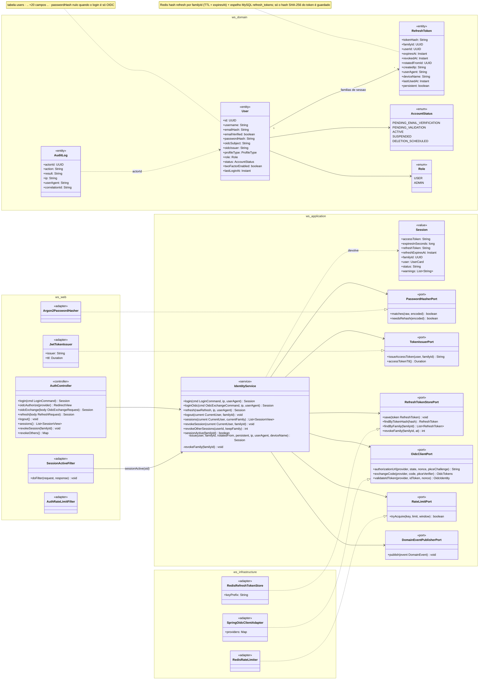
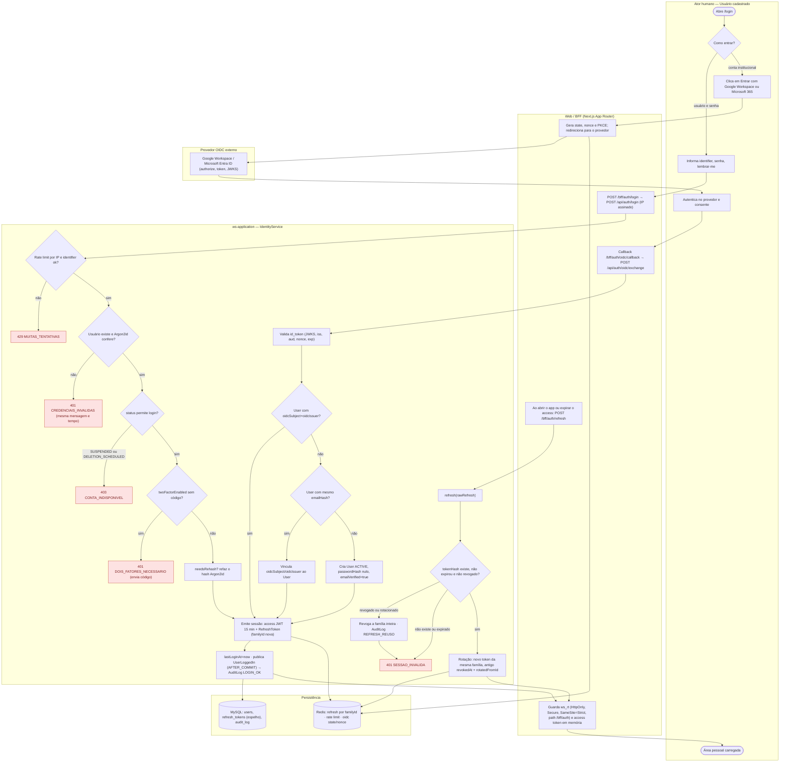
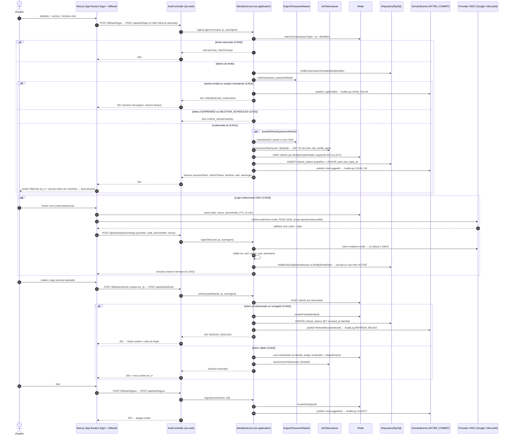
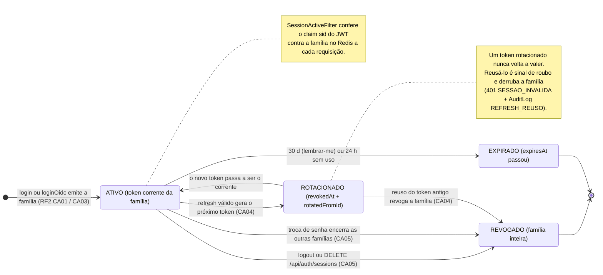
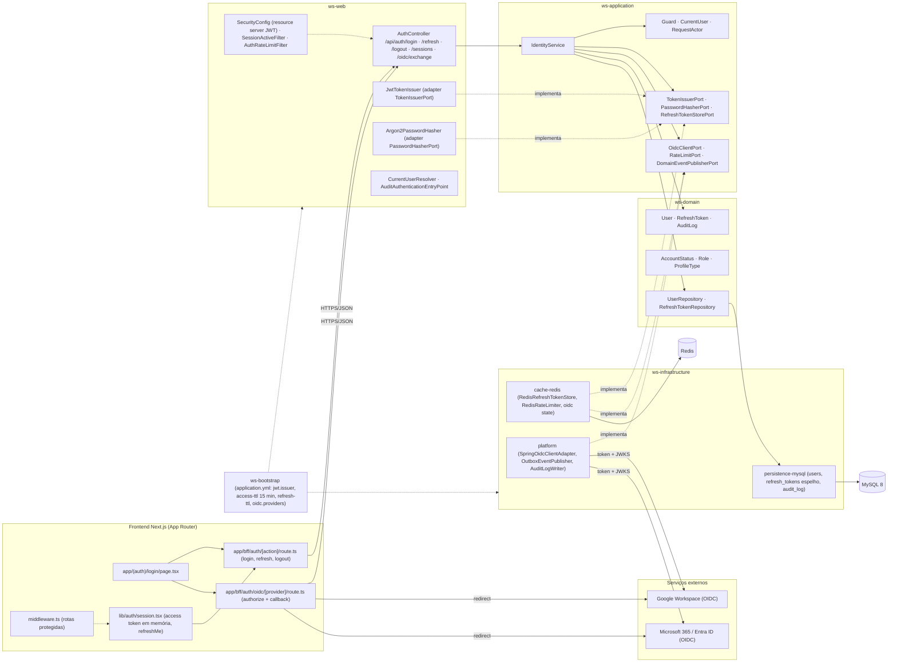

# RF2 — Autenticar usuário na plataforma com credenciais de acesso
**HU:** HU2 · **Sprint (board Work Station):** 1 · **Equivalente FAI:** RF2 Autenticação (`AuthController /api/auth/login|refresh|logout|sessions`, `IdentityService.login/refresh/revokeFamily`, `JwtTokenIssuer`, `RefreshToken` por `familyId`, BFF `/bff/auth` com cookie HttpOnly) · **Aba/rota:** `/login` (BFF `/bff/auth/login`, `/bff/auth/refresh`, `/bff/auth/logout`, `/bff/auth/oidc/[provider]`) — rota sugerida
**Critérios de aceite cobertos:** RF2.CA01 … RF2.CA06 (RF1–RF18 não têm CAs no board: derivados da HU2 e marcados "CA a confirmar")

> **HU2** — COMO usuário cadastrado no sistema POSSO autenticar-me na plataforma com minhas credenciais de acesso PARA acessar minha área pessoal de forma segura.

## Critérios de aceite derivados da HU2 (todos "CA a confirmar")

| CA | Enunciado (Dado / Quando / Então) |
|---|---|
| **RF2.CA01** (CA a confirmar) | Dado `identifier` (username ou e-mail) e senha, quando faço login, então a senha é conferida contra o hash **Argon2id** (`PasswordHasherPort.matches`, com re-hash transparente se os parâmetros mudaram) e recebo um **access JWT** (15 min; claims `user_id`, `sid`=familyId, `role`, `profile_type`) e um **refresh token** opaco (30 d se "lembrar-me", 24 h se não) guardado como hash no **Redis** (`refresh:{familyId}`) com espelho em `refresh_tokens`; o BFF devolve o refresh só em cookie HttpOnly + Secure + SameSite=Strict (`ws_rt`). |
| **RF2.CA02** (CA a confirmar) | Dado credenciais erradas ou usuário inexistente, então `401 CREDENCIAIS_INVALIDAS` com a mesma mensagem e tempo (sem enumerar contas); conta `SUSPENDED`/`DELETION_SCHEDULED` → `403 CONTA_INDISPONIVEL`; `PENDING_EMAIL_VERIFICATION` entra com aviso; `twoFactorEnabled` → `401 DOIS_FATORES_NECESSARIO` até informar o código. |
| **RF2.CA03** (CA a confirmar) | Dado o botão "Entrar com conta institucional", então o fluxo **OAuth2/OIDC Authorization Code + PKCE** (Google Workspace ou Microsoft 365 / Entra ID) valida o `id_token` (assinatura JWKS, `iss`, `aud`, `nonce`, `exp`), vincula `oidcSubject`/`oidcIssuer` ao `User` existente de mesmo `emailHash` (ou cria conta `ACTIVE`, `passwordHash` nulo, `emailVerified` true) e emite a mesma sessão do CA01. |
| **RF2.CA04** (CA a confirmar) | Dado um refresh token válido, quando o BFF chama `/api/auth/refresh`, então ocorre **rotação**: novo token da mesma família, o anterior fica `revokedAt`/`rotatedFromId`; reuso de um token já rotacionado **revoga a família inteira** e responde `401 SESSAO_INVALIDA` (detecção de roubo). |
| **RF2.CA05** (CA a confirmar) | Dado o usuário autenticado, então `logout` revoga a família; `GET /api/auth/sessions` lista dispositivos (deviceName, IP, lastUsedAt, atual) e `DELETE /api/auth/sessions/{familyId}` revoga outra sessão; trocar a senha encerra todas as outras famílias. `SessionActiveFilter` recusa access tokens cuja família foi revogada (`sid`). |
| **RF2.CA06** (CA a confirmar) | Dado tentativas repetidas, então há limite por IP e por `identifier` (`429 MUITAS_TENTATIVAS`), `AuditLog LOGIN_OK / LOGIN_FALHA / REFRESH_REUSO / LOGOUT` com `correlationId` e sem senha, e `User.lastLoginAt` é atualizado; todas as mensagens são i18n (pt-BR/en/es). |

## 1. Diagrama de classes

## 2. Diagrama de atividades

Raias: Usuário · Web/BFF · `ws-application` · Persistência · Provedor OIDC externo. Cobre login local, login institucional (OIDC) e renovação com rotação.

## 3. Diagrama de sequência

Caminho feliz do login local, refresh com rotação e os `alt` de erro (CA02, CA04); o login OIDC aparece em `opt`.

## 4. Máquina de estados

O RF2 não tem estados próprios na `TAXONOMIA`; usa o ciclo da **família de `RefreshToken`** (a sessão de autenticação), derivado dos campos `expiresAt`, `revokedAt` e `rotatedFromId`. O `User.status` só condiciona a entrada (`ACTIVE`/`PENDING_*` entram; `SUSPENDED`/`DELETION_SCHEDULED` não).

## 5. Diagrama de componentes

## 6. Rastreabilidade

| CA | Classe (§1) | Passo da atividade (§2) | Mensagem da sequência (§3) | Transição de estado (§4) | Componente (§5) |
|---|---|---|---|---|---|
| RF2.CA01 | `IdentityService.login/issue`, `Session`, `TokenIssuerPort`/`JwtTokenIssuer`, `RefreshTokenStorePort`/`RedisRefreshTokenStore`, `RefreshToken` | `A3`, `B1`, `C2`, `C5`, `C6`, `B4` | 2–3, 8–9, 17–22 | `[*] → ATIVO` | `FE1`, `FE2`, `FE4`, `W1`, `W3`, `W4`, `I2` |
| RF2.CA02 | `AccountStatus`, `User.twoFactorEnabled`, `PasswordHasherPort.matches` | `C2` → `E401`, `C3` → `E403`, `C4` → `E2FA` | 10–15 (`401 CREDENCIAIS_INVALIDAS`, `403 CONTA_INDISPONIVEL`) | — | `W1`, `S1`, `W5 AuditAuthenticationEntryPoint` |
| RF2.CA03 | `OidcClientPort`/`SpringOidcClientAdapter`, `User.oidcSubject/oidcIssuer`, `IdentityService.loginOidc` | `A4`, `B2`, `B3`, `X1`, `C10`–`C14` | 25–34 (`opt Login institucional OIDC`) | `[*] → ATIVO` (via loginOidc) | `FE3`, `I3`, `X1`, `X2` |
| RF2.CA04 | `RefreshToken.rotatedFromId/revokedAt`, `IdentityService.refresh/revokeFamily`, `RefreshTokenStorePort.revokeFamily` | `B5`, `C15`–`C18`, `E401b` | 35–48 (refresh, reuso → revoga família) | `ATIVO → ROTACIONADO → ATIVO`, `ROTACIONADO → REVOGADO` | `FE2 refresh`, `I2`, `I1 refresh_tokens` |
| RF2.CA05 | `IdentityService.logout/sessions/revokeSession/revokeOtherSessions/sessionActive`, `SessionActiveFilter`, `RefreshToken.deviceName/lastUsedAt` | (logout em §3) | 49–53 | `ATIVO → REVOGADO` (logout, DELETE sessions, troca de senha) | `W1 /sessions`, `W2 SessionActiveFilter` |
| RF2.CA06 | `RateLimitPort`/`RedisRateLimiter`, `AuthRateLimitFilter`, `AuditLog`, `User.lastLoginAt`, `DomainEventPublisherPort` | `C1` → `E429`, `C7`, `C17` | 4–6, 11, 19–20, 43 | — | `W2 AuthRateLimitFilter`, `I2`, `I3 AuditLogWriter` |
