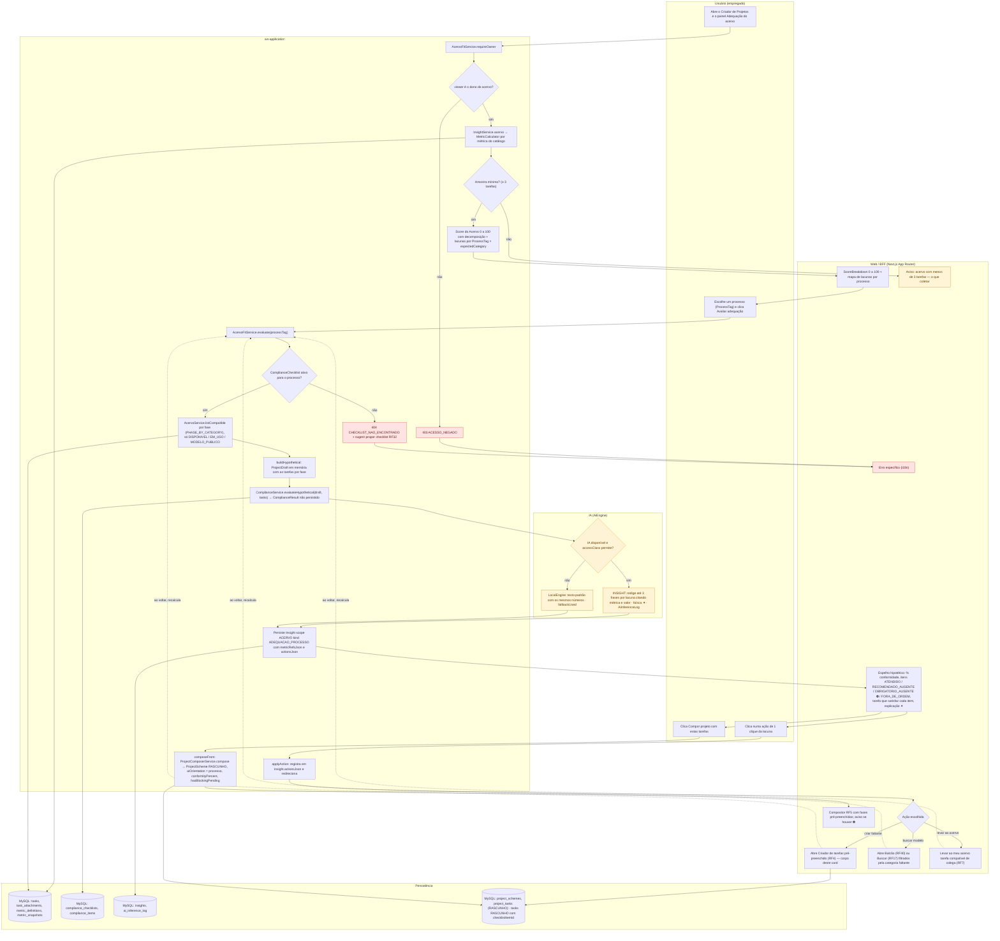
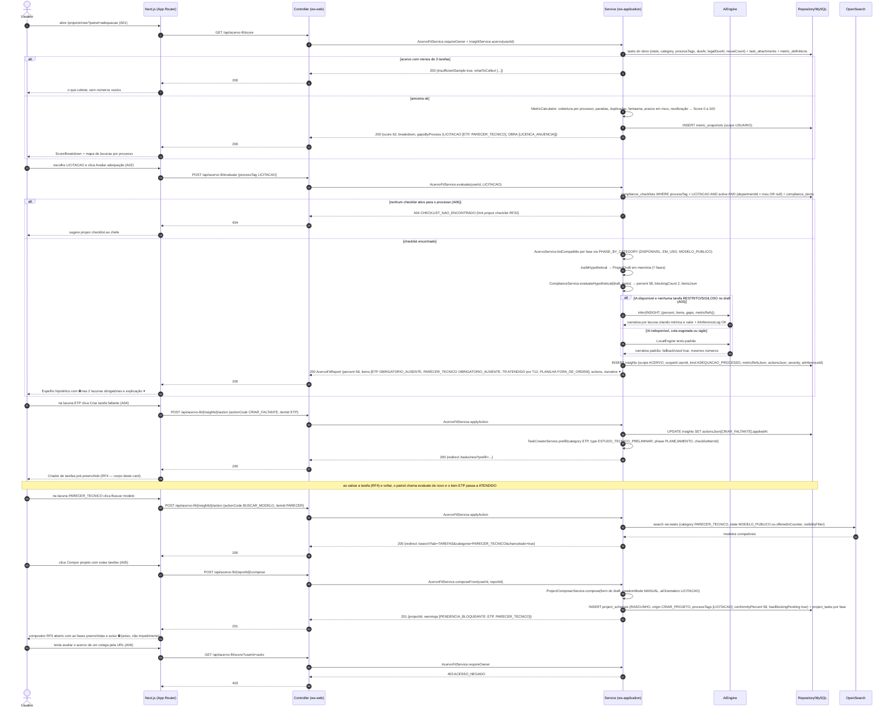
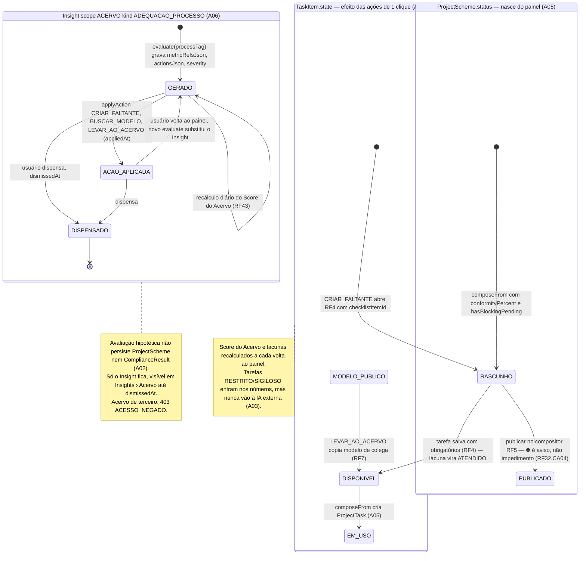
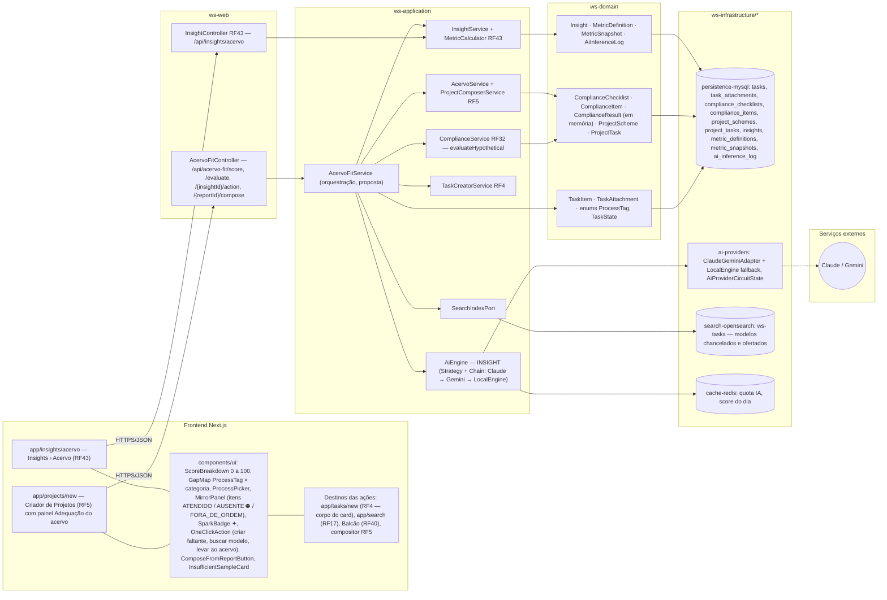

# RF20 — Utilizar o construtor de projetos do Work Station para compreender se as tarefas de meu acervo são adequadas dentro de meu ambiente empresarial
**HU:** HU20 · **Sprint (board Work Station):** a confirmar (card renomeado em 2026-10-02; origem `_anterior/RF20` = Sprint 4) · **Equivalente FAI:** Inventory Score (RF29 do FAI: "o que falta no meu closet") + Smart Mirror (RF28: "o que falta neste look") + Criar Look (RF5) · **Aba/rota:** painel **Adequação do acervo** dentro do Criador de Projetos (`/projects/new?painel=adequacao`, proposta) e sub-aba Insights › Acervo (`/insights/acervo`, RF43)
**Critérios de aceite cobertos:** o **título** define o RF — CAs derivados do título + HU20, numerados **RF20.A01 … RF20.A06** e marcados "(CA a confirmar)". **Corpo do card = criador de tarefas** (RF20.CA01–CA15: Fonte · Detecção por IA · Dados · Mais detalhes · Arte do card) — esses CAs são citados abaixo como estão escritos e estão diagramados no **RF4** (Criador de tarefas) e em `_anterior/RF20`; não são modelados aqui.

> **HU20** — COMO usuário autenticado dentro do sistema Work Station POSSO utilizar o construtor de projetos PARA compreender de maneira mais estratégica e funcional se os dados qualitativos ou quantitativos de meu acervo de trabalho constituem projetos sólidos e bem elaborados.

O construtor de projetos (RF5 `ProjectComposerService`) ganha um **painel de adequação**: antes ou durante a composição, o usuário escolhe um **processo** (`ProcessTag`: Licitação, Convênio, Obra…) e o sistema responde **"o meu acervo sustenta um projeto sólido deste processo?"** com três leituras: (1) **Score do Acervo 0–100** com decomposição e **lacunas por processo** (RF43 §2 — `InsightService.acervo`, `Insight` scope ACERVO, `MetricSnapshot`); (2) **Espelho de Conformidade hipotético** (RF32 — `ComplianceService.evaluateHypothetical` sobre um projeto-rascunho montado automaticamente com as tarefas compatíveis do meu Acervo via `PHASE_BY_CATEGORY`, devolvendo % de conformidade, itens OBRIGATORIO_AUSENTE ⛔ e FORA_DE_ORDEM); (3) **ações de 1 clique**: criar a tarefa faltante (abre o Criador de tarefas, RF4 — corpo deste card), buscar modelo no Balcão (RF40) ou na Buscar (RF17), levar tarefa de colega ao meu acervo (RF7), **compor o projeto** com o que já existe (RF5) ou abrir sessão DECIA. Números vêm de serviços determinísticos; a IA (`AiEngine` `INSIGHT`) só redige a explicação com faísca ✦ e cai para texto-padrão sem perder nenhum número.

| CA (título) | Enunciado (Dado / Quando / Então) |
|---|---|
| **RF20.A01** (CA a confirmar) | Dado um empregado no Criador de Projetos, quando abre o painel **Adequação do acervo**, então vê o **Score do Acervo** (0–100) com decomposição (cobertura por processo, tarefas paradas, duplicadas, "fantasma" sem anexo, prazos legais em risco, reutilização) e o **mapa de lacunas por processo** (`ProcessTag` × categorias esperadas), calculados por `InsightService.acervo` sobre `MetricDefinition`/`MetricSnapshot` (RF43.CA03); acervo com menos de 3 tarefas mostra "o que coletar" em vez de números. |
| **RF20.A02** (CA a confirmar) | Dado um processo escolhido (ex.: LICITACAO), quando peço "avaliar adequação", então o sistema monta um **projeto hipotético** com as tarefas compatíveis do meu Acervo (`AcervoService.listCompatible` + `PHASE_BY_CATEGORY`, só DISPONIVEL/EM_USO/MODELO_PUBLICO) e roda `ComplianceService.evaluateHypothetical` contra o checklist ativo da empresa/departamento (RF32.CA01), devolvendo % de conformidade, itens ATENDIDO / RECOMENDADO_AUSENTE / OBRIGATORIO_AUSENTE ⛔ / FORA_DE_ORDEM e qual tarefa satisfaz cada item; nada é persistido como `ProjectScheme` nem `ComplianceResult`. |
| **RF20.A03** (CA a confirmar) | Dado o resultado, quando a IA está disponível, então `AiEngine INSIGHT` redige em até 3 frases por lacuna "por que isto falta e o que fazer", citando métrica e valor (faísca ✦, `AiInferenceLog`); IA indisponível ou `accessClass` RESTRITO/SIGILOSO → texto-padrão do motor local, com os mesmos números. |
| **RF20.A04** (CA a confirmar) | Dado uma lacuna OBRIGATORIO_AUSENTE, quando aciono a ação de 1 clique, então posso: **criar a tarefa faltante** (abre o Criador de tarefas pré-preenchido com categoria/tipo/fase esperados e `checklistItemId`, RF4/RF32.CA03), **buscar modelo** no Balcão (RF40) ou na Buscar (RF17), ou **levar ao meu acervo** uma tarefa compatível de colega (RF7); a ação fica em `Insight.actionsJson` e o painel recalcula ao voltar. |
| **RF20.A05** (CA a confirmar) | Dado um resultado com conformidade ≥ limiar do checklist e sem ⛔, quando clico **Compor projeto com estas tarefas**, então o compositor (RF5) abre com as fases pré-preenchidas pelo projeto hipotético e `ProjectScheme` nasce RASCUNHO com `aiOrientation` = processo escolhido; com ⛔ o botão fica disponível com aviso "projeto nascerá com pendência bloqueante" (`hasBlockingPending`) — aviso, não impedimento (RF32.CA04). |
| **RF20.A06** (CA a confirmar) | Dado o painel, quando a avaliação termina, então um `Insight` (scope ACERVO, kind ADEQUACAO_PROCESSO, `metricRefsJson`, `actionsJson`, `severity`) é gravado para o usuário e aparece em Insights › Acervo (RF43) até ser dispensado (`dismissedAt`) ou até o próximo recálculo; avaliação de acervo de **terceiro** responde `403 ACESSO_NEGADO` (RF43.CA04 "só o dono"); checklist inexistente para o processo → `404 CHECKLIST_NAO_ENCONTRADO` com sugestão de propor um (RF32). |

| CA do corpo (citado como está no card) | Onde está modelado |
|---|---|
| RF20.CA01 formatos e limite de upload, antivírus · CA02 detecção por IA pré-preenche · CA03 IA sem confiança → formulário vazio · CA04 obrigatórios → Acervo e projeto/fase · CA05 lote/.zip → rascunho por arquivo · CA06 Ctrl+V → TEXTO_MANUAL/PLANILHA/IMAGEM_EDITADA · CA07 vinculado Google/Microsoft sincroniza · CA08 e-mail → tarefa · CA09 protocolo → PROTOCOLO · CA10 busca web de órgão · CA11 prazo legal calculado · CA12 OCR indisponível → job · CA13 chancelas sugeridas · CA14 422 por campo · CA15 Oferecer no Balcão | **RF4 — Criador de tarefas** (`docs/diagramas/RF4/README.md`) e `docs/diagramas/_anterior/RF20/README.md` |

| Leitura do painel | Serviço (existente) | Entidades lidas | Saída |
|---|---|---|---|
| Score do Acervo + lacunas por processo | `InsightService.acervo` (RF43) | `TaskItem`, `MetricDefinition`, `MetricSnapshot`, `ComplianceItem.expectedCategory` | `Insight` scope ACERVO, `metricRefsJson` |
| Espelho hipotético por processo | `ComplianceService.evaluateHypothetical` (RF32) + `AcervoService.listCompatible` (RF5) | `ComplianceChecklist`, `ComplianceItem`, `TaskItem` | `ComplianceResult` em memória (não persistido) |
| Compor projeto | `ProjectComposerService.compose` (RF5) | `TaskItem` → `ProjectTask` | `ProjectScheme` RASCUNHO |
| Criar faltante | `TaskCreatorService` (RF4) | — | `TaskItem` RASCUNHO com `checklistItemId` |

## 1. Diagrama de classes

```mermaid
classDiagram
direction LR

namespace ws_domain_acervo {
  class TaskItem {
    <<entity>>
    +id: UUID
    +ownerId: UUID
    +departmentId: UUID
    +title: String
    +category: TaskCategory
    +type: TaskType
    +processTags: Set~ProcessTag~
    +state: TaskState
    +accessClass: AccessClassification
    +dueAt: LocalDate
    +legalDueAt: LocalDate
    +checklistItemId: UUID tarefa faltante criada pelo Espelho
    +reuseCount: int
    +projectUsageCount: int
    .. +40 campos ..
  }
  class TaskAttachment {
    <<entity>>
    +taskId: UUID
    +isPrimary: boolean
  }
}

namespace ws_domain_projetos {
  class ProjectScheme {
    <<entity>>
    +id: UUID
    +ownerId: UUID
    +title: String
    +processTags: Set~ProcessTag~
    +creationMode: CreationMode
    +origin: SchemeOrigin CRIAR_PROJETO
    +aiOrientation: String
    +status: ProjectStatus RASCUNHO
    +conformityPercent: BigDecimal
    +hasBlockingPending: boolean
    +autosaveDraftJson: JSON
  }
  class ProjectTask {
    <<entity>>
    +projectId: UUID
    +taskId: UUID
    +phase: ProjectPhase
    +sortOrder: int
  }
  class ComplianceChecklist {
    <<entity>>
    +id: UUID
    +companyId: UUID
    +departmentId: UUID
    +processTag: ProcessTag
    +name: String
    +legalBasis: String
    +active: boolean
  }
  class ComplianceItem {
    <<entity>>
    +id: UUID
    +checklistId: UUID
    +label: String
    +requirement: String OBRIGATORIO RECOMENDADO
    +expectedPhase: ProjectPhase
    +expectedCategory: TaskCategory
    +expectedType: TaskType
    +mustPrecedeItemId: UUID
  }
  class ComplianceResult {
    <<entity>>
    +projectId: UUID nulo quando hipotético
    +checklistId: UUID
    +itemsJson: JSON status por item e satisfiedByProjectTaskId
    +percent: BigDecimal
    +blockingCount: int
  }
}

namespace ws_domain_ia {
  class Insight {
    <<entity>>
    +id: UUID
    +scope: InsightScope ACERVO
    +scopeId: UUID userId
    +kind: String ADEQUACAO_PROCESSO
    +title: String
    +bodyMd: String
    +metricRefsJson: JSON metricCode value formula source
    +actionsJson: JSON 1 clique
    +severity: String
    +aiInferenceId: UUID
    +dismissedAt: Instant
    +generatedAt: Instant
  }
  class MetricDefinition {
    <<entity>>
    +code: String
    +domain: MetricDomain
    +formula: String
    +minSamples: int
  }
  class MetricSnapshot {
    <<entity>>
    +metricCode: String
    +scope: MetricScope USUARIO
    +scopeId: UUID
    +value: BigDecimal
    +valuesJson: JSON
  }
  class AiInferenceLog {
    <<entity>>
    +capability: AiCapability INSIGHT
    +result: InferenceResult
    +fallbackUsed: boolean
  }
}

namespace ws_domain_enums {
  class ProcessTag {
    <<enum>>
    LICITACAO
    CONVENIO
    OBRA
    REGULARIZACAO_FUNDIARIA
    PLANEJAMENTO_URBANO
    ORCAMENTO
    PESSOAL
    JURIDICO
  }
  class ProjectPhase {
    <<enum>>
    DEMANDA
    PLANEJAMENTO
    ELABORACAO
    ANALISE
    APROVACAO
    EXECUCAO
    ENCERRAMENTO
  }
  class TaskState {
    <<enum>>
    RASCUNHO
    DISPONIVEL
    EM_USO
    BLOQUEADA
    CONCLUIDA
    ARQUIVADA
    MODELO_PUBLICO
    OFERECIDA
  }
  class InsightScope {
    <<enum>>
    ACERVO
    PERFIL
    EQUIPE
    PROJETO
  }
}

namespace ws_application {
  class AcervoFitService {
    <<service>>
    +evaluate(userId, processTag) AcervoFitReport proposta
    +buildHypothetical(userId, processTag) ProjectDraft fases via PHASE_BY_CATEGORY
    +applyAction(userId, insightId, actionCode) ActionResult
    +composeFrom(userId, reportId) ProjectScheme RASCUNHO
    -requireOwner(viewer, userId) 403
  }
  class InsightService {
    <<service>>
    +acervo(userId) List~Insight~ Score do Acervo 0 a 100 e lacunas por processo
    +applyAction(insightId, actionCode) void
  }
  class MetricCalculator {
    <<service>>
    +compute(metricCode, scope, scopeId) MetricSnapshot determinístico
  }
  class ComplianceService {
    <<service>>
    +evaluateHypothetical(project, tasks) ComplianceResult não persistido
    +createMissingTask(actorId, projectId, itemId) TaskItem
  }
  class AcervoService {
    <<service>>
    +listCompatible(userId, phase, filters) List~TaskItem~ PHASE_BY_CATEGORY
    +countAvailable(userId) int
  }
  class ProjectComposerService {
    <<service>>
    +openComposer(userId, draft) ComposerState
    +compose(userId, form) ProjectScheme
  }
  class TaskCreatorService {
    <<service>>
    +prefill(category, type, phase, checklistItemId) TaskForm RF4
  }
  class AiEngine {
    <<service>>
    +infer(INSIGHT, numbers) narrativa só sobre números calculados
  }
  class SearchIndexPort {
    <<port>>
    +search(q, filters) modelos no Balcão e na Buscar
  }
}

namespace ws_web {
  class AcervoFitController {
    <<controller>>
    +GET_api_acervo_fit_score()
    +POST_api_acervo_fit_evaluate(processTag)
    +POST_api_acervo_fit_insightId_action(actionCode)
    +POST_api_acervo_fit_reportId_compose()
  }
  class InsightController {
    <<controller>>
    +GET_api_insights_acervo()
  }
}

namespace ws_infrastructure {
  class ClaudeGeminiAdapter {
    <<adapter>>
  }
  class LocalEngine {
    <<adapter>>
  }
  class OpenSearchIndexAdapter {
    <<adapter>>
  }
}

TaskItem "1" --> "*" TaskAttachment : fantasma = sem anexo
TaskItem --> ProcessTag
TaskItem --> TaskState
TaskItem "*" --> "0..1" ComplianceItem : checklistItemId
ProjectScheme "1" --> "*" ProjectTask
ProjectTask "*" --> "1" TaskItem
ProjectTask --> ProjectPhase
ComplianceChecklist "1" --> "*" ComplianceItem
ComplianceChecklist --> ProcessTag
ComplianceResult "*" --> "1" ComplianceChecklist
ComplianceItem --> ProjectPhase : expectedPhase
Insight --> InsightScope
Insight "*" --> "*" MetricSnapshot : metricRefsJson
MetricSnapshot "*" --> "1" MetricDefinition : metricCode
Insight "*" --> "0..1" AiInferenceLog : aiInferenceId

AcervoFitController ..> AcervoFitService
InsightController ..> InsightService
AcervoFitService ..> InsightService : Score do Acervo e lacunas RF43
AcervoFitService ..> ComplianceService : evaluateHypothetical RF32
AcervoFitService ..> AcervoService : listCompatible RF5
AcervoFitService ..> ProjectComposerService : composeFrom RF5
AcervoFitService ..> TaskCreatorService : criar faltante RF4
AcervoFitService ..> AiEngine : INSIGHT narrativa
AcervoFitService ..> SearchIndexPort : buscar modelo RF17 RF40
InsightService ..> MetricCalculator
InsightService ..> Insight
ComplianceService ..> ComplianceResult : em memória
ClaudeGeminiAdapter ..> AiEngine : primário
LocalEngine ..> AiEngine : fallback texto-padrão
OpenSearchIndexAdapter ..|> SearchIndexPort

note for AcervoFitService "serviço de orquestração (proposta) — não cria entidade nova: lê TaskItem, ComplianceChecklist e grava só Insight (A06) · requireOwner 403 (RF43.CA04)"
note for ComplianceResult "hipotético: projectId nulo, não persistido (A02) · persistido só quando o projeto existe (RF32.CA02)"
note for Insight "scope ACERVO, kind ADEQUACAO_PROCESSO · metricRefsJson cita métrica, valor, fórmula e fonte · actionsJson: criar faltante, buscar modelo, levar ao acervo, compor (A04, A06)"
note for TaskItem "corpo do card RF20.CA01–15 (Criador de tarefas) está no RF4 — aqui a tarefa é só lida e, na ação criar faltante, nasce RASCUNHO com checklistItemId"
```

## 2. Diagrama de atividades

## 3. Diagrama de sequência

## 4. Máquina de estados

O RF20 (título) não cria estados próprios: nada do que ele avalia é persistido além do **`Insight`**, cujo ciclo (sem enum na TAXONOMIA — `generatedAt` → `actionsJson[].appliedAt` → `dismissedAt`) é mostrado abaixo. O segundo bloco mostra o efeito das ações de 1 clique sobre `TaskItem.state` (`TaskState`) e o terceiro o nascimento do `ProjectScheme` (`ProjectStatus`) a partir do painel. Os estados do corpo do card (criador de tarefas) estão em `_anterior/RF20` §4 e no RF4.

## 5. Diagrama de componentes

## 6. Rastreabilidade

| CA | Elemento do diagrama (classe / passo / mensagem / transição / componente) |
|---|---|
| RF20.A01 | Classes `Insight` (scope ACERVO, metricRefsJson), `MetricDefinition`, `MetricSnapshot`, `TaskItem` (state, processTags, dueAt, legalDueAt, reuseCount), `TaskAttachment` (fantasma), `InsightService.acervo`, `MetricCalculator` · Atividades `U1 → A1 → A4 → P1 → A5 → W2 / A6 → W1` · Sequência msgs 1–13 (`alt acervo com menos de 3 tarefas`, `Score 62, breakdown, gapsByProcess`) · Componentes `ScoreBreakdown`, `GapMap`, `InsufficientSampleCard`, `InsightService + MetricCalculator RF43` |
| RF20.A02 | Classes `ComplianceChecklist`, `ComplianceItem` (expectedPhase, expectedCategory), `ComplianceResult` (nota "hipotético não persistido"), `AcervoFitService.evaluate/buildHypothetical`, `AcervoService.listCompatible`, `ComplianceService.evaluateHypothetical`, enum `ProcessTag` · Atividades `U2 → A7 → A8 → A10 → A11 → A12 → P2` · Sequência msgs 14–24 e 31–34 (`listCompatible … PHASE_BY_CATEGORY`, `buildHypothetical`, `evaluateHypothetical → percent 58, blockingCount 2`) · Nota da máquina *Insight* ("não persiste ProjectScheme nem ComplianceResult") · Componentes `ProcessPicker`, `MirrorPanel`, `ComplianceService RF32` |
| RF20.A03 | `AiEngine.infer(INSIGHT)`, `AiInferenceLog` (fallbackUsed), `LocalEngine`, `ClaudeGeminiAdapter`, `TaskItem.accessClass` · Atividades `I1 → I2 / I3 → A13` · Sequência msgs 25–30 (`alt IA disponível e nenhuma tarefa RESTRITO/SIGILOSO` / `LocalEngine texto-padrão, mesmos números`) · Nota da máquina *TaskItem.state* (sigilo) · Componentes `SparkBadge ✦`, `ai-providers`, `Claude / Gemini` |
| RF20.A04 | `Insight.actionsJson`, `AcervoFitService.applyAction`, `TaskCreatorService.prefill`, `TaskItem.checklistItemId`, `SearchIndexPort.search` · Atividades `U3 → A14 → W4 → W5 (RF4) / W6 (RF17, RF40) / W7 (RF7)` e retornos "ao voltar, recalcula" · Sequência msgs 35–50 (`CRIAR_FALTANTE → redirect /tasks/new?prefill`, nota de recálculo, `BUSCAR_MODELO → search ws-tasks … → redirect /search`) · Transições `GERADO → ACAO_APLICADA → GERADO`, `[*] → RASCUNHO → DISPONIVEL`, `MODELO_PUBLICO → DISPONIVEL` · Componentes `OneClickAction`, `app/tasks/new (RF4)`, `app/search (RF17)`, `Balcão (RF40)` |
| RF20.A05 | `AcervoFitService.composeFrom`, `ProjectComposerService.compose`, `ProjectScheme` (RASCUNHO, aiOrientation, conformityPercent, hasBlockingPending), `ProjectTask` · Atividades `U4 → A15 → P4 → W8` · Sequência msgs 51–57 (`INSERT project_schemes (RASCUNHO … hasBlockingPending true)`, `warnings [PENDENCIA_BLOQUEANTE]`, "aviso, não impedimento") · Máquina *ProjectScheme.status — nasce do painel* e transição `DISPONIVEL → EM_USO` · Componentes `ComposeFromReportButton`, `ProjectComposerService RF5` |
| RF20.A06 | `Insight` (dismissedAt, generatedAt), `AcervoFitService.requireOwner`, `ComplianceChecklist.active` · Atividades `A2 → A3 403`, `A8 → A9 404 CHECKLIST_NAO_ENCONTRADO`, `A13 → P3` · Sequência msgs 18–21 (`404 … hint propor checklist RF32`), 31 (`INSERT insights`), 58–62 (`403 ACESSO_NEGADO`) · Máquina *Insight* (GERADO → DISPENSADO) e nota · Componentes `app/insights/acervo`, `InsightController RF43` |
| RF20.CA01 … RF20.CA15 (corpo do card) | Criador de tarefas — **não modelados aqui**: ver `docs/diagramas/RF4/README.md` e `docs/diagramas/_anterior/RF20/README.md` (cabeçalho, tabela "CA do corpo") · Ponto de contato neste README: ação `CRIAR_FALTANTE` → `TaskCreatorService.prefill` → `app/tasks/new` (A04) |

Tela/aba: `/projects/new` (esqueleto em `app/(shell)/projects/new/page.tsx`) · `/insights` (esqueleto em `app/(shell)/insights/page.tsx`)
