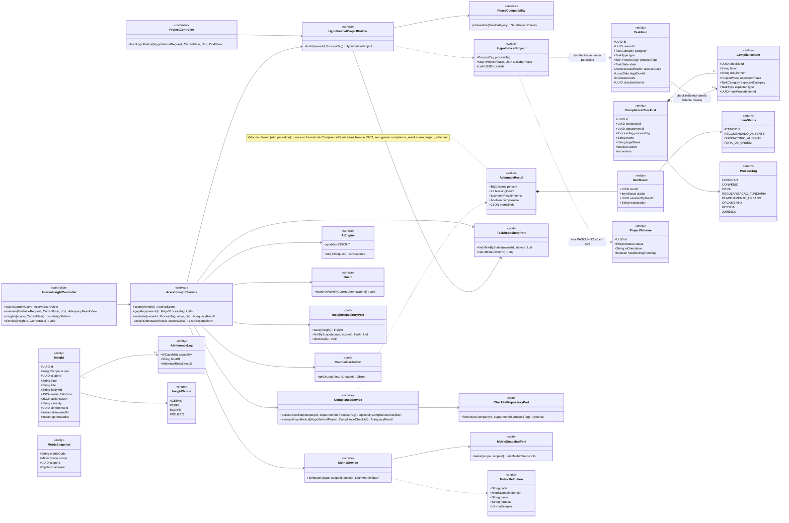
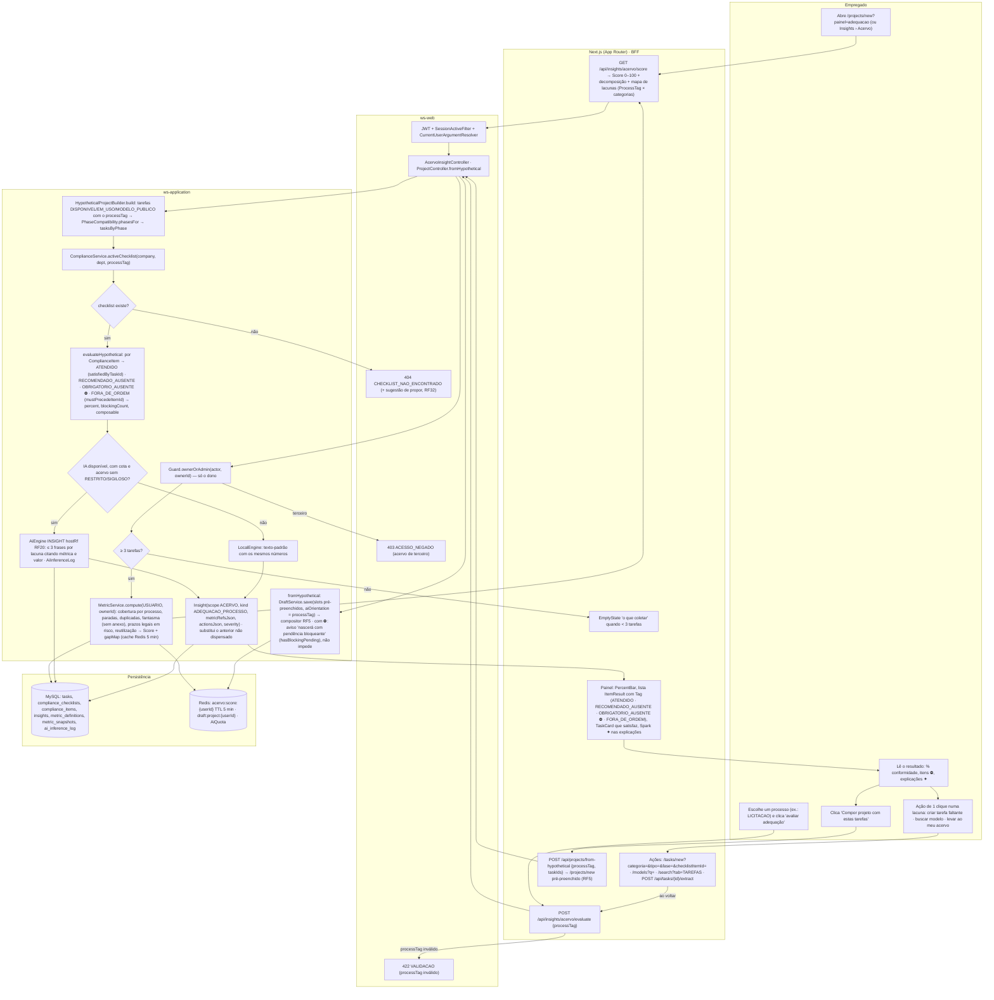
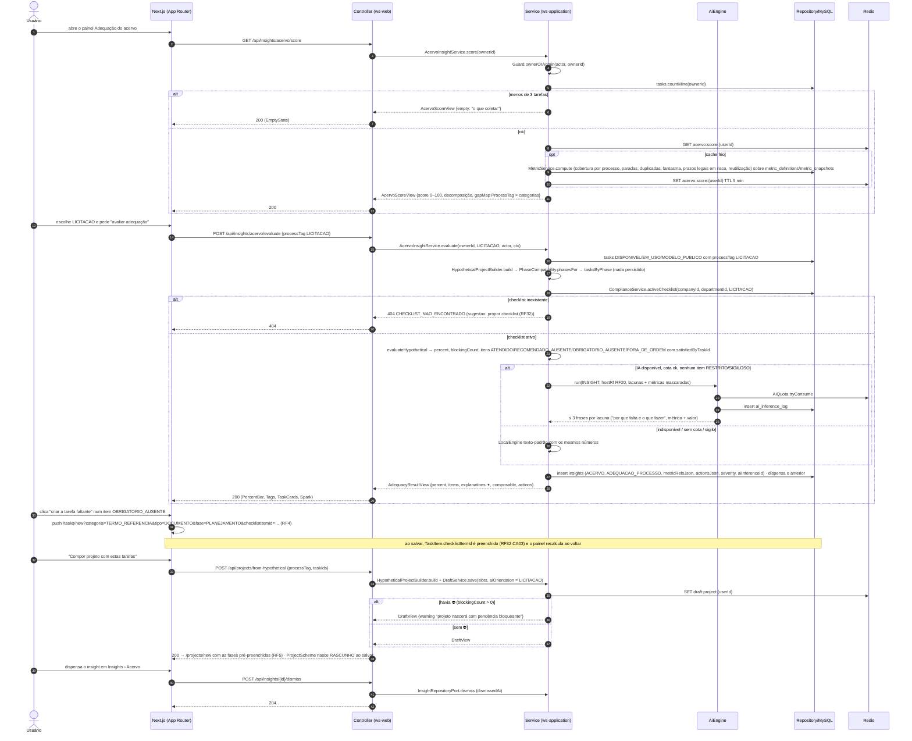
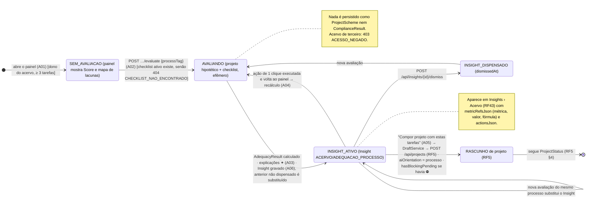
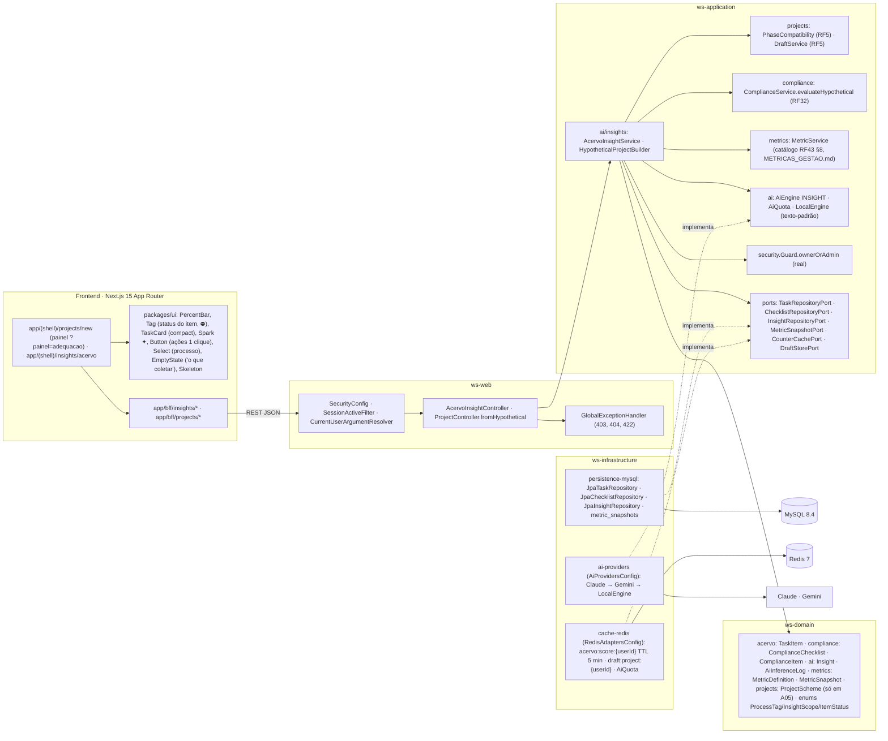

# RF20 — Utilizar o construtor de projetos do Work Station para compreender se as tarefas de meu acervo são adequadas dentro de meu ambiente empresarial
**HU:** HU20 · **Sprint (board Work Station):** a confirmar (card renomeado em 2026-10-02; o card "SPRINT 4" cita "HU20 / RF20 Criador de Tarefas" = escopo antigo, preservado em `_anterior/RF20`; a HU20 do Product Backlog remete a "RF22 — Editar esquema + Canvas 2D + Meu Quarto") · **Equivalente FAI:** Inventory Score (RF29 do FAI: "o que falta no meu closet") + Smart Mirror (RF28: "o que falta neste look") + Criar Look (RF5) · **Aba/rota:** painel **Adequação do acervo** dentro do Criador de Projetos (`/projects/new?painel=adequacao`, proposta) e sub-aba Insights › Acervo (`/insights/acervo`, RF43); API `GET /api/insights/acervo/score`, `POST /api/insights/acervo/evaluate {processTag}`, `GET /api/insights?scope=ACERVO`, `POST /api/projects/from-hypothetical`
**Critérios de aceite cobertos:** RF20.A01 … RF20.A06 — o **título** define o RF: CAs derivados do título + HU20, numerados `RF20.A01…A06` e marcados "(CA a confirmar)". **Corpo do card = criador de tarefas** (RF20.CA01–CA15: Fonte · Detecção por IA · Dados · Mais detalhes · Arte do card) — esses CAs são citados abaixo como estão escritos e estão **diagramados no RF4** (Criador de tarefas) e em `_anterior/RF20`; não são modelados aqui. Todas as classes do RF são **(planejado)**; reais: `Guard`, `AiProvidersConfig`, `RedisAdaptersConfig`.

> **HU20** — COMO usuário autenticado dentro do sistema Work Station POSSO utilizar o construtor de projetos PARA compreender de maneira mais estratégica e funcional se os dados qualitativos ou quantitativos de meu acervo de trabalho constituem projetos sólidos e bem elaborados.

O "construtor" aqui é o **painel Adequação do acervo** do Criador de Projetos (RF5): mede o **Score do Acervo** (`MetricDefinition`/`MetricSnapshot`, RF43.CA03), monta um **projeto hipotético** com as tarefas compatíveis do Acervo (`PhaseCompatibility`, como no RF5) e o avalia contra o **Espelho de Conformidade** (`ComplianceChecklist`/`ComplianceItem`, RF32) **sem persistir** `ProjectScheme` nem `ComplianceResult`. A IA só redige a explicação (`AiEngine INSIGHT`); o resultado vira um `Insight` (scope ACERVO) com ações de 1 clique e pode abrir o compositor do RF5 pré-preenchido.

Corpo do card (criador de tarefas, modelado no RF4): RF20.CA01 formatos e limite de upload, antivírus · CA02 detecção por IA pré-preenche · CA03 IA sem confiança → formulário vazio · CA04 obrigatórios → Acervo e projeto/fase · CA05 lote/.zip · CA06 colar · CA07 vinculado Google/Microsoft · CA08 e-mail · CA09 protocolo · CA10 busca web de órgão · CA11 prazo legal · CA12 OCR indisponível · CA13 chancelas sugeridas · CA14 422 por campo · CA15 Oferecer no Balcão.

## Critérios de aceite derivados do título + HU20 (todos "CA a confirmar")

| CA | Enunciado (Dado / Quando / Então) |
|---|---|
| **RF20.A01** (CA a confirmar) | Dado um empregado no Criador de Projetos, quando abre o painel **Adequação do acervo**, então vê o **Score do Acervo** (0–100) com decomposição (cobertura por processo, tarefas paradas, duplicadas, "fantasma" sem anexo, prazos legais em risco, reutilização) e o **mapa de lacunas por processo** (`ProcessTag` × categorias esperadas), calculados por `AcervoInsightService` sobre `MetricDefinition`/`MetricSnapshot` (RF43.CA03); acervo com menos de 3 tarefas mostra "o que coletar" em vez de números. |
| **RF20.A02** (CA a confirmar) | Dado um processo escolhido (ex.: LICITACAO), quando peço "avaliar adequação", então o sistema monta um **projeto hipotético** com as tarefas compatíveis do meu Acervo (`PhaseCompatibility.phasesFor`, só DISPONIVEL/EM_USO/MODELO_PUBLICO) e roda `ComplianceService.evaluateHypothetical` contra o checklist ativo da empresa/departamento (RF32.CA01), devolvendo % de conformidade, itens ATENDIDO / RECOMENDADO_AUSENTE / OBRIGATORIO_AUSENTE ⛔ / FORA_DE_ORDEM e qual tarefa satisfaz cada item; **nada é persistido** como `ProjectScheme` nem `ComplianceResult`. |
| **RF20.A03** (CA a confirmar) | Dado o resultado, quando a IA está disponível, então `AiEngine INSIGHT` (`hostRf RF20`) redige em até 3 frases por lacuna "por que isto falta e o que fazer", citando métrica e valor (faísca ✦, `AiInferenceLog`); IA indisponível, sem cota ou `accessClass` RESTRITO/SIGILOSO → texto-padrão do `LocalEngine`, com os mesmos números. |
| **RF20.A04** (CA a confirmar) | Dado uma lacuna OBRIGATORIO_AUSENTE, quando aciono a ação de 1 clique, então posso: **criar a tarefa faltante** (abre o RF4 pré-preenchido com categoria/tipo/fase esperados e `checklistItemId`, RF32.CA03), **buscar modelo** no Balcão (RF40) ou na Buscar (RF17), ou **levar ao meu acervo** uma tarefa compatível de colega (RF7); a ação fica em `Insight.actionsJson` e o painel recalcula ao voltar. |
| **RF20.A05** (CA a confirmar) | Dado um resultado com conformidade ≥ limiar do checklist e sem ⛔, quando clico **Compor projeto com estas tarefas**, então o compositor (RF5) abre com as fases pré-preenchidas pelo projeto hipotético e o `ProjectScheme` nasce RASCUNHO com `aiOrientation` = processo escolhido; com ⛔ o botão fica disponível com aviso "projeto nascerá com pendência bloqueante" (`hasBlockingPending`) — aviso, não impedimento (RF32.CA04). |
| **RF20.A06** (CA a confirmar) | Dado o painel, quando a avaliação termina, então um `Insight` (scope ACERVO, kind ADEQUACAO_PROCESSO, `metricRefsJson`, `actionsJson`, `severity`) é gravado para o usuário e aparece em Insights › Acervo (RF43) até ser dispensado (`dismissedAt`) ou até o próximo recálculo; avaliação de acervo de **terceiro** → `403 ACESSO_NEGADO` (RF43.CA04 "só o dono"); checklist inexistente para o processo → `404 CHECKLIST_NAO_ENCONTRADO` com sugestão de propor um (RF32). |

## 1. Diagrama de classes

## 2. Diagrama de atividades

## 3. Diagrama de sequência

## 4. Máquina de estados

Entidade central: **`Insight`** (scope ACERVO, kind ADEQUACAO_PROCESSO) — ciclo derivado de `generatedAt`/`dismissedAt` e do recálculo (A06); a avaliação em si é efêmera (`AdequacyResult`, nada persistido, A02). O projeto só ganha estado (`ProjectStatus` RASCUNHO, RF5 §4) depois de "Compor projeto" (A05).

## 5. Diagrama de componentes

## 6. Rastreabilidade

| CA | Classe (§1) | Passo da atividade (§2) | Mensagem da sequência (§3) | Transição de estado (§4) | Componente (§5) | Situação |
|---|---|---|---|---|---|---|
| RF20.A01 | `AcervoInsightController.score`, `AcervoInsightService.score/gapMap`, `MetricService`, `MetricDefinition`, `MetricSnapshot`, `CounterCachePort` | `A1`→`F1`→`S1`→`S2`→`S3`, `F2` | 1–14 | `[*]`→`SEM` | `INS`, `MET`, `RDS`, `UI` (`PercentBar`, `EmptyState`) | planejado (RF43.CA03) |
| RF20.A02 | `HypotheticalProjectBuilder.build`, `PhaseCompatibility.phasesFor`, `ComplianceService.activeChecklist/evaluateHypothetical`, `AdequacyResult`, `ItemResult`, `ItemStatus` | `A2`→`F3`→`S4`→`S7`, `E422`, `E404` | 15–24 | `SEM`→`AVA` | `CMP`, `COMPL`, `MY` | planejado (RF32.CA01) |
| RF20.A03 | `AcervoInsightService.explain`, `AiEngine` (INSIGHT, `hostRf RF20`), `AiInferenceLog`, `LocalEngine` | `S8`→`S9`/`S10` | 25–31 | `AVA`→`ATV` | `AIE`, `AIP` | planejado (RF43.CA02) |
| RF20.A04 | `Insight.actionsJson`, rotas `/tasks/new?…&checklistItemId=`, `/models`, `/search`, `POST /api/tasks/{id}/extract`, `TaskItem.checklistItemId` | `A4`→`F5`→`F3` | 35–37 | `ATV`→`AVA` | `UI` (`Button`), `PG` | planejado (RF4, RF7, RF17, RF32.CA03, RF40) |
| RF20.A05 | `ProjectController.fromHypothetical`, `DraftService`, `ProjectScheme.aiOrientation/hasBlockingPending` | `A5`→`F6`→`H1` | 38–46 | `ATV`→`RAS` | `CMP`, `RDS` (`draft:project`) | planejado (RF5, RF32.CA04) |
| RF20.A06 | `Insight` (ACERVO, ADEQUACAO_PROCESSO, `dismissedAt`), `InsightRepositoryPort.save/dismiss`, `Guard.ownerOrAdmin`, `ChecklistRepositoryPort` | `S1`→`E403`, `S6`→`E404`, `S11` | 4, 21–23, 32–34, 47–50 | `ATV`→`DIS`, notas | `INS`, `GD`, `MY` (`insights`) | planejado (RF43.CA04, RF32) |
| RF20.CA01 … RF20.CA15 (corpo = criador de tarefas) | — | — | — | — | — | diagramados no **RF4** e em `_anterior/RF20`; não modelados aqui |
