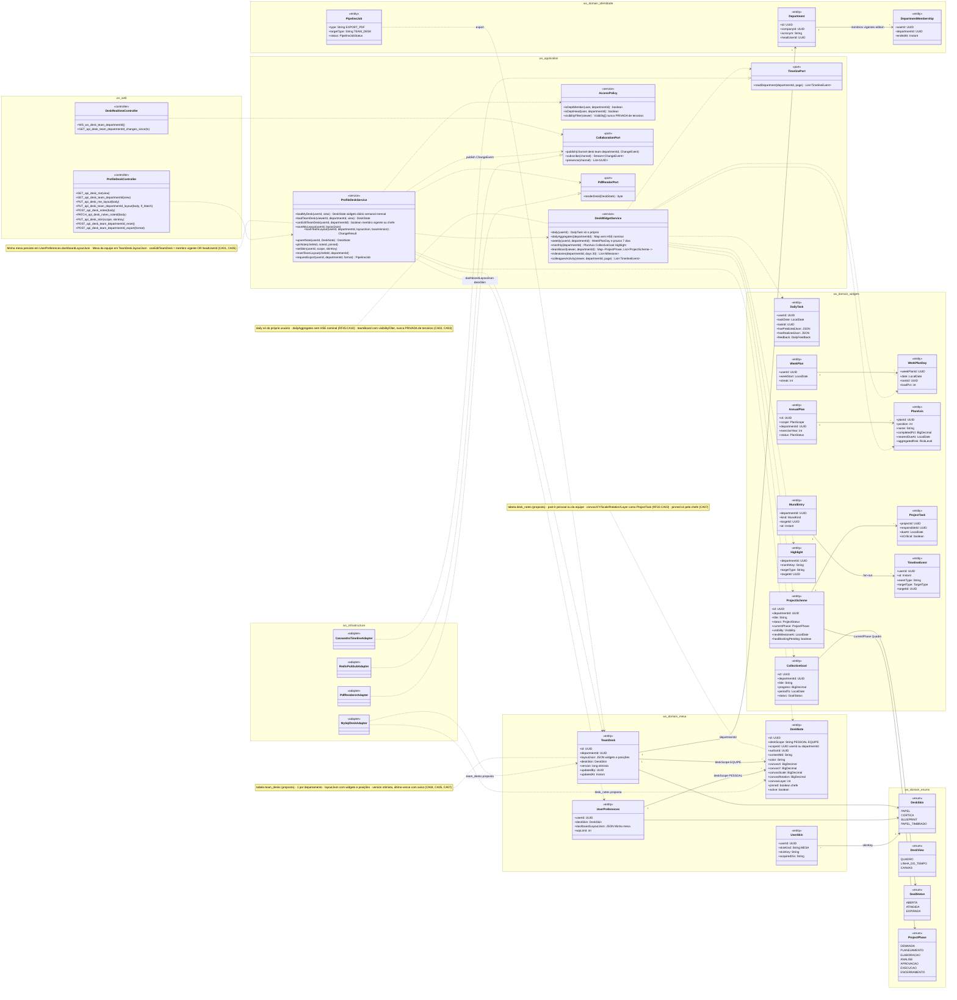
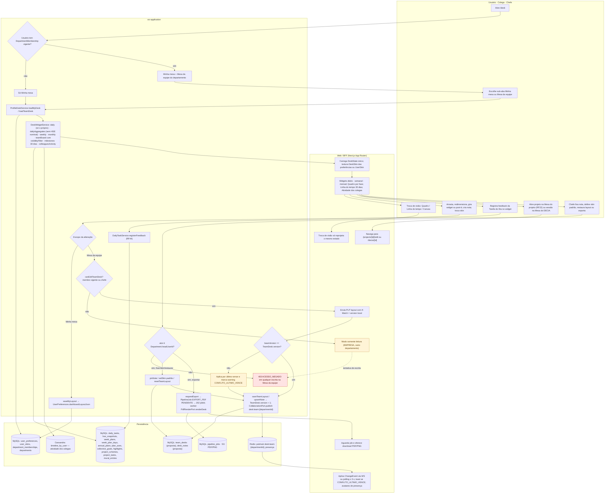
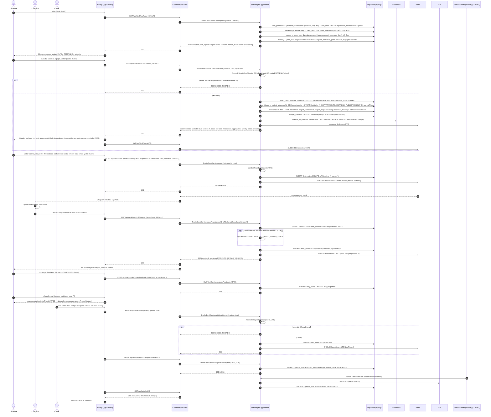
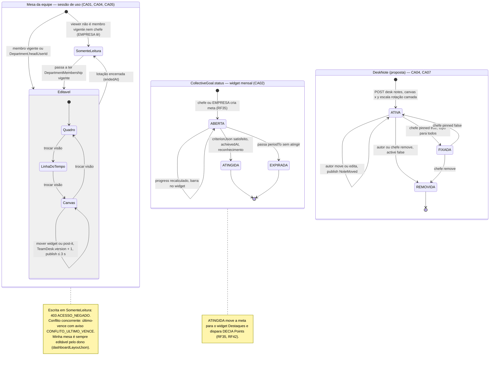
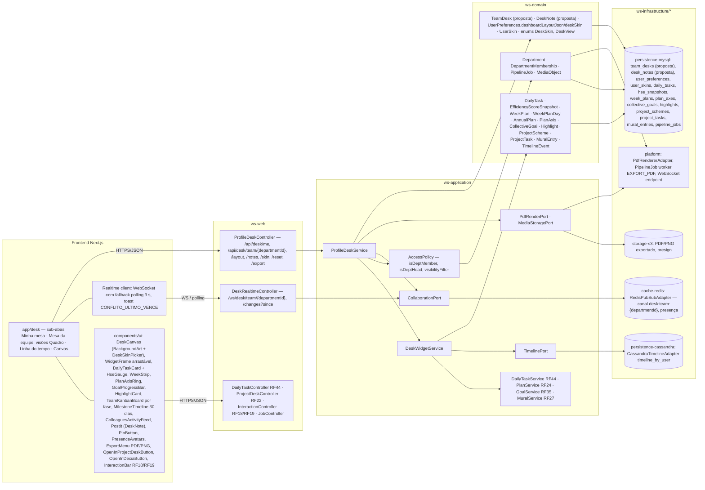

# RF21 — Utilizar a mesa de trabalho digital de meu perfil
**HU:** HU21 · **Sprint (board Work Station):** a confirmar (card renomeado em 2026-10-02; origem RF22 Mesa de Trabalho = Sprint 4) · **Equivalente FAI:** RF27 Meu Quarto (Ilha central, Smart Mirror, skins) + RF15 Editor Canvas 2D · **Aba/rota:** Mesa de Trabalho (`/desk`, sub-abas **Minha mesa** · **Mesa da equipe**); a Mesa de um **projeto** continua no RF22 (`/projects/[id]/edit`) e a **Mesa do DECIA** na sessão (`docs/produto/DECIA_SESSAO_E_MESA.md` §C)
**Critérios de aceite cobertos:** RF21.CA01 … RF21.CA07 — corpo do card vazio: CAs derivados do título + HU21 + RF22 (quadro / linha do tempo / canvas, skins, colaboração ≤ 3 s, versões) + Mesa do DECIA §C (mesma família visual); todos marcados "(CA a confirmar)"

> **HU21** — COMO usuário pertencente a alguma empresa ou organização POSSO acessar a mesa de trabalho de minha equipe PARA visualizar de forma estratégica, formal e coerente as metas diárias, semanais e mensais de minha empresa, além de entender o que meus colegas de equipe estão produzindo.

A **Mesa de Trabalho do perfil** é o painel pessoal/da equipe que reúne, sobre a mesma família visual do RF22 (texturas `DeskSkin` PAPEL · CORTIÇA · BLUEPRINT · PAPEL_TIMBRADO, post-its, cartões), **widgets** com três horizontes: **diário** (Tarefa do Dia e HSE, `DailyTask` RF44), **semanal** (`WeekPlan`/`WeekPlanDay`, prazos ≤ 7 dias) e **mensal** (eixos do Plano Anual do departamento `PlanAxis.completedPct`, metas coletivas `CollectiveGoal.progress`, destaques `Highlight`). Tem duas sub-abas: **Minha mesa** (layout em `UserPreferences.dashboardLayoutJson`, skin de `UserPreferences.deskSkin`/`UserSkin`) e **Mesa da equipe** (um canvas por departamento, compartilhado pelos membros com propagação ≤ 3 s via Redis pub/sub, projetos da equipe por fase, linha do tempo de marcos, atividade dos colegas via `TimelineEvent`/`MuralEntry`). Entidades novas **(propostas)**: `TeamDesk` (`id · departmentId · layoutJson · deskSkin · version · updatedBy · updatedAt`) e `DeskNote` (`id · deskScope (PESSOAL · EQUIPE) · scopeId · authorId · contentMd · color · canvasX · canvasY · canvasScale · canvasRotation · canvasLayer · pinned · active`). Três visões do mesmo estado — **Quadro** (projetos da equipe por `ProjectPhase`), **Linha do tempo** (marcos `nextMilestoneAt`, `dueAt`, `legalDueAt`, `votingDeadlineAt`) e **Canvas** (widgets e post-its com x/y/escala/rotação/camada). Abrir um projeto leva à Mesa do projeto (RF22); abrir uma sessão leva à Mesa do DECIA. Limites LGPD: HSE nominal e Tarefa do Dia só do próprio usuário; a equipe vê agregados (RF45.CA10, `ABAS_POR_PERFIL.md` §7.b).

| CA | Enunciado (Dado / Quando / Então) |
|---|---|
| **RF21.CA01** (CA a confirmar) | Dado um usuário autenticado com lotação (`DepartmentMembership` vigente), quando abre `/desk`, então vê as sub-abas **Minha mesa** e **Mesa da equipe** (do departamento em que está lotado) com a textura `DeskSkin` das suas preferências ou de uma `UserSkin` comprada (RF38/RF42); conta EMPRESA vê a Mesa de cada departamento em **leitura**; sem lotação, só Minha mesa. |
| **RF21.CA02** (CA a confirmar) | Dado a Mesa, quando carrega, então mostra widgets nos três horizontes: **diário** — Tarefa do Dia + HSE previsto × realizado (RF44, só do próprio usuário); **semanal** — semana planejada `WeekPlanDay` e prazos ≤ 7 dias; **mensal** — eixos do Plano Anual do departamento (`PlanAxis.completedPct`, `aggregatedRisk`), metas coletivas abertas (`CollectiveGoal.progress`) e Destaque do mês (`Highlight`); cada widget linka ao RF de origem. |
| **RF21.CA03** (CA a confirmar) | Dado a Mesa da equipe, quando abro a visão **Quadro**, então vejo os projetos do departamento (visibilidade DEPARTAMENTO/EMPRESA/PUBLICA) agrupados por `ProjectPhase` com responsável, prazo e `hasBlockingPending`; a visão **Linha do tempo** mostra marcos dos próximos 30 dias; o painel **Atividade dos colegas** lista `TimelineEvent`/`MuralEntry` do departamento (projetos publicados, decisões validadas, chancelas, reconhecimentos) — nunca itens PRIVADA nem HSE/Tarefa do Dia de terceiros. |
| **RF21.CA04** (CA a confirmar) | Dado a visão **Canvas**, quando arrasto, redimensiono ou giro um widget ou post-it (`DeskNote`) e troco a skin, então a posição (`canvasX/Y/Scale/Rotation/Layer`) persiste em `UserPreferences.dashboardLayoutJson` (Minha mesa) ou `TeamDesk.layoutJson` (Mesa da equipe) sem gerar versão; trocar de visão reprojeta o mesmo estado sem perder dados (como RF22.CA03). |
| **RF21.CA05** (CA a confirmar) | Dado dois membros editando a Mesa da equipe, quando um move um post-it ou cria uma nota, então o outro recebe a alteração em ≤ 3 s (Redis pub/sub `desk:team:{departmentId}` + WebSocket/polling), com presença visível e conflito resolvido por **último-vence com aviso** (`CONFLITO_ULTIMO_VENCE`, `TeamDesk.version`); só membros do departamento e o chefe escrevem — demais `403 ACESSO_NEGADO`. |
| **RF21.CA06** (CA a confirmar) | Dado um card de projeto na Mesa, quando clico "abrir na Mesa do projeto", então vou para RF22 (`/projects/[id]/edit`) e qualquer alteração estrutural gera `ProjectVersion` (RF22.CA02); "abrir sessão DECIA" leva à Mesa do DECIA; as ações sociais inline seguem RF18/RF19; o widget Tarefa do Dia aceita o feedback do RF44 direto da Mesa. |
| **RF21.CA07** (CA a confirmar) | Dado a Mesa da equipe, quando o chefe (`Department.headUserId`) fixa (`pinned`) uma nota ou define a skin padrão, então ela fica no topo para todos; a Mesa guarda `version` e permite "restaurar layout padrão"; exportar a Mesa em PDF/PNG roda como `PipelineJob EXPORT_PDF` (RF22.CA07). |

| Widget | Horizonte | Entidades lidas | RF origem | Visível na Mesa da equipe? |
|---|---|---|---|---|
| Tarefa do Dia + HSE previsto × realizado | diário | `DailyTask`, `EfficiencyScoreSnapshot` | RF44 | só a própria; equipe vê agregados (quantos CONCLUI/ADIEI/BLOQUEADA/DELEGUEI) |
| Semana planejada + prazos ≤ 7 dias | semanal | `WeekPlan`, `WeekPlanDay`, `TaskItem.dueAt/legalDueAt`, `ProjectTask.dueAt` | RF44, RF41 | prazos da equipe sim (dado operacional) |
| Eixos do Plano Anual | mensal | `AnnualPlan` (scope DEPARTAMENTO/EMPRESA), `PlanAxis` | RF24 | sim |
| Metas coletivas | mensal | `CollectiveGoal`, `GoalParticipant` | RF35 | sim |
| Destaque do mês | mensal | `Highlight` | RF35 | sim |
| Projetos da equipe por fase (Quadro) | contínuo | `ProjectScheme`, `ProjectTask` | RF5/RF22 | sim (visibilidade ≥ DEPARTAMENTO) |
| Marcos (Linha do tempo) | 30 dias | `ProjectScheme.nextMilestoneAt`, `ReopenRequest.votingDeadlineAt`, `Meeting.ratificationDeadlineAt` | RF22, RF14, RF37 | sim |
| Atividade dos colegas | contínuo | `TimelineEvent`, `MuralEntry` | RF27 | sim |
| Post-its (`DeskNote`, proposta) | livre | `DeskNote` | RF21 | sim, com `pinned` pelo chefe |

## 1. Diagrama de classes

## 2. Diagrama de atividades

## 3. Diagrama de sequência

## 4. Máquina de estados

A Mesa do perfil não tem entidade com `status`: `TeamDesk` e `DeskNote` (propostas) só versionam o layout. Os ciclos relevantes são (1) a **visão** da Mesa (`DeskView`, região concorrente como em RF22.CA03) com o **modo de edição** da Mesa da equipe; (2) a **`CollectiveGoal.status`** (`GoalStatus`), estado dos widgets mensais que a HU21 pede ("metas diárias, semanais e mensais"); (3) a **`DeskNote`** (proposta) com `pinned`/`active`.

## 5. Diagrama de componentes

## 6. Rastreabilidade

| CA | Elemento do diagrama (classe / passo / mensagem / transição / componente) |
|---|---|
| RF21.CA01 | Classes `UserPreferences.deskSkin/dashboardLayoutJson`, `UserSkin`, `TeamDesk` (proposta), `DepartmentMembership`, enum `DeskSkin`, `ProfileDeskService.loadMyDesk/loadTeamDesk`, `AccessPolicy.isDeptMember/isDeptHead` · Atividades `U1 → A1 → A2 / A3 → U2 → A4 → P1 → W1` · Sequência msgs 1–9 (`user_preferences … user_skins MESA … department_memberships`, `teamDeskAvailable`) e 13–15 (`isDeptMember OR isDeptHead OR conta EMPRESA`, `alt → 403`) · Estados `[*] → SomenteLeitura / Editavel` · Componentes `app/desk`, `DeskCanvas`, `DeskSkinPicker` |
| RF21.CA02 | Classes `DailyTask`, `EfficiencyScoreSnapshot`, `WeekPlan`, `WeekPlanDay`, `AnnualPlan`, `PlanAxis` (completedPct, aggregatedRisk), `CollectiveGoal` (progress), `Highlight`, `DeskWidgetService.daily/dailyAggregates/weekly/monthly` (nota "daily só do próprio") · Atividades `A5 → P2` · Sequência msgs 5–7 (daily, weekly, monthly) e 20 (`dailyAggregates … sem nominal`) · Máquina *CollectiveGoal.status* · Componentes `DailyTaskCard + HseGauge`, `WeekStrip`, `PlanAxisRing`, `GoalProgressBar`, `HighlightCard` · Tabela de widgets do cabeçalho |
| RF21.CA03 | `ProjectScheme` (currentPhase, visibility, nextMilestoneAt, hasBlockingPending), `ProjectTask`, `TimelineEvent`, `MuralEntry`, `DeskWidgetService.teamBoard/milestones/colleaguesActivity`, `AccessPolicy.visibilityFilter`, `TimelinePort`, enum `ProjectPhase` · Atividades `A5 → P2 / P3 → W3` · Sequência msgs 18–23 (`teamBoard … visibility IN (DEPARTAMENTO, EMPRESA, PUBLICA) GROUP BY currentPhase`, `milestones 30 dias`, `timeline_by_user dos membros`) · Componentes `TeamKanbanBoard`, `MilestoneTimeline`, `ColleaguesActivityFeed`, `persistence-cassandra` |
| RF21.CA04 | `DeskNote` (canvasX/Y/Scale/Rotation/Layer), `TeamDesk.layoutJson`, `UserPreferences.dashboardLayoutJson`, enum `DeskView`, `ProfileDeskService.saveMyLayout/saveTeamLayout/upsertNote/setSkin` · Atividades `U3 → W2`, `U4 → A8 → A9 / A12 → P4` · Sequência msg 24 ("trocar visão reprojeta o mesmo estado") e 27–33 (`POST /api/desk/notes … canvasX, canvasY`) · Região concorrente *Quadro → LinhaDoTempo → Canvas* e transição `Canvas → Canvas`; máquina *DeskNote* `[*] → ATIVA → ATIVA` · Componentes `WidgetFrame arrastável`, `PostIt` |
| RF21.CA05 | `CollaborationPort` (publish/subscribe/presence), `RedisPubSubAdapter`, `DeskRealtimeController`, `TeamDesk.version`, `ProfileDeskService.canEditTeamDesk` (nota) · Atividades `A6 → W6 -.-> A7 403`, `A10 → A11 (último-vence) → A12 → P5 → W5` · Sequência msgs 25–26 (SUBSCRIBE), 31–36 (`PUBLISH … NoteCreated`, `WS push em até 3 s`), 37–46 (`If-Match 7`, `opt version atual 8 … CONFLITO_ULTIMO_VENCE`, `version 9`) · Nota da máquina *Mesa da equipe* · Componentes `Realtime client`, `PresenceAvatars`, `cache-redis pub/sub` |
| RF21.CA06 | `DailyTaskService.registerFeedback` (RF44), `ProjectDeskController` (RF22), `InteractionBar RF18/RF19` · Atividades `U5 → A13 → P2`, `U6 → W7` · Sequência msgs 47–53 (`POST /api/daily-tasks/today/feedback`, "navega para /projects/P4/edit (RF22 — … ProjectVersion)") · Componentes `OpenInProjectDeskButton`, `OpenInDeciaButton`, `DailyTaskController RF44`, `ProjectDeskController RF22` |
| RF21.CA07 | `DeskNote.pinned`, `TeamDesk.deskSkin/version`, `Department.headUserId`, `ProfileDeskService.pinNote/resetTeamLayout/requestExport`, `PipelineJob EXPORT_PDF` (targetType TEAM_DESK), `PdfRenderPort.renderDesk`, `MediaObject` · Atividades `U7 → A14 → A7 403 / A15 → P4 → A12`, `A14 → A16 → P6 → W8` · Sequência msgs 54–72 (`PATCH …/notes/{id} {pinned true}`, `alt ator não é headUserId → 403`, `INSERT pipeline_jobs EXPORT_PDF TEAM_DESK`, `renderDesk`, `downloadUrl presign`) · Transições `ATIVA → FIXADA → ATIVA / REMOVIDA` · Componentes `PinButton`, `ExportMenu PDF/PNG`, `storage-s3`, `platform PdfRendererAdapter` |
