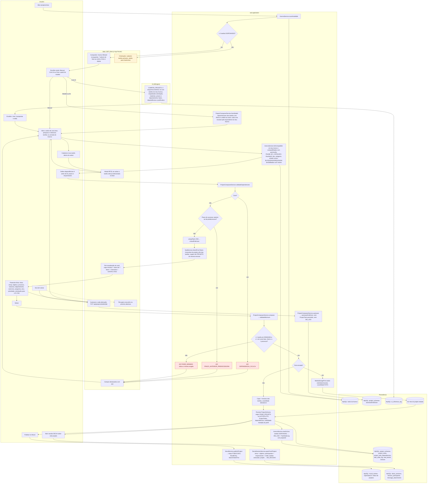
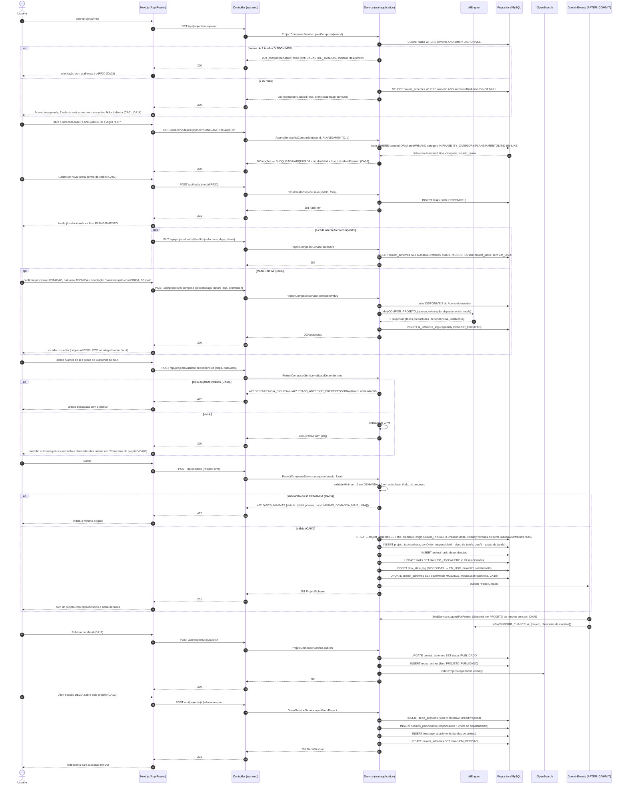
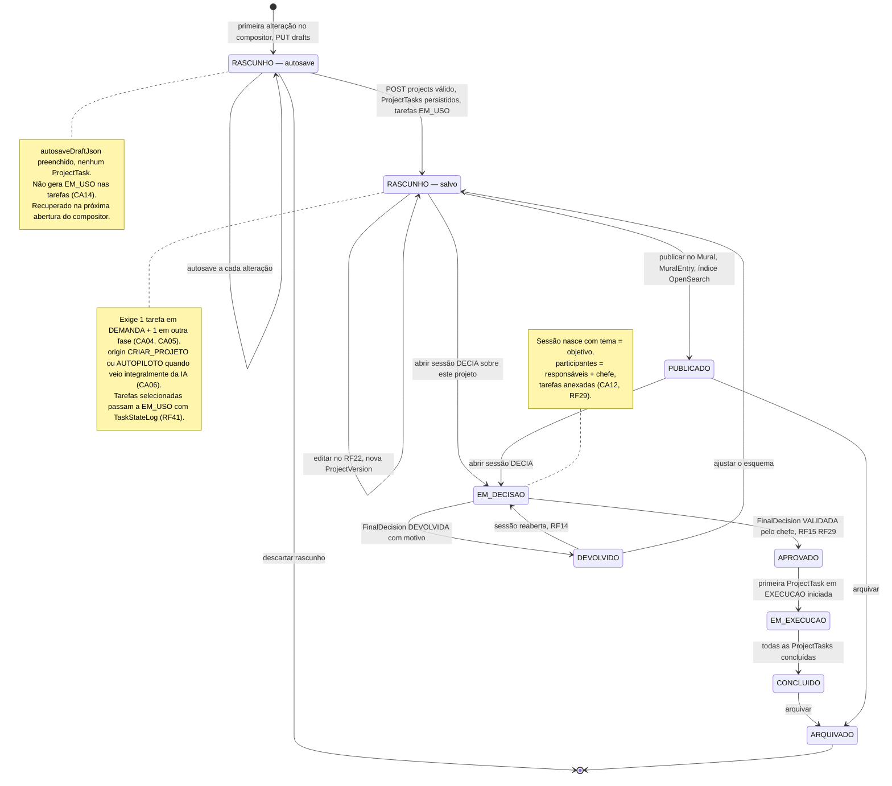
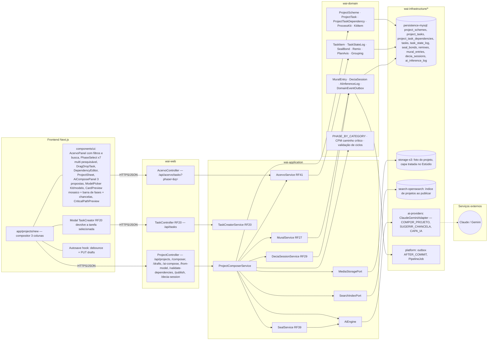

# RF21 — Compor um Esquema de Projeto no Criador de Projetos, escolhendo em cada fase (select) as unidades de tarefa do meu Acervo, em modo manual ou com IA
**HU:** HU21 · **Sprint (board Work Station):** 4 · **Equivalente FAI:** RF5 Criar esquema (aba "Criar Look": slots por tipo com uma peça de cada, selects alimentados pelo Closet, modo Manual / Com IA, título, ocasião, estilo, orientação livre, foto opcional, capa = composição das peças, selos vindos das peças, pré-visualização do card, cadastrar nova peça inline, mínimo de 2 peças) · **Aba/rota:** Criar Projeto (`/projects/new`)
**Critérios de aceite cobertos:** RF21.CA01 · CA02 · CA03 · CA04 · CA05 · CA06 · CA07 · CA08 · CA09 · CA10 · CA11 · CA12 · CA13 · CA14

O **Esquema de Projeto** (`ProjectScheme`, = look) é a composição ordenada de tarefas (`TaskItem`, = peças) em **7 fases** (`ProjectPhase`: DEMANDA · PLANEJAMENTO · ELABORAÇÃO · ANÁLISE · APROVAÇÃO · EXECUÇÃO · ENCERRAMENTO). Cada fase tem um **select múltiplo pesquisável** cujo conteúdo são as tarefas do Acervo do usuário (RF41) **compatíveis com a fase** (mapa `PHASE_BY_CATEGORY`, equivalente ao `SLOT_BY_CATEGORY` do FAI). Cada tarefa selecionada vira um `ProjectTask` (fase, ordem, responsável, prazo) e as dependências viram `ProjectTaskDependency` (sem ciclos). O compositor funciona em modo **Manual** ou **Com IA** (AiEngine `COMPOR_PROJETO` devolve 3 propostas usando só tarefas do Acervo), aceita "Criar a partir de modelo" (Kit / modelo chancelado, com `Remix` e crédito) e mantém **autosave** do rascunho em `ProjectScheme.autosaveDraftJson`.

| Categoria (`TaskCategory`) | Fase(s) compatível(is) — `PHASE_BY_CATEGORY` |
|---|---|
| OFICIO_MEMORANDO, PROTOCOLO (tipo) | DEMANDA |
| ETP, TERMO_REFERENCIA, CRONOGRAMA | PLANEJAMENTO |
| PROJETO_BASICO_EXECUTIVO, PLANILHA_ORCAMENTARIA, PARECER_TECNICO, MAPA_GEORREFERENCIA | ELABORAÇÃO · ANÁLISE |
| ATA, PORTARIA_RESOLUCAO, LICENCA_ANUENCIA | APROVAÇÃO |
| CONTRATO_CONVENIO, VISTORIA_RELATORIO_FOTOGRAFICO | EXECUÇÃO |
| Relatório final (DOCUMENTO em ENCERRAMENTO) | ENCERRAMENTO |
| OUTRO, FORMULARIO | qualquer fase |

## 1. Diagrama de classes

```mermaid
classDiagram
direction LR

namespace wai_domain_projetos {
  class ProjectScheme {
    <<entity>>
    +id: UUID
    +ownerId: UUID
    +companyId: UUID
    +departmentId: UUID
    +title: String
    +emoji: String
    +iconId: String
    +objective: String 1 frase
    +descriptionMd: String
    +processTags: Set~ProcessTag~ max 2
    +natureTags: Set~NatureTag~ max 2
    +creationMode: CreationMode
    +origin: SchemeOrigin
    +originalProjectId: UUID
    +sourceSessionId: UUID
    +aiOrientation: String
    +status: ProjectStatus
    +currentPhase: ProjectPhase
    +priority: Priority
    +visibility: Visibility herdada do perfil
    +exerciseYear: int
    +programGroupingId: UUID
    +planAxisId: UUID
    +coverMode: CoverMode
    +coverUrl: String
    +mosaicJson: JSON
    +criticalPathJson: JSON
    +nextMilestoneAt: LocalDate
    +aiGenerated: boolean
    +aiInferenceId: UUID
    +sealIdsJson: JSON
    +autosaveDraftJson: JSON
    +version: long
    .. +12 campos ..
  }
  class ProjectTask {
    <<entity>>
    +id: UUID
    +projectId: UUID
    +taskId: UUID
    +phase: ProjectPhase
    +sortOrder: int
    +responsibleId: UUID padrão dono da tarefa
    +dueAt: LocalDate padrão prazo da tarefa
    +startAt: LocalDate
    +estimatedHours: BigDecimal
    +pertOptimistic: BigDecimal
    +pertMostLikely: BigDecimal
    +pertPessimistic: BigDecimal
    +isCritical: boolean
    +slackDays: int
    +moscow: String MUST SHOULD COULD WONT
    +snapshotJson: JSON
  }
  class ProjectTaskDependency {
    <<entity>>
    +id: UUID
    +projectId: UUID
    +predecessorProjectTaskId: UUID
    +successorProjectTaskId: UUID
    +type: DependencyType
    +lagDays: int
  }
  class ProcessKit {
    <<entity>>
    +id: UUID
    +ownerId: UUID
    +name: String
    +processTag: ProcessTag
    +sealIdsJson: JSON
    +remixCount: int
  }
  class KitItem {
    <<entity>>
    +id: UUID
    +kitId: UUID
    +taskId: UUID
    +phase: ProjectPhase
    +sortOrder: int
    +optional: boolean
  }
}

namespace wai_domain_acervo {
  class TaskItem {
    <<entity>>
    +id: UUID
    +ownerId: UUID
    +title: String
    +type: TaskType
    +category: TaskCategory
    +state: TaskState
    +visibility: Visibility
    +dueAt: LocalDate
    +thumbnailUrl: String
    +sealIdsJson: JSON
    +originalTaskId: UUID
    +blockReason: String
    +projectUsageCount: int
    .. +45 campos ..
  }
  class TaskStateLog {
    <<entity>>
    +id: UUID
    +taskId: UUID
    +fromState: TaskState
    +toState: TaskState
    +actorId: UUID
    +reason: String
    +projectId: UUID
    +correlationId: String
    +at: Instant
  }
}

namespace wai_domain_outros {
  class SealBond {
    <<entity>>
    +id: UUID
    +sealId: UUID
    +targetType: String TASK ou PROJECT
    +targetId: UUID
    +basis: SealBondBasis
    +status: SealBondStatus
    +confidence: BigDecimal
  }
  class PlanAxis {
    <<entity>>
    +id: UUID
    +planId: UUID
    +position: int 1 a 6
    +name: String
  }
  class Grouping {
    <<entity>>
    +id: UUID
    +type: GroupingType PROGRAMA
    +label: String
  }
  class Remix {
    <<entity>>
    +id: UUID
    +actorId: UUID
    +sourceType: String
    +sourceId: UUID
    +resultType: String
    +resultId: UUID
    +modelOfferId: UUID
  }
  class MuralEntry {
    <<entity>>
    +id: UUID
    +kind: String PROJETO_PUBLICADO
    +targetType: TargetType PROJECT
    +targetId: UUID
  }
  class DeciaSession {
    <<entity>>
    +id: UUID
    +topic: String = objective
    +linkedProjectId: UUID
    +status: SessionStatus
  }
  class AiInferenceLog {
    <<entity>>
    +id: UUID
    +capability: AiCapability COMPOR_PROJETO
    +result: String
  }
}

namespace wai_domain_enums {
  class ProjectPhase {
    <<enum>>
    DEMANDA
    PLANEJAMENTO
    ELABORACAO
    ANALISE
    APROVACAO
    EXECUCAO
    ENCERRAMENTO
  }
  class ProjectStatus {
    <<enum>>
    RASCUNHO
    PUBLICADO
    EM_DECISAO
    APROVADO
    EM_EXECUCAO
    CONCLUIDO
    ARQUIVADO
    DEVOLVIDO
  }
  class CreationMode {
    <<enum>>
    MANUAL
    COM_IA
  }
  class SchemeOrigin {
    <<enum>>
    CRIAR_PROJETO
    DECIA
    REMIX
    AUTOPILOTO
    MODELO
    CENARIO
    DOSSIE
    ATA_VIVA
  }
  class DependencyType {
    <<enum>>
    FS
    SS
    FF
    SF
  }
  class TaskState {
    <<enum>>
    RASCUNHO
    DISPONIVEL
    EM_USO
    BLOQUEADA
    CONCLUIDA
    ARQUIVADA
    MODELO_PUBLICO
    OFERECIDA
  }
}

namespace wai_application {
  class ProjectComposerService {
    <<service>>
    +openComposer(userId) ComposerState
    +autosave(userId, draftId, DraftJson) ProjectScheme
    +listPhaseOptions(userId, phase, query) List~TaskOption~
    +compose(userId, ProjectForm) ProjectScheme
    +composeWithAi(userId, processTags, natureTags, orientation) List~Proposal~
    +fromModel(userId, modelId ou kitId) ComposerState
    +validateMinimum(selections) 422 FASES_MINIMAS
    +validateDependencies(deps, dueDates) 422 DEPENDENCIA_CICLICA ou PRAZO_ANTERIOR_PREDECESSORA
    +criticalPath(tasks, deps) List~UUID~
    +publish(projectId) ProjectScheme
    +openDeciaSession(projectId) DeciaSession
  }
  class AcervoService {
    <<service>>
    +countAvailable(userId) int
    +listCompatible(userId, phase, filters) List~TaskItem~
    +markInUse(taskIds, projectId, correlationId)
  }
  class TaskCreatorService {
    <<service>>
    +save(userId, TaskForm) TaskItem
  }
  class SealService {
    <<service>>
    +inheritFromTasks(taskIds) List~SealBond~
    +suggestForProject(projectId, issuerIds) List~SealBond~
  }
  class MuralService {
    <<service>>
    +publishProject(projectId) MuralEntry
  }
  class DeciaSessionService {
    <<service>>
    +openFromProject(projectId) DeciaSession
  }
  class AiEngine {
    <<service>>
    +infer(capability, input, mode) AiResult
  }
  class MediaStoragePort {
    <<port>>
    +put(stream) MediaObject
    +studio(mediaId, ops) MediaObject
  }
  class SearchIndexPort {
    <<port>>
    +indexProject(ProjectScheme)
  }
}

namespace wai_web {
  class ProjectController {
    <<controller>>
    +GET_api_projects_composer()
    +PUT_api_projects_drafts_id(DraftJson)
    +GET_api_acervo_tasks(phase, q, filters)
    +POST_api_projects_ai_compose(body)
    +POST_api_projects(ProjectForm)
    +POST_api_projects_from_model(modelId)
    +POST_api_projects_id_publish()
    +POST_api_projects_id_decia_session()
  }
}

namespace wai_infrastructure {
  class ClaudeGeminiAdapter {
    <<adapter>>
  }
  class S3StorageAdapter {
    <<adapter>>
  }
  class OpenSearchIndexAdapter {
    <<adapter>>
  }
}

ProjectScheme "1" --> "*" ProjectTask : tarefas por fase
ProjectScheme "1" --> "*" ProjectTaskDependency : grafo sem ciclos
ProjectScheme "*" --> "0..1" PlanAxis : planAxisId
ProjectScheme "*" --> "0..1" Grouping : programGroupingId
ProjectScheme "*" --> "0..1" ProjectScheme : originalProjectId remix ou modelo
ProjectScheme "1" --> "*" SealBond : targetId quando PROJECT
ProjectScheme "1" --> "0..1" MuralEntry : publicação
ProjectScheme "1" --> "0..1" DeciaSession : linkedProjectId
ProjectScheme "*" --> "0..1" AiInferenceLog : aiInferenceId
ProjectTask "*" --> "0..1" TaskItem : taskId
ProjectTaskDependency "*" --> "1" ProjectTask : predecessor
ProjectTaskDependency "*" --> "1" ProjectTask : successor
ProjectTaskDependency --> DependencyType
ProcessKit "1" --> "*" KitItem
KitItem "*" --> "1" TaskItem
TaskItem "1" --> "*" TaskStateLog : DISPONIVEL para EM_USO
TaskItem "1" --> "*" SealBond : chancela vem da tarefa
Remix "*" --> "1" ProjectScheme : resultId
ProjectScheme --> ProjectStatus
ProjectScheme --> ProjectPhase : currentPhase
ProjectScheme --> CreationMode
ProjectScheme --> SchemeOrigin
ProjectTask --> ProjectPhase
TaskItem --> TaskState

ProjectController ..> ProjectComposerService
ProjectController ..> AcervoService
ProjectController ..> TaskCreatorService : modal Cadastrar nova tarefa
ProjectComposerService ..> AcervoService
ProjectComposerService ..> SealService
ProjectComposerService ..> MuralService
ProjectComposerService ..> DeciaSessionService
ProjectComposerService ..> AiEngine : COMPOR_PROJETO 3 propostas
ProjectComposerService ..> MediaStoragePort : foto do projeto
ProjectComposerService ..> SearchIndexPort
ClaudeGeminiAdapter ..> AiEngine
S3StorageAdapter ..|> MediaStoragePort
OpenSearchIndexAdapter ..|> SearchIndexPort

note for ProjectScheme "tabela project_schemes · mínimo 1 tarefa em DEMANDA + 1 em outra fase (CA04, CA05) · autosaveDraftJson sem ProjectTask persistido não gera EM_USO (CA14)"
note for ProjectTask "tabela project_tasks · responsibleId padrão = dono da tarefa, dueAt padrão = prazo da tarefa (CA04)"
note for ProjectTaskDependency "tabela project_task_dependencies · ciclo ou prazo anterior à predecessora = 422 (CA08)"
note for AcervoService "listCompatible filtra por PHASE_BY_CATEGORY e devolve BLOQUEADA/ARQUIVADA desabilitadas com motivo (CA03)"
```

## 2. Diagrama de atividades

## 3. Diagrama de sequência

## 4. Máquina de estados

Entidade central: **`ProjectScheme.status`** (enum `ProjectStatus`). O RF21 cobre o nascimento do esquema: rascunho de autosave (RASCUNHO com `autosaveDraftJson` e **sem** `ProjectTask`), esquema salvo (RASCUNHO com `ProjectTask`s e tarefas EM_USO), publicação (PUBLICADO, CA11) e abertura de sessão (EM_DECISAO, CA12). Os demais estados pertencem ao RF22/RF29 e aparecem para contexto.

## 5. Diagrama de componentes

## 6. Rastreabilidade

| CA | Elemento do diagrama (classe / passo / mensagem / transição / componente) |
|---|---|
| RF21.CA01 | `ProjectComposerService.openComposer`, `AcervoService.countAvailable` · Atividades `U1 → A1 → A2 (sim) → W1` · Sequência `GET /api/projects/composer` → `else 2 ou mais` → "Acervo à esquerda, 7 selects vazios, ficha à direita" · Componentes `AcervoPanel`, `PhaseSelect x7`, `ProjectSheet` |
| RF21.CA02 | Atividades `A2 (não) → W2` (orientação + atalho /tasks/new) · Sequência `alt menos de 2 tarefas DISPONIVEIS` → `{composerEnabled: false, hint: CADASTRE_TAREFAS}` |
| RF21.CA03 | `AcervoService.listCompatible` (nota PHASE_BY_CATEGORY, desabilitadas com motivo), tabela `PHASE_BY_CATEGORY` do cabeçalho, enum `TaskState` · Atividades `U3 → A3 → P1` · Sequência `GET /api/acervo/tasks?phase=PLANEJAMENTO&q=ETP` → "BLOQUEADA/ARQUIVADA com disabled e disabledReason" · Componentes `AcervoController`, `PhaseSelect` |
| RF21.CA04 | Classes `ProjectScheme` (origin CRIAR_PROJETO, visibility herdada), `ProjectTask` (nota responsibleId/dueAt padrão), `TaskStateLog`, `AcervoService.markInUse` · Atividades `U7 → A11 → A12 (sim) → A17 → A18 → P3` · Sequência `else válido (CA04)`: UPDATE project_schemes, INSERT project_tasks, UPDATE tasks EM_USO, INSERT task_state_log · Transição `RASC_AUTO → RASC_SALVO` e nota |
| RF21.CA05 | `ProjectComposerService.validateMinimum` · Atividades `A12 (não) → A13 422 FASES_MINIMAS → W6` · Sequência `alt sem tarefa ou só DEMANDA` → `422 FASES_MINIMAS` · Nota do estado RASC_SALVO |
| RF21.CA06 | `ProjectComposerService.composeWithAi`, `AiEngine` (COMPOR_PROJETO), `AiInferenceLog`, enums `CreationMode.COM_IA`, `SchemeOrigin.AUTOPILOTO` · Atividades `U2 (Com IA) → I1 → P4 → U11` · Sequência `opt modo Com IA`: `POST /api/projects/ai-compose` → 3 propostas → INSERT ai_inference_log · Componentes `AiComposePanel`, `ai-providers` |
| RF21.CA07 | `TaskCreatorService.save`, `ProjectController ..> TaskCreatorService` · Atividades `U4 → W3 → U3` · Sequência "Cadastrar nova tarefa dentro do select" → `POST /api/tasks (modal RF20)` → "já selecionada na fase" · Componentes `Modal TaskCreator RF20`, `TaskController RF20` |
| RF21.CA08 | Classes `ProjectTaskDependency` (nota 422), enum `DependencyType`, `ProjectComposerService.validateDependencies/criticalPath`, `ProjectScheme.criticalPathJson`, `ProjectTask.isCritical/slackDays` · Atividades `U5 → A4 → A5/A6 → A7/A8 → A9` · Sequência `POST /api/projects/validate-dependencies` → `alt ciclo ou prazo inválido` / `else válido` (criticalPath CPM) · Componentes `DependencyEditor`, `CriticalPathPreview`, `D4` |
| RF21.CA09 | Classes `SealBond` (TASK ou PROJECT), `TaskItem.sealIdsJson`, `ProjectScheme.sealIdsJson`, `SealService.inheritFromTasks/suggestForProject` · Atividades `A10` · Sequência "chancelas das tarefas em Chancelas do projeto" e `DE->>S: SealService.suggestForProject` (tier PROJETO do mesmo emissor) · Componente `SealService RF39` |
| RF21.CA10 | `ProjectScheme.coverMode/coverUrl/mosaicJson`, `MediaStoragePort.studio` · Atividades `A14 → A15` (mosaico) / `A14 → A16 → P5` (foto tratada) · Sequência `UPDATE project_schemes SET coverMode MOSAICO, mosaicJson` · Componentes `CardPreview`, `storage-s3` |
| RF21.CA11 | `ProjectComposerService.publish`, `MuralService.publishProject`, `MuralEntry`, `SearchIndexPort` · Atividades `U9 → A21 → P6` · Sequência `POST /api/projects/{id}/publish` → status PUBLICADO, INSERT mural_entries, indexProject respeitando visibility · Transição `RASC_SALVO → PUBLICADO` · Componentes `MuralService RF27`, `search-opensearch` |
| RF21.CA12 | `DeciaSessionService.openFromProject`, `DeciaSession` (topic = objective, linkedProjectId) · Atividades `U10 → A22 → P7` · Sequência `POST /api/projects/{id}/decia-session` → decia_sessions, session_participants, message_attachments, status EM_DECISAO · Transição `RASC_SALVO/PUBLICADO → EM_DECISAO` e nota · Componente `DeciaSessionService RF29` |
| RF21.CA13 | Classes `ProcessKit`, `KitItem`, `Remix`, `ProjectScheme.originalProjectId`, enum `SchemeOrigin.MODELO/REMIX`, `ProjectComposerService.fromModel` · Atividades `U2 (Modelo ou Kit) → A19 → U3` · Componentes `ModelPicker Kit/modelo`, `ProjectController /from-model` |
| RF21.CA14 | `ProjectScheme.autosaveDraftJson`, `ProjectComposerService.autosave` · Atividades `U3/U6 → W4 → A20 → P2`, `U8 → W4`, `W7` (recupera) · Sequência `loop a cada alteração` → `PUT /api/projects/drafts/{draftId}` (sem project_tasks, sem EM_USO) e `SELECT ... autosaveDraftJson IS NOT NULL` na abertura · Estado `RASC_AUTO` + nota · Componente `Autosave hook` |
