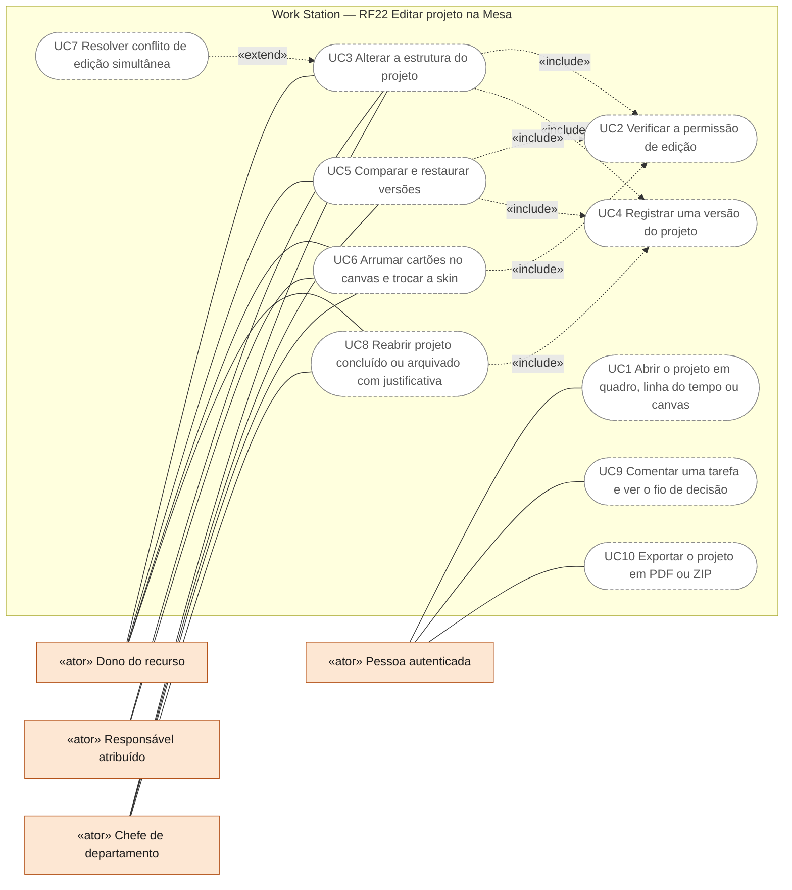
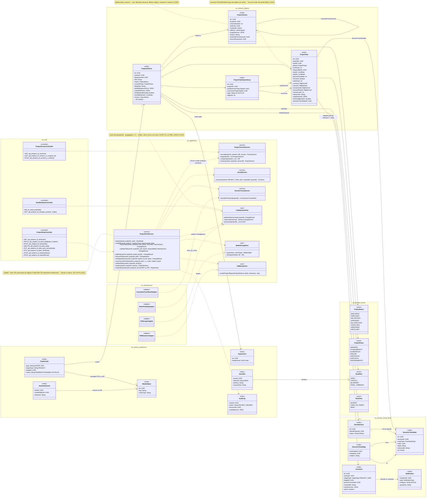
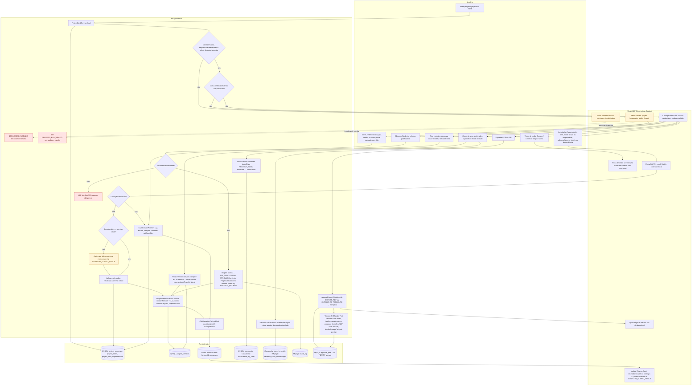
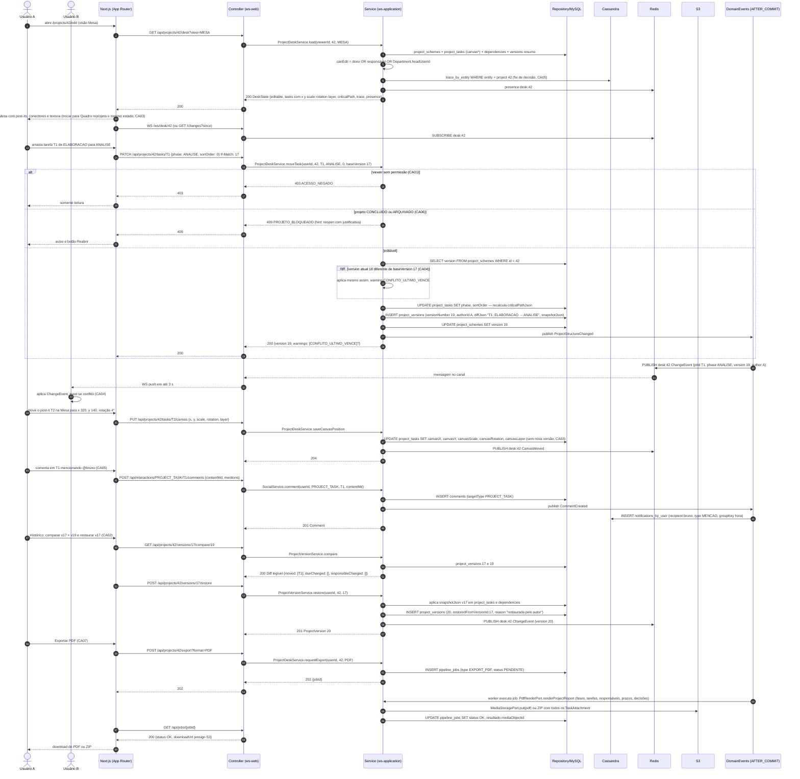
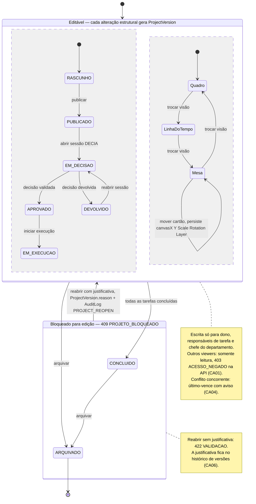
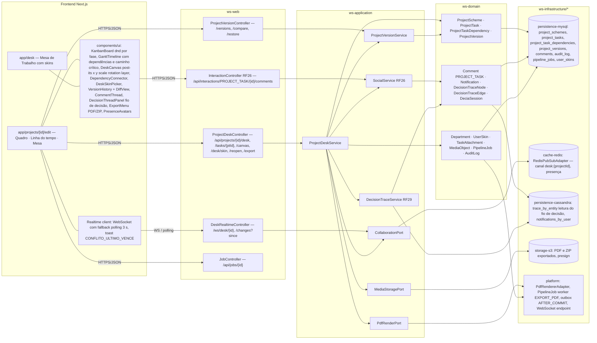

# RF22 — Editar um Esquema de Projeto na Mesa de Trabalho (quadro por fase, linha do tempo e canvas livre) com versões e histórico
**HU:** HU22 · **Sprint (board Work Station):** 4 · **Equivalente FAI:** RF9 Editar esquema + RF15 Editor Canvas 2D + RF27 Meu Quarto · **Aba/rota:** `/projects/[id]/edit` e Mesa de Trabalho (`/desk`)
**Critérios de aceite cobertos:** RF22.CA01 · CA02 · CA03 · CA04 · CA05 · CA06 · CA07

Três visões do **mesmo** `ProjectScheme`: **Quadro** (kanban por `ProjectPhase`, arrastar e soltar), **Linha do tempo** (barras por `ProjectTask` com prazo, `ProjectTaskDependency` e caminho crítico — Gantt simples) e **Mesa** (canvas livre: cartões/post-its com `canvasX/Y/Scale/Rotation/Layer`, conectores de dependência, textura `DeskSkin` PAPEL · CORTIÇA · BLUEPRINT · PAPEL_TIMBRADO e skins salvas em `UserSkin`, RF38). Toda alteração **estrutural** gera uma `ProjectVersion` com autor, data e `diffJson` legível; a edição é **colaborativa** (propagação ≤ 3 s via Redis pub/sub + WebSocket/polling, conflito resolvido por *último-vence* com aviso); comentários por tarefa usam `Comment` com `targetType = PROJECT_TASK`; o painel lateral mostra o **fio de decisão** (`DecisionTraceNode/Edge`) da `DeciaSession` vinculada (RF29); projetos CONCLUÍDO/ARQUIVADO ficam bloqueados (reabrir exige justificativa); exportação em **PDF** e **ZIP** roda como `PipelineJob EXPORT_PDF` com entrega via `MediaStoragePort`.

| Alteração | Estrutural? | Gera `ProjectVersion`? | Persistido em |
|---|---|---|---|
| Adicionar / remover tarefa, mover de fase, mudar prazo ou responsável, criar/remover dependência | sim | sim (CA02) | `project_tasks`, `project_task_dependencies`, `project_versions` |
| Mover / redimensionar / girar cartão na Mesa, trocar camada ou cor do post-it, trocar skin de mesa | não | não (posição por tarefa, CA03) | `project_tasks.canvas*`, `project_schemes.deskSkin/deskBackgroundJson` |
| Comentar tarefa | não | não | `comments` (PROJECT_TASK) |
| Reabrir projeto CONCLUÍDO/ARQUIVADO | sim | sim, com `reason` obrigatório (CA06) | `project_versions`, `audit_log` |

## 0. Diagrama de casos de uso

Quem lê e quem edita um Esquema de Projeto em `/projects/[id]/edit`: editam o dono, o responsável por tarefa do projeto e o chefe do departamento; os demais que veem o projeto ficam em modo leitura. Pílulas cheias existem no código hoje; tracejadas são planejadas.

| Caso de uso | Ator(es) | CAs | Situação |
|---|---|---|---|
| UC1 Abrir o projeto em quadro, linha do tempo ou canvas | Pessoa autenticada | RF22.CA01, RF22.CA03 | planejado — `/projects/[id]/edit` é esqueleto; sem permissão de edição, modo leitura |
| UC2 Verificar a permissão de edição | (incluído por UC3, UC5, UC6) | RF22.CA01, RF22.CA06 | planejado — `ProjectDeskService.canEdit`; `403 ACESSO_NEGADO` e `409 PROJETO_BLOQUEADO` |
| UC3 Alterar a estrutura do projeto | Dono do recurso · Responsável atribuído · Chefe de departamento | RF22.CA02, RF22.CA06 | planejado — tarefas, fases, prazos, responsáveis e dependências |
| UC4 Registrar uma versão do projeto | (incluído por UC3, UC5, UC8) | RF22.CA02 | planejado — `ProjectVersion` com autor, data e `diffJson` legível |
| UC5 Comparar e restaurar versões | Dono do recurso · Chefe de departamento | RF22.CA02 | planejado |
| UC6 Arrumar cartões no canvas e trocar a skin | Dono do recurso · Responsável atribuído · Chefe de departamento | RF22.CA03 | planejado — não gera versão |
| UC7 Resolver conflito de edição simultânea | (estende UC3) | RF22.CA04 | planejado — propagação em até 3 s, último-vence com aviso |
| UC8 Reabrir projeto concluído ou arquivado com justificativa | Dono do recurso · Chefe de departamento | RF22.CA06 | planejado — `AuditLog PROJECT_REOPEN` |
| UC9 Comentar uma tarefa e ver o fio de decisão | Pessoa autenticada | RF22.CA05 | planejado |
| UC10 Exportar o projeto em PDF ou ZIP | Pessoa autenticada | RF22.CA07 | planejado — `PipelineJob EXPORT_PDF` ou `EXPORT_ZIP` |

## 1. Diagrama de classes

## 2. Diagrama de atividades

## 3. Diagrama de sequência

## 4. Máquina de estados

Entidade central: **`ProjectScheme.status`** (enum `ProjectStatus`), visto pelo RF22 sob a ótica de **edição**: os estados do grupo *Editável* aceitam alterações estruturais (cada uma gera `ProjectVersion`), enquanto CONCLUIDO e ARQUIVADO bloqueiam a edição; reabrir exige justificativa registrada em `ProjectVersion.reason` e `AuditLog` (CA06). Transições de negócio entre os estados editáveis pertencem ao RF21/RF29 e estão simplificadas.

## 5. Diagrama de componentes

## 6. Rastreabilidade

| CA | Elemento do diagrama (classe / passo / mensagem / transição / componente) |
|---|---|
| RF22.CA01 | `ProjectDeskService.canEdit` (nota: dono OR responsável OR `Department.headUserId`), classe `Department` · Atividades `A2 (não) → W5 -.-> A4 403 ACESSO_NEGADO` · Sequência `canEdit = …` e `alt viewer sem permissão → 403 ACESSO_NEGADO` · Nota do estado *Editável* · Componentes `PresenceAvatars`, `ProjectDeskController` |
| RF22.CA02 | Classes `ProjectVersion` (versionNumber, authorId, diffJson legível, snapshotJson, restoredFromVersionId), `ProjectVersionService.record/list/compare/restore` · Atividades `A6 (sim) → A9 → A10 → P2`, `U6 → A15` · Sequência `INSERT project_versions (19 …)`, `GET …/versions/17/compare/19`, `POST …/versions/17/restore` · Tabela de alterações estruturais do cabeçalho · Componentes `VersionHistory + DiffView`, `ProjectVersionController` |
| RF22.CA03 | `ProjectTask.canvasX/canvasY/canvasScale/canvasRotation/canvasLayer/stickyColor`, enum `DeskView`, `ProjectDeskService.saveCanvasPosition` · Atividades `U2 → W2`, `U4 → A12 → P1` · Sequência `GET …/desk?view=MESA` ("trocar para Quadro reprojeta o mesmo estado") e `PUT …/tasks/T2/canvas` (sem nova versão) · Região concorrente *Quadro → LinhaDoTempo → Mesa* da máquina de estados · Componentes `KanbanBoard`, `GanttTimeline`, `DeskCanvas` |
| RF22.CA04 | `CollaborationPort` (nota canal desk:{projectId}, ≤ 3 s, último-vence), `RedisPubSubAdapter`, `DeskRealtimeController`, `ProjectScheme.version` · Atividades `A7 → A8 (último-vence, warning) → A9 → A11 → P3 → W4` · Sequência `opt version atual 18 diferente de baseVersion 17` → `warnings: [CONFLITO_ULTIMO_VENCE]`, `PUBLISH desk:42`, `WS push em até 3 s`, "toast se conflito" · Componentes `Realtime client`, `cache-redis pub/sub` |
| RF22.CA05 | Classes `Comment` (targetType PROJECT_TASK, mentionsJson), `Notification`, `DecisionTraceNode/Edge`, `DeciaSession.linkedProjectId`, `SocialService.comment`, `DecisionTraceService.threadForProject` · Atividades `U5 → A13 → P4`, `U5 → A14 → P5` · Sequência `trace_by_entity … (fio de decisão)` e `POST /api/interactions/PROJECT_TASK/T1/comments` → `notifications_by_user` · Componentes `CommentThread`, `DecisionThreadPanel`, `InteractionController RF26`, `persistence-cassandra` |
| RF22.CA06 | Enum `ProjectStatus` (CONCLUIDO, ARQUIVADO), `ProjectDeskService.reopen`, `AuditLog` (PROJECT_REOPEN), `ProjectVersion.reason` · Atividades `A3 (sim) → W6 -.-> A5 409 PROJETO_BLOQUEADO`, `U7 → A16 → A17 422 / A18 → P6 → A10` · Sequência `else projeto CONCLUIDO ou ARQUIVADO → 409 PROJETO_BLOQUEADO` · Estado composto *Bloqueado* e transição `Bloqueado → Editavel : reabrir com justificativa` + nota |
| RF22.CA07 | Classes `PipelineJob` (EXPORT_PDF), `MediaObject`, `TaskAttachment`, `PdfRenderPort`, `MediaStoragePort.presign`, `ProjectDeskService.requestExport` · Atividades `U8 → A19 → P7 → W7`, `A20` · Sequência `POST …/export?format=PDF` → 202 jobId → worker `renderProjectReport` → `MediaStoragePort.put(pdf) ou ZIP com todos os TaskAttachment` → `GET /api/jobs/{jobId}` → downloadUrl · Componentes `ExportMenu PDF/ZIP`, `JobController`, `storage-s3`, `platform PdfRendererAdapter` |

Tela/aba: `/desk` (esqueleto em `app/(shell)/desk/page.tsx`) · `/projects/[id]/edit` (esqueleto em `app/(shell)/projects/[id]/edit/page.tsx`)
