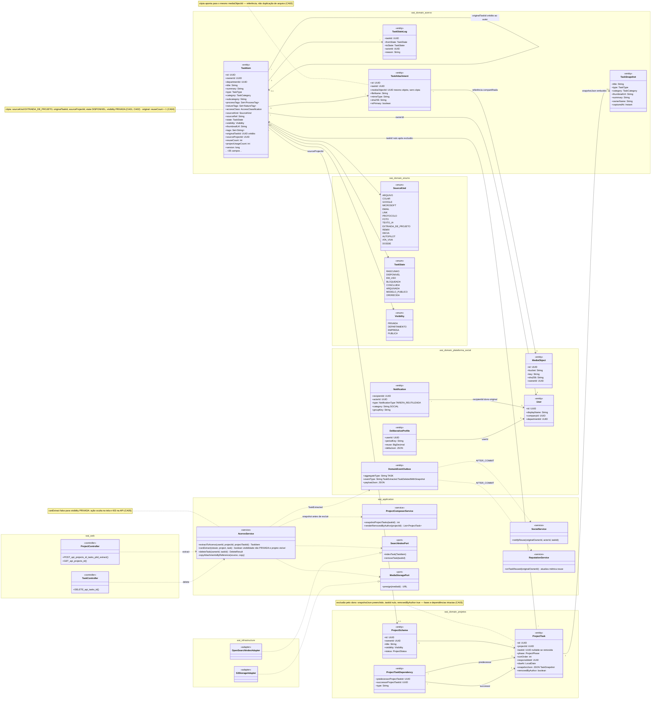
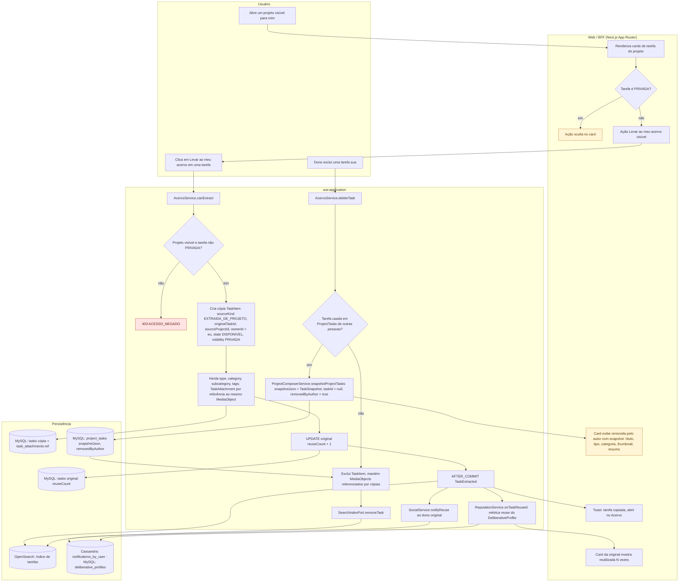
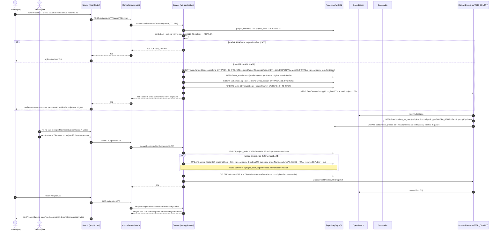
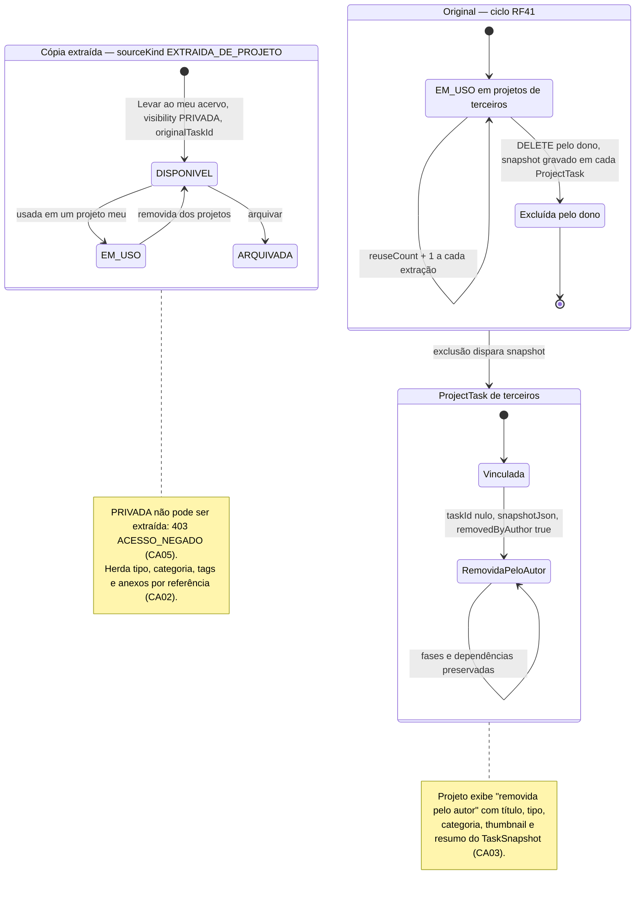
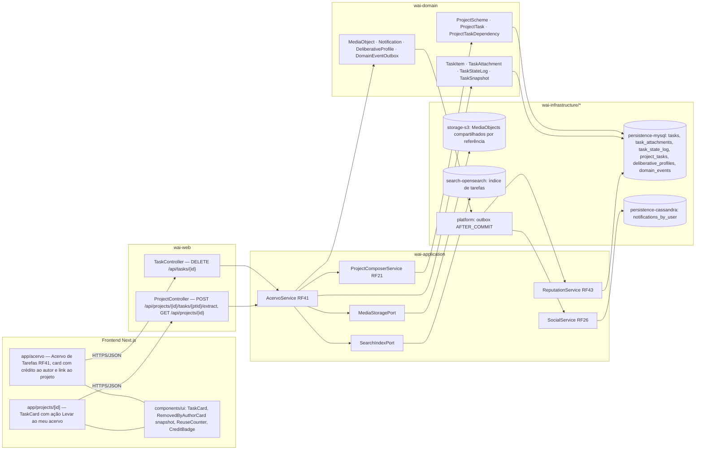

# RF23 — Extrair uma tarefa de um Esquema de Projeto para o meu Acervo (reutilização com crédito) e preservar snapshot quando a tarefa original for excluída
**HU:** HU23 · **Sprint (board Work Station):** Product Backlog (não comprometido na Sprint 4; candidato à Sprint 5) · **Equivalente FAI:** RF7 Peça a partir do esquema · **Aba/rota:** ação "Levar ao meu acervo" no card de tarefa dentro de `/projects/[id]` (destino: Acervo de Tarefas `/acervo`, RF41)
**Critérios de aceite cobertos:** RF23.CA01 · CA02 · CA03 · CA04 · CA05

Dois fluxos sobre a mesma ligação `ProjectTask ↔ TaskItem`: (1) **Extrair** — em qualquer projeto visível para mim, cada tarefa não-PRIVADA tem a ação **"Levar ao meu acervo"**, que cria uma cópia (`TaskItem` com `sourceKind = EXTRAIDA_DE_PROJETO`, `originalTaskId` = crédito ao autor, `sourceProjectId` = link ao projeto), herdando tipo, categoria, tags e **anexos por referência** (`TaskAttachment` aponta para o mesmo `MediaObject`, sem duplicar arquivo), nascendo `DISPONIVEL` e `PRIVADA`, e incrementando `reuseCount` da original (métrica de reutilização do perfil deliberativo, objetivo 2). (2) **Excluir** — quando o dono apaga uma tarefa usada em projetos de terceiros, cada `ProjectTask` grava o **snapshot** (`TaskSnapshot` em `snapshotJson`), `taskId` fica nulo e `removedByAuthor = true`; o projeto exibe "removida pelo autor" sem quebrar fases nem `ProjectTaskDependency`.

## 1. Diagrama de classes

## 2. Diagrama de atividades

## 3. Diagrama de sequência

## 4. Máquina de estados

Entidade central: **`TaskItem.state`** (enum `TaskState`) — o RF23 cria a **cópia** diretamente em `DISPONIVEL` e encerra o ciclo da **original** por exclusão com snapshot. A ligação `ProjectTask` ganha o marcador `removedByAuthor`, mostrado como estado derivado.

## 5. Diagrama de componentes

## 6. Rastreabilidade

| CA | Elemento do diagrama (classe / passo / mensagem / transição / componente) |
|---|---|
| RF23.CA01 | `TaskItem.sourceKind EXTRAIDA_DE_PROJETO / originalTaskId / sourceProjectId`, enum `SourceKind`, `AcervoService.extractToAcervo` · Atividades `W4 → U2 → A1 → A4 → P1` · Sequência `POST /api/projects/77/tasks/PT9/extract` → `INSERT tasks (… EXTRAIDA_DE_PROJETO, originalTaskId T9, sourceProjectId 77 …)` · Transição `[*] → DISPONIVEL` da *Cópia* · Componentes `TaskCard`, `CreditBadge`, `ProjectController /extract` |
| RF23.CA02 | `TaskAttachment.mediaObjectId` (nota "referência, não duplicação"), `MediaObject`, `AcervoService.copyAttachmentsByReference`, enums `TaskState.DISPONIVEL`, `Visibility.PRIVADA` · Atividades `A5` · Sequência `INSERT task_attachments (mediaObjectId igual ao da original)` e `state DISPONIVEL, visibility PRIVADA, type, category, tags herdados` · Nota da *Cópia* · Componente `storage-s3 (compartilhados por referência)` |
| RF23.CA03 | `ProjectTask.snapshotJson / removedByAuthor / taskId nullable`, `TaskSnapshot`, `ProjectTaskDependency`, `ProjectComposerService.snapshotProjectTasks/renderRemovedByAuthor`, `AcervoService.deleteTask` · Atividades `U3 → A8 → A9 → A10 → P4 → A11 → W6` · Sequência `DELETE /api/tasks/T9` → `alt usada em projetos de terceiros` → `UPDATE project_tasks SET snapshotJson …, taskId = NULL, removedByAuthor = true` + nota "fases … intactos" → card "removida pelo autor" · Estados *Original → EXCLUIDA* e *ProjectTask → RemovidaPeloAutor* · Componente `RemovedByAuthorCard` |
| RF23.CA04 | `TaskItem.reuseCount`, `DeliberativeProfile.reuse`, `ReputationService.onTaskReused`, `Notification` · Atividades `A6 → P2`, `A7 → A14 → P5 → W7` · Sequência `UPDATE tasks SET reuseCount + 1`, `UPDATE deliberative_profiles SET reuse`, "reutilizada N vezes" · Transição `EM_USO_ORIG → EM_USO_ORIG : reuseCount + 1` · Componentes `ReuseCounter`, `ReputationService RF43` |
| RF23.CA05 | `AcervoService.canExtract` (nota PRIVADA → oculta + 403) · Atividades `W2 (sim) → W3` (ação oculta) e `A2 (não) → A3 403 ACESSO_NEGADO` · Sequência `alt tarefa PRIVADA ou projeto invisível → 403 ACESSO_NEGADO` · Nota da *Cópia* |
