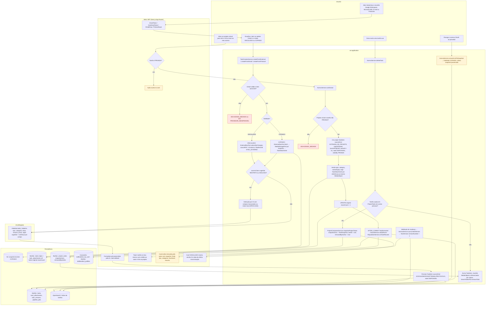
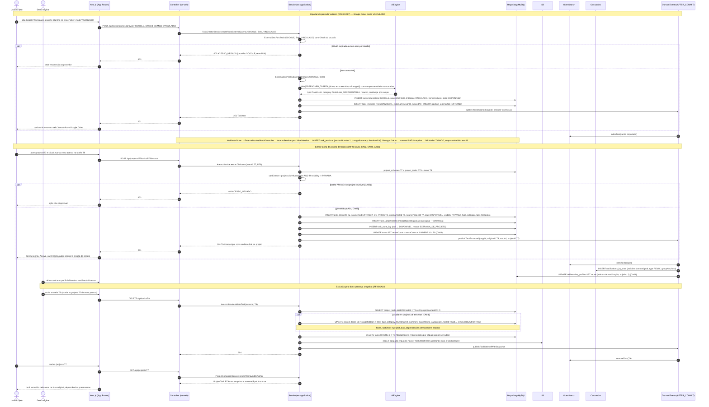
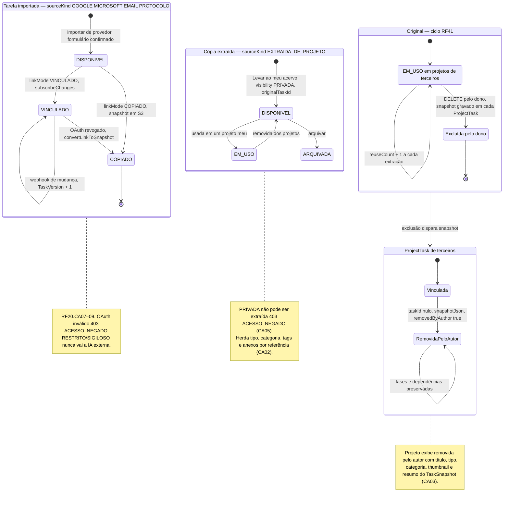
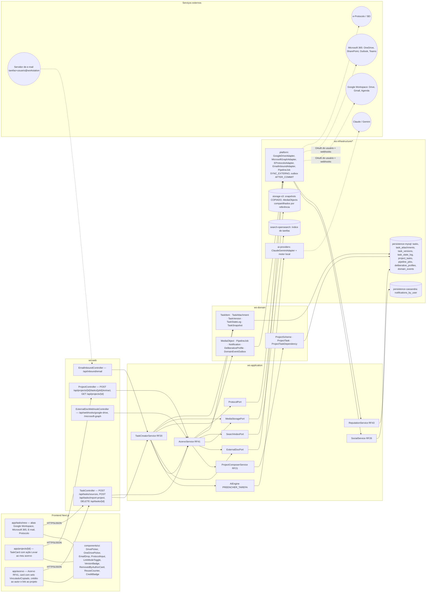

# RF23 — Importar tarefas ou projetos de outros provedores para dentro de meu perfil do Work Station
**HU:** HU23 · **Sprint (board Work Station):** Product Backlog (não comprometido na Sprint 4; candidato à Sprint 5) · **Equivalente FAI:** RF7 Peça a partir do esquema (corpo do card) + RF4 Adicionar peça — fontes externas (título) · **Aba/rota:** Criar Tarefa (`/tasks/new`, abas Google Workspace · Microsoft 365 · E-mail · Protocolo) para **importar**; ação "Levar ao meu acervo" no card de tarefa em `/projects/[id]` para **extrair**; destino Acervo de Tarefas (`/acervo`, RF41)
**Critérios de aceite cobertos:** RF23.CA01 · CA02 · CA03 · CA04 · CA05 (corpo do card — extrair tarefa de projeto + snapshot) · RF20.CA07 · RF20.CA08 · RF20.CA09 (importar de Google/Microsoft, e-mail e e-Protocolo — CAs escritos no card RF20, citados como estão) · RF23.CA06 (CA a confirmar — importar **projeto** de provedor) — regra: o **título do card** define o RF; o corpo contém os CAs RF23.CA01–05 de extração (= antigo RF23, ver `_anterior/RF23`); as fontes externas do título vêm do antigo RF20 etapa 1 (`_anterior/RF20`)

O título fala de **importar tarefas ou projetos de outros provedores**; o corpo descreve **extrair** uma tarefa de um Esquema de Projeto para o meu Acervo. Este README modela os dois caminhos, que convergem na mesma entidade `TaskItem` do meu Acervo:

| Caminho | Fonte | `SourceKind` | `linkMode` | Porta / adaptador | CAs |
|---|---|---|---|---|---|
| **Importar** — Google Workspace (Drive, Gmail, Agenda) | arquivo/mensagem externa escolhida via OAuth | GOOGLE | VINCULADO (assina mudanças → `TaskVersion`) ou COPIADO (snapshot em S3) | `ExternalDocPort` → `GoogleDriveAdapter` | RF20.CA07 |
| **Importar** — Microsoft 365 (OneDrive/SharePoint, Outlook, Teams) | idem | MICROSOFT | VINCULADO ou COPIADO | `ExternalDocPort` → `MicrosoftGraphAdapter` | RF20.CA07 |
| **Importar** — e-mail encaminhado ou .eml/.msg | mensagem | EMAIL | COPIADO | `EmailInboundAdapter` | RF20.CA08 |
| **Importar** — e-Protocolo / SEI | nº de processo | PROTOCOLO | VINCULADO (link ao sistema de origem) | `ProtocolPort` → `EProtocoloAdapter` | RF20.CA09 |
| **Importar projeto** — pasta do Drive/SharePoint ou plano do Planner/Tasks | pasta/plano | PASTA → N tarefas + `ProjectScheme` RASCUNHO | COPIADO | `ExternalDocPort` | RF23.CA06 (a confirmar) |
| **Extrair** — "Levar ao meu acervo" em projeto de terceiro | `ProjectTask` visível | EXTRAIDA_DE_PROJETO | — (anexos por referência) | `AcervoService` | RF23.CA01–CA05 |

Regras comuns: a cópia nasce `DISPONIVEL` e `PRIVADA`, herda tipo, categoria e tags; `accessClass` RESTRITO/SIGILOSO nunca vai a IA externa; o item VINCULADO ganha `TaskVersion` a cada revisão externa (webhook) e, se o usuário revoga o OAuth, vira COPIADO com o último snapshot. Quando o dono exclui uma tarefa usada em projetos de outros, cada `ProjectTask` guarda `TaskSnapshot` em `snapshotJson` e mostra "removida pelo autor" sem quebrar fases nem dependências.

## 1. Diagrama de classes

```mermaid
classDiagram
direction LR

namespace ws_domain_acervo {
  class TaskItem {
    <<entity>>
    +id: UUID
    +ownerId: UUID
    +departmentId: UUID
    +title: String
    +summary: String
    +type: TaskType
    +category: TaskCategory
    +subcategory: String
    +processTags: Set~ProcessTag~
    +natureTags: Set~NatureTag~
    +accessClass: AccessClassification
    +format: String gdoc gsheet docx msg url
    +sourceKind: SourceKind
    +sourceRef: String id Drive OneDrive messageId protocolo
    +linkMode: LinkMode
    +senderOrigin: String
    +protocolNumber: String
    +state: TaskState
    +visibility: Visibility
    +thumbnailUrl: String
    +tags: Set~String~
    +originalTaskId: UUID crédito
    +sourceProjectId: UUID
    +reuseCount: int
    +projectUsageCount: int
    +version: long
    .. +30 campos ..
  }
  class TaskAttachment {
    <<entity>>
    +id: UUID
    +taskId: UUID
    +mediaObjectId: UUID mesmo objeto, sem cópia
    +fileName: String
    +mimeType: String
    +sha256: String
    +isPrimary: boolean
  }
  class TaskVersion {
    <<entity>>
    +id: UUID
    +taskId: UUID
    +versionNumber: int
    +externalRevisionId: String
    +syncedAt: Instant
    +thumbnailUrl: String
    +changeSummary: String
    +snapshotMediaId: UUID
  }
  class TaskStateLog {
    <<entity>>
    +taskId: UUID
    +fromState: TaskState
    +toState: TaskState
    +actorId: UUID
    +reason: String
  }
  class TaskSnapshot {
    <<entity>>
    +title: String
    +type: TaskType
    +category: TaskCategory
    +thumbnailUrl: String
    +summary: String
    +ownerName: String
    +capturedAt: Instant
  }
}

namespace ws_domain_projetos {
  class ProjectScheme {
    <<entity>>
    +id: UUID
    +ownerId: UUID
    +title: String
    +origin: SchemeOrigin
    +visibility: Visibility
    +status: ProjectStatus
  }
  class ProjectTask {
    <<entity>>
    +id: UUID
    +projectId: UUID
    +taskId: UUID nullable se removida
    +phase: ProjectPhase
    +sortOrder: int
    +responsibleId: UUID
    +dueAt: LocalDate
    +snapshotJson: JSON TaskSnapshot
    +removedByAuthor: boolean
  }
  class ProjectTaskDependency {
    <<entity>>
    +predecessorProjectTaskId: UUID
    +successorProjectTaskId: UUID
    +type: String FS SS FF SF
  }
}

namespace ws_domain_plataforma_social {
  class MediaObject {
    <<entity>>
    +id: UUID
    +bucket: String
    +key: String
    +sha256: String
    +accessClass: AccessClassification
  }
  class PipelineJob {
    <<entity>>
    +type: String SYNC_EXTERNO THUMBNAIL OCR
    +targetType: String TASK
    +targetId: UUID
    +status: String
  }
  class User {
    <<entity>>
    +id: UUID
    +displayName: String
    +companyId: UUID
  }
  class Notification {
    <<entity>>
    +recipientId: UUID
    +actorId: UUID
    +type: NotificationType REMIX
    +category: String SOCIAL
    +groupKey: String
  }
  class DeliberativeProfile {
    <<entity>>
    +userId: UUID
    +periodKey: String
    +reuse: BigDecimal
    +deltaJson: JSON
  }
  class DomainEventOutbox {
    <<entity>>
    +aggregateType: String TASK
    +eventType: String TaskImported TaskExtracted TaskDeletedWithSnapshot
    +payloadJson: JSON
  }
}

namespace ws_domain_enums {
  class SourceKind {
    <<enum>>
    GOOGLE
    MICROSOFT
    EMAIL
    PROTOCOLO
    EXTRAIDA_DE_PROJETO
    ARQUIVO
    COLAR
    LINK
    FOTO
    TEXTO_IA
    REMIX
    DECIA
    AUTOPILOT
    ATA_VIVA
    DOSSIE
    EXTRACAO
  }
  class LinkMode {
    <<enum>>
    VINCULADO
    COPIADO
  }
  class TaskState {
    <<enum>>
    RASCUNHO
    DISPONIVEL
    EM_USO
    BLOQUEADA
    CONCLUIDA
    ARQUIVADA
    MODELO_PUBLICO
    OFERECIDA
  }
  class Visibility {
    <<enum>>
    PRIVADA
    DEPARTAMENTO
    EMPRESA
    PUBLICA
  }
}

namespace ws_application {
  class TaskCreatorService {
    <<service>>
    +createFromExternal(userId, provider, ref, linkMode) TaskItem
    +createFromEmail(userId, MailMessage, attachmentsMode) TaskItem
    +createFromProtocol(userId, protocolNumber) TaskItem
    +importFolderAsProject(userId, provider, folderRef) ProjectScheme CA06 a confirmar
  }
  class AcervoService {
    <<service>>
    +extractToAcervo(userId, projectId, projectTaskId) TaskItem
    +canExtract(viewer, project, task) boolean visibilidade não PRIVADA e projeto visível
    +deleteTask(ownerId, taskId) DeleteResult
    +syncLinkedVersion(taskId, externalRevision) TaskVersion
    +convertLinkToSnapshot(taskId) TaskVersion
    -copyAttachmentsByReference(source, copy)
  }
  class ProjectComposerService {
    <<service>>
    +snapshotProjectTasks(taskId) int
    +renderRemovedByAuthor(projectId) List~ProjectTask~
  }
  class SocialService {
    <<service>>
    +notifyReuse(originalOwnerId, actorId, taskId)
  }
  class ReputationService {
    <<service>>
    +onTaskReused(originalOwnerId) atualiza métrica reuse
  }
  class ExternalDocPort {
    <<port>>
    +pick(provider, oauthToken) ExternalDoc
    +fetch(provider, ref, mode) ExternalDoc
    +listFolder(provider, folderRef) List~ExternalDoc~
    +subscribeChanges(provider, ref) Subscription
    +revoke(provider, ref)
  }
  class ProtocolPort {
    <<port>>
    +lookup(protocolNumber) ProtocolMetadata
  }
  class MediaStoragePort {
    <<port>>
    +put(stream, mimeType, accessClass) MediaObject
    +presign(mediaId) URL
  }
  class SearchIndexPort {
    <<port>>
    +indexTask(TaskItem)
    +removeTask(taskId)
  }
}

namespace ws_web {
  class TaskController {
    <<controller>>
    +POST_api_tasks_sources(provider, ref, linkMode)
    +POST_api_tasks_import_project(provider, folderRef)
    +DELETE_api_tasks_id()
  }
  class ProjectController {
    <<controller>>
    +POST_api_projects_id_tasks_ptId_extract()
    +GET_api_projects_id()
  }
  class ExternalDocWebhookController {
    <<controller>>
    +POST_api_webhooks_google_drive()
    +POST_api_webhooks_microsoft_graph()
  }
  class EmailInboundController {
    <<controller>>
    +POST_api_inbound_email(MailMessage)
  }
}

namespace ws_infrastructure {
  class GoogleDriveAdapter {
    <<adapter>>
  }
  class MicrosoftGraphAdapter {
    <<adapter>>
  }
  class EProtocoloAdapter {
    <<adapter>>
  }
  class EmailInboundAdapter {
    <<adapter>>
  }
  class S3StorageAdapter {
    <<adapter>>
  }
  class OpenSearchIndexAdapter {
    <<adapter>>
  }
}

ProjectScheme "1" --> "*" ProjectTask
ProjectTask "*" --> "0..1" TaskItem : taskId nulo após exclusão
ProjectTask "1" --> "0..1" TaskSnapshot : snapshotJson embutido
ProjectTaskDependency "*" --> "1" ProjectTask : predecessor
ProjectTaskDependency "*" --> "1" ProjectTask : successor
TaskItem "*" --> "0..1" TaskItem : originalTaskId crédito ao autor
TaskItem "*" --> "0..1" ProjectScheme : sourceProjectId
TaskItem "1" --> "*" TaskAttachment
TaskItem "1" --> "*" TaskVersion : só se VINCULADO
TaskItem "1" --> "*" TaskStateLog
TaskItem "*" --> "1" User : ownerId
TaskAttachment "*" --> "1" MediaObject : referência compartilhada
TaskVersion "*" --> "0..1" MediaObject : snapshotMediaId
PipelineJob "*" --> "1" TaskItem : SYNC_EXTERNO
Notification "*" --> "1" User : recipientId dono original
DeliberativeProfile "*" --> "1" User : userId
TaskItem --> SourceKind
TaskItem --> LinkMode
TaskItem --> TaskState
TaskItem --> Visibility

TaskController ..> TaskCreatorService : importar
TaskController ..> AcervoService : delete
ProjectController ..> AcervoService : extract
ExternalDocWebhookController ..> AcervoService : syncLinkedVersion
EmailInboundController ..> TaskCreatorService : createFromEmail
TaskCreatorService ..> ExternalDocPort
TaskCreatorService ..> ProtocolPort
TaskCreatorService ..> MediaStoragePort
TaskCreatorService ..> AcervoService : addToAcervo
AcervoService ..> ProjectComposerService : snapshot antes de excluir
AcervoService ..> ExternalDocPort : revoke e fetch
AcervoService ..> SearchIndexPort
AcervoService ..> MediaStoragePort
AcervoService ..> DomainEventOutbox : TaskImported TaskExtracted
DomainEventOutbox ..> SocialService : AFTER_COMMIT
DomainEventOutbox ..> ReputationService : AFTER_COMMIT
GoogleDriveAdapter ..|> ExternalDocPort
MicrosoftGraphAdapter ..|> ExternalDocPort
EProtocoloAdapter ..|> ProtocolPort
EmailInboundAdapter ..> EmailInboundController : entrega MailMessage
S3StorageAdapter ..|> MediaStoragePort
OpenSearchIndexAdapter ..|> SearchIndexPort

note for TaskItem "importada: sourceKind GOOGLE MICROSOFT EMAIL PROTOCOLO, sourceRef, linkMode (RF20.CA07–09) · extraída: sourceKind EXTRAIDA_DE_PROJETO, originalTaskId, sourceProjectId, state DISPONIVEL, visibility PRIVADA (CA01, CA02) · original: reuseCount + 1 (CA04)"
note for TaskVersion "tabela task_versions · 1 linha por revisão externa do item VINCULADO · revogar OAuth converte em COPIADO com último snapshot (RF20.CA07)"
note for TaskAttachment "cópia extraída aponta para o mesmo mediaObjectId — referência, não duplicação de arquivo (CA02)"
note for ProjectTask "exclusão pelo dono: snapshotJson preenchido, taskId nulo, removedByAuthor true — fases e dependências intactas (CA03)"
note for AcervoService "canExtract falso para visibility PRIVADA: ação oculta na tela e 403 na API (CA05)"
```

## 2. Diagrama de atividades

## 3. Diagrama de sequência

## 4. Máquina de estados

Entidade central: **`TaskItem.state`** (enum `TaskState`). Tanto a tarefa **importada** de provedor quanto a **cópia extraída** nascem diretamente em `DISPONIVEL`. Dois estados derivados completam o RF: `TaskItem.linkMode` (VINCULADO → COPIADO ao revogar OAuth, RF20.CA07) e o marcador `ProjectTask.removedByAuthor` (CA03).

## 5. Diagrama de componentes

## 6. Rastreabilidade

| CA | Elemento do diagrama (classe / passo / mensagem / transição / componente) |
|---|---|
| RF23.CA01 | `TaskItem.sourceKind EXTRAIDA_DE_PROJETO / originalTaskId / sourceProjectId`, enum `SourceKind`, `AcervoService.extractToAcervo` · Atividades `U3 → W3 (não) → A12 → A15 → P3` · Sequência `POST /api/projects/77/tasks/PT9/extract` → `INSERT tasks (… EXTRAIDA_DE_PROJETO, originalTaskId T9, sourceProjectId 77 …)` · Transição `[*] → DISPONIVEL` da *Cópia* · Componentes `TaskCard`, `CreditBadge`, `ProjectController /extract` |
| RF23.CA02 | `TaskAttachment.mediaObjectId` (nota "referência, não duplicação"), `MediaObject`, `AcervoService.copyAttachmentsByReference`, enums `TaskState.DISPONIVEL`, `Visibility.PRIVADA` · Atividades `A16` · Sequência `INSERT task_attachments (mediaObjectId igual ao da original)` e `state DISPONIVEL, visibility PRIVADA, type, category, tags herdados` · Nota da *Cópia* · Componente `storage-s3 (compartilhados por referência)` |
| RF23.CA03 | `ProjectTask.snapshotJson / removedByAuthor / taskId nullable`, `TaskSnapshot`, `ProjectTaskDependency`, `ProjectComposerService.snapshotProjectTasks/renderRemovedByAuthor`, `AcervoService.deleteTask` · Atividades `U4 → A19 → A20 → A21 → P5 → A22 → W6` · Sequência bloco "Exclusão pelo dono" → `alt usada em projetos de terceiros` → `UPDATE project_tasks SET snapshotJson …, taskId = NULL, removedByAuthor = true` + nota "fases … intactos" → card removida pelo autor · Estados *Original → EXCLUIDA* e *ProjectTask → RemovidaPeloAutor* · Componente `RemovedByAuthorCard` |
| RF23.CA04 | `TaskItem.reuseCount`, `DeliberativeProfile.reuse`, `ReputationService.onTaskReused`, `Notification` · Atividades `A17 → P3`, `A18 → P6 → W5` · Sequência `UPDATE tasks SET reuseCount + 1`, `UPDATE deliberative_profiles SET reuse`, "reutilizada N vezes" · Transição `EM_USO_ORIG → EM_USO_ORIG : reuseCount + 1` · Componentes `ReuseCounter`, `ReputationService RF43` |
| RF23.CA05 | `AcervoService.canExtract` (nota PRIVADA → oculta + 403) · Atividades `W3 (sim) → W4` (ação oculta) e `A13 (não) → A14 403 ACESSO_NEGADO` · Sequência `alt tarefa PRIVADA ou projeto invisível → 403 ACESSO_NEGADO` · Nota da *Cópia* |
| RF20.CA07 (Google/Microsoft vinculado ou copiado) | Classes `TaskVersion`, `TaskItem.linkMode/sourceRef/format`, enum `LinkMode`, `ExternalDocPort.fetch/subscribeChanges/revoke`, `TaskCreatorService.createFromExternal`, `AcervoService.syncLinkedVersion/convertLinkToSnapshot`, `ExternalDocWebhookController`, `GoogleDriveAdapter`, `MicrosoftGraphAdapter`, `PipelineJob SYNC_EXTERNO` · Atividades `U1 → W1 → U2 → A1 → A2 → A4 → A5/A6`, `A10 → W7`, `U5 → A11` · Sequência bloco "Importar de provedor externo" (`POST /api/tasks/sources`, `alt OAuth expirado → 403 ACESSO_NEGADO`, `INSERT task_versions`, nota do webhook e da revogação) · Estados *Importada*: `VINC → VINC` (TaskVersion + 1), `VINC → COP` (OAuth revogado) · Componentes `DrivePicker`, `OneDrivePicker`, `LinkModeToggle`, `VersionBadge`, `C3`, `I5 → E1/E2` |
| RF20.CA08 (e-mail) | `TaskCreatorService.createFromEmail`, `EmailInboundController`, `EmailInboundAdapter`, enum `SourceKind.EMAIL`, `TaskItem.senderOrigin/sourceRef` · Atividades `U1 → W1 (EmailDrop) → A1` · Componentes `EmailDrop`, `C4`, `E4 → C4` |
| RF20.CA09 (protocolo) | `TaskCreatorService.createFromProtocol`, `ProtocolPort.lookup`, `EProtocoloAdapter`, `TaskItem.protocolNumber`, enum `SourceKind.PROTOCOLO` · Atividades `U1 → W1 (ProtocolInput) → A1` · Componentes `ProtocolInput`, `P2 → I5 → E3` |
| RF23.CA06 (a confirmar — importar **projeto** de provedor) | `TaskCreatorService.importFolderAsProject`, `ExternalDocPort.listFolder`, `TaskController POST /api/tasks/import-project`, `ProjectScheme` RASCUNHO com uma `ProjectTask` por arquivo da pasta (ou item do plano Planner/Google Tasks) · Sem passo próprio nos diagramas 2–4 até confirmação do CA |

> Dúvidas para `docs/DECISOES.md`: (1) o título cita **projetos** de outros provedores, mas nenhum CA do board descreve essa importação — RF23.CA06 acima é proposta (pasta Drive/SharePoint → PASTA explodida em tarefas + `ProjectScheme` RASCUNHO; Planner/Google Tasks → `ProjectTask` por item); (2) `NotificationType` não tem valor para "tarefa reutilizada" — usei `REMIX` (existente); alternativa é acrescentar `TAREFA_REUTILIZADA` à TAXONOMIA; (3) eventos `TaskImported`, `TaskExtracted`, `TaskDeletedWithSnapshot` e o erro `422 PROVEDOR_INDISPONIVEL` são propostas; (4) a importação de provedores continua sendo também parte do RF20 (Criador de Tarefas) — o RF23 reutiliza `TaskCreatorService` e não duplica o formulário.
