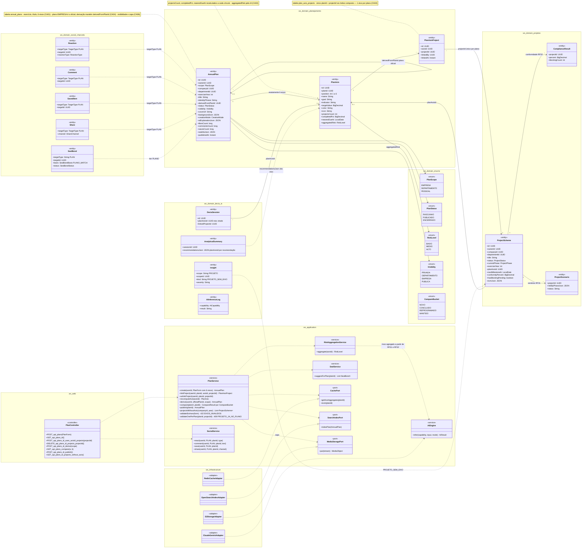
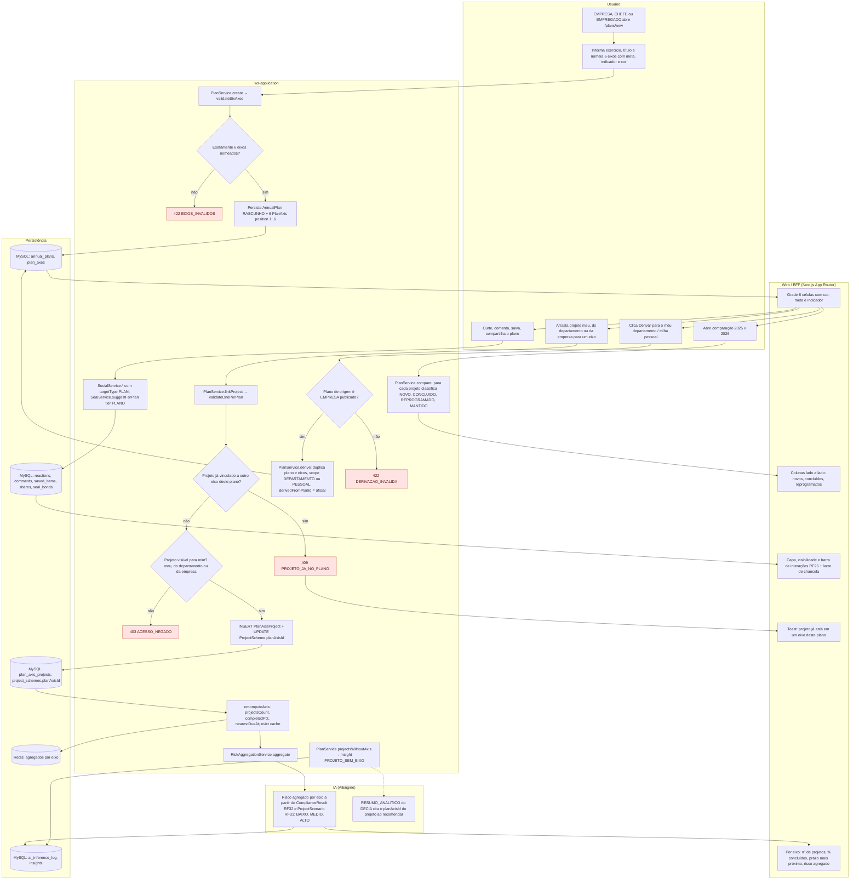
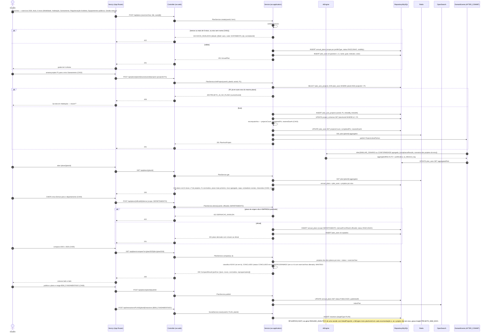
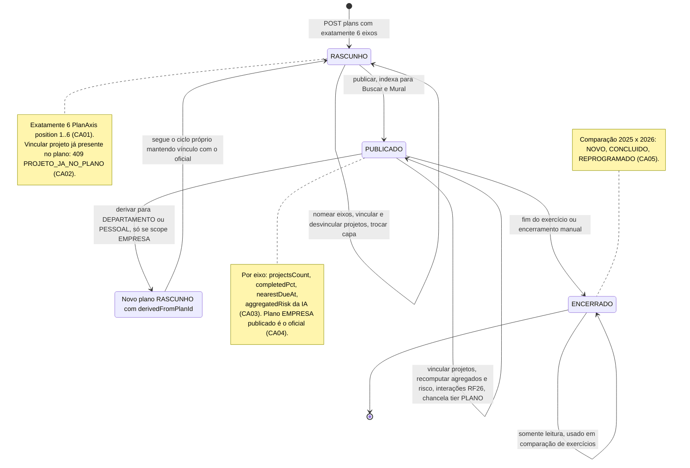
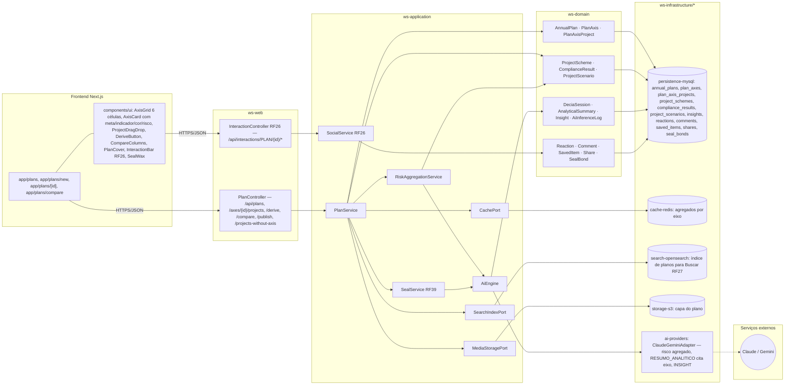

# RF24 — Criar o Plano Anual / Trilha Estratégica (6 eixos) e vincular projetos a cada eixo, com comparação entre exercícios
**HU:** HU24 · **Sprint (board Work Station):** Product Backlog (não comprometido na Sprint 4; candidato à Sprint 5) · **Equivalente FAI:** RF13 DNA de Estilo (6 células) · **Aba/rota:** Plano Anual (`/plans`, `/plans/new`, `/plans/[id]`, comparação em `/plans/compare?a=&b=`)
**Critérios de aceite cobertos:** RF24.CA01 · CA02 · CA03 · CA04 · CA05 · CA06 · CA07

O **Plano Anual** (`AnnualPlan`, = DNA de Estilo) é o conjunto de **6 eixos estratégicos** (`PlanAxis`, position 1..6, cada um com meta, indicador e cor) que recebem projetos (`PlanAxisProject`, único por plano+projeto — um projeto fica em **1 eixo por plano**). A EMPRESA publica o plano oficial (`scope = EMPRESA`); chefes e empregados **derivam** (duplicam) o plano para DEPARTAMENTO/PESSOAL mantendo `derivedFromPlanId`. Cada eixo agrega nº de projetos, % concluídos, prazo mais próximo e **risco agregado** (IA, a partir de `ComplianceResult` RF32 e `ProjectScenario` RF31). A comparação lado a lado de dois exercícios classifica projetos em **novos, concluídos e reprogramados**. O plano recebe interações sociais (RF26) e chancela tier PLANO (RF39); a IA do DECIA cita `planAxisId` nas recomendações (RF11/RF29) e sinaliza projetos sem eixo (`Insight`).

## 1. Diagrama de classes

## 2. Diagrama de atividades

## 3. Diagrama de sequência

## 4. Máquina de estados

Entidade central: **`AnnualPlan.status`** (RASCUNHO · PUBLICADO · ENCERRADO). A derivação (CA04) nasce de um plano EMPRESA **PUBLICADO** e cria um novo plano RASCUNHO com `derivedFromPlanId`.

## 5. Diagrama de componentes

## 6. Rastreabilidade

| CA | Elemento do diagrama (classe / passo / mensagem / transição / componente) |
|---|---|
| RF24.CA01 | `AnnualPlan` (exerciseYear, title), `PlanAxis` (position 1..6, name, goal, indicator, color), relação `AnnualPlan "1" --> "6" PlanAxis`, `PlanService.create/validateSixAxes` · Atividades `U2 → A1 → A2 → A3 422 EIXOS_INVALIDOS / A4 → P1 → W1` · Sequência `POST /api/plans` → `alt … 422 EIXOS_INVALIDOS` / `INSERT plan_axes x6` · Transição `[*] → RASCUNHO` + nota · Componentes `AxisGrid 6 células`, `AxisCard` |
| RF24.CA02 | `PlanAxisProject` (nota índice único planId + projectId), `ProjectScheme.planAxisId`, `PlanService.linkProject/validateOnePerPlan` · Atividades `U3 → A5 → A6 → A7 409 PROJETO_JA_NO_PLANO`, `A8 → A9 403`, `A10 → P2` · Sequência `POST /api/plans/{planId}/axes/{axisId}/projects` → `alt P1 já em outro eixo → 409` / `INSERT plan_axis_projects` + `UPDATE project_schemes SET planAxisId` · Nota de RASCUNHO · Componente `ProjectDragDrop` |
| RF24.CA03 | `PlanAxis.projectsCount/completedPct/nearestDueAt/aggregatedRisk`, enum `RiskLevel`, `PlanService.recomputeAxis`, `RiskAggregationService.aggregate`, `ComplianceResult`, `ProjectScenario`, `CachePort` · Atividades `A11 → P3`, `A12 → I1 → W2` · Sequência `recomputeAxis …`, `DE->>AI infer(… complianceResults, scenarios)` → `UPDATE plan_axes SET aggregatedRisk`, `GET /api/plans/{planId}` · Nota de PUBLICADO · Componentes `cache-redis`, `ai-providers` |
| RF24.CA04 | `AnnualPlan.derivedFromPlanId/scope`, enum `PlanScope`, `PlanService.derive` · Atividades `U4 → A14 → A15 422 / A13 → P1` · Sequência `POST /api/plans/{officialId}/derive` → `alt não é EMPRESA publicado → 422 DERIVACAO_INVALIDA` / `INSERT annual_plans (scope DEPARTAMENTO, derivedFromPlanId …)` · Transição `PUBLICADO → DERIVADO → RASCUNHO` · Componente `DeriveButton` |
| RF24.CA05 | Enum `CompareBucket` (NOVO, CONCLUIDO, REPROGRAMADO, MANTIDO), `PlanService.compare` · Atividades `U5 → A16 → W4` · Sequência `GET /api/plans/compare?a=&b=` → classificação → `CompareResult {porEixo …}` · Nota de ENCERRADO · Componentes `app/plans/compare`, `CompareColumns` |
| RF24.CA06 | Classes `Reaction/Comment/SavedItem/Share` (targetType PLAN), `SealBond` (tier PLANO, PLANO_MATCH), `AnnualPlan.visibility/coverUrl/likesCount…`, `SocialService`, `SealService.suggestForPlan`, `MediaStoragePort` · Atividades `U6 → A17 → P5 → W5` · Sequência `POST /api/plans/{planId}/publish` + `POST /api/interactions/PLAN/{planId}/reactions` · Transição `PUBLICADO → PUBLICADO : interações RF26, chancela tier PLANO` · Componentes `PlanCover`, `InteractionBar RF26`, `SealWax`, `InteractionController RF26`, `storage-s3` |
| RF24.CA07 | `DeciaSession.planAxisId`, `AnalyticalSummary.recommendationsJson (planAxisId)`, `Insight PROJETO_SEM_EIXO`, `PlanService.projectsWithoutAxis` · Atividades `A18 → P4`, `I2` · Sequência nota final "RF11/RF29 (CA07) … inclui planAxisId em cada recomendação … Insight PROJETO_SEM_EIXO" · Componentes `PlanController /projects-without-axis`, `ai-providers RESUMO_ANALITICO cita eixo` |
