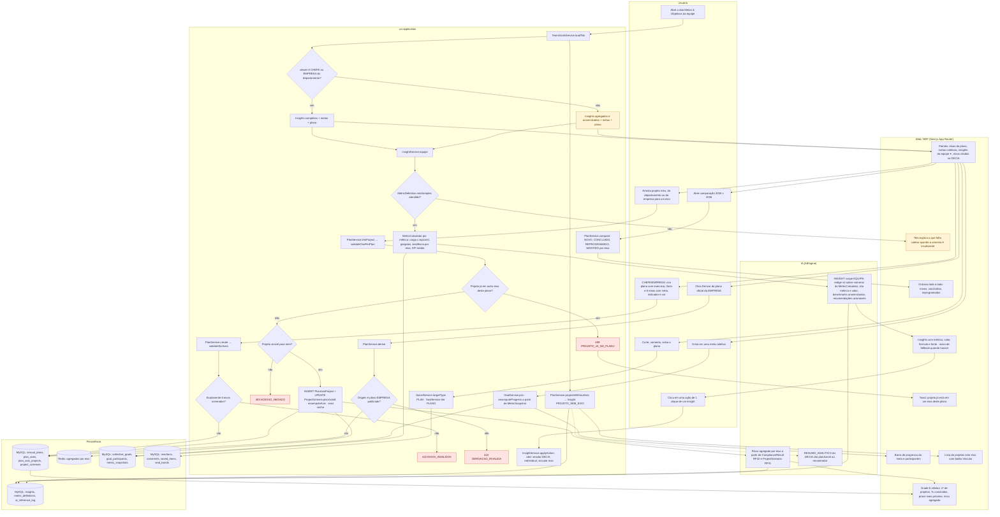
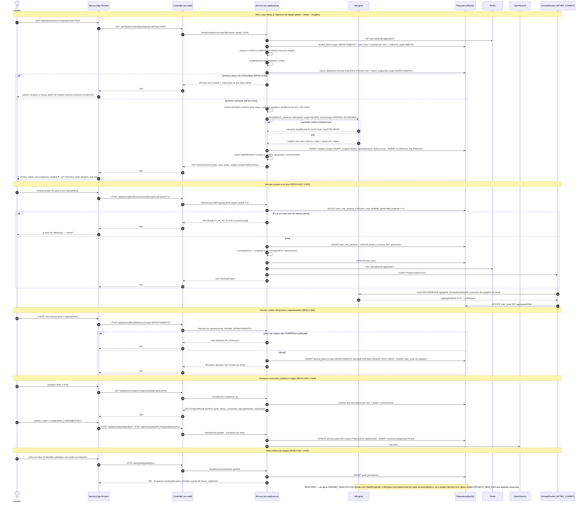
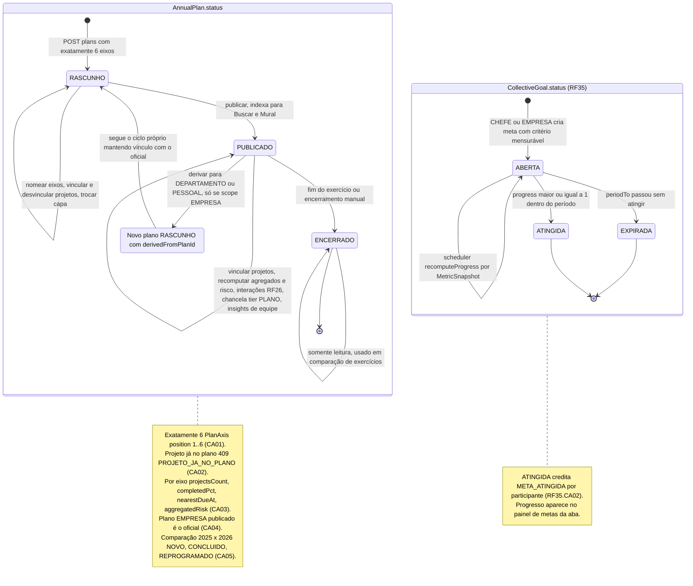
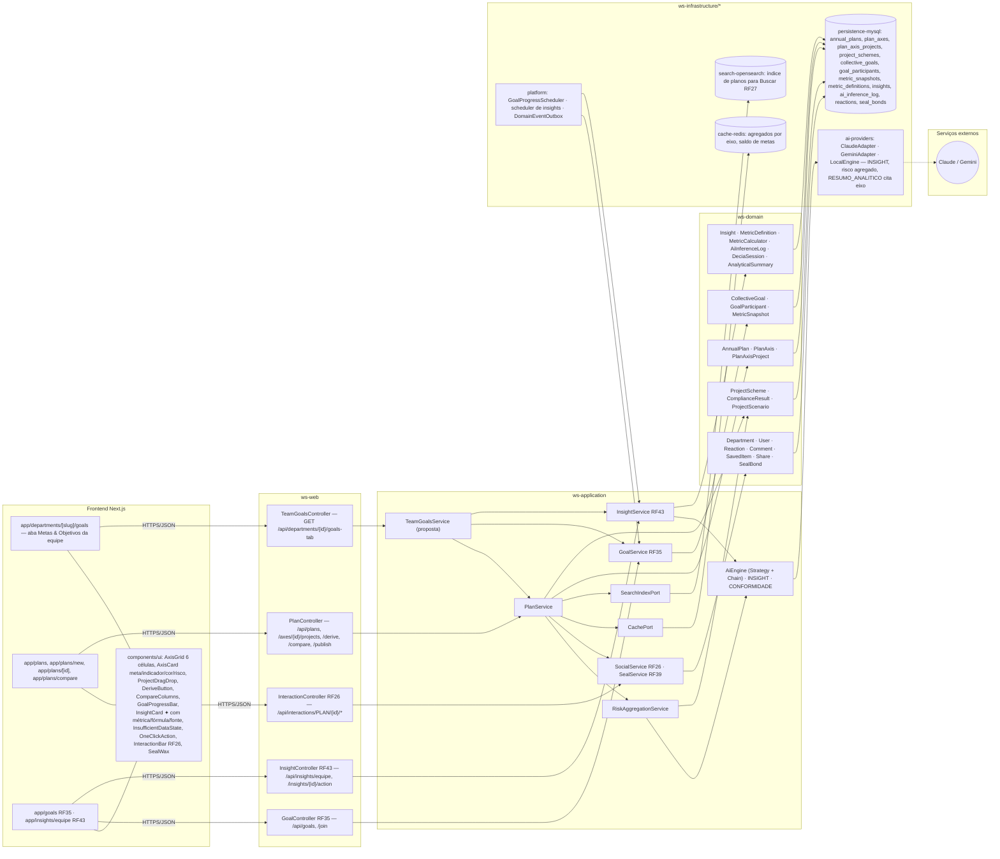

# RF24 — Visualizar a aba metas & objetivos de minha equipe com insights analíticos gerados por IA
**HU:** HU24 · **Sprint (board Work Station):** Product Backlog (não comprometido na Sprint 4; candidato à Sprint 5) · **Equivalente FAI:** RF13 DNA de Estilo (6 células) · **Aba/rota:** Plano Anual (`/plans`, `/plans/new`, `/plans/[id]`, `/plans/compare?a=&b=`) + aba **Metas & Objetivos** da equipe (`/departments/[slug]/goals`, proposta) que reúne eixos do plano, metas coletivas (`/goals`, RF35) e Insights › Equipe (`/insights/equipe`, RF43)
**Critérios de aceite cobertos:** RF24.CA01 · CA02 · CA03 · CA04 · CA05 · CA06 · CA07 (corpo do card — Plano Anual) · RF35.CA01 · RF35.CA02 (metas coletivas, citados como estão) · RF43.CA14 · RF43.CA15 (insights de equipe, citados como estão) — regra: o **título do card** define o RF; o corpo contém os CAs RF24.CA01–07 do Plano Anual (= `_anterior/RF24`); o título acrescenta "da equipe" e "insights da IA", cobertos pelos CAs do RF35 e do RF43 §4

A aba **Metas & Objetivos** é a visão da **equipe** (departamento) sobre três fontes já modeladas: (1) o **Plano Anual** (`AnnualPlan` = DNA de Estilo, 6 `PlanAxis` com meta, indicador e cor, projetos ligados por `PlanAxisProject`, derivação do plano oficial da EMPRESA, comparação entre exercícios); (2) as **metas coletivas** (`CollectiveGoal`/`GoalParticipant`, RF35) com progresso calculado de `MetricSnapshot`; (3) os **insights de equipe** (`Insight` com `scope = EQUIPE`, RF43 §4) — carga e balanceamento, gargalos, tendência por eixo, recomendações acionáveis — redigidos pela `AiEngine` **somente sobre números** do `MetricCalculator`, com amostra mínima (`MetricDefinition.minSamples`) e benchmarks anonimizados. CHEFE e EMPRESA veem a aba completa; EMPREGADO vê o plano do departamento, as metas em que pode entrar e os insights **agregados** (nunca nominais, RF45.CA10).

| Painel da aba | Entidades | Quem vê | CAs |
|---|---|---|---|
| Eixos do plano (grade 6 células) | `AnnualPlan`, `PlanAxis`, `PlanAxisProject`, `ProjectScheme.planAxisId` | todos da equipe | RF24.CA01–CA04 |
| Comparar exercícios | `AnnualPlan` ENCERRADO × PUBLICADO, enum `CompareBucket` | todos da equipe | RF24.CA05 |
| Social e chancela do plano | `Reaction`, `Comment`, `SavedItem`, `Share`, `SealBond` tier PLANO | todos | RF24.CA06 |
| Metas coletivas | `CollectiveGoal`, `GoalParticipant`, `MetricSnapshot` | todos (criar: EMPRESA/CHEFE) | RF35.CA01, CA02 |
| Insights da equipe ✦ | `Insight` EQUIPE, `MetricDefinition`, `MetricSnapshot`, `AiInferenceLog` | CHEFE/EMPRESA completo, EMPREGADO agregado | RF43.CA14, CA15 |
| Eixo citado pelo DECIA | `DeciaSession.planAxisId`, `AnalyticalSummary.recommendationsJson`, `Insight PROJETO_SEM_EIXO` | todos | RF24.CA07 |

## 1. Diagrama de classes

```mermaid
classDiagram
direction LR

namespace ws_domain_planejamento {
  class AnnualPlan {
    <<entity>>
    +id: UUID
    +ownerId: UUID
    +scope: PlanScope
    +companyId: UUID
    +departmentId: UUID
    +exerciseYear: int
    +title: String
    +identityPhrase: String
    +derivedFromPlanId: UUID
    +status: PlanStatus
    +visibility: Visibility
    +coverUrl: String
    +creationMode: CreationMode
    +aiExplanationJson: JSON
    +sealIdsJson: JSON
    +publishedAt: Instant
    .. +6 campos ..
  }
  class PlanAxis {
    <<entity>>
    +id: UUID
    +planId: UUID
    +position: int 1 a 6
    +name: String
    +goal: String
    +indicator: String
    +targetValue: BigDecimal
    +color: String
    +icon: String
    +projectsCount: int
    +completedPct: BigDecimal
    +nearestDueAt: LocalDate
    +aggregatedRisk: RiskLevel
  }
  class PlanAxisProject {
    <<entity>>
    +id: UUID
    +axisId: UUID
    +projectId: UUID
    +linkedBy: UUID
    +linkedAt: Instant
  }
}

namespace ws_domain_projetos {
  class ProjectScheme {
    <<entity>>
    +id: UUID
    +ownerId: UUID
    +departmentId: UUID
    +title: String
    +status: ProjectStatus
    +currentPhase: ProjectPhase
    +exerciseYear: int
    +planAxisId: UUID
    +nextMilestoneAt: LocalDate
    +conformityPercent: BigDecimal
    +evmJson: JSON
  }
  class ComplianceResult {
    <<entity>>
    +projectId: UUID
    +percent: BigDecimal
    +blockingCount: int
  }
  class ProjectScenario {
    <<entity>>
    +projectId: UUID
    +riskByPhaseJson: JSON
  }
}

namespace ws_domain_gamificacao {
  class CollectiveGoal {
    <<entity>>
    +id: UUID
    +creatorId: UUID
    +companyId: UUID
    +departmentId: UUID
    +title: String
    +criterionJson: JSON metricCode operator target
    +periodFrom: LocalDate
    +periodTo: LocalDate
    +rewardPointsPerParticipant: int
    +progress: BigDecimal 0 a 1
    +status: GoalStatus
    +achievedAt: Instant
  }
  class GoalParticipant {
    <<entity>>
    +goalId: UUID
    +userId: UUID
    +joinedAt: Instant
    +contributionJson: JSON
  }
}

namespace ws_domain_ia {
  class Insight {
    <<entity>>
    +id: UUID
    +scope: InsightScope EQUIPE
    +scopeId: UUID departmentId
    +kind: String CARGA GARGALO TENDENCIA_EIXO PROJETO_SEM_EIXO
    +title: String
    +bodyMd: String
    +metricRefsJson: JSON metricCode value formula source proxy
    +actionsJson: JSON 1 clique
    +severity: String
    +aiInferenceId: UUID
    +dismissedAt: Instant
    +generatedAt: Instant
  }
  class MetricDefinition {
    <<entity>>
    +code: String
    +domain: MetricDomain EQUIPES PROJETOS
    +formula: String
    +proxyNote: String
    +minSamples: int
  }
  class MetricSnapshot {
    <<entity>>
    +metricCode: String
    +scope: MetricScope DEPARTAMENTO
    +scopeId: UUID
    +periodStart: LocalDate
    +periodEnd: LocalDate
    +value: BigDecimal
  }
  class AiInferenceLog {
    <<entity>>
    +capability: AiCapability INSIGHT
    +mode: AiMode
    +result: InferenceResult
    +fallbackUsed: boolean
  }
  class DeciaSession {
    <<entity>>
    +id: UUID
    +planAxisId: UUID eixo citado
    +linkedProjectId: UUID
  }
  class AnalyticalSummary {
    <<entity>>
    +sessionId: UUID
    +recommendationsJson: JSON planAxisId por recomendação
  }
}

namespace ws_domain_identidade_social {
  class Department {
    <<entity>>
    +id: UUID
    +companyId: UUID
    +name: String
    +headUserId: UUID
  }
  class User {
    <<entity>>
    +id: UUID
    +profileType: ProfileType
    +departmentId: UUID
  }
  class Reaction {
    <<entity>>
    +targetType: TargetType PLAN
    +targetId: UUID
    +reactionType: ReactionType
  }
  class SealBond {
    <<entity>>
    +targetType: String PLAN
    +targetId: UUID
    +basis: SealBondBasis PLANO_MATCH
    +status: SealBondStatus
  }
}

namespace ws_domain_enums {
  class PlanScope {
    <<enum>>
    EMPRESA
    DEPARTAMENTO
    PESSOAL
  }
  class PlanStatus {
    <<enum>>
    RASCUNHO
    PUBLICADO
    ENCERRADO
  }
  class RiskLevel {
    <<enum>>
    BAIXO
    MEDIO
    ALTO
  }
  class CompareBucket {
    <<enum>>
    NOVO
    CONCLUIDO
    REPROGRAMADO
    MANTIDO
  }
  class GoalStatus {
    <<enum>>
    ABERTA
    ATINGIDA
    EXPIRADA
  }
  class InsightScope {
    <<enum>>
    ACERVO
    PERFIL
    EQUIPE
    PROJETO
  }
}

namespace ws_application {
  class PlanService {
    <<service>>
    +create(userId, PlanForm com 6 eixos) AnnualPlan
    +linkProject(userId, planId, axisId, projectId) PlanAxisProject
    +recomputeAxis(axisId) PlanAxis
    +derive(userId, officialPlanId, scope) AnnualPlan
    +compare(planA, planB) CompareResult por CompareBucket
    +publish(planId) AnnualPlan
    +projectsWithoutAxis(departmentId, year) List~ProjectScheme~
    -validateSixAxes(form) 422 EIXOS_INVALIDOS
    -validateOnePerPlan(planId, projectId) 409 PROJETO_JA_NO_PLANO
  }
  class TeamGoalsService {
    <<service>>
    +loadTab(viewer, departmentId, year) TeamGoalsView
    +visibleInsights(viewer, departmentId) List~Insight~ agregado para EMPREGADO
  }
  class RiskAggregationService {
    <<service>>
    +aggregate(axisId) RiskLevel
  }
  class GoalService {
    <<service>>
    +create(issuerId, form) CollectiveGoal
    +join(userId, goalId) GoalParticipant
    +recomputeProgress(goalId) CollectiveGoal
  }
  class InsightService {
    <<service>>
    +equipe(departmentId, viewer) List~Insight~
    +applyAction(insightId, actionCode)
  }
  class MetricCalculator {
    <<service>>
    +compute(metricCode, scope, period) MetricSnapshot
  }
  class SocialService {
    <<service>>
    +react(userId, PLAN, planId, type)
  }
  class SealService {
    <<service>>
    +suggestForPlan(planId) List~SealBond~
  }
  class AiEngine {
    <<service>>
    +run(capability, input, accessClass, mode) AiResult
  }
  class CachePort {
    <<port>>
    +getAxisAggregates(planId)
    +evict(planId)
  }
  class SearchIndexPort {
    <<port>>
    +indexPlan(AnnualPlan)
  }
}

namespace ws_web {
  class PlanController {
    <<controller>>
    +POST_api_plans(PlanForm)
    +GET_api_plans_id()
    +POST_api_plans_id_axes_axisId_projects(projectId)
    +POST_api_plans_id_derive(scope)
    +GET_api_plans_compare(a, b)
    +POST_api_plans_id_publish()
  }
  class TeamGoalsController {
    <<controller>>
    +GET_api_departments_id_goals_tab(year)
  }
  class GoalController {
    <<controller>>
    +POST_api_goals(body)
    +POST_api_goals_id_join()
  }
  class InsightController {
    <<controller>>
    +GET_api_insights_equipe(dept)
    +POST_api_insights_id_action()
  }
}

namespace ws_infrastructure {
  class RedisCacheAdapter {
    <<adapter>>
  }
  class ClaudeGeminiAdapter {
    <<adapter>>
  }
  class OpenSearchIndexAdapter {
    <<adapter>>
  }
}

AnnualPlan "1" --> "6" PlanAxis : exatamente 6 eixos
AnnualPlan "*" --> "0..1" AnnualPlan : derivedFromPlanId plano oficial
AnnualPlan "*" --> "0..1" Department : departmentId
PlanAxis "1" --> "*" PlanAxisProject
PlanAxisProject "*" --> "1" ProjectScheme : projectId único por plano
ProjectScheme "*" --> "0..1" PlanAxis : planAxisId
ProjectScheme "1" --> "*" ComplianceResult : conformidade RF32
ProjectScheme "1" --> "*" ProjectScenario : cenários RF31
CollectiveGoal "1" --> "*" GoalParticipant
CollectiveGoal "*" --> "1" Department : departmentId
CollectiveGoal ..> MetricSnapshot : criterionJson metricCode
Insight "*" --> "1" Department : scopeId quando EQUIPE
Insight ..> MetricDefinition : metricRefsJson
Insight ..> AiInferenceLog : aiInferenceId
MetricSnapshot ..> MetricDefinition : metricCode
DeciaSession "*" --> "0..1" PlanAxis : planAxisId
AnalyticalSummary ..> PlanAxis : recommendationsJson cita eixo
Reaction ..> AnnualPlan : targetType PLAN
SealBond ..> AnnualPlan : tier PLANO
User "*" --> "0..1" Department : lotação
AnnualPlan --> PlanScope
AnnualPlan --> PlanStatus
PlanAxis --> RiskLevel : aggregatedRisk
CollectiveGoal --> GoalStatus
Insight --> InsightScope

TeamGoalsController ..> TeamGoalsService
TeamGoalsService ..> PlanService
TeamGoalsService ..> GoalService
TeamGoalsService ..> InsightService
PlanController ..> PlanService
GoalController ..> GoalService
InsightController ..> InsightService
PlanService ..> RiskAggregationService
PlanService ..> SealService
PlanService ..> SocialService
PlanService ..> CachePort
PlanService ..> SearchIndexPort
GoalService ..> MetricCalculator : progresso
InsightService ..> MetricCalculator : só números calculados
InsightService ..> AiEngine : INSIGHT scope EQUIPE
RiskAggregationService ..> AiEngine : risco agregado RF31 e RF32
RedisCacheAdapter ..|> CachePort
OpenSearchIndexAdapter ..|> SearchIndexPort
ClaudeGeminiAdapter ..> AiEngine

note for AnnualPlan "tabela annual_plans · exercício, título, 6 eixos (CA01) · plano EMPRESA é o oficial, derivação mantém derivedFromPlanId (CA04) · visibilidade e capa (CA06)"
note for PlanAxisProject "tabela plan_axis_projects · único planId + projectId — 1 eixo por plano (CA02)"
note for PlanAxis "projectsCount, completedPct, nearestDueAt recalculados a cada vínculo · aggregatedRisk pela IA (CA03)"
note for Insight "tabela insights · scope EQUIPE (RF43.CA14) · gerado só quando MetricDefinition.minSamples é atendido (RF43.CA15) · EMPREGADO recebe versão agregada e anonimizada"
note for TeamGoalsService "proposta: compõe a aba Metas & Objetivos a partir de PlanService, GoalService e InsightService — não possui tabela própria"
```

## 2. Diagrama de atividades

## 3. Diagrama de sequência

## 4. Máquina de estados

Entidade central: **`AnnualPlan.status`** (`PlanStatus` RASCUNHO · PUBLICADO · ENCERRADO). A derivação (CA04) nasce de um plano EMPRESA **PUBLICADO** e cria um novo plano RASCUNHO com `derivedFromPlanId`. Como composto auxiliar, o ciclo de `CollectiveGoal.status` (`GoalStatus`, RF35) que alimenta o painel de metas; `Insight` não tem enum de status (só `dismissedAt`).

## 5. Diagrama de componentes

## 6. Rastreabilidade

| CA | Elemento do diagrama (classe / passo / mensagem / transição / componente) |
|---|---|
| RF24.CA01 | `AnnualPlan` (exerciseYear, title), `PlanAxis` (position 1..6, name, goal, indicator, color), relação `AnnualPlan "1" --> "6" PlanAxis`, `PlanService.create/validateSixAxes` · Atividades `U2 → A5 → A6 → A7 422 EIXOS_INVALIDOS / P1 → W2` · Sequência (bloco "Vincular"/derivação usam o plano criado) · Transição `[*] → RASCUNHO` + nota · Componentes `AxisGrid 6 células`, `AxisCard`, `app/plans/new` |
| RF24.CA02 | `PlanAxisProject` (nota índice único planId + projectId), `ProjectScheme.planAxisId`, `PlanService.linkProject/validateOnePerPlan` · Atividades `U3 → A8 → A9 → A10 409 PROJETO_JA_NO_PLANO`, `A11 → A12 403`, `A13 → P1` · Sequência `POST /api/plans/{planId}/axes/{axisId}/projects` → `alt P1 já em outro eixo → 409` / `INSERT plan_axis_projects · UPDATE project_schemes SET planAxisId` · Nota do estado *Plan* · Componente `ProjectDragDrop` |
| RF24.CA03 | `PlanAxis.projectsCount/completedPct/nearestDueAt/aggregatedRisk`, enum `RiskLevel`, `PlanService.recomputeAxis`, `RiskAggregationService.aggregate`, `ComplianceResult`, `ProjectScenario`, `CachePort` · Atividades `A13 → P2`, `A13 → I2 → W2` · Sequência `recomputeAxis`, `DE->>AI run(CONFORMIDADE agregada …)` → `UPDATE plan_axes SET aggregatedRisk`, `GET /api/departments/{deptId}/goals-tab` (agregados do Redis) · Componentes `cache-redis`, `ai-providers` |
| RF24.CA04 | `AnnualPlan.derivedFromPlanId/scope`, enum `PlanScope`, `PlanService.derive` · Atividades `U4 → A14 → A15 → A16 422 / P1` · Sequência `POST /api/plans/{officialId}/derive` → `alt não é EMPRESA publicado → 422 DERIVACAO_INVALIDA` / `INSERT annual_plans (scope DEPARTAMENTO, derivedFromPlanId …)` · Transição `PUBLICADO → DERIVADO → RASCUNHO` · Componente `DeriveButton` |
| RF24.CA05 | Enum `CompareBucket` (NOVO, CONCLUIDO, REPROGRAMADO, MANTIDO), `PlanService.compare` · Atividades `U5 → A17 → W4` · Sequência `GET /api/plans/compare?a=&b=` → `CompareResult {porEixo …}` · Transição `ENCERRADO → ENCERRADO : usado em comparação` · Componentes `app/plans/compare`, `CompareColumns` |
| RF24.CA06 | `Reaction` (targetType PLAN), `SealBond` (tier PLANO, PLANO_MATCH), `AnnualPlan.visibility/coverUrl/sealIdsJson`, `SocialService.react`, `SealService.suggestForPlan` · Atividades `U6 → A18 → P5` · Sequência `POST /api/plans/{planId}/publish · POST /api/interactions/PLAN/{planId}/reactions` · Transição `PUBLICADO → PUBLICADO : interações RF26, chancela tier PLANO` · Componentes `InteractionBar RF26`, `SealWax`, `InteractionController RF26` |
| RF24.CA07 | `DeciaSession.planAxisId`, `AnalyticalSummary.recommendationsJson (planAxisId)`, `Insight PROJETO_SEM_EIXO`, `PlanService.projectsWithoutAxis` · Atividades `A1 → A23 → P4 → W8`, `A23 -.-> I3` · Sequência nota final "RF24.CA07 — … inclui planAxisId em cada recomendação … Insight PROJETO_SEM_EIXO que aparece nesta aba" · Componentes `ai-providers RESUMO_ANALITICO cita eixo`, painel "eixos citados no DECIA" em `W1` |
| RF35.CA01 (meta coletiva: período, critério mensurável, recompensa) | `CollectiveGoal` (criterionJson, periodFrom/To, rewardPointsPerParticipant, progress), `GoalParticipant`, `GoalService.create/join/recomputeProgress`, `MetricSnapshot` · Atividades `U7 → A19 → P3 → W5` · Sequência bloco "Meta coletiva da equipe" (`POST /api/goals/{goalId}/join`) · Estado composto *Goal* `[*] → ABERTA → ABERTA` · Componentes `app/goals RF35`, `GoalProgressBar`, `GoalProgressScheduler` |
| RF35.CA02 (progresso automático e meta atingida) | `CollectiveGoal.status/achievedAt`, enum `GoalStatus`, `GoalService.recomputeProgress` · Atividade `A19` (recomputeProgress a partir de MetricSnapshot) · Transição `ABERTA → ATINGIDA / EXPIRADA` e nota (META_ATINGIDA por participante) · Componente `platform GoalProgressScheduler` |
| RF43.CA14 (insights de equipe para CHEFE/EMPRESA, benchmarks anonimizados, recomendações acionáveis) | `Insight` (scope EQUIPE, metricRefsJson, actionsJson, severity), `InsightService.equipe/applyAction`, `MetricCalculator`, `TeamGoalsService.visibleInsights`, `AiEngine INSIGHT` · Atividades `A1 → A2 → A3/A4`, `A20 → A22 → I1 → P4 → W6`, `U8 → A24` · Sequência bloco "Abrir a aba" (`InsightService.equipe`, `MetricCalculator.compute`, `run(INSIGHT …)`, `viewer EMPREGADO recebe só insights agregados`) · Componentes `InsightCard ✦`, `OneClickAction`, `InsightController RF43`, `ai-providers INSIGHT` |
| RF43.CA15 (amostra mínima) | `MetricDefinition.minSamples` · Atividades `A21 (não) → W7` · Sequência `alt amostra abaixo de minSamples → 200 aba sem insights + explicação do que falta coletar` · Nota de `Insight` · Componente `InsufficientDataState` |

> Dúvidas para `docs/DECISOES.md`: (1) a aba "Metas & Objetivos da equipe" é uma rota nova (`/departments/[slug]/goals`) ou é a sub-aba *Meus Planos Anuais / Trilhas* do perfil (RF19 sub-aba 6) com filtro de departamento? Modelei como rota nova com `TeamGoalsService`/`TeamGoalsController` (**propostas**, sem tabela própria); (2) o que o EMPREGADO vê dos insights de equipe — modelei "agregado e anonimizado" seguindo RF45.CA10 e ABAS_POR_PERFIL §7.b, mas o RF43.CA14 restringe a aba Insights › Equipe a CHEFE/EMPRESA; (3) `kind` do `Insight` (CARGA, GARGALO, TENDENCIA_EIXO, PROJETO_SEM_EIXO) não é enum nomeado na TAXONOMIA; (4) `409 PROJETO_JA_NO_PLANO`, `422 EIXOS_INVALIDOS`, `422 DERIVACAO_INVALIDA` herdados de `_anterior/RF24` continuam propostas.
