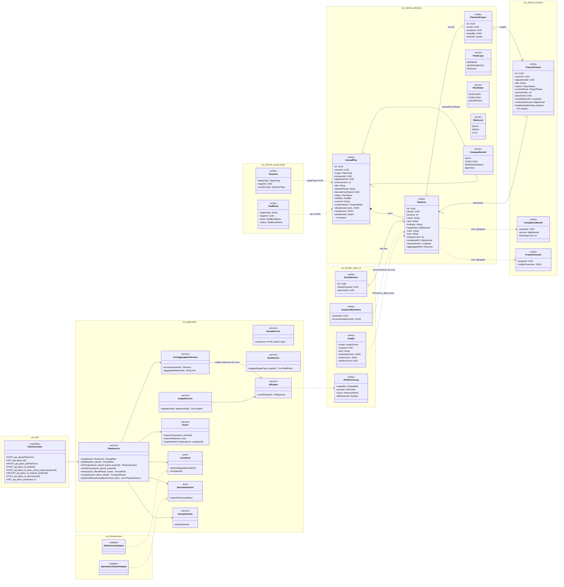
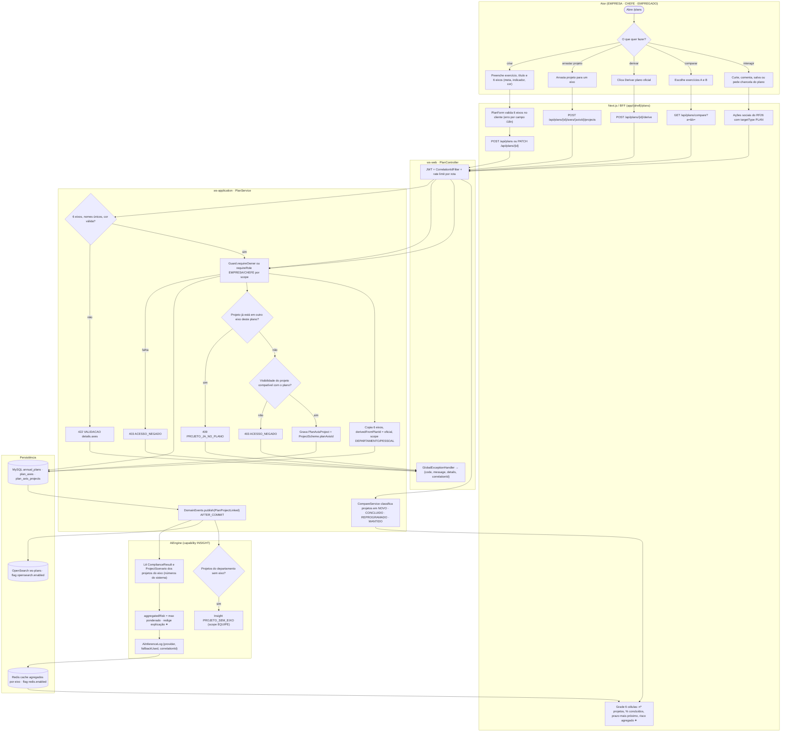
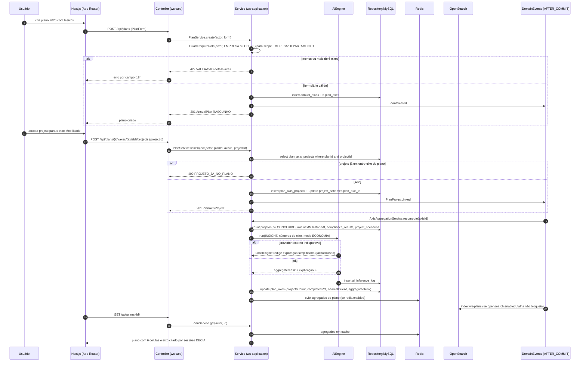
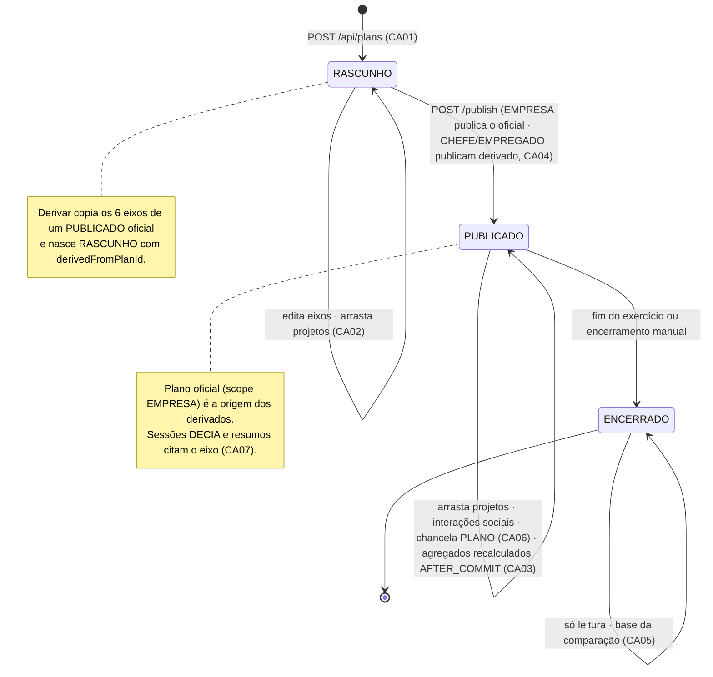
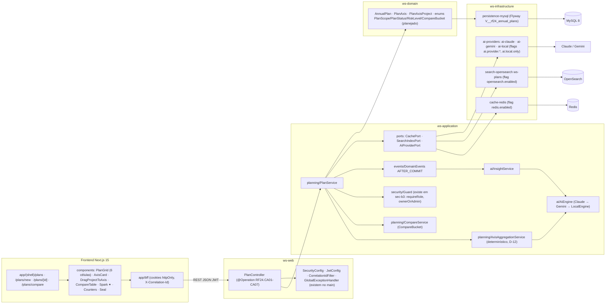

# RF24 — Visualizar a aba metas & objetivos de minha equipe com insights analíticos gerados por IA
**HU:** HU24 · **Sprint (board Work Station):** Product Backlog (não comprometido na Sprint 4) · **Equivalente FAI:** RF13 DNA de Estilo (6 células) · **Aba/rota:** Plano Anual (`/plans`, `/plans/new`, `/plans/[id]`, `/plans/compare?a=&b=`) + visão da equipe em `/departments/[slug]` (sub-aba Plano Anual, RF28) e `/insights` › Equipe (RF43)
**Critérios de aceite cobertos:** RF24.CA01 · CA02 · CA03 · CA04 · CA05 · CA06 · CA07 (corpo do card) — regra: o **título do card** define o RF; o corpo contém os CAs do Plano Anual (RF24.CA01–07). O título acrescenta "insights analíticos gerados por IA": cobertos pelo CA03 (risco agregado da IA) e pelo CA07 (IA do DECIA cita o eixo e sinaliza projetos sem eixo), com apoio dos insights de equipe do RF43 §4 (citados, não reescritos aqui).

O **Plano Anual** (`AnnualPlan`, = DNA de Estilo) tem 6 eixos (`PlanAxis`) com meta, indicador e cor; projetos entram nos eixos por `PlanAxisProject` (1 eixo por plano). O plano da EMPRESA é o oficial; CHEFE e EMPREGADO **derivam** (`derivedFromPlanId`). A IA só **interpreta números calculados pelo sistema** (D-12): `aggregatedRisk` vem de `ComplianceResult`/`ProjectScenario` (RF31/RF32) e os insights da aba (`Insight` com `scope EQUIPE`) citam `MetricSnapshot`.

| Painel da aba | Entidades | Quem vê | CAs |
|---|---|---|---|
| Grade de 6 eixos | `AnnualPlan`, `PlanAxis`, `PlanAxisProject`, `ProjectScheme.planAxisId` | equipe (visibilidade do plano) | CA01–CA04 |
| Comparar exercícios | dois `AnnualPlan` do mesmo escopo, enum `CompareBucket` | equipe | CA05 |
| Social e chancela | `Reaction`, `Comment`, `SavedItem`, `Share`, `SealBond` tier PLANO | todos | CA06 |
| Eixo citado pelo DECIA · projetos sem eixo | `DeciaSession.planAxisId`, `AnalyticalSummary.recommendationsJson[].planAxisId`, `Insight PROJETO_SEM_EIXO` | todos | CA07 |

## 1. Diagrama de classes

## 2. Diagrama de atividades

## 3. Diagrama de sequência

## 4. Máquina de estados

Entidade central: `AnnualPlan.status` (`PlanStatus`). O vínculo projeto-eixo (`PlanAxisProject`) não tem estado próprio: existe ou não.

## 5. Diagrama de componentes

## 6. Rastreabilidade

| CA | Classe | Passo (atividades) | Mensagem (sequência) | Transição (estados) | Componente |
|---|---|---|---|---|---|
| RF24.CA01 | `AnnualPlan`, `PlanAxis` (6, position 1..6), `PlanService.create` | A2 → F1 → F2 → P1 (422 VALIDACAO) | 1–9 | `[*] → RASCUNHO` | `PlanController`, `PlanGrid`, `MY` |
| RF24.CA02 | `PlanAxisProject`, `ProjectScheme.planAxisId`, `PlanService.linkProject` | A3 → F3 → P2 → P3 (409 PROJETO_JA_NO_PLANO) → P4 → P5 | 10–17 | `RASCUNHO/PUBLICADO → self (arrasta)` | `DragProjectToAxis`, `PS` |
| RF24.CA03 | `PlanAxis.projectsCount/completedPct/nearestDueAt/aggregatedRisk`, `AxisAggregationService`, `ComplianceResult`, `ProjectScenario` | P8 → I1 → I2 → I5 → D2 → F7 | 18–26 | `PUBLICADO → self (agregados AFTER_COMMIT)` | `AG`, `AIE`, `RD` |
| RF24.CA04 | `AnnualPlan.derivedFromPlanId`, `PlanScope`, `PlanService.derive` | A4 → F4 → P2 → P6 | — (POST /derive segue o fluxo 1–9) | nota de RASCUNHO · `RASCUNHO → PUBLICADO` | `PS`, `GD` |
| RF24.CA05 | `CompareBucket`, `PlanService.compare` | A5 → F5 → P7 → F7 | — (GET /compare) | `ENCERRADO → self (base da comparação)` | `CMP`, `CompareTable` |
| RF24.CA06 | `Reaction/Comment/SavedItem/Share` com `TargetType PLAN`, `SealBond` tier PLANO, `AnnualPlan.visibility/coverUrl` | A6 → F6 | — (RF26/RF39) | `PUBLICADO → self (interações · chancela)` | `Counters`, `Seal`, `SocialService`, `SealService` |
| RF24.CA07 | `DeciaSession.planAxisId`, `AnalyticalSummary.recommendationsJson[].planAxisId`, `Insight PROJETO_SEM_EIXO`, `PlanService.projectsWithoutAxis` | I3 → I4 | 27–30 (eixo citado no GET) | nota de PUBLICADO | `INS`, `AIE`, `AIP` |

Tela/aba: `/companies/[slug]` (esqueleto em `app/(shell)/companies/[slug]/page.tsx`) · `/plans` (esqueleto em `app/(shell)/plans/page.tsx`) · `/goals` (esqueleto em `app/(shell)/goals/page.tsx`)
