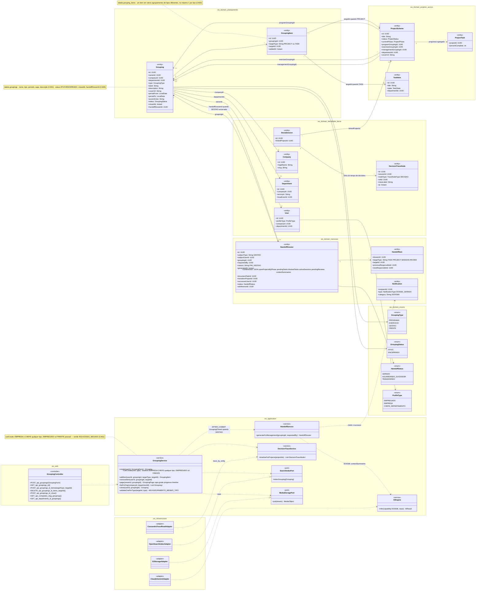
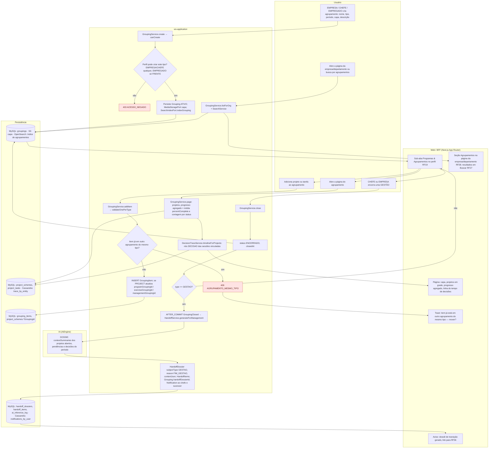
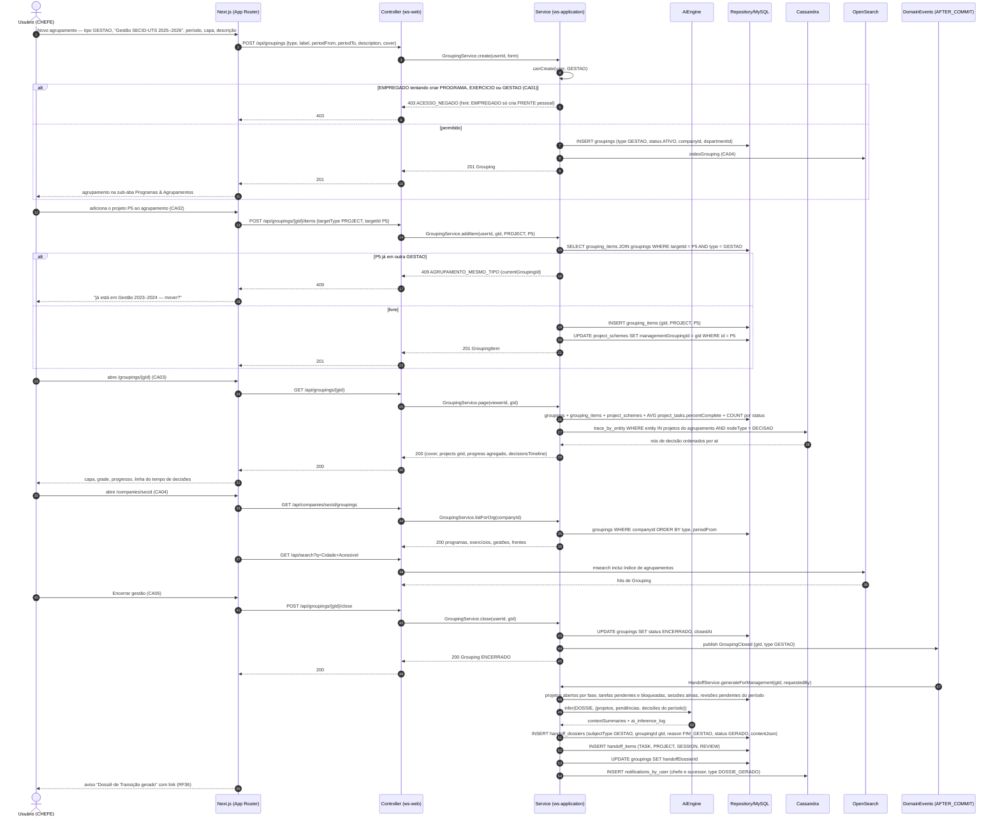
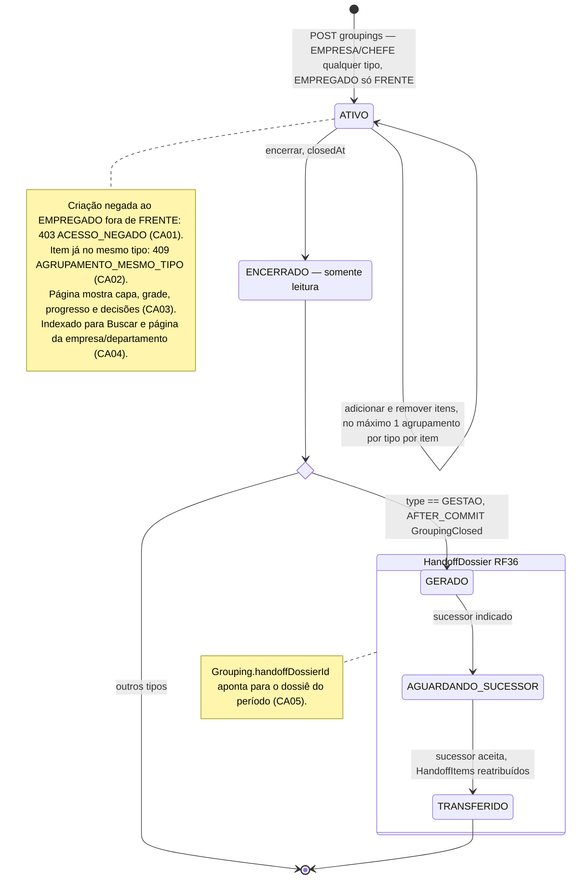
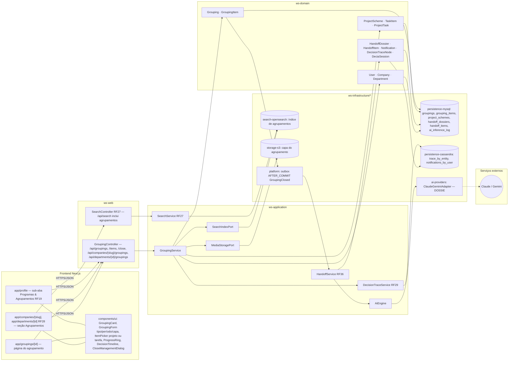

# RF25 — Agrupar projetos e tarefas em Programas, Exercícios e Gestões (agrupamentos institucionais)
**HU:** HU25 · **Sprint (board Work Station):** Product Backlog (não comprometido na Sprint 4; candidato à Sprint 5) · **Equivalente FAI:** Agrupamentos (Coleções da marca RF35, Eras da celebridade RF34, temporadas) · **Aba/rota:** sub-aba *Programas & Agrupamentos* no perfil (RF19), página do agrupamento (`/groupings/[id]`), página da empresa/departamento (RF28)
**Critérios de aceite cobertos:** RF25.CA01 · CA02 · CA03 · CA04 · CA05

O **Agrupamento** (`Grouping`, = SchemeGrouping do FAI) organiza projetos e tarefas em quatro tipos (`GroupingType`): **PROGRAMA** (= coleção, ex.: "Programa Cidade Acessível 2026"), **EXERCÍCIO** (= temporada, ano orçamentário), **GESTÃO** (= era, período de um chefe ou de uma gestão da empresa) e **FRENTE** (= linha de estilo, tema transversal). EMPRESA e CHEFE criam qualquer tipo; EMPREGADO só cria FRENTE pessoal. A ligação é `GroupingItem` (targetType PROJECT | TASK) e, para projetos, os ponteiros desnormalizados `ProjectScheme.programGroupingId / exerciseGroupingId / managementGroupingId` — **um item pode estar em vários agrupamentos de tipos diferentes, mas em no máximo um por tipo**. A página do agrupamento mostra capa, projetos em grade, progresso agregado e a linha do tempo de decisões (`DecisionTraceNode`, RF29). Agrupamentos aparecem na página da empresa/departamento (RF28) e são indexados para Buscar (RF27). **Encerrar uma GESTÃO** gera automaticamente o **Dossiê de Transição** (`HandoffDossier`, RF36) do período.

| Tipo | Quem cria | Período | Exemplo |
|---|---|---|---|
| PROGRAMA | EMPRESA, CHEFE | livre | Programa Cidade Acessível 2026 |
| EXERCICIO | EMPRESA, CHEFE | ano orçamentário | Exercício 2026 |
| GESTAO | EMPRESA, CHEFE | mandato do chefe / gestão da empresa | Gestão SECID-UTS 2025–2026 |
| FRENTE | EMPRESA, CHEFE, EMPREGADO (pessoal) | livre | Convênios federais |

## 1. Diagrama de classes

## 2. Diagrama de atividades

## 3. Diagrama de sequência

## 4. Máquina de estados

Entidade central: **`Grouping.status`** (ATIVO · ENCERRADO). Encerrar um agrupamento do tipo **GESTAO** dispara a criação do `HandoffDossier` (RF36), cujos estados aparecem como consequência.

## 5. Diagrama de componentes

## 6. Rastreabilidade

| CA | Elemento do diagrama (classe / passo / mensagem / transição / componente) |
|---|---|
| RF25.CA01 | `Grouping` (type, label, description, coverUrl, periodFrom/To), enums `GroupingType`, `ProfileType`, `GroupingService.create/canCreate` (nota EMPREGADO só FRENTE), `MediaStoragePort` · Atividades `U1 → A1 → A2 → A3 403 ACESSO_NEGADO / A4 → P1` · Sequência `POST /api/groupings` → `alt EMPREGADO tentando criar … → 403` / `INSERT groupings` · Transição `[*] → ATIVO` + nota · Componentes `GroupingForm`, `storage-s3` |
| RF25.CA02 | `GroupingItem` (nota 1 por tipo), `ProjectScheme.programGroupingId/exerciseGroupingId/managementGroupingId`, `GroupingService.addItem/validateOnePerType` · Atividades `U2 → A5 → A6 → A7 409 AGRUPAMENTO_MESMO_TIPO / A8 → P2` · Sequência `POST /api/groupings/{gId}/items` → `alt P5 já em outra GESTAO → 409` / `INSERT grouping_items` + `UPDATE project_schemes SET managementGroupingId` · Transição `ATIVO → ATIVO` · Componente `ItemPicker` |
| RF25.CA03 | `GroupingService.page`, `ProjectTask.percentComplete`, `DecisionTraceNode` (nodeType DECISAO), `DeciaSession.linkedProjectId`, `DecisionTraceService.timelineForProjects`, `CassandraTraceReadAdapter` · Atividades `U3 → A9 → A10 → P3 → W2` · Sequência `GET /api/groupings/{gId}` → `AVG percentComplete + COUNT por status` → `trace_by_entity … nodeType = DECISAO` → `{cover, projects grid, progress, decisionsTimeline}` · Componentes `app/groupings/[id]`, `ProgressRing`, `DecisionTimeline`, `persistence-cassandra` |
| RF25.CA04 | `GroupingService.listForOrg`, `SearchIndexPort.indexGrouping`, `Company`, `Department` · Atividades `U4 → A11 → P1 → W4` · Sequência `indexGrouping (CA04)`, `GET /api/companies/secid/groupings`, `GET /api/search?q=…` → `msearch inclui índice de agrupamentos` · Componentes `F3 (RF28)`, `SearchController RF27`, `search-opensearch` |
| RF25.CA05 | `Grouping.status/closedAt/handoffDossierId`, enums `GroupingStatus`, `HandoffStatus`, `HandoffDossier` (subjectType GESTAO, reason FIM_GESTAO, contentJson), `HandoffItem`, `GroupingService.close`, `HandoffService.generateForManagement`, `AiEngine DOSSIE`, `Notification` · Atividades `U5 → A12 → A14 → A13 (sim) → A15 → I1 → A16 → P4 → W5` · Sequência `POST /api/groupings/{gId}/close` → `publish GroupingClosed` → `HandoffService.generateForManagement` → `infer(DOSSIE …)` → `INSERT handoff_dossiers`, `handoff_items`, `UPDATE groupings SET handoffDossierId`, notificação · Transições `ATIVO → ENCERRADO → fim → DOSSIE_GERADO → AGUARDANDO_SUCESSOR → TRANSFERIDO` · Componentes `CloseManagementDialog`, `HandoffService RF36`, `platform outbox GroupingClosed`, `ai-providers DOSSIE` |
