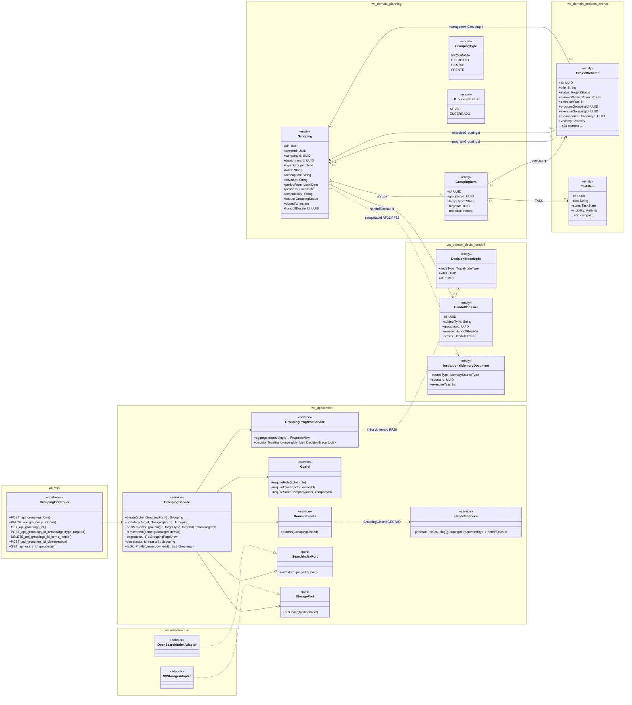
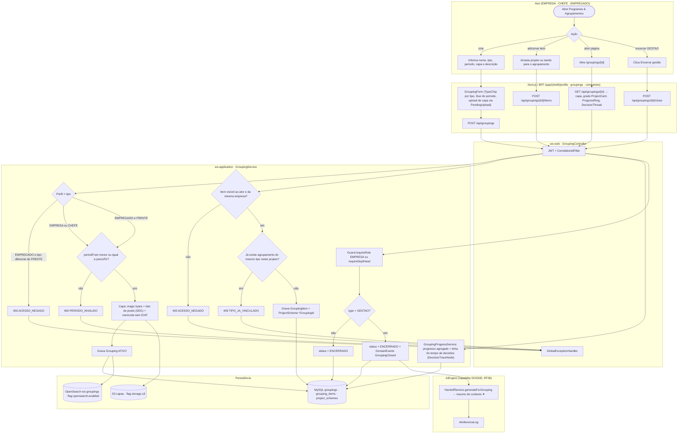
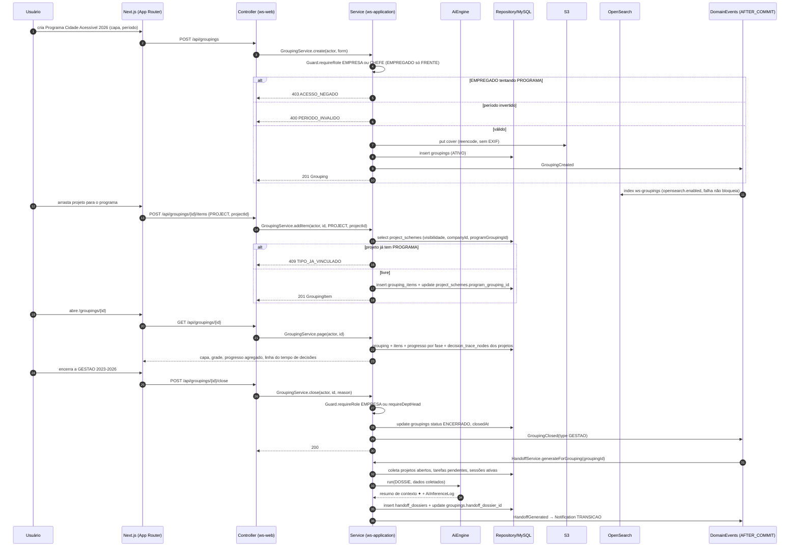
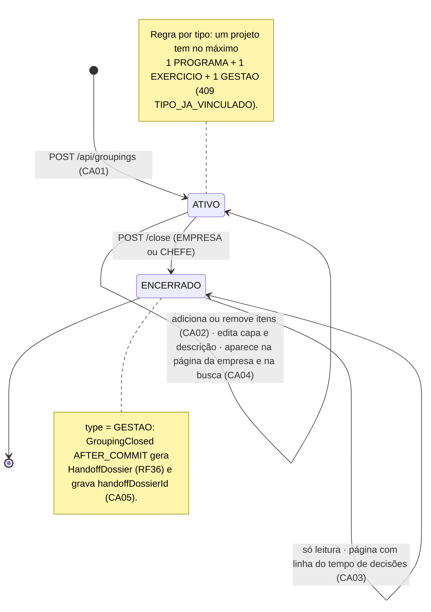
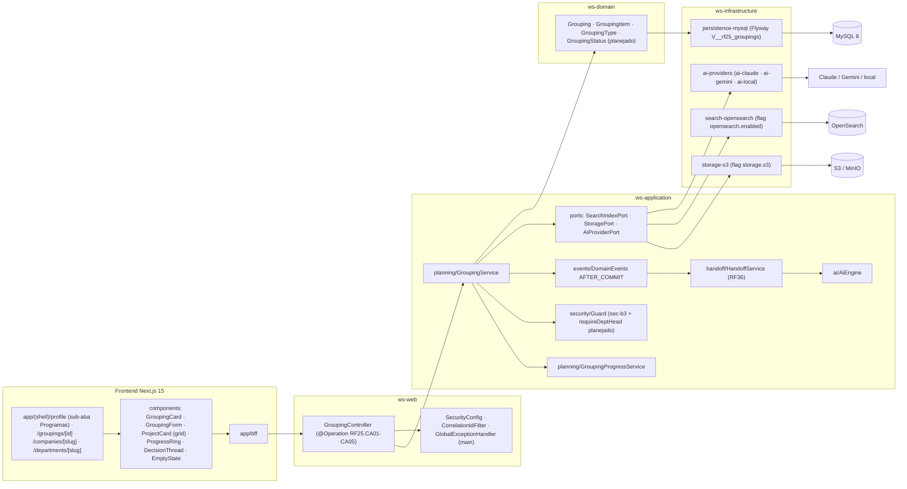

# RF25 — Agrupar projetos e tarefas em Programas, Exercícios e Gestões (agrupamentos institucionais)
**HU:** HU25 · **Sprint (board Work Station):** Product Backlog (não comprometido na Sprint 4) · **Equivalente FAI:** Agrupamentos (Coleções da marca RF35, Eras da celebridade RF34, temporadas) · **Aba/rota:** sub-aba **Programas & Agrupamentos** do perfil (`/profile?tab=programas`, `/u/[username]?tab=programas`), página do agrupamento (`/groupings/[id]`), páginas da empresa/departamento (`/companies/[slug]`, `/departments/[slug]`, RF28)
**Critérios de aceite cobertos:** RF25.CA01 · CA02 · CA03 · CA04 · CA05 (corpo do card, inalterado) — regra: o **título do card** define o RF e o corpo traz os próprios CAs.

Tipos (`GroupingType`): **PROGRAMA** (= coleção, EMPRESA/CHEFE), **EXERCICIO** (= temporada, ano orçamentário), **GESTAO** (= era, período de um chefe ou de uma gestão), **FRENTE** (= linha de estilo; a única que o EMPREGADO cria, pessoal). Um projeto aponta direto para até três agrupamentos (`ProjectScheme.programGroupingId / exerciseGroupingId / managementGroupingId`) e `GroupingItem` registra qualquer item (PROJECT · TASK). Encerrar uma GESTAO dispara o **Dossiê de Transição** (RF36) por evento AFTER_COMMIT.

## 1. Diagrama de classes

## 2. Diagrama de atividades

## 3. Diagrama de sequência

## 4. Máquina de estados

Entidade central: `Grouping.status` (`GroupingStatus`). Os itens (`GroupingItem`) não têm estado.

## 5. Diagrama de componentes

## 6. Rastreabilidade

| CA | Classe | Passo | Mensagem | Transição | Componente |
|---|---|---|---|---|---|
| RF25.CA01 | `Grouping` (type, label, periodFrom/To, coverUrl, description), `GroupingType`, `GroupingService.create`, `Guard.requireRole` | A2 → F1 → F2 → P1 (403) → P2 (400 PERIODO_INVALIDO) → P3 → P4 | 1–11 | `[*] → ATIVO` | `GC`, `GS`, `GroupingForm`, `S3A` |
| RF25.CA02 | `GroupingItem`, `ProjectScheme.programGroupingId/exerciseGroupingId/managementGroupingId`, `GroupingService.addItem` | A3 → F3 → P5 → P6 (409 TIPO_JA_VINCULADO) → P7 | 12–19 | `ATIVO → self (itens)` · nota de ATIVO | `GS`, `MY` |
| RF25.CA03 | `GroupingProgressService.aggregate/decisionTimeline`, `DecisionTraceNode` | A4 → F4 → P12 | 20–24 | `ENCERRADO → self (linha do tempo)` | `GP`, `ProgressRing`, `DecisionThread` |
| RF25.CA04 | `SearchIndexPort.indexGrouping`, `InstitutionalMemoryDocument`, páginas RF28 | P4 → D3 | 11 | `ATIVO → self (busca e página)` | `OSA`, `R1 (/companies, /departments)` |
| RF25.CA05 | `Grouping.closedAt/handoffDossierId`, `DomainEvents GroupingClosed`, `HandoffService.generateForGrouping`, `HandoffDossier` | A5 → F5 → P8 → P9 → P11 → I1 → I2 | 25–36 | `ATIVO → ENCERRADO` + nota | `DE`, `HS`, `AIE`, `AIP` |

Tela/aba: `/companies/[slug]` (esqueleto em `app/(shell)/companies/[slug]/page.tsx`) · `/profile` (esqueleto em `app/(shell)/profile/page.tsx`)
