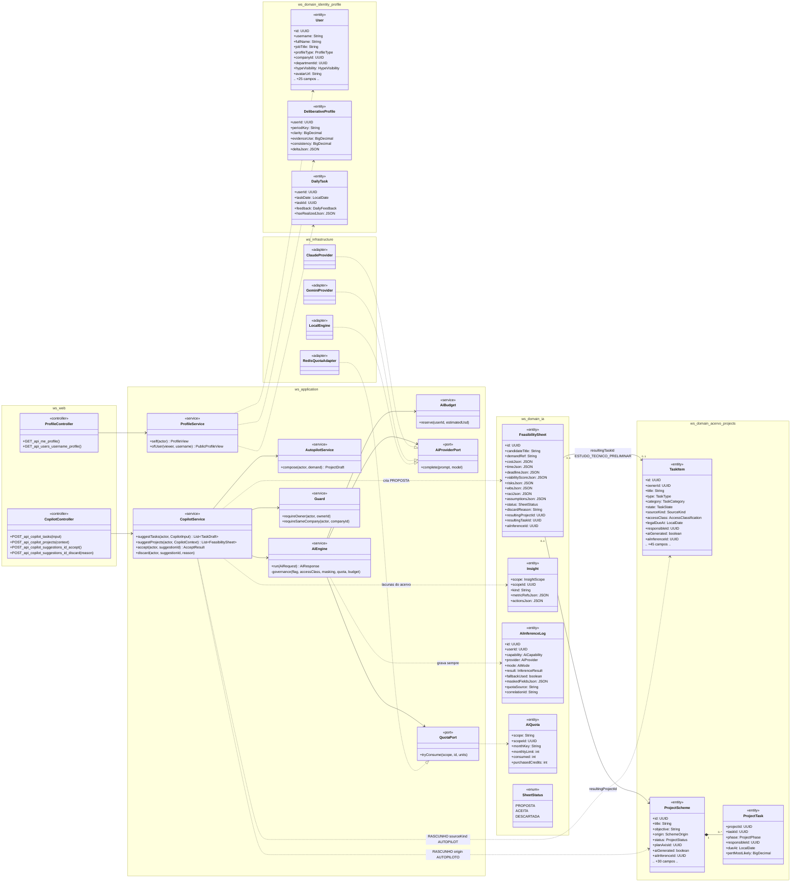
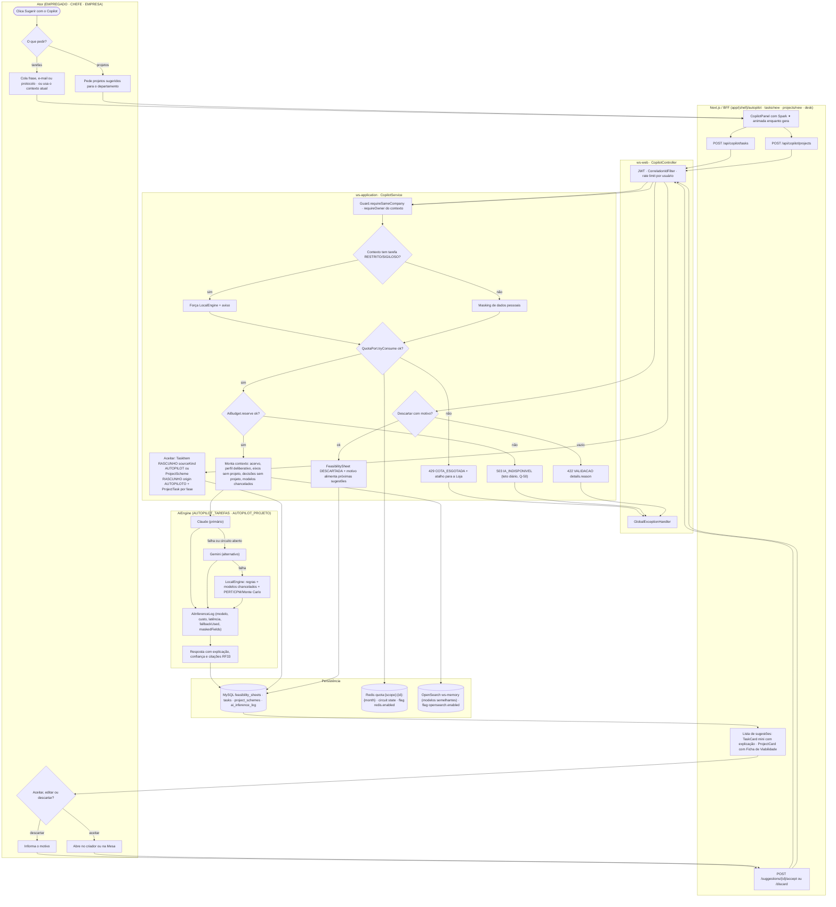
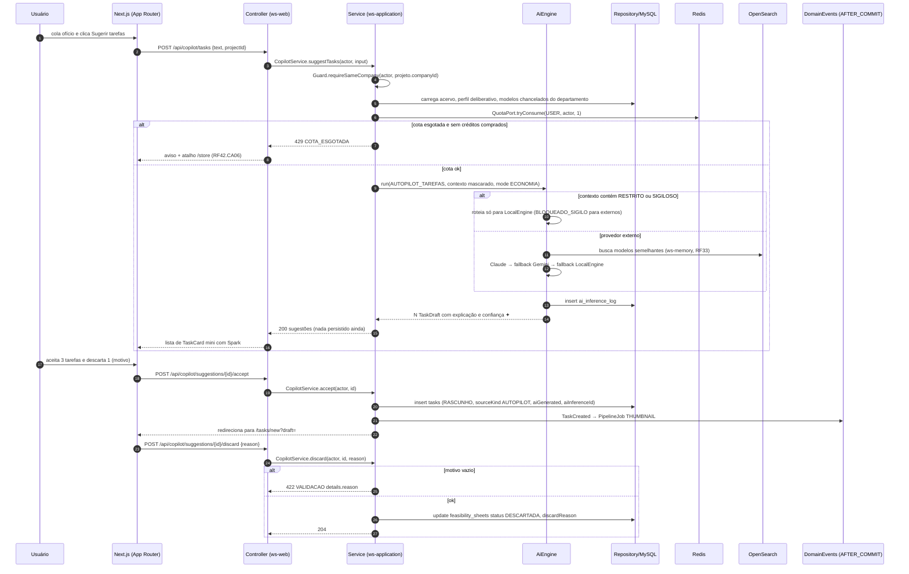
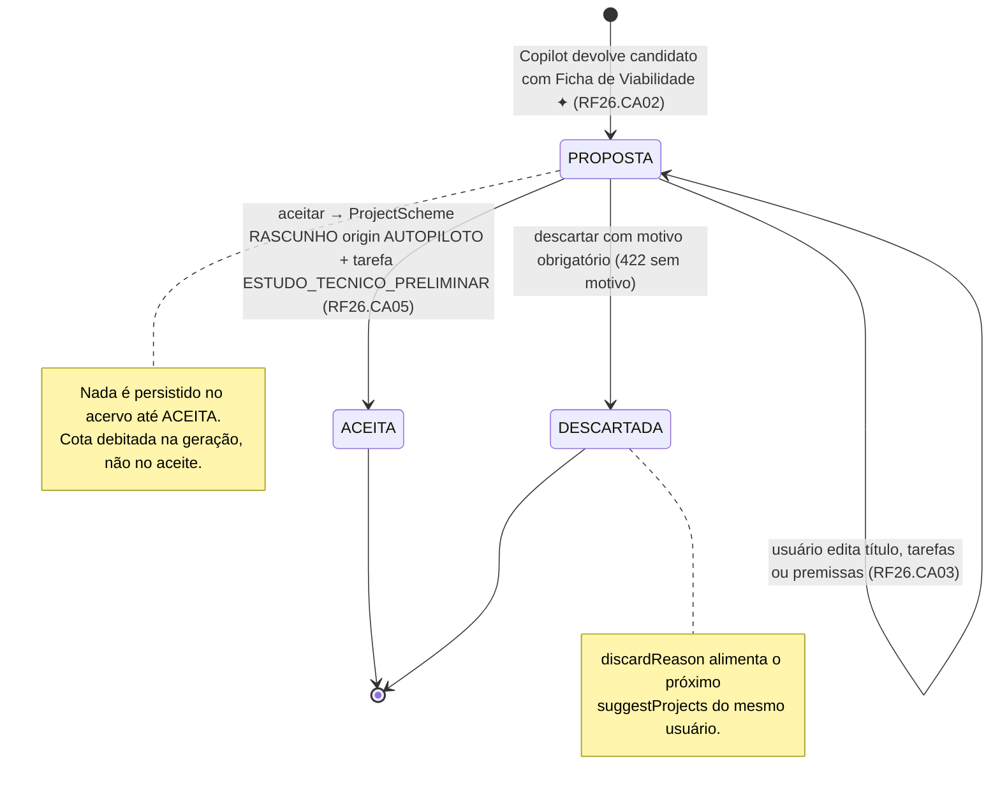
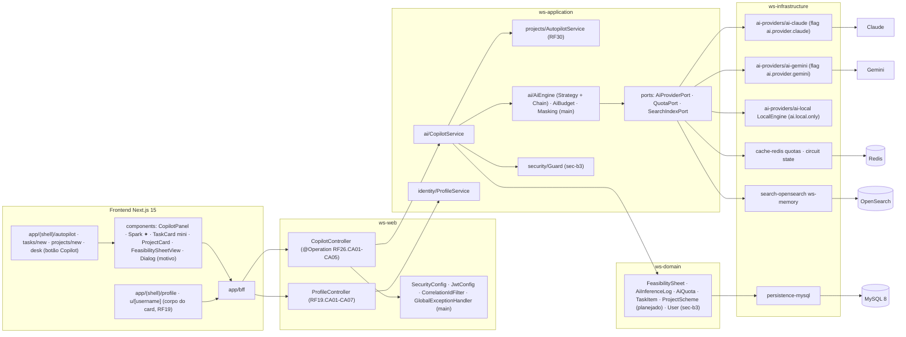

# RF26 — Utilizar o Copilot do WS para criar sugestões de tarefas e projetos de maneira mais prática e funcional
**HU:** HU26 · **Sprint (board Work Station):** Sprint 4 (card RF26 "Interações sociais" comprometido com o título antigo; conteúdo atual do título = Copilot) · **Equivalente FAI:** RF10 Copilot (sugestões) + RF6 Perfil Lookbook (corpo do card) · **Aba/rota:** Copilot em `/autopilot` (sugestões de tarefas e projetos, estende RF30/RF43 §7) e botão **Sugerir com o Copilot** em `/tasks/new`, `/projects/new` e na Mesa (`/desk`); corpo do card: Meu perfil (`/profile`, `/u/[username]`)
**Critérios de aceite cobertos:** **RF19.CA01 … RF19.CA07** (citados como estão escritos — **corpo do card = antigo RF19**, perfil/portfólio) + **RF26.CA01 … RF26.CA05 (CA a confirmar)**, derivados do título + HU26 (Copilot que sugere tarefas e projetos inteiros) — regra: o **título do card** define o RF; título e corpo divergem (`RENUMERACAO.md`).

**CAs derivados do título (a confirmar):**
- **RF26.CA01** Em `/autopilot`, no criador de tarefas e na Mesa, o botão **Sugerir com o Copilot** recebe uma frase, e-mail, protocolo ou o contexto atual (projeto aberto, acervo, perfil) e devolve **N tarefas em rascunho** (tipo, categoria, prazo legal, responsável, dependências) — nada vira DISPONÍVEL sem revisão (= RF43.CA07).
- **RF26.CA02** O Copilot sugere **projetos inteiros** (até 5 candidatos ordenados por viabilidade) a partir de eixos do plano sem projeto, lacunas do acervo e decisões DECIA sem projeto, cada um com Ficha de Viabilidade (= RF43.CA08, RF30.CA02).
- **RF26.CA03** Cada sugestão carrega a faísca ✦, a explicação ("baseado em: eixo X, modelo chancelado Y, sessão Z") e o `AiInferenceLog`; o usuário **aceita, edita ou descarta** (descartar exige motivo, que alimenta as próximas sugestões).
- **RF26.CA04** Tarefas RESTRITO/SIGILOSO no contexto nunca saem para provedor externo (só `LocalEngine`, com aviso); sem chave externa o Copilot usa regras + modelos chancelados e avisa o fallback (= RF30.CA05, RF43.CA02).
- **RF26.CA05** Aceitar cria `TaskItem` RASCUNHO com `sourceKind AUTOPILOT` ou `ProjectScheme` RASCUNHO com `origin AUTOPILOTO` e abre o item no criador correspondente (RF4/RF5) ou na Mesa (RF22); cota de IA (`AiQuota`) é debitada e, sem cota, o botão oferece a Loja (RF42.CA06).

## 1. Diagrama de classes

## 2. Diagrama de atividades

## 3. Diagrama de sequência

## 4. Máquina de estados

Entidade central: `FeasibilitySheet.status` (`SheetStatus`) para as sugestões de projeto; as sugestões de tarefa não têm estado persistido até serem aceitas (nascem como `TaskItem` RASCUNHO, máquina do RF41). Corpo do card (perfil, RF19) não tem estado próprio.

## 5. Diagrama de componentes

## 6. Rastreabilidade

| CA | Classe | Passo | Mensagem | Transição | Componente |
|---|---|---|---|---|---|
| RF26.CA01 (a confirmar) | `CopilotService.suggestTasks`, `TaskItem` RASCUNHO, `AiCapability AUTOPILOT_TAREFAS` | A2 → F2 → P1 → P7 → I1..I5 → F4 | 1–20 | — (tarefa segue máquina do RF41) | `CC`, `CS`, `AIE` |
| RF26.CA02 (a confirmar) | `CopilotService.suggestProjects`, `FeasibilitySheet`, `AUTOPILOT_PROJETO` | A3 → F3 → P7 → I1..I5 | — (mesmo fluxo com /projects) | `[*] → PROPOSTA` | `CS`, `AS`, `FeasibilitySheetView` |
| RF26.CA03 (a confirmar) | `AiInferenceLog`, `FeasibilitySheet.discardReason`, `CopilotService.discard` | A4 → A5 → F5 → P9 (422) → P10 | 21–31 | `PROPOSTA → DESCARTADA` · `PROPOSTA → self` | `Spark ✦`, `Dialog` |
| RF26.CA04 (a confirmar) | `AiEngine.governance`, `Masking`, `LocalEngine`, `InferenceResult BLOQUEADO_SIGILO` | P2 → P3 · I1 → I2 → I3 | 11–14 | — | `AIE`, `AIL`, `AIC`, `AIG` |
| RF26.CA05 (a confirmar) | `CopilotService.accept`, `SourceKind AUTOPILOT`, `SchemeOrigin AUTOPILOTO`, `AiQuota`, `QuotaPort` | A6 → P8 · P5 (429 COTA_ESGOTADA) | 6–9, 22–26 | `PROPOSTA → ACEITA` | `RD`, `CS` |
| RF19.CA01 (corpo) | `User`, `ProfileService.self`, contadores | — (corpo do card, ver `RF6`/`_anterior/RF19`) | — | — | `R3`, `PCO`, `PS` |
| RF19.CA02 (corpo) | `ProfileService.ofUser`, `Visibility`, `HypeVisibility` | — | — | — | `R3`, `Guard.requireSameCompany` |
| RF19.CA03 (corpo) | filtros e paginação por sub-aba (querystring) | — | — | — | `R3` |
| RF19.CA04 (corpo) | `DailyTask` único (userId, taskDate) | — (RF44) | — | — | `PS` |
| RF19.CA05 (corpo) | `DeliberativeProfile.deltaJson` | — (RF43/RF45) | — | — | `PS` |
| RF19.CA06 (corpo) | sub-abas institucionais EMPRESA/CHEFE | — (RF28) | — | — | `R3` |
| RF19.CA07 (corpo) | i18n pt-BR/en/es, responsivo | — | — | — | `R3`, `lib/i18n` |
