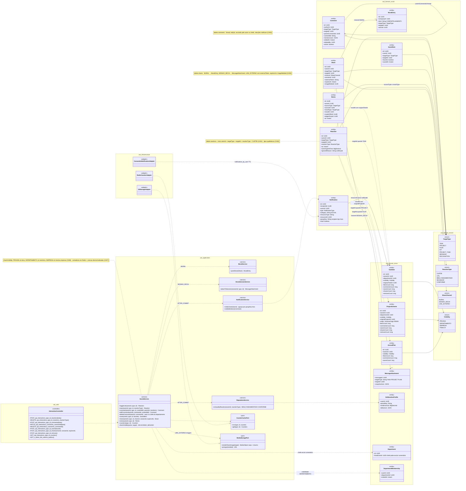
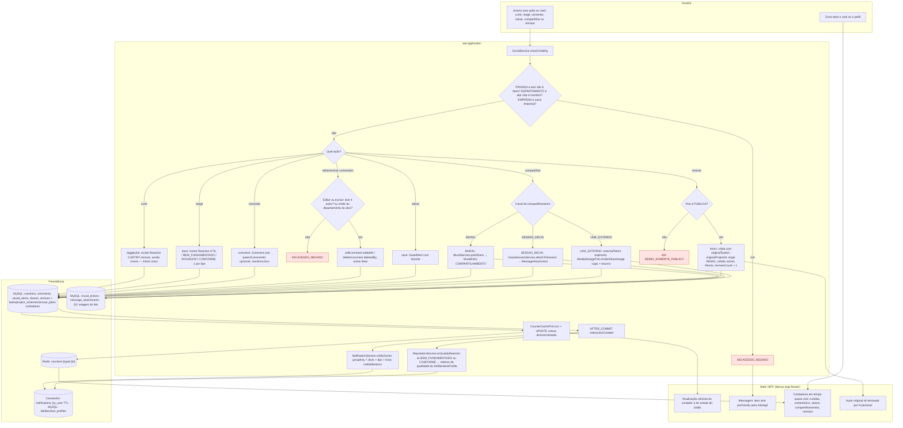
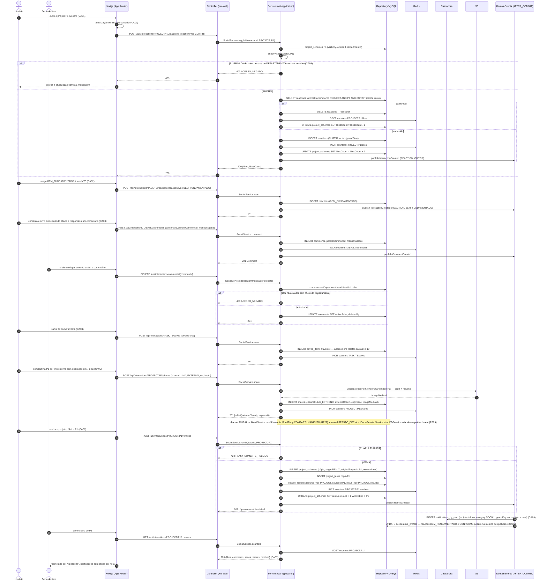
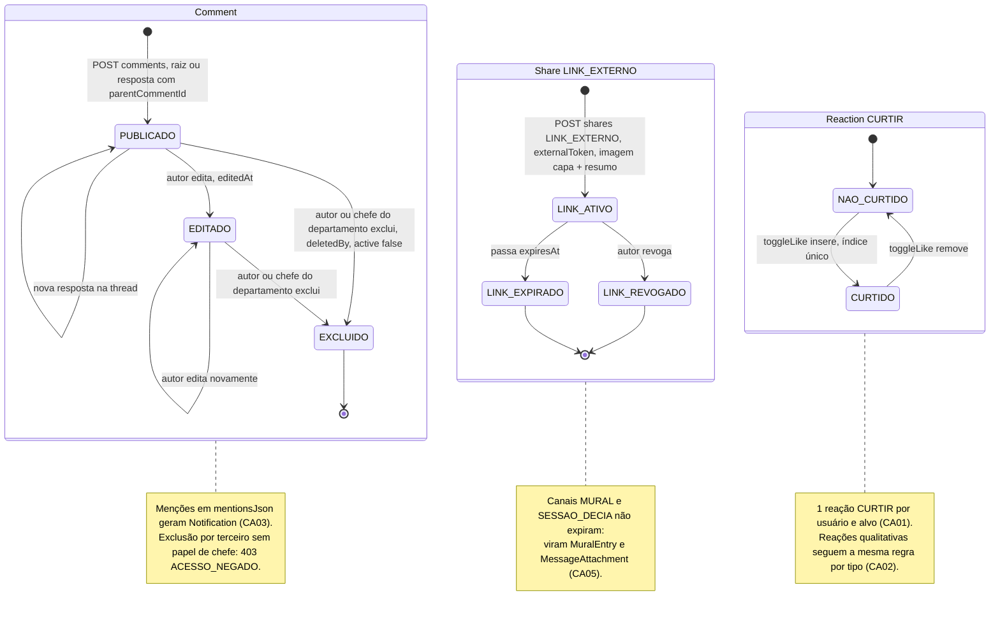
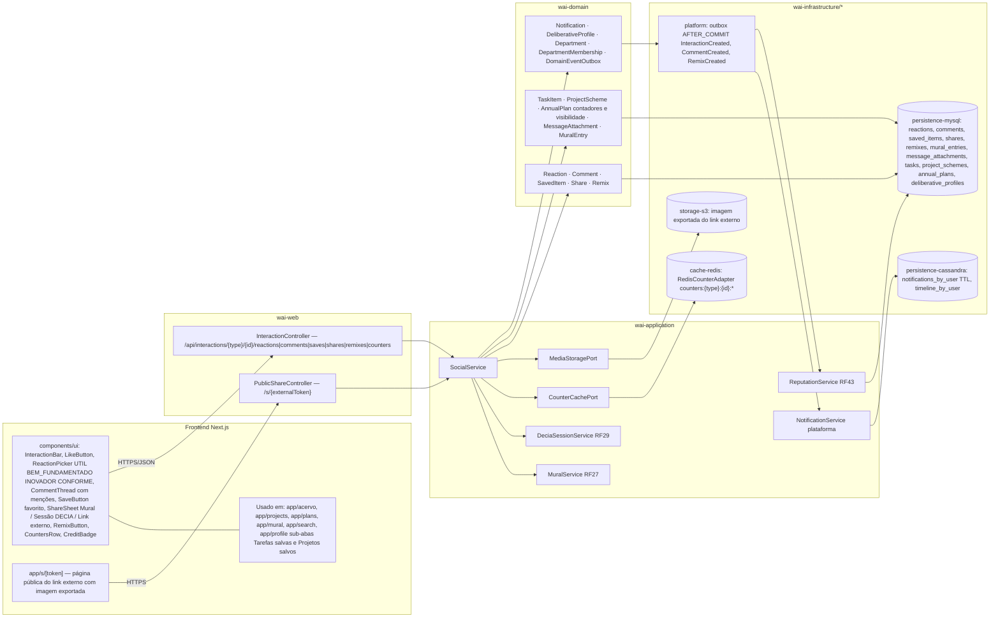

# RF26 — Curtir, reagir, comentar, salvar, compartilhar e remixar tarefas, esquemas de projeto e planos anuais (interações sociais)
**HU:** HU26 · **Sprint (board Work Station):** 4 · **Equivalente FAI:** RF19 Interações sociais (alvo polimórfico PIECE/SCHEME/DNA) · **Aba/rota:** ações inline em todos os cards (Acervo, Projetos, Planos, Mural, Buscar) · **API:** `/api/interactions/{type}/{id}/reactions|comments|saves|shares|remixes|counters`
**Critérios de aceite cobertos:** RF26.CA01 · CA02 · CA03 · CA04 · CA05 · CA06 · CA07 · CA08 · CA09

Alvo polimórfico `TargetType` (TASK · PROJECT · PLAN — além de KIT, PROJECT_TASK, MESSAGE, RECOGNITION usados por outros RFs). Seis interações, cada uma com sua entidade: **curtir** (`Reaction` CURTIR, única por ator e alvo), **reagir** (`Reaction` ÚTIL · BEM_FUNDAMENTADO · INOVADOR · CONFORME), **comentar** (`Comment` com thread `parentCommentId`, edição, exclusão pelo autor ou pelo chefe do departamento, menções → `Notification`), **salvar** (`SavedItem` com marcador favorito → sub-abas *Tarefas salvas* / *Projetos salvos*, RF19), **compartilhar** (`Share` em canal MURAL → `MuralEntry` RF27, SESSAO_DECIA → `MessageAttachment` RF29, LINK_EXTERNO com `externalToken`, `expiresAt` e imagem exportada `imageMediaId`) e **remixar** (`Remix` + cópia com `originalTaskId` / `originalProjectId` e crédito visível). Contadores desnormalizados (`likesCount … remixesCount`) em tempo quase real via Redis; toda interação respeita a **visibilidade** do alvo e gera **notificação agrupada por hora** (`Notification.groupKey`) ao dono, alimentando o perfil deliberativo (reações BEM_FUNDAMENTADO e CONFORME pesam na métrica de qualidade).

| Interação | Entidade | Regra de unicidade / canal | Contador |
|---|---|---|---|
| Curtir / descurtir | `Reaction` CURTIR | único (actorId, targetType, targetId, CURTIR) — toggle | `likesCount` |
| Reagir | `Reaction` UTIL · BEM_FUNDAMENTADO · INOVADOR · CONFORME | 1 por tipo, ator e alvo | — (pesa no perfil deliberativo) |
| Comentar | `Comment` | thread via `parentCommentId`, `editedAt`, `deletedBy`, `mentionsJson` | `commentsCount` |
| Salvar | `SavedItem` | único (userId, targetType, targetId), `favorite` | `savesCount` |
| Compartilhar | `Share` | `channel` MURAL · SESSAO_DECIA · LINK_EXTERNO (`externalToken`, `expiresAt`, `imageMediaId`) | `sharesCount` |
| Remixar | `Remix` + nova `TaskItem`/`ProjectScheme` | só alvos PUBLICA, `originalTaskId` / `originalProjectId` | `remixesCount` |

## 1. Diagrama de classes

## 2. Diagrama de atividades

## 3. Diagrama de sequência

## 4. Máquina de estados

O RF26 não tem máquina de estados própria. A entidade com ciclo de vida mais rico que ele altera é o **`Comment`** (`active`, `editedAt`, `deletedBy`), mostrado abaixo; o segundo diagrama aninhado mostra o ciclo do **`Share` LINK_EXTERNO** (`expiresAt`) e o toggle de **`Reaction` CURTIR**.

## 5. Diagrama de componentes

## 6. Rastreabilidade

| CA | Elemento do diagrama (classe / passo / mensagem / transição / componente) |
|---|---|
| RF26.CA01 | `Reaction` (nota índice único actorId + targetType + targetId + CURTIR), `SocialService.toggleLike` · Atividades `A4 (curtir) → A5 → P1` · Sequência `POST …/PROJECT/P1/reactions {CURTIR}` → `alt já curtido → DELETE` / `INSERT reactions` · Máquina *Reaction CURTIR* · Componente `LikeButton` |
| RF26.CA02 | Enum `ReactionType` (UTIL, BEM_FUNDAMENTADO, INOVADOR, CONFORME), `SocialService.react` · Atividades `A4 (reagir) → A6` · Sequência `POST …/TASK/T3/reactions {BEM_FUNDAMENTADO}` · Nota de *Reaction CURTIR* · Componente `ReactionPicker` |
| RF26.CA03 | `Comment` (parentCommentId, mentionsJson, editedAt, deletedBy, active), `Department.headUserId`, `SocialService.comment/editComment/deleteComment`, `NotificationService.notifyMentions` · Atividades `A7`, `A8 → A9 403 / A10` · Sequência `POST …/comments {contentMd, parentCommentId, mentions}` e `DELETE /api/interactions/comments/{id}` com `alt ator não é autor nem chefe → 403` · Máquina *Comment* (PUBLICADO → EDITADO → EXCLUIDO) · Componente `CommentThread` |
| RF26.CA04 | `SavedItem` (favorite), `SocialService.save` · Atividades `A4 (salvar) → A11` · Sequência `POST …/TASK/T3/saves {favorite true}` → "aparece em Tarefas salvas RF19" · Componentes `SaveButton`, `app/profile sub-abas Tarefas salvas e Projetos salvos` |
| RF26.CA05 | `Share` (channel, sessionId, externalToken, expiresAt, imageMediaId), enum `ShareChannel`, `MuralEntry`, `MessageAttachment`, `MuralService.postShare`, `DeciaSessionService.attachToSession`, `MediaStoragePort.renderShareImage` · Atividades `A12 → A13 / A14 / A15 → P3` · Sequência `POST …/PROJECT/P1/shares {LINK_EXTERNO, expiresAt}` → `renderShareImage` → `INSERT shares` + nota MURAL / SESSAO_DECIA · Máquina *Share LINK_EXTERNO* · Componentes `ShareSheet`, `PublicShareController /s/{token}`, `app/s/[token]`, `storage-s3` |
| RF26.CA06 | `Remix`, `TaskItem.originalTaskId`, `ProjectScheme.originalProjectId / origin REMIX`, `SocialService.remix` · Atividades `A16 → A17 422 REMIX_SOMENTE_PUBLICO / A18 → W4` · Sequência `POST …/PROJECT/P1/remixes` → `alt não é PUBLICA → 422` / `INSERT project_schemes (cópia, origin REMIX, originalProjectId)`, `INSERT remixes`, "remixado por N pessoas" · Componentes `RemixButton`, `CreditBadge` |
| RF26.CA07 | `TaskItem/ProjectScheme/AnnualPlan.likesCount … remixesCount`, `CounterCachePort`, `RedisCounterAdapter`, `SocialService.counters` · Atividades `A19 → P2 → W3`, `W1` (otimista) · Sequência `INCR/DECR counters:…`, `UPDATE … likesCount`, `GET …/counters` → `MGET` · Componentes `CountersRow`, `cache-redis` |
| RF26.CA08 | `SocialService.checkVisibility` (nota), enum `Visibility`, `DepartmentMembership` · Atividades `A1 → A2 → A3 403 ACESSO_NEGADO → W2` · Sequência `checkVisibility(actor, P1)` → `alt P1 PRIVADA de outra pessoa, ou DEPARTAMENTO sem ser membro → 403` |
| RF26.CA09 | `Notification.groupKey` (dono + tipo + hora, category SOCIAL), `DeliberativeProfile`, `NotificationService.notifyOwner`, `ReputationService.onQualityReaction`, `CassandraNotificationAdapter` · Atividades `A20 → A21 → P4`, `A20 → A22 → P4` · Sequência `DE->>CS INSERT notifications_by_user (… groupKey dono + tipo + hora)` e `DE->>DB UPDATE deliberative_profiles — BEM_FUNDAMENTADO e CONFORME pesam` · Componentes `NotificationService`, `ReputationService RF43`, `persistence-cassandra` |
