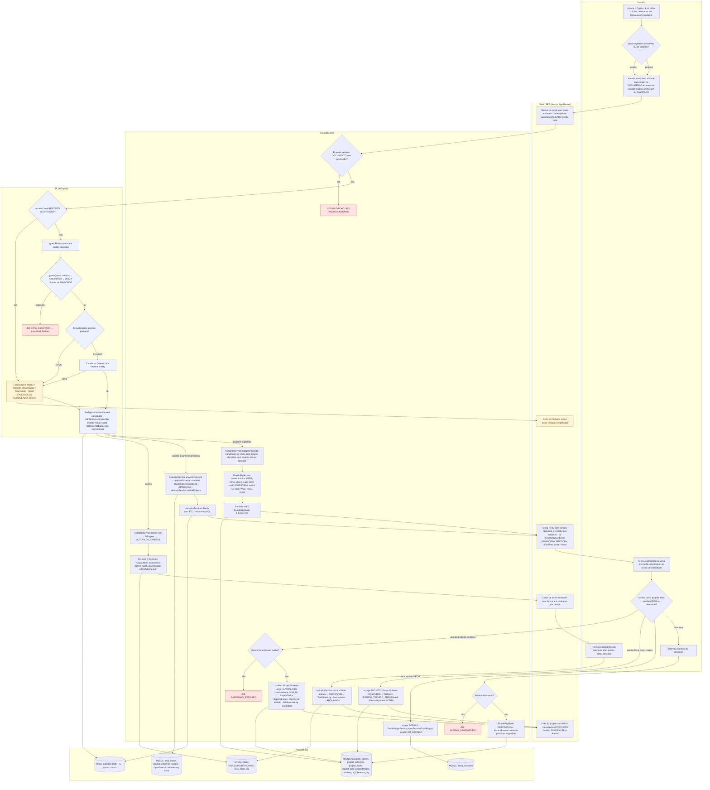
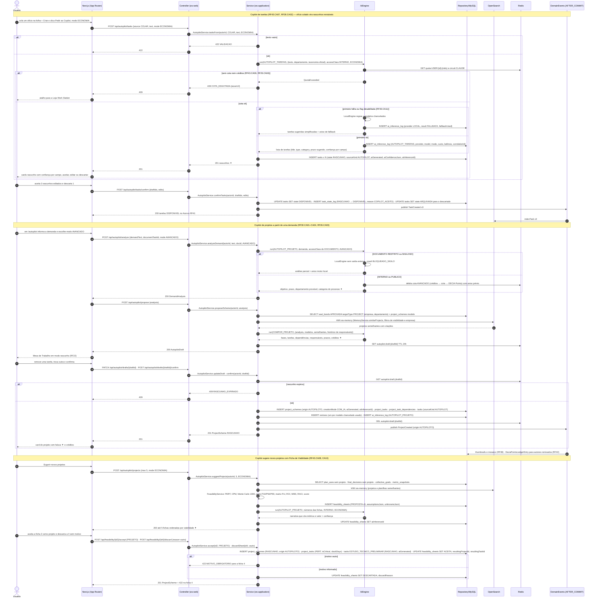
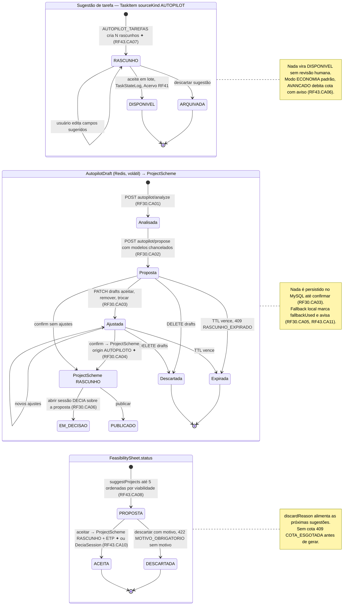
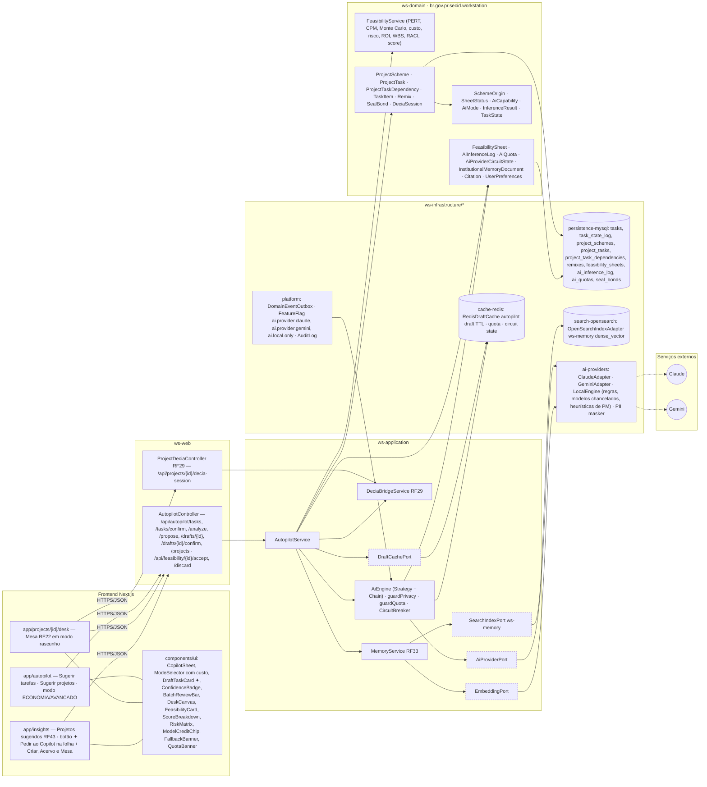

# RF26 — Utilizar o Copilot do WS para criar sugestões de tarefas e projetos de maneira mais prática e funcional
**HU:** HU26 · **Sprint (board Work Station):** Product Backlog (não comprometido na Sprint 4) · **Equivalente FAI:** Autopiloto + "Vista-me" (RF28) e sugestões do Copilot (RF10) para o título · corpo do card = RF6 Perfil Lookbook (+ RF17 perfil de outros) · **Aba/rota:** Copilot / Autopilot (`/autopilot`: *Sugerir tarefas* e *Sugerir projetos*), Insights › Projetos sugeridos (`/insights`, RF43), botão ✦ "Pedir ao Copilot" na folha "+ Criar", no Acervo (RF41) e na Mesa de Trabalho (RF22); a proposta de projeto abre na Mesa em modo rascunho
**Critérios de aceite cobertos:** corpo do card = **RF19.CA01–07 (perfil do usuário: cabeçalho, 15 sub-abas, filtros, Tarefa do Dia, perfil deliberativo, sub-abas institucionais, i18n)** — citados como estão escritos, **corpo do card = antigo RF19 (perfil, ver RF6/RF16 e `_anterior/RF19`)**, não modelados aqui; o **título** (Copilot do WS) é modelado com os CAs já escritos nos cards RF30 e RF43: RF30.CA01 · CA02 · CA03 · CA04 · CA05 · CA06 (Autopiloto de Projeto) · RF43.CA06 (modo ECONOMIA/AVANÇADO) · RF43.CA07 (Autopilot de tarefas) · RF43.CA08 (Ficha de Viabilidade, até 5 candidatos) · RF43.CA10 (aceitar/descartar) · RF43.CA11 (motor local sem chave externa) — e RF26.CA01–CA04 derivados da HU26 "(CA a confirmar)"

O **Copilot do WS** é o nome de produto para o par **Autopilot de tarefas** (texto, ofício ou e-mail → N `TaskItem` RASCUNHO com `sourceKind = AUTOPILOT`, RF43.CA07) + **Autopilot de projetos** (demanda → `AutopilotDraft` volátil em Redis → `ProjectScheme` com `origin = AUTOPILOTO` ao confirmar, RF30; ou **até 5 candidatos** com `FeasibilitySheet` ordenados por viabilidade, RF43.CA08). Tudo passa pela `AiEngine` (Strategy + Chain: Claude → Gemini → `LocalEngine`), respeita `AiMode` ECONOMIA/AVANÇADO (`UserPreferences.aiModeDefault`, cota `AiQuota`), nunca envia `accessClass` RESTRITO/SIGILOSO a provedor externo e **nada vira tarefa DISPONÍVEL nem projeto PUBLICADO sem aceite humano**. CAs derivados da HU26 (a confirmar):

- **RF26.CA01 (a confirmar)** O Copilot é acionável de qualquer tela de criação (folha "+ Criar", Acervo, Mesa, página do projeto) e recebe texto livre, documento do Acervo ou projeto/eixo como contexto.
- **RF26.CA02 (a confirmar)** Sugestões de tarefas chegam como rascunhos revisáveis em lote (aceitar, editar, descartar) com faísca ✦ e confiança por campo; só o aceite cria `TaskItem` DISPONÍVEL.
- **RF26.CA03 (a confirmar)** Sugestões de projetos chegam como proposta na Mesa (RF22) ou como Ficha de Viabilidade; aceitar cria `ProjectScheme` RASCUNHO com crédito (`Remix`) aos modelos chancelados usados.
- **RF26.CA04 (a confirmar)** O usuário escolhe o modo ECONOMIA (padrão) ou AVANÇADO por pedido; AVANÇADO debita cota/créditos/DECIA Points com aviso prévio; sem cota, 409 COTA_ESGOTADA com atalho para a Loja.

## 1. Diagrama de classes

```mermaid
classDiagram
direction LR

namespace ws_domain_projetos_acervo {
  class ProjectScheme {
    <<entity>>
    +id: UUID
    +ownerId: UUID
    +departmentId: UUID
    +title: String
    +objective: String
    +creationMode: CreationMode
    +origin: SchemeOrigin AUTOPILOTO
    +originalProjectId: UUID
    +aiOrientation: String
    +status: ProjectStatus
    +currentPhase: ProjectPhase
    +planAxisId: UUID
    +aiGenerated: boolean
    +aiInferenceId: UUID
    .. +25 campos ..
  }
  class ProjectTask {
    <<entity>>
    +id: UUID
    +projectId: UUID
    +taskId: UUID
    +phase: ProjectPhase
    +sortOrder: int
    +responsibleId: UUID
    +dueAt: LocalDate
    +pertOptimistic: BigDecimal
    +pertMostLikely: BigDecimal
    +pertPessimistic: BigDecimal
    +isCritical: boolean
    +moscow: String
  }
  class ProjectTaskDependency {
    <<entity>>
    +predecessorProjectTaskId: UUID
    +successorProjectTaskId: UUID
    +type: String
    +lagDays: int
  }
  class TaskItem {
    <<entity>>
    +id: UUID
    +ownerId: UUID
    +title: String
    +type: TaskType ESTUDO_TECNICO_PRELIMINAR
    +category: TaskCategory
    +accessClass: AccessClassification
    +sourceKind: SourceKind AUTOPILOT
    +state: TaskState RASCUNHO
    +originalTaskId: UUID
    +aiGenerated: boolean
    +aiInferenceId: UUID
    +aiConfidenceJson: JSON
    .. +40 campos ..
  }
  class SealBond {
    <<entity>>
    +sealId: UUID
    +targetType: String PROJECT TASK
    +targetId: UUID
    +status: SealBondStatus APROVADA
  }
  class Remix {
    <<entity>>
    +actorId: UUID
    +sourceType: String
    +sourceId: UUID
    +resultType: String
    +resultId: UUID
    +ledgerEntryId: UUID
  }
  class DeciaSession {
    <<entity>>
    +id: UUID
    +topic: String
    +linkedProjectId: UUID
    +aiMode: AiMode
  }
}

namespace ws_domain_ia {
  class FeasibilitySheet {
    <<entity>>
    +id: UUID
    +candidateTitle: String
    +demandRef: String
    +costJson: JSON p10 p50 p90
    +timeJson: JSON pert cpm
    +deadlineJson: JSON monteCarloRuns pOnTime
    +viabilityScoreJson: JSON total e dimensões
    +risksJson: JSON top 5
    +wbsJson: JSON
    +raciJson: JSON
    +assumptionsJson: JSON
    +unknownsJson: JSON
    +status: SheetStatus
    +discardReason: String
    +resultingProjectId: UUID
    +resultingTaskId: UUID
    +aiInferenceId: UUID
  }
  class AiInferenceLog {
    <<entity>>
    +id: UUID
    +userId: UUID
    +capability: AiCapability
    +hostRf: String RF26
    +provider: AiProvider
    +model: String
    +mode: AiMode
    +latencyMs: int
    +estimatedCostUsd: BigDecimal
    +result: InferenceResult
    +fallbackUsed: boolean
    +maskedFields: String
    +quotaSource: String
    +correlationId: String
  }
  class AiQuota {
    <<entity>>
    +scope: String USER DEPARTMENT
    +scopeId: UUID
    +monthKey: String
    +monthlyLimit: int
    +consumed: int
    +purchasedCredits: int
  }
  class AiProviderCircuitState {
    <<entity>>
    +provider: AiProvider
    +state: CircuitState
    +failures: int
  }
  class InstitutionalMemoryDocument {
    <<entity>>
    +docId: String
    +sourceType: String PROJETO TAREFA
    +sourceId: UUID
    +embedding: float
  }
  class Citation {
    <<entity>>
    +sourceType: String
    +sourceId: UUID
    +excerpt: String
    +score: BigDecimal
  }
  class UserPreferences {
    <<entity>>
    +userId: UUID
    +aiModeDefault: AiMode
  }
}

namespace ws_domain_enums {
  class SchemeOrigin {
    <<enum>>
    CRIAR_PROJETO
    DECIA
    REMIX
    AUTOPILOTO
    MODELO
    CENARIO
    DOSSIE
    ATA_VIVA
  }
  class SheetStatus {
    <<enum>>
    PROPOSTA
    ACEITA
    DESCARTADA
  }
  class AiCapability {
    <<enum>>
    AUTOPILOT_TAREFAS
    AUTOPILOT_PROJETO
    COMPOR_PROJETO
    MEMORIA_BUSCA
    ..27 valores
  }
  class AiMode {
    <<enum>>
    ECONOMIA
    AVANCADO
  }
  class InferenceResult {
    <<enum>>
    OK
    FALLBACK
    ERRO
    BLOQUEADO_SIGILO
  }
  class TaskState {
    <<enum>>
    RASCUNHO
    DISPONIVEL
    EM_USO
    BLOQUEADA
    CONCLUIDA
    ARQUIVADA
    MODELO_PUBLICO
    OFERECIDA
  }
}

namespace ws_application {
  class AutopilotService {
    <<service>>
    +tasksFrom(actorId, source, text, mode) List~TaskItem~ RASCUNHO
    +confirmTasks(actorId, draftIds, edits) List~TaskItem~ DISPONIVEL
    +analyzeDemand(actorId, demandText, documentTaskId, mode) DemandAnalysis
    +proposeScheme(actorId, analysis) AutopilotDraft
    +updateDraft(actorId, draftId, patch) AutopilotDraft
    +confirm(actorId, draftId) ProjectScheme
    +discard(actorId, draftId)
    +suggestProjects(actorId, max5, mode) List~FeasibilitySheet~
    +accept(sheetId, target) ProjectScheme ou DeciaSession
    +discardSheet(sheetId, reason) FeasibilitySheet
  }
  class FeasibilityService {
    <<service>>
    +pert(o, m, p) Estimate
    +cpm(tasks, deps) CriticalPath
    +monteCarlo(tasks, runs1000) ProbabilityOnTime
    +costBands(wbs) P10P50P90
    +riskMatrix(risks) Top5
    +viabilityScore(dims) Score0to100
  }
  class MemoryService {
    <<service>>
    +similarProjects(analysis, companyId, visibilityCtx) List~Citation~
  }
  class DeciaBridgeService {
    <<service>>
    +openSessionFromProject(actorId, projectId) DeciaSession
  }
  class AiEngine {
    <<service>>
    +run(capability, input, accessClass, mode) AiResult
    -guardPrivacy(input, accessClass) MaskedInput
    -guardQuota(userId, departmentId, mode) QuotaSource
    -chain() List~AiProviderPort~
  }
  class CircuitBreaker {
    <<service>>
    +allow(provider) boolean
    +onFailure(provider)
  }
  class AiProviderPort {
    <<port>>
    +infer(prompt, model, timeout) ProviderResult
  }
  class DraftCachePort {
    <<port>>
    +put(draftId, draft, ttl)
    +get(draftId) AutopilotDraft
    +evict(draftId)
  }
  class SearchIndexPort {
    <<port>>
    +knn(index, vector, filters, k) List~Hit~
  }
  class EmbeddingPort {
    <<port>>
    +embed(text) float
  }
}

namespace ws_web {
  class AutopilotController {
    <<controller>>
    +POST_api_autopilot_tasks(source, text, mode)
    +POST_api_autopilot_tasks_confirm(draftIds, edits)
    +POST_api_autopilot_analyze(body)
    +POST_api_autopilot_propose(body)
    +PATCH_api_autopilot_drafts_id(patch)
    +POST_api_autopilot_drafts_id_confirm()
    +POST_api_autopilot_projects(max5, mode)
    +POST_api_feasibility_id_accept(target)
    +POST_api_feasibility_id_discard(reason)
  }
}

namespace ws_infrastructure {
  class ClaudeAdapter {
    <<adapter>>
  }
  class GeminiAdapter {
    <<adapter>>
  }
  class LocalEngine {
    <<adapter>>
    regras + modelos chancelados + heurísticas de PM
  }
  class RedisDraftCache {
    <<adapter>>
  }
  class OpenSearchIndexAdapter {
    <<adapter>>
    índice ws-memory
  }
}

ProjectScheme "1" --> "*" ProjectTask
ProjectScheme "1" --> "*" ProjectTaskDependency
ProjectTask --> TaskItem : taskId
ProjectScheme --> SchemeOrigin
ProjectScheme --> AiInferenceLog : aiInferenceId
ProjectScheme --> ProjectScheme : originalProjectId modelo
TaskItem --> TaskState
TaskItem --> AiInferenceLog : aiInferenceId
Remix --> ProjectScheme : resultId
Remix ..> SealBond : sourceId modelo chancelado
FeasibilitySheet --> SheetStatus
FeasibilitySheet ..> ProjectScheme : resultingProjectId origin AUTOPILOTO
FeasibilitySheet ..> TaskItem : resultingTaskId ESTUDO_TECNICO_PRELIMINAR
FeasibilitySheet ..> DeciaSession : accept SESSAO
DeciaSession --> ProjectScheme : linkedProjectId
AiInferenceLog --> AiCapability
AiInferenceLog --> AiMode
AiInferenceLog --> InferenceResult
UserPreferences --> AiMode : aiModeDefault
AiQuota ..> AiEngine : guardQuota
AiProviderCircuitState ..> CircuitBreaker

AutopilotController ..> AutopilotService
AutopilotService ..> AiEngine : AUTOPILOT_TAREFAS e AUTOPILOT_PROJETO
AutopilotService ..> FeasibilityService : números determinísticos
AutopilotService ..> MemoryService : semelhantes RF33
AutopilotService ..> DraftCachePort : rascunho volátil
AutopilotService ..> DeciaBridgeService : abrir sessão sobre a proposta
AutopilotService ..> Remix : crédito por modelo
AiEngine ..> AiProviderPort : chain primário → alternativo → local
AiEngine ..> CircuitBreaker
AiEngine ..> AiInferenceLog
MemoryService ..> EmbeddingPort
MemoryService ..> SearchIndexPort
MemoryService ..> InstitutionalMemoryDocument
MemoryService ..> Citation
ClaudeAdapter ..|> AiProviderPort
GeminiAdapter ..|> AiProviderPort
LocalEngine ..|> AiProviderPort : fallback provider LOCAL
RedisDraftCache ..|> DraftCachePort
OpenSearchIndexAdapter ..|> SearchIndexPort

note for AutopilotService "Copilot do WS = Autopilot de tarefas (RF43.CA07) + Autopilot de projetos (RF30, RF43.CA08–CA10) · nada vira DISPONIVEL ou PUBLICADO sem aceite humano"
note for AiEngine "Strategy + Chain · guardPrivacy mascara e bloqueia RESTRITO/SIGILOSO · guardQuota créditos → cota mensal → DECIA Points no modo AVANCADO (RF43.CA06) · LocalEngine sem chave externa (RF43.CA11)"
note for TaskItem "tabela tasks · sugestões nascem RASCUNHO com sourceKind AUTOPILOT, aiGenerated e aiConfidenceJson · aceite em lote leva a DISPONIVEL (RF43.CA07)"
note for FeasibilitySheet "tabela feasibility_sheets · até 5 por pedido, ordenadas por viabilityScoreJson.total · PROPOSTA → ACEITA ou DESCARTADA com motivo (RF43.CA08, CA10)"
```

## 2. Diagrama de atividades

## 3. Diagrama de sequência

## 4. Máquina de estados

Entidades centrais do Copilot: **`FeasibilitySheet.status`** (`SheetStatus`), o **`AutopilotDraft`** volátil (Redis, não é entidade MySQL) e o ciclo de aceite das sugestões — **`TaskItem.state`** (RASCUNHO → DISPONIVEL) e **`ProjectScheme.status`** (nasce RASCUNHO com `origin = AUTOPILOTO`). O corpo do card (perfil, RF19.CA01–07) não tem estados próprios e está em `_anterior/RF19`.

## 5. Diagrama de componentes

## 6. Rastreabilidade

| CA | Elemento do diagrama (classe / passo / mensagem / transição / componente) |
|---|---|
| RF19.CA01–CA07 (corpo do card = perfil) | **Não modelados aqui** — corpo do card = antigo RF19; ver RF6 (Perfil Empresarial), RF16 (Ver perfil de empregado) e `_anterior/RF19/README.md` (cabeçalho, 15 sub-abas, filtros/URL, Tarefa do Dia, perfil deliberativo, sub-abas institucionais, i18n) |
| RF30.CA01 (demanda em texto, ofício ou DOCUMENTO) | `AutopilotService.analyzeDemand`, `TaskItem.accessClass` do DOCUMENTO · Atividades `U3 → W1 → A1 → A2 (422/403)` · Sequência bloco "Copilot de projetos a partir de uma demanda" (`POST /api/autopilot/analyze`) · Transição `[*] → Analisada` · Componentes `app/autopilot`, `CopilotSheet` |
| RF30.CA02 (proposta remixa modelos chancelados e semelhantes) | `SealBond APROVADA`, `MemoryService.similarProjects`, `InstitutionalMemoryDocument`, `Citation`, `Remix`, `ProjectTaskDependency` · Atividades `A6 → P3` · Sequência `SELECT seal_bonds APROVADA` + `kNN ws-memory` + `run(COMPOR_PROJETO …)` · Transição `Analisada → Proposta` · Componentes `MemoryService RF33`, `search-opensearch`, `ModelCreditChip` |
| RF30.CA03 (rascunho não persistido, ajustes) | `DraftCachePort`, `RedisDraftCache`, `AutopilotService.updateDraft/discard` · Atividades `A7 → P2 → W3 → U5` · Sequência `SET autopilot:draft TTL 24h`, `PATCH /api/autopilot/drafts/{draftId}` · Estados `Proposta → Ajustada → Descartada/Expirada` · Componentes `DeskCanvas`, `cache-redis` |
| RF30.CA04 (confirmar persiste com origem AUTOPILOTO e log) | `ProjectScheme.origin AUTOPILOTO / creationMode COM_IA / aiGenerated / aiInferenceId`, `AiInferenceLog`, `Remix` · Atividades `U6 → A17 → A18 (409) / A11 → P4 → W5` · Sequência `POST /api/autopilot/drafts/{draftId}/confirm` → `INSERT project_schemes … remixes … ai_inference_log` · Transição `Ajustada → RASCUNHO_P` · Componente `persistence-mysql` |
| RF30.CA05 (fallback sem chave ou cota) | `LocalEngine ..|> AiProviderPort`, `AiInferenceLog.fallbackUsed/result FALLBACK`, `CircuitBreaker`, `AiProviderCircuitState` · Atividades `I5 → I7 → W4` · Sequência `alt primário falha ou flag desabilitada` · Nota do estado *D* · Componentes `FallbackBanner`, `ai-providers`, `FeatureFlag ai.local.only` |
| RF30.CA06 (abrir sessão DECIA sobre a proposta) | `DeciaBridgeService.openSessionFromProject`, `DeciaSession.linkedProjectId` · Atividades `U6 → A13 → P5` · Transição `RASCUNHO_P → EM_DECISAO` · Componente `ProjectDeciaController RF29` |
| RF43.CA06 (modo ECONOMIA/AVANÇADO, cota e DECIA Points) | `AiMode`, `UserPreferences.aiModeDefault`, `AiQuota`, `AiEngine.guardQuota`, `AiInferenceLog.mode/quotaSource` · Atividades `U3 → W1`, `I3 → I4 409 COTA_ESGOTADA` · Sequência `GET quota:USER …`, `alt sem cota nem créditos → 409 COTA_ESGOTADA {storeUrl}`, `debita cota AVANCADO … com aviso prévio` · Nota do estado *T* · Componentes `ModeSelector com custo`, `QuotaBanner`, `cache-redis quota` |
| RF43.CA07 (Autopilot de tarefas → rascunhos) | `AutopilotService.tasksFrom/confirmTasks`, `TaskItem` (state RASCUNHO, sourceKind AUTOPILOT, aiGenerated, aiConfidenceJson), enum `AiCapability.AUTOPILOT_TAREFAS` · Atividades `A3 → A4 → P1 → W2 → U4 → A5` · Sequência bloco "Copilot de tarefas" (`POST /api/autopilot/tasks`, `INSERT tasks x N (state RASCUNHO …)`, `POST /api/autopilot/tasks/confirm`) · Estado *T* `RASCUNHO → DISPONIVEL / ARQUIVADA` · Componentes `DraftTaskCard ✦`, `ConfidenceBadge`, `BatchReviewBar` |
| RF43.CA08 (Ficha de Viabilidade, até 5) | `FeasibilitySheet` (costJson, timeJson, deadlineJson, viabilityScoreJson, risksJson, wbsJson, raciJson, assumptionsJson, unknownsJson), `FeasibilityService`, `AutopilotService.suggestProjects(max5)` · Atividades `A8 → A9 → A10 → P4 → W3` · Sequência bloco "Copilot sugere novos projetos" (`POST /api/autopilot/projects`, `INSERT feasibility_sheets (PROPOSTA x5 …)`) · Transição `[*] → PROPOSTA` · Componentes `FeasibilityCard`, `ScoreBreakdown`, `RiskMatrix`, `ws-domain FeasibilityService` |
| RF43.CA10 (aceitar/descartar ficha) | `FeasibilitySheet.status/discardReason/resultingProjectId/resultingTaskId`, `AutopilotService.accept/discardSheet`, `TaskItem ESTUDO_TECNICO_PRELIMINAR` · Atividades `U6 → A12 → P4 → W5`, `U7 → A14 → A15 (422) / A16` · Sequência `POST /api/feasibility/{id2}/accept {PROJETO}` + `alt motivo vazio → 422 MOTIVO_OBRIGATORIO` · Transições `PROPOSTA → ACEITA / DESCARTADA` e nota |
| RF43.CA11 (motor local sem chave externa) | Nota de `AiEngine` (LocalEngine sem chave externa), `FeasibilityService` determinístico · Atividades `I1 (sim) → I7`, `I5 (OPEN) → I7` · Sequência `alt DOCUMENTO RESTRITO ou SIGILOSO → LocalEngine … BLOQUEADO_SIGILO` · Componente `ai-providers LocalEngine`, `FeatureFlag ai.local.only` |
| RF26.CA01 (a confirmar — acionável de qualquer tela de criação) | Atividades `U1` (folha + Criar, Acervo, Mesa, /autopilot) · Componentes `F3` (botão ✦ Pedir ao Copilot), `CopilotSheet` |
| RF26.CA02 (a confirmar — rascunhos revisáveis em lote) | = RF43.CA07 acima · Componente `BatchReviewBar` |
| RF26.CA03 (a confirmar — proposta na Mesa ou Ficha, crédito aos modelos) | = RF30.CA02–CA04 e RF43.CA08–CA10 acima · `Remix`, `ModelCreditChip` |
| RF26.CA04 (a confirmar — escolha de modo e aviso de débito) | = RF43.CA06 acima · `ModeSelector com custo`, `QuotaBanner` |

> Dúvidas para `docs/DECISOES.md`: (1) o card RF26 tem **título Copilot** e **corpo perfil** (RF19.CA01–07) — este README modela o título e remete o corpo a RF6/RF16/`_anterior/RF19`; confirmar se o board será corrigido (ver RENUMERACAO.md e Q-44); (2) "Copilot do WS" e "Autopilot/Autopiloto" (RF30, RF43) são o mesmo recurso? Modelei como sinônimos de produto para o mesmo `AutopilotService`; (3) `AutopilotService.confirmTasks`, endpoint `/api/autopilot/tasks/confirm`, `hostRf RF26`, `TaskStateLog.reason COPILOT_ACEITO` e os CAs RF26.CA01–04 são propostas; (4) `AutopilotDraft` e `DraftCachePort` (Redis, TTL 24 h) continuam proposta herdada do RF30; (5) a HU26 cita "Ref.: RF21 … Critérios de aceite no card RF21" — o RF21 atual é a Mesa de trabalho digital, portanto a referência aponta para o antigo RF21 (criador de projetos, hoje card RF5).
