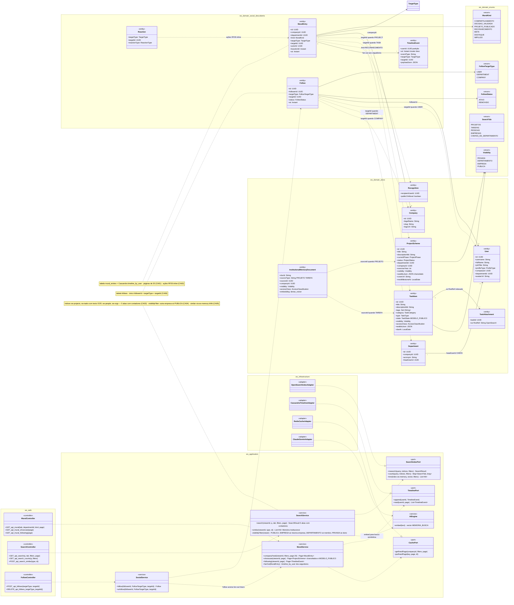
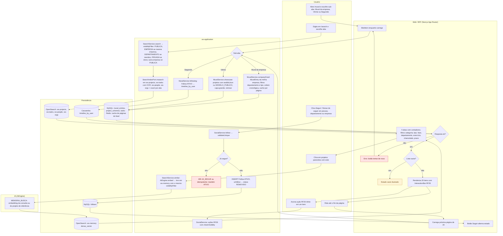
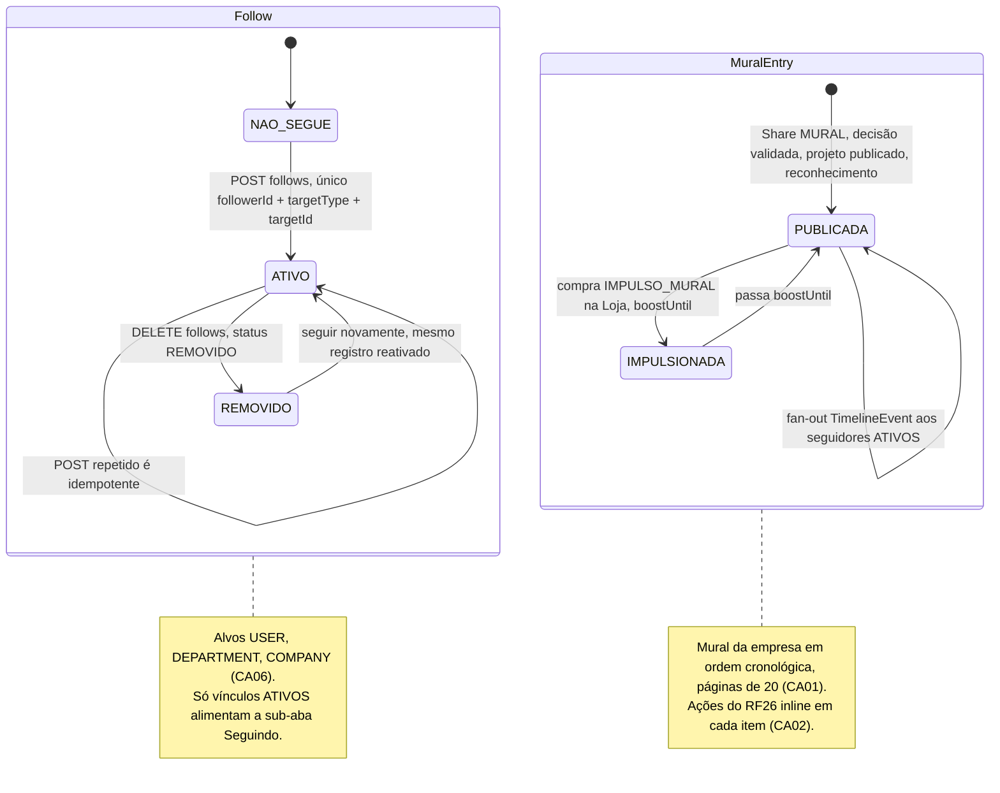
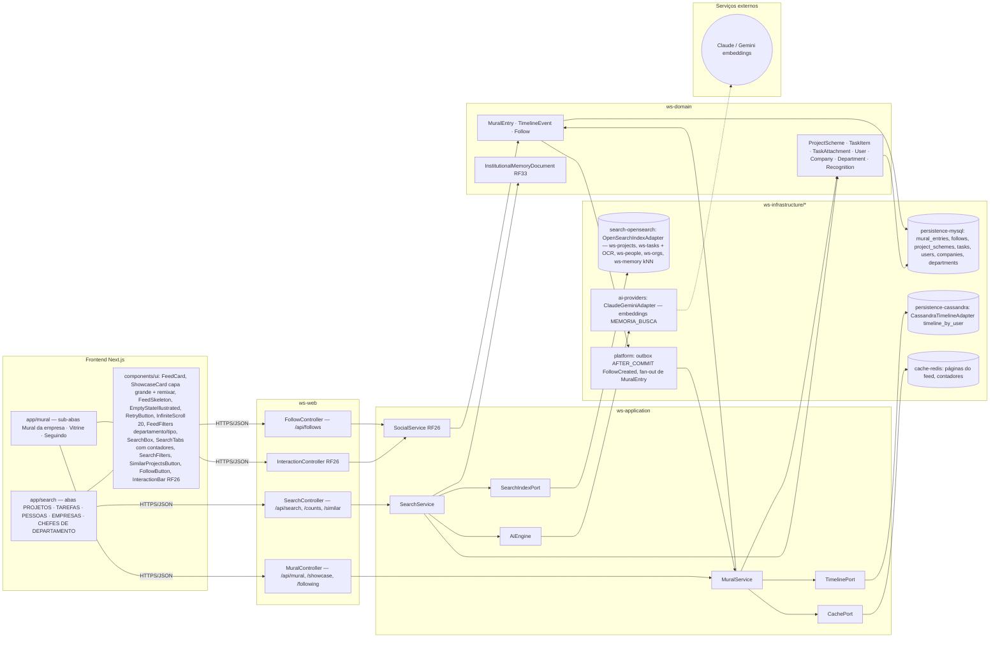

# RF27 — Navegar no Mural (mural da empresa e vitrine de projetos) e Buscar projetos, tarefas, pessoas, empresas e chefes de departamento
**HU:** HU27 · **Sprint (board Work Station):** 4 · **Equivalente FAI:** Feed (Comunidade/Passarela) + RF8 Buscar/Explorar · **Aba/rota:** Mural (`/mural`, sub-abas Mural da empresa · Vitrine de projetos · Seguindo) e Buscar (`/search`, abas PROJETOS · TAREFAS · PESSOAS · EMPRESAS · CHEFES DE DEPARTAMENTO)
**Critérios de aceite cobertos:** RF27.CA01 · CA02 · CA03 · CA04 · CA05 · CA06

**Mural** — três sub-abas: **Mural da empresa** (`MuralEntry` da minha empresa: compartilhamentos, decisões validadas, projetos publicados, reconhecimentos — ordem cronológica, filtros por departamento e tipo de item), **Vitrine de projetos** (= Passarela: projetos chancelados `sealIdsJson` e modelos `MODELO_PUBLICO`, capa grande e "remixar") e **Seguindo** (atividade das pessoas/departamentos/empresas que sigo, via `Follow` + Cassandra `timeline_by_user`). Páginas de 20 itens, skeleton, estado vazio ilustrado e "tentar de novo" em erro; cada item traz as ações do RF26 inline. **Buscar** — textual (título, descrição, tags, texto OCR de documentos via `TaskAttachment.ocrTextRef`) nos índices OpenSearch, devolvendo as **5 abas com contadores**, respeitando visibilidade e perfil (outra empresa só se PUBLICA); busca **semântica** opcional ("projetos parecidos com este") sobre a Memória Institucional (`InstitutionalMemoryDocument`, RF33). **Seguir/deixar de seguir** pessoas, departamentos e empresas com vínculo único.

| Aba de Buscar | Índice OpenSearch | Entidade | Filtros |
|---|---|---|---|
| PROJETOS | `ws-projects` | `ProjectScheme` | fase, departamento, exercício, chancelado, prazo |
| TAREFAS | `ws-tasks` (+ texto OCR) | `TaskItem`, `TaskAttachment.ocrTextRef` | categoria, tipo, departamento, chancelado, prazo |
| PESSOAS | `ws-people` | `User` (EMPREGADO) | departamento, empresa |
| EMPRESAS | `ws-orgs` | `Company` | — |
| CHEFES DE DEPARTAMENTO | `ws-people` (profileType CHEFE_DEPARTAMENTO) | `User`, `Department.headUserId` | empresa, departamento |
| semântica (opcional) | `ws-memory` kNN | `InstitutionalMemoryDocument` | sourceType PROJETO/TAREFA |

## 1. Diagrama de classes

## 2. Diagrama de atividades

## 3. Diagrama de sequência

```mermaid
sequenceDiagram
  autonumber
  actor U as Usuário
  participant NX as Next.js (App Router)
  participant C as Controller (ws-web)
  participant S as Service (ws-application)
  participant AI as AiEngine
  participant DB as Repository/MySQL
  participant CS as Cassandra
  participant OS as OpenSearch
  participant R as Redis
  participant DE as DomainEvents (AFTER_COMMIT)

  U->>NX: abre /mural (Mural da empresa, filtro departamento SECID-UTS)
  NX->>NX: renderiza skeleton (CA01)
  NX->>C: GET /api/mural?tab=EMPRESA&departmentId=UTS&page=1&size=20
  C->>S: MuralService.companyFeed(viewerId, filters, page 1)
  S->>R: GET feed:{companyId}:{filtersHash}:1
  alt cache miss
    S->>DB: mural_entries WHERE companyId AND departmentId ORDER BY at DESC LIMIT 20
    S->>R: SET feed:… TTL 30s
  end
  alt falha de infraestrutura
    S-->>C: 503 INDISPONIVEL {correlationId}
    C-->>NX: 503
    NX-->>U: erro com botão "tentar de novo" (CA01)
  else ok
    S-->>C: 200 Page {items 20, nextPage}
    C-->>NX: 200
    alt lista vazia
      NX-->>U: estado vazio ilustrado (CA01)
    else itens
      NX-->>U: 20 cards com ações do RF26 inline (CA02)
    end
  end

  U->>NX: sub-aba Seguindo
  NX->>C: GET /api/mural/following?page=1
  C->>S: MuralService.following(viewerId, 1)
  S->>CS: timeline_by_user WHERE userId = viewer ORDER BY at DESC LIMIT 20
  CS-->>S: eventos das pessoas e departamentos seguidos
  S-->>C: 200 Page
  C-->>NX: 200

  U->>NX: sub-aba Vitrine de projetos
  NX->>C: GET /api/mural/showcase?page=1
  C->>S: MuralService.showcase
  S->>DB: project_schemes WHERE sealIdsJson não vazio OR tasks.state MODELO_PUBLICO, visibility PUBLICA ou EMPRESA
  S-->>C: 200 projetos com capa grande e ação remixar
  C-->>NX: 200

  U->>NX: busca "pavimentação" em /search (CA03)
  NX->>C: GET /api/search?q=pavimentacao&tab=PROJETOS&fase=ELABORACAO&page=1
  C->>S: SearchService.search(viewerId, q, PROJETOS, filters, 1)
  S->>S: visibilityFilter(viewer) = PUBLICA + EMPRESA (minha empresa) + DEPARTAMENTO (minhas lotações) + PRIVADA (ownerId = eu) (CA04)
  S->>OS: msearch ws-projects, ws-tasks (title, descriptionMd, tags, ocrText), ws-people, ws-orgs com filtros de visibilidade e perfil
  OS-->>S: hits da aba PROJETOS + counts por índice
  S-->>C: 200 {tabs: {PROJETOS 12, TAREFAS 31, PESSOAS 2, EMPRESAS 1, CHEFES_DE_DEPARTAMENTO 1}, items}
  C-->>NX: 200
  NX-->>U: 5 abas com contadores e filtros — resultados de outra empresa só se PUBLICA (CA04)

  U->>NX: "projetos parecidos com este" no projeto P1 (CA05)
  NX->>C: POST /api/search/similar {type PROJECT, id P1}
  C->>S: SearchService.similar(viewerId, PROJECT, P1)
  S->>AI: embed(título + objetivo + descrição de P1) MEMORIA_BUSCA
  AI-->>S: vector
  S->>OS: knn ws-memory (dense_vector) filtros sourceType PROJETO, visibilityFilter, accessClass não SIGILOSO
  OS-->>S: top 10 InstitutionalMemoryDocument
  S-->>C: 200 projetos parecidos com score
  C-->>NX: 200

  U->>NX: Seguir o departamento CPOE (CA06)
  NX->>C: POST /api/follows {targetType DEPARTMENT, targetId CPOE}
  C->>S: SocialService.follow(followerId, DEPARTMENT, CPOE)
  S->>DB: SELECT follows WHERE followerId AND DEPARTMENT AND CPOE (índice único)
  alt já segue
    S-->>C: 200 Follow existente (idempotente)
  else novo
    S->>DB: INSERT follows (status ATIVO)
    S->>DE: publish FollowCreated
    S-->>C: 201 Follow
  end
  C-->>NX: 201
  NX-->>U: botão vira "Seguindo"
  DE->>CS: backfill opcional dos últimos eventos de CPOE em timeline_by_user do seguidor
  Note over DE,CS: a cada nova MuralEntry de CPOE, MuralService.fanOut grava TimelineEvent em timeline_by_user de cada seguidor ATIVO
  U->>NX: Deixar de seguir
  NX->>C: DELETE /api/follows/DEPARTMENT/CPOE
  C->>S: SocialService.unfollow
  S->>DB: UPDATE follows SET status REMOVIDO
  S-->>C: 204
```

## 4. Máquina de estados

O RF27 é majoritariamente leitura. A entidade que ele altera é o **`Follow`** (`status` ATIVO · REMOVIDO, CA06); o segundo bloco mostra o ciclo do **`MuralEntry`** (sem campo de status, apenas `boostUntil` do impulso comprado na Loja, RF42) para contextualizar a ordem do Mural.

## 5. Diagrama de componentes

## 6. Rastreabilidade

| CA | Elemento do diagrama (classe / passo / mensagem / transição / componente) |
|---|---|
| RF27.CA01 | `MuralEntry` (nota páginas de 20), `MuralService.companyFeed/showcase/following`, `CachePort`, `TimelinePort` · Atividades `U1 → W1 (skeleton) → A1 → A2/A3/A4 → W2 (não) → W3 tentar de novo`, `W4 (sim) → W5 estado vazio`, `W6 → U2 → W7 próxima página` · Sequência `GET /api/mural?…&size=20` com `alt falha de infraestrutura → 503 … tentar de novo` e `alt lista vazia → estado vazio ilustrado` · Nota de *MuralEntry* · Componentes `FeedSkeleton`, `EmptyStateIllustrated`, `RetryButton`, `InfiniteScroll 20`, `cache-redis` |
| RF27.CA02 | `Reaction ..> MuralEntry : ações RF26 inline`, `SocialService` · Atividades `W6 → U3 → A12` · Sequência "20 cards com ações do RF26 inline" · Transição `PUBLICADA` (nota) · Componentes `InteractionBar RF26`, `InteractionController RF26` |
| RF27.CA03 | `SearchService.search`, `SearchIndexPort.msearch/count`, enum `SearchTab`, `TaskAttachment.ocrTextRef`, tabela de índices do cabeçalho · Atividades `U4 → A5 → A6 → P3 → W8` · Sequência `GET /api/search?q=…&tab=PROJETOS` → `msearch ws-projects, ws-tasks (title, descriptionMd, tags, ocrText), ws-people, ws-orgs` → `{tabs: {PROJETOS 12, TAREFAS 31, …}}` · Componentes `SearchBox`, `SearchTabs com contadores`, `SearchFilters`, `search-opensearch` |
| RF27.CA04 | `SearchService.visibilityFilter` (nota outra empresa só PUBLICA), enum `Visibility`, `User.profileType`, `Department.headUserId` (aba CHEFES) · Atividades `A5` · Sequência `visibilityFilter(viewer) = PUBLICA + EMPRESA (minha empresa) + …` e "resultados de outra empresa só se PUBLICA" |
| RF27.CA05 | `InstitutionalMemoryDocument` (embedding dense_vector), `SearchService.similar`, `SearchIndexPort.knn`, `AiEngine.embed` · Atividades `U5 → A7 → I1 → P4 → W8` · Sequência `POST /api/search/similar {PROJECT, P1}` → `embed(…) MEMORIA_BUSCA` → `knn ws-memory … accessClass não SIGILOSO` · Componentes `SimilarProjectsButton`, `ws-memory kNN`, `ai-providers embeddings`, `Claude / Gemini embeddings` |
| RF27.CA06 | `Follow` (nota índice único), enums `FollowTargetType`, `FollowStatus`, `SocialService.follow/unfollow`, `MuralService.fanOut`, `TimelineEvent` · Atividades `U6 → A8 → A9 → A10 / A11 → P5 → W9` · Sequência `POST /api/follows {DEPARTMENT, CPOE}` → `alt já segue → idempotente` / `INSERT follows (ATIVO)` → `DELETE /api/follows/DEPARTMENT/CPOE` → `status REMOVIDO`, nota de fan-out · Máquina *Follow* (NAO_SEGUE → ATIVO → REMOVIDO → ATIVO) · Componentes `FollowButton`, `FollowController`, `persistence-cassandra timeline_by_user` |
