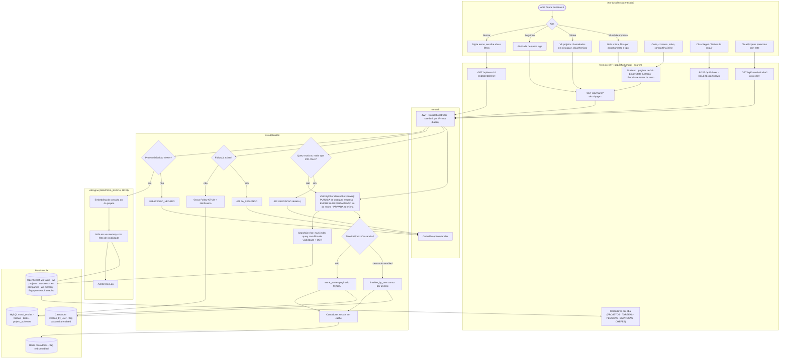
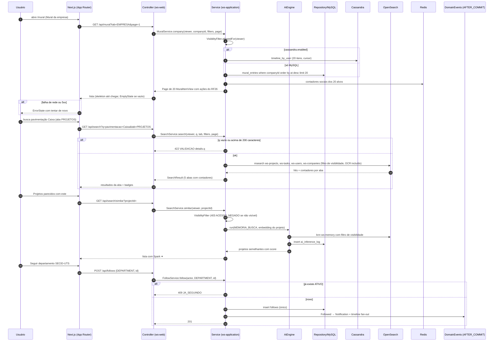
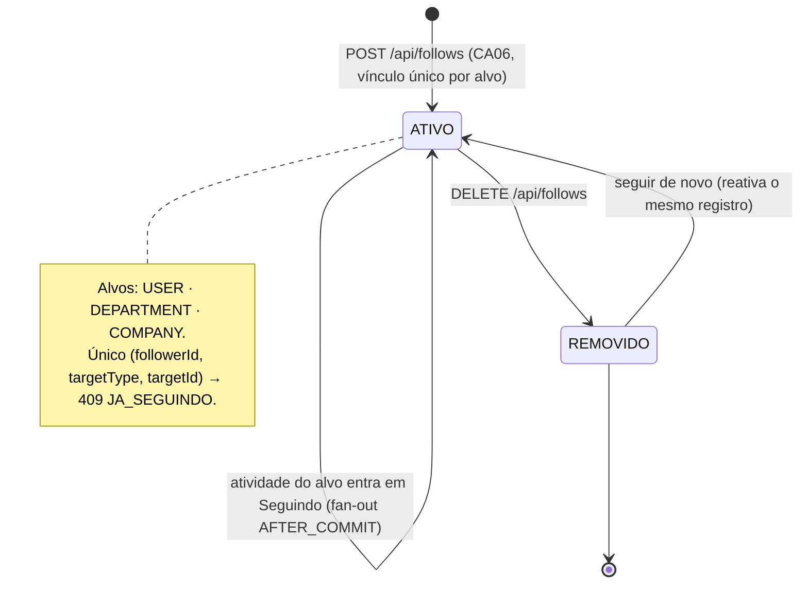
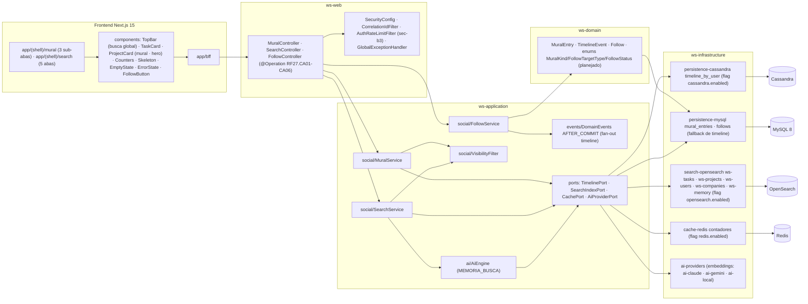

# RF27 — Navegar no Mural (mural da empresa e vitrine de projetos) e Buscar projetos, tarefas, pessoas, empresas e chefes de departamento
**HU:** HU27 · **Sprint (board Work Station):** Sprint 4 (comprometido) · **Equivalente FAI:** Feed (Comunidade/Passarela) + RF8 Buscar/Explorar · **Aba/rota:** Mural (`/mural`, sub-abas Mural da empresa · Vitrine de projetos · Seguindo) e Buscar (`/search?q=&tab=PROJETOS|TAREFAS|PESSOAS|EMPRESAS|CHEFES`)
**Critérios de aceite cobertos:** RF27.CA01 · CA02 · CA03 · CA04 · CA05 · CA06 (corpo do card, inalterado) — regra: o **título do card** define o RF e o corpo traz os próprios CAs.

O Mural é a projeção cronológica `MuralEntry` (MySQL) espelhada em Cassandra `timeline_by_user` (flag `cassandra.enabled`; sem a flag, consulta MySQL paginada). A Busca é textual (OpenSearch `ws-tasks`, `ws-projects`, `ws-users`, `ws-companies`; OCR de anexos em `TaskAttachment.ocrTextRef`) e, opcionalmente, semântica via Memória Institucional (`ws-memory`, RF33). Toda leitura passa pelo filtro de **visibilidade e perfil** (`VisibilityFilter`: itens de outra empresa só se `PUBLICA`). Seguir é `Follow` único por (followerId, targetType, targetId).

## 1. Diagrama de classes

```mermaid
classDiagram
direction LR

namespace ws_domain_social {
  class MuralEntry {
    <<entity>>
    +id: UUID
    +companyId: UUID
    +departmentId: UUID
    +kind: MuralKind
    +targetType: TargetType
    +targetId: UUID
    +actorId: UUID
    +boostUntil: Instant
    +at: Instant
  }
  class TimelineEvent {
    <<entity>>
    +userId: UUID
    +at: Instant
    +eventType: String
    +targetType: TargetType
    +targetId: UUID
    +payloadJson: JSON
  }
  class Follow {
    <<entity>>
    +id: UUID
    +followerId: UUID
    +targetType: FollowTargetType
    +targetId: UUID
    +status: FollowStatus
    +at: Instant
  }
  class Reaction {
    <<entity>>
    +actorId: UUID
    +targetType: TargetType
    +targetId: UUID
    +reactionType: ReactionType
  }
  class MuralKind {
    <<enum>>
    COMPARTILHAMENTO
    DECISAO_VALIDADA
    PROJETO_PUBLICADO
    RECONHECIMENTO
    META
    DESTAQUE
    IMPULSO
  }
  class FollowTargetType {
    <<enum>>
    USER
    DEPARTMENT
    COMPANY
  }
  class FollowStatus {
    <<enum>>
    ATIVO
    REMOVIDO
  }
}

namespace ws_domain_indexados {
  class TaskItem {
    <<entity>>
    +id: UUID
    +title: String
    +summary: String
    +tags: Set~String~
    +visibility: Visibility
    +accessClass: AccessClassification
    +companyId: UUID
    .. +50 campos ..
  }
  class TaskAttachment {
    <<entity>>
    +taskId: UUID
    +ocrStatus: String
    +ocrTextRef: String
  }
  class ProjectScheme {
    <<entity>>
    +id: UUID
    +title: String
    +status: ProjectStatus
    +visibility: Visibility
    +sealIdsJson: JSON
    +offeredInCounter: boolean
    .. +32 campos ..
  }
  class User {
    <<entity>>
    +id: UUID
    +username: String
    +fullName: String
    +profileType: ProfileType
    +companyId: UUID
    +departmentId: UUID
  }
  class Company {
    <<entity>>
    +id: UUID
    +legalName: String
    +slug: String
  }
  class Department {
    <<entity>>
    +id: UUID
    +name: String
    +acronym: String
    +headUserId: UUID
  }
  class InstitutionalMemoryDocument {
    <<entity>>
    +docId: String
    +sourceType: MemorySourceType
    +embedding: dense_vector
    +visibility: Visibility
  }
}

namespace ws_application {
  class MuralService {
    <<service>>
    +company(viewer, companyId, filters, page) Page~MuralItemView~
    +showcase(viewer, page) Page~ProjectCardView~
    +following(viewer, page) Page~MuralItemView~
  }
  class SearchService {
    <<service>>
    +search(viewer, q, tab, filters, page) SearchResult
    +similar(viewer, projectId) List~ProjectCardView~
  }
  class FollowService {
    <<service>>
    +follow(actor, targetType, targetId) Follow
    +unfollow(actor, targetType, targetId)
  }
  class VisibilityFilter {
    <<service>>
    +allowedFor(viewer) Filter
  }
  class SocialService {
    <<service>>
    +react(actor, targetType, targetId, type)
  }
  class Guard {
    <<service>>
    +requireSameCompany(actor, companyId)
  }
  class TimelinePort {
    <<port>>
    +append(userId, TimelineEvent)
    +page(userId, cursor)
  }
  class SearchIndexPort {
    <<port>>
    +search(index, query, filter, page)
    +knn(index, embedding, filter)
  }
  class CachePort {
    <<port>>
    +counters(targetIds)
  }
}

namespace ws_web {
  class MuralController {
    <<controller>>
    +GET_api_mural(tab, departmentId, kind, page)
    +GET_api_mural_showcase(page)
  }
  class SearchController {
    <<controller>>
    +GET_api_search(q, tab, filters, page)
    +GET_api_search_similar(projectId)
  }
  class FollowController {
    <<controller>>
    +POST_api_follows(targetType, targetId)
    +DELETE_api_follows(targetType, targetId)
  }
}

namespace ws_infrastructure {
  class CassandraTimelineAdapter {
    <<adapter>>
  }
  class MysqlTimelineAdapter {
    <<adapter>>
  }
  class OpenSearchIndexAdapter {
    <<adapter>>
  }
  class RedisCountersAdapter {
    <<adapter>>
  }
}

MuralEntry ..> TaskItem : targetType TASK
MuralEntry ..> ProjectScheme : targetType PROJECT
TimelineEvent ..> MuralEntry : projecao por seguidor
Follow ..> User : USER
Follow ..> Department : DEPARTMENT
Follow ..> Company : COMPANY
Department "0..1" --> "0..1" User : headUserId CHEFES
TaskAttachment "0..*" --> "1" TaskItem
MuralController --> MuralService
SearchController --> SearchService
FollowController --> FollowService
MuralService --> VisibilityFilter
SearchService --> VisibilityFilter
MuralService --> TimelinePort
MuralService --> CachePort
SearchService --> SearchIndexPort
SearchService ..> InstitutionalMemoryDocument : similar RF33
FollowService --> Guard
MuralService ..> SocialService : acoes inline RF26
CassandraTimelineAdapter ..|> TimelinePort
MysqlTimelineAdapter ..|> TimelinePort
OpenSearchIndexAdapter ..|> SearchIndexPort
RedisCountersAdapter ..|> CachePort
```

## 2. Diagrama de atividades

## 3. Diagrama de sequência

## 4. Máquina de estados

Entidade central: `Follow.status` (`FollowStatus`). `MuralEntry` não tem estado (append-only; o impulso é só `boostUntil`, RF42). Os itens exibidos seguem as máquinas de `TaskState` (RF41) e `ProjectStatus` (RF22).

## 5. Diagrama de componentes

## 6. Rastreabilidade

| CA | Classe | Passo | Mensagem | Transição | Componente |
|---|---|---|---|---|---|
| RF27.CA01 | `MuralService.company/showcase/following`, `TimelinePort.page` (20 por página) | A2/A3/A4 → F1 → F2 → P2 → P3/P4 → P10 | 1–12 | — | `Skeleton · EmptyState · ErrorState`, `CASA`, `MY` |
| RF27.CA02 | `SocialService.react`, `Reaction`, `MuralItemView.actions` | A6 → F1 | 9 (ações do RF26 na view) | — | `Counters`, `TaskCard`, `ProjectCard` |
| RF27.CA03 | `SearchService.search`, `SearchIndexPort.search`, `TaskAttachment.ocrTextRef`, contadores por aba | A5 → F3 → P6 (422) → P5 → F4 | 13–21 | — | `SS`, `OSA` |
| RF27.CA04 | `VisibilityFilter.allowedFor`, `Visibility`, `Guard.requireSameCompany` | P1 (toda leitura) · P9 (403 ACESSO_NEGADO) | 4, 25 | — | `VF` |
| RF27.CA05 | `SearchService.similar`, `InstitutionalMemoryDocument`, `AiEngine MEMORIA_BUSCA` | A8 → F6 → P9 → I1 → I2 → I3 | 22–29 | — | `AIE`, `AIP`, `OSA (ws-memory)` |
| RF27.CA06 | `Follow` (único), `FollowService.follow/unfollow`, `Notification`, fan-out `TimelineEvent` | A7 → F5 → P7 (409 JA_SEGUINDO) → P8 | 30–37 | `[*] → ATIVO → REMOVIDO → ATIVO` | `FS`, `FollowButton`, `DE` |
