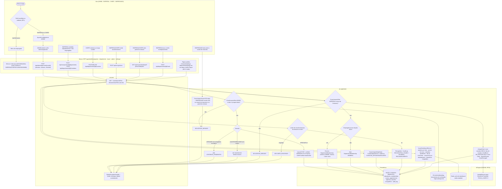
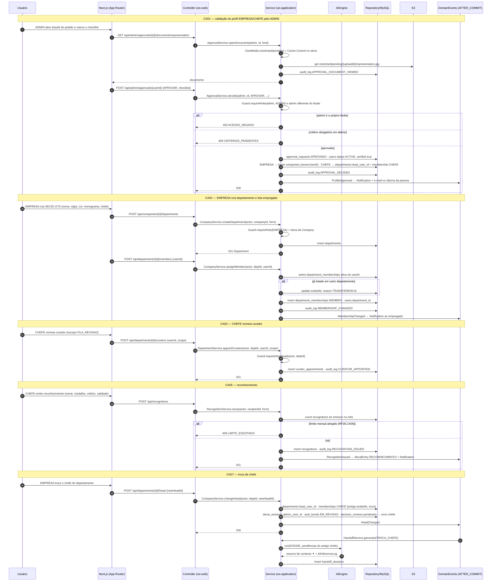
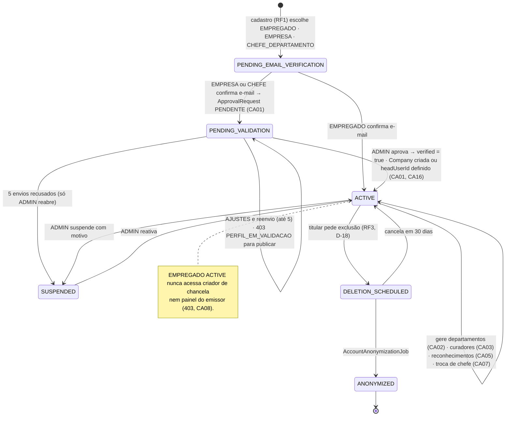
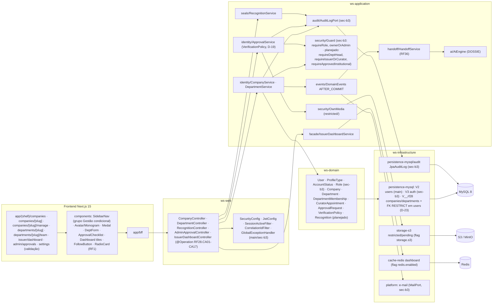
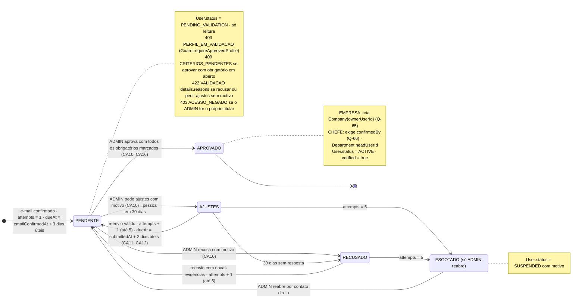

# RF28 — Gerir perfis de empresa e chefe de departamento (departamentos, página institucional, chancela de tarefas/projetos e emissão de reconhecimentos)
**HU:** HU28 · **Sprint (board Work Station):** Sprint 4 (comprometido) · **Equivalente FAI:** RF14 Aba Marcas + RF22 Perfil institucional (perfis MARCA/CELEBRIDADE; verificação = `IssuerVerificationPolicy`) · **Aba/rota:** Empresas & Departamentos (`/companies`, `/companies/[slug]`, `/companies/[slug]/manage`, `/companies/[slug]/manage/departments`, `/departments/[slug]`, `/departments/[slug]/team`), painel do emissor (`/issuer/dashboard`), fila do ADMIN (`/admin/approvals`), central de validação da pessoa (`/settings?tab=validacao`)
**Critérios de aceite cobertos:** RF28.CA01 · CA02 · CA03 · CA04 · CA05 · CA06 · CA07 · CA08 (corpo do card, inalterado) + **RF28.CA09 … CA17 (CA a confirmar, D-19 — validação institucional com `VerificationPolicy` versionada, §7)** — regra: o **título do card** define o RF e o corpo traz os próprios CAs; o fluxo de chancelas em si está no RF39 e o Balcão no RF40.

Perfis: **EMPREGADO** (= PESSOAL), **EMPRESA** (= MARCA), **CHEFE_DEPARTAMENTO** (= CELEBRIDADE), **ADMIN**; papel contextual **CURADOR** (`CuratorAppointment`). EMPRESA e CHEFE nascem `PENDING_VALIDATION` e passam pelo ADMIN (`ApprovalRequest` + `VerificationPolicy`). A EMPRESA cria `Department`s e lota pessoas (`DepartmentMembership`, 1 lotação ativa por vez, histórico preservado). A troca de chefe (`Department.headUserId`) move sessões DECIA, filas de revisão e chancelas pendentes e gera o Dossiê de Transição (RF36). O que já existe em código (`sec-b3`): `User` com `profileType`/`status`/`verified`, `ProfileType`, `AccountStatus`, `Guard.requireRole/ownerOrAdmin`, `AuditLogPort`; `Company`, `Department` e o restante são **planejados** (`users.company_id`/`department_id` sem FK até a migration deste RF, D-23).

## 1. Diagrama de classes

```mermaid
classDiagram
direction LR

namespace ws_domain_identity {
  class User {
    <<entity>>
    +id: UUID
    +username: String
    +fullName: String
    +profileType: ProfileType
    +role: Role
    +status: AccountStatus
    +jobTitle: String
    +companyId: UUID
    +departmentId: UUID
    +verified: boolean
    +accountOrigin: AccountOrigin
    .. +25 campos (sec-b3) ..
  }
  class Company {
    <<entity>>
    +id: UUID
    +ownerUserId: UUID
    +legalName: String
    +slug: String
    +cnpj: String
    +logoUrl: String
    +coatOfArmsUrl: String
    +about: String
    +websiteUrl: String
    +accentColor: String
    +pointsPolicyJson: JSON
    +hypePolicyJson: JSON
    +recordingRetentionPolicy: String
    +status: String
  }
  class Department {
    <<entity>>
    +id: UUID
    +companyId: UUID
    +name: String
    +acronym: String
    +slug: String
    +color: String
    +monogram: String
    +headUserId: UUID
    +about: String
    +coverUrl: String
    +active: boolean
  }
  class DepartmentMembership {
    <<entity>>
    +id: UUID
    +userId: UUID
    +departmentId: UUID
    +roleInDept: DeptRole
    +startedAt: Instant
    +endedAt: Instant
    +reason: String
  }
  class CuratorAppointment {
    <<entity>>
    +id: UUID
    +departmentId: UUID
    +curatorUserId: UUID
    +appointedBy: UUID
    +appointedAt: Instant
    +revokedAt: Instant
    +revokeReason: String
    +scope: CuratorScope
  }
  class ApprovalRequest {
    <<entity>>
    +id: UUID
    +userId: UUID
    +requestedProfile: ProfileType
    +status: ApprovalStatus
    +policyVersion: String
    +criteriaJson: JSON
    +reasonsJson: JSON
    +note: String
    +attempts: int
    +emailConfirmedAt: Instant
    +submittedAt: Instant
    +dueAt: Instant
    +verificationCode: String
    +documentKeysJson: JSON
    +confirmedBy: UUID
    +reviewedBy: UUID
    +reviewedAt: Instant
  }
  class VerificationPolicy {
    <<entity>>
    +id: UUID
    +version: String
    +profileType: ProfileType
    +criteriaJson: JSON
    +reasonsJson: JSON
    +maxSubmissions: int
    +slaBusinessDays: int
    +status: String
  }
  class ProfileType {
    <<enum>>
    EMPREGADO
    EMPRESA
    CHEFE_DEPARTAMENTO
  }
  class AccountStatus {
    <<enum>>
    PENDING_EMAIL_VERIFICATION
    PENDING_VALIDATION
    ACTIVE
    SUSPENDED
    DELETION_SCHEDULED
    ANONYMIZED
  }
  class ApprovalStatus {
    <<enum>>
    PENDENTE
    AJUSTES
    APROVADO
    RECUSADO
  }
  class DeptRole {
    <<enum>>
    MEMBRO
    CHEFE
    CURADOR
  }
  class CuratorScope {
    <<enum>>
    FILA_REVISAO
    PREMIACAO
    AMBOS
  }
}

namespace ws_domain_seals_gamification {
  class Recognition {
    <<entity>>
    +id: UUID
    +issuerUserId: UUID
    +recipientUserId: UUID
    +name: String
    +medalArtJson: JSON
    +criterion: String
    +source: RecognitionSource
    +validUntil: LocalDate
    +issuedAt: Instant
    +publicOnMural: boolean
  }
  class SealBond {
    <<entity>>
    +sealId: UUID
    +status: SealBondStatus
    +requiresReview: boolean
  }
  class HandoffDossier {
    <<entity>>
    +subjectType: String
    +reason: HandoffReason
    +status: HandoffStatus
  }
  class MetricSnapshot {
    <<entity>>
    +metricCode: String
    +scope: MetricScope
    +scopeId: UUID
    +value: BigDecimal
  }
  class AuditLog {
    <<entity>>
    +actorId: UUID
    +action: String
    +resourceType: String
    +resourceId: String
    +result: String
    +correlationId: String
  }
}

namespace ws_application {
  class CompanyService {
    <<service>>
    +update(actor, companyId, CompanyForm) Company
    +createDepartment(actor, companyId, DepartmentForm) Department
    +updateDepartment(actor, deptId, DepartmentForm) Department
    +assignMember(actor, deptId, userId) DepartmentMembership
    +changeHead(actor, deptId, newHeadId) Department
    +publicPage(viewer, slug) CompanyPageView
  }
  class DepartmentService {
    <<service>>
    +publicPage(viewer, slug) DepartmentPageView
    +appointCurator(actor, deptId, userId, scope) CuratorAppointment
    +revokeCurator(actor, appointmentId, reason)
  }
  class RecognitionService {
    <<service>>
    +issue(actor, recipientId, RecognitionForm) Recognition
    -checkMonthlyLimit(issuerId) 409 LIMITE_ESGOTADO
  }
  class ApprovalService {
    <<service>>
    +queue(admin, filters) Page~ApprovalRequest~
    +decide(admin, id, decision, reasons, checklist, note) ApprovalRequest
    +resubmit(actor, evidence) ApprovalRequest
    +confirmHead(actor, deptId, approvalId)
  }
  class IssuerDashboardService {
    <<service>>
    +load(actor, period, deptId) IssuerDashboardView
  }
  class Guard {
    <<service>>
    +requireRole(actor, role)
    +requireDeptHead(actor, deptId)
    +requireApprovedInstitutional(actor)
    +requireIssuerOrCurator(actor, deptId)
  }
  class AuditLogPort {
    <<port>>
    +record(AuditEvent)
  }
  class DomainEvents {
    <<service>>
    +publish(event)
  }
}

namespace ws_web {
  class CompanyController {
    <<controller>>
    +GET_api_companies_slug()
    +PATCH_api_companies_id()
    +POST_api_companies_id_departments()
    +PATCH_api_departments_id()
    +POST_api_departments_id_members(userId)
    +POST_api_departments_id_head(newHeadId)
  }
  class DepartmentController {
    <<controller>>
    +GET_api_departments_slug()
    +POST_api_departments_id_curators(userId, scope)
    +DELETE_api_departments_id_curators_appointmentId(reason)
  }
  class RecognitionController {
    <<controller>>
    +POST_api_recognitions(form)
  }
  class AdminApprovalController {
    <<controller>>
    +GET_api_admin_approvals()
    +POST_api_admin_approvals_userId(decision)
    +GET_api_admin_approvals_id_documents_kind()
  }
  class IssuerDashboardController {
    <<controller>>
    +GET_api_issuer_dashboard(period, deptId)
  }
}

Company "1" o-- "0..*" Department
Company "1" o-- "0..*" User : emprega
Department "1" o-- "0..*" DepartmentMembership : lotacoes
User "1" o-- "0..*" DepartmentMembership : historico
Department "0..1" --> "0..1" User : headUserId
Department "1" o-- "0..*" CuratorAppointment
User "1" --> "0..1" ApprovalRequest
VerificationPolicy "1" o-- "0..*" ApprovalRequest : policyVersion
User "1" o-- "0..*" Recognition : recebe
Department ..> SealBond : fila de revisao RF39
Department ..> HandoffDossier : troca de chefe RF36
CompanyController --> CompanyService
DepartmentController --> DepartmentService
RecognitionController --> RecognitionService
AdminApprovalController --> ApprovalService
IssuerDashboardController --> IssuerDashboardService
CompanyService --> Guard
DepartmentService --> Guard
RecognitionService --> Guard
ApprovalService --> Guard
IssuerDashboardService ..> MetricSnapshot
CompanyService --> AuditLogPort
DepartmentService --> AuditLogPort
RecognitionService --> AuditLogPort
ApprovalService --> AuditLogPort
AuditLogPort ..> AuditLog
CompanyService --> DomainEvents
```

## 2. Diagrama de atividades

## 3. Diagrama de sequência

## 4. Máquina de estados

Entidade central: `User.status` (`AccountStatus`, enum existente em `sec-b3`) para os perfis institucionais; o sub-estado da validação (`ApprovalRequest.status`) está em §7.2. `DepartmentMembership` não tem enum: ativa (`endedAt` nulo) ou encerrada.

## 5. Diagrama de componentes

## 6. Rastreabilidade

| CA | Classe | Passo | Mensagem | Transição | Componente |
|---|---|---|---|---|---|
| RF28.CA01 | `User.profileType/status`, `ApprovalRequest`, `ApprovalService.decide`, `Guard.requireRole`, `AdminApprovalController.POST_api_admin_approvals_userId` | A1 → A2 → A4 → F2 → P1 (403) → P2 (409/422) → P3 · F1 (menus por perfil) | 1–18 | `PENDING_EMAIL_VERIFICATION → PENDING_VALIDATION → ACTIVE` | `APS`, `admin/approvals`, `SidebarNav` |
| RF28.CA02 | `Department`, `DepartmentMembership` (1 ativa, histórico), `CompanyService.createDepartment/assignMember` | A5 → F3 → P4 → P5 → P6/P7 | 19–31 | `ACTIVE → self (departamentos)` | `CS`, `DeptForm`, `MY` |
| RF28.CA03 | `CuratorAppointment`, `CuratorScope`, `DepartmentService.appointCurator/revokeCurator`, `AuditLog CURATOR_APPOINTED/REVOKED` | A6 → F4 → P8 | 32–37 | `ACTIVE → self (curadores)` | `AUD`, `AUDJ` |
| RF28.CA04 | `CompanyService.publicPage`, `DepartmentService.publicPage`, `Follow` (RF27.CA06), `MetricSnapshot` (métricas públicas) | F8 | — (GET páginas públicas) | — | `R1 (/companies/[slug], /departments/[slug])`, `FollowButton` |
| RF28.CA05 | `Recognition`, `RecognitionService.issue`, `MuralEntry RECONHECIMENTO` | A7 → F5 → P9 (409 LIMITE_ESGOTADO) → P10 | 38–47 | `ACTIVE → self (reconhecimentos)` | `RS`, `Medal` |
| RF28.CA06 | `IssuerDashboardService.load`, `MetricSnapshot`, `AiInferenceLog` (custo de IA), `SealBond` (fila), `BenefitRedemption` | A8 → F6 → P11 | — (GET /api/issuer/dashboard) | — | `IDS`, `RD`, `issuer/dashboard` |
| RF28.CA07 | `Department.headUserId`, `CompanyService.changeHead`, `DomainEvents HeadChanged`, `HandoffDossier TROCA_CHEFE` | A9 → F7 → P4 → P12 → I1 | 48–58 | `ACTIVE → self (troca de chefe)` | `DE`, `HS`, `AIE` |
| RF28.CA08 | `Guard.requireIssuerOrCurator`, `Guard.requireRole` | A10 → P13 → E1 | — (403 em todo endpoint de emissor) | nota de ACTIVE | `GD`, `SidebarNav` |
| RF28.CA09–CA17 (a confirmar) | `ApprovalRequest`, `VerificationPolicy`, `ApprovalStatus` AJUSTES/RECUSADO, `OwnMedia` | §7 | 1–18 | §7.2 | `APS`, `OM`, `S3A` |

## 7. Validação de perfis EMPRESA e CHEFE_DEPARTAMENTO — política versionada (CA a confirmar, D-19)

Bloco **B** do brief de cadastro e LGPD (`docs/produto/CADASTRO_E_LGPD.md`), adaptado da `IssuerVerificationPolicy`/`IssuerReviewService` do FAI: MARCA → **EMPRESA (órgão)**, CELEBRIDADE → **CHEFE_DEPARTAMENTO**, `FAI-XXXXXX` → `WS-XXXXXX`, `400 FORMULARIO_INVALIDO` → `422 VALIDACAO` com `details`. Entidades em `TAXONOMIA.md` §1.8 (`ApprovalRequest`) e §1.9 (`VerificationPolicy`), ambas **proposta**. O cadastro em si (RadioCard, campos por tipo, `PendingUpload`) está no RF1.

### 7.1 Critérios de aceite (RF28.CA09–CA17)

| CA | Enunciado (Dado / Quando / Então) |
|---|---|
| **RF28.CA09** (CA a confirmar) | Dado um `ApprovalRequest`, então ele referencia a `VerificationPolicy` vigente (`policyVersion`), traz o **checklist** de critérios obrigatórios e complementares do tipo (`criteriaJson`, com o resultado automático `OK`/`FALHA`/`ANALISTA` e a marcação do admin) e aceita as decisões `APROVAR`, `AJUSTES` e `RECUSAR`; `ApprovalRequest.status` passa a PENDENTE · **AJUSTES** · APROVADO · **RECUSADO**. |
| **RF28.CA10** (CA a confirmar) | Dado a decisão do ADMIN, então `AJUSTES` e `RECUSAR` exigem **pelo menos um motivo padronizado** (`reasonsJson`; senão `422 VALIDACAO details.reasons`) e `APROVAR` exige todos os critérios obrigatórios marcados (senão `409 CRITERIOS_PENDENTES`, Q-70). A observação livre tem até 500 caracteres e nunca leva dado sensível. |
| **RF28.CA11** (CA a confirmar) | Dado `AJUSTES` ou `RECUSADO`, então a pessoa corrige pela **central de validação** (`/settings?tab=validacao`: status, linha do tempo, critérios, motivos e formulário de reenvio) e reenvia (`POST /api/me/validation/resubmit`); o cadastro conta como 1º envio e há **no máximo 5**; reenvio inválido não grava nada; esgotado o limite, só o ADMIN reabre (`SUSPENDED` com motivo). |
| **RF28.CA12** (CA a confirmar) | Dado o pedido, então o prazo é contado em **dias úteis** (proposta: 3 para a 1ª análise, 2 para reanálise, 30 dias corridos para a pessoa responder a `AJUSTES`; Q-71) a partir de `emailConfirmedAt`; **antes da confirmação do e-mail a conta não entra na fila**. |
| **RF28.CA13** (CA a confirmar) | Dado o ADMIN, então ele **não decide o próprio perfil** (`403 ACESSO_NEGADO`) e cada abertura de documento de verificação (`GET /api/admin/approvals/{id}/documents/{kind}`) responde com `Cache-Control: no-store`, passa por `OwnMedia` (`restricted/pending/`) e gera `AuditLog APPROVAL_DOCUMENT_VIEWED`. |
| **RF28.CA14** (CA a confirmar) | Dado um envio, reenvio ou decisão, então as notificações no app e por e-mail (admins no envio; a pessoa na decisão) saem **depois do commit** (AFTER_COMMIT), no idioma da pessoa. |
| **RF28.CA15** (CA a confirmar) | Dado o modal "Verificar" de um critério de controle (`SITE_OFICIAL`, `ATO_NOMEACAO`), então ele mostra o **link oficial** e o **código de verificação** `WS-` + 6 hex (derivado do `userId`, visível só ao dono na central), com os botões "Confere" e "Não confere → motivo"; o critério `REPRESENTACAO` é marcado automaticamente quando o domínio do e-mail é o mesmo do `officialSite` e não está na lista de e-mails gratuitos. |
| **RF28.CA16** (CA a confirmar, Q-65, Q-66) | Dado `APROVADO`, então para EMPRESA o sistema **cria a `Company`** com `ownerUserId` = a pessoa, `legalName`, `cnpj` e `websiteUrl` vindos da extensão; para CHEFE exige antes a **confirmação do chefe atual ou do dono da EMPRESA** (`confirmedBy`) e então define `Department.headUserId` e abre `DepartmentMembership CHEFE`. `User.status → ACTIVE`, `verified = true`. |
| **RF28.CA17** (CA a confirmar) | Dado o tipo do perfil, então valem os critérios e motivos da tabela §7.3, carregados da política e não fixos nas telas; motivos têm texto i18n (pt-BR, en, es). |

### 7.2 Máquina de estados do `ApprovalRequest` (proposta)

### 7.3 Critérios e motivos propostos (carregados de `VerificationPolicy` v1.0)

**EMPRESA (órgão)**

| Código | Critério | Como é conferido | Obrigatório |
|---|---|---|---|
| `EMAIL_CONFIRMADO` | e-mail da conta confirmado | automático | sim |
| `CNPJ_VALIDO` | 14 dígitos, não repetidos, dígitos verificadores corretos | automático | sim |
| `CNPJ_ATIVO` | situação ativa na Receita Federal e razão social igual à informada | analista (consulta pública) | sim |
| `ORGAO_PUBLICO` | natureza jurídica de órgão ou entidade da administração pública (ou órgão convidado pela SECID) | analista | sim |
| `SITE_OFICIAL` | `officialSite` aberto pelo analista, no domínio institucional, com o mesmo nome do órgão; `@perfil` recusado no cadastro | automático (link) + analista | sim |
| `REPRESENTACAO` | quem cadastrou representa o órgão: e-mail no domínio do site **ou** código `WS-xxxxxx` publicado numa página do site **ou** documento de representação legível (ato de nomeação, portaria) em `restricted/` | automático (domínio) + analista | sim |
| `SEM_CONFLITO` | não repete `Company` já aprovada nem imita órgão de terceiro | automático (nome/CNPJ aprovado) + analista | sim |
| `PERFIL_COMPLETO` | logo/brasão, descrição e contato institucional | automático | não |

**CHEFE_DEPARTAMENTO**

| Código | Critério | Como é conferido | Obrigatório |
|---|---|---|---|
| `EMAIL_CONFIRMADO` | e-mail da conta confirmado | automático | sim |
| `ORGAO_EXISTENTE` | `companyId` aponta para `Company` aprovada | automático | sim |
| `ATO_NOMEACAO` | `appointmentLink` aberto pelo analista no Diário Oficial, nomeando a pessoa para a chefia do departamento informado | automático (link) + analista | sim |
| `NOME_CONFERE` | nome civil do cadastro igual ao do ato | analista | sim |
| `CONFIRMACAO_INSTITUCIONAL` | chefe atual do departamento ou dono da EMPRESA confirma (`confirmedBy`, Q-66) | automático (confirmação registrada) | sim |
| `SEM_CONFLITO` | departamento sem outro chefe pendente ou aprovado para o mesmo período | automático + analista | sim |
| `PERFIL_COMPLETO` | foto, cargo e descrição do departamento | automático | não |

**Motivos padronizados** (texto mostrado à pessoa fica no i18n): `DOCUMENTO_ILEGIVEL` · `DOCUMENTO_DIVERGENTE` · `CNPJ_INVALIDO_OU_INATIVO` · `NAO_E_ORGAO_PUBLICO` · `SITE_NAO_VERIFICAVEL` · `REPRESENTACAO_NAO_COMPROVADA` · `ATO_NOMEACAO_NAO_LOCALIZADO` · `ORGAO_INEXISTENTE` · `CONFIRMACAO_PENDENTE` · `POSSIVEL_IMPERSONACAO` · `DADOS_INCOMPLETOS` · `VIOLACAO_DOS_TERMOS` · `OUTRO` (exige observação).

Endpoints propostos: `GET /api/admin/approvals` (fila, filtros por status e prazo) · `GET /api/admin/approvals/{id}` (dossiê com checklist e verificações automáticas) · `POST /api/admin/approvals/{userId}` (= `{decision, reasons, checklist, note}`; CA01) · `GET /api/admin/approvals/{id}/documents/{kind}` · `GET /api/me/validation` · `POST /api/me/validation/resubmit` · `POST /api/departments/{id}/head-confirmations/{approvalId}` (chefe atual ou dono da EMPRESA). Auditoria: `APPROVAL_SUBMITTED`, `APPROVAL_DECIDED`, `APPROVAL_DOCUMENT_VIEWED`, `APPROVAL_CONFIRMED` (a acrescentar em `AuditActions`, que hoje tem só os códigos de RF1–RF3).

Tela/aba: `/companies` (esqueleto em `app/(shell)/companies/page.tsx`) · `/companies/[slug]` (esqueleto em `app/(shell)/companies/[slug]/page.tsx`) · `/departments/[slug]` (esqueleto em `app/(shell)/departments/[slug]/page.tsx`) · `/recognitions` (esqueleto em `app/(shell)/recognitions/page.tsx`) · `/issuer/dashboard` (esqueleto em `app/(shell)/issuer/dashboard/page.tsx`) · `/companies/[slug]/manage/departments` (esqueleto em `app/(shell)/companies/[slug]/manage/departments/page.tsx`) · `/departments/[slug]/team` (esqueleto em `app/(shell)/departments/[slug]/team/page.tsx`) · `/seals/review` (esqueleto em `app/(shell)/seals/review/page.tsx`) · `/curation` (esqueleto em `app/(shell)/curation/page.tsx`) · `/admin` (esqueleto em `app/(shell)/admin/page.tsx`)
