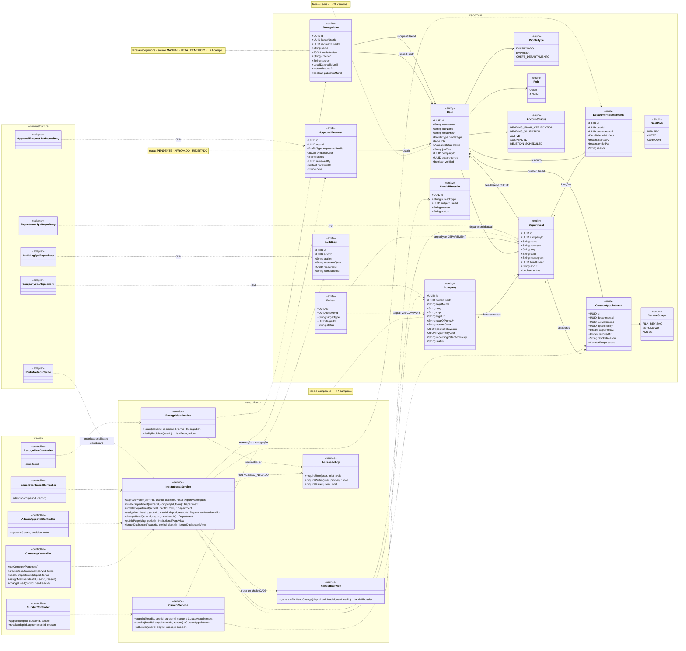
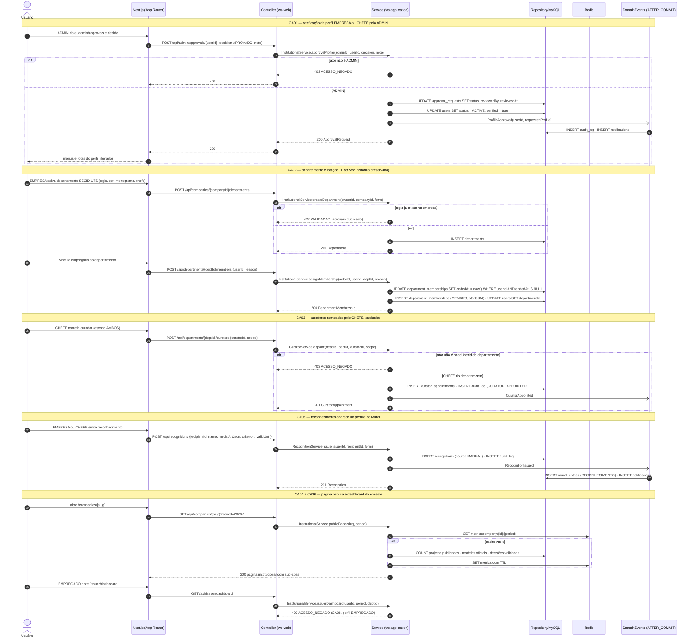
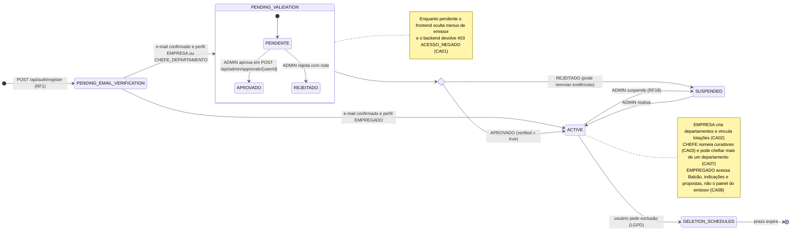
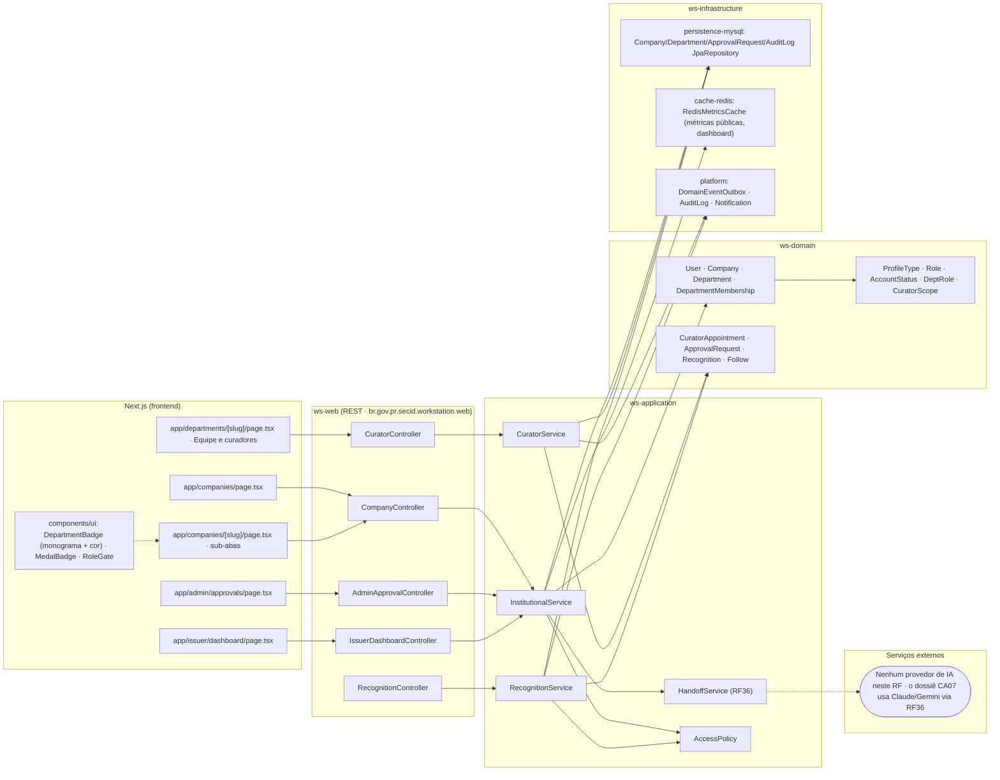
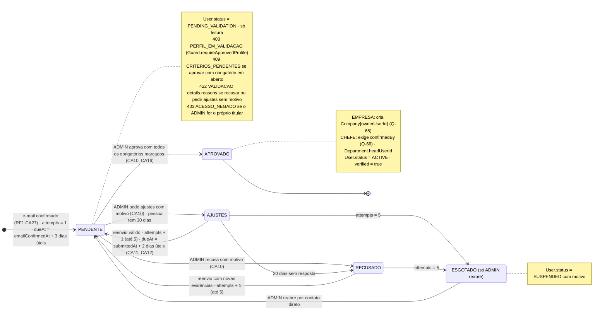

# RF28 — Gerir perfis EMPRESA e CHEFE DE DEPARTAMENTO (departamentos, página institucional, chancela de tarefas/projetos e emissão de reconhecimentos)

**HU:** HU28 · **Sprint (board Work Station):** 4 · **Equivalente FAI:** RF14 Aba Marcas + RF22 Perfil institucional (+ perfis MARCA/CELEBRIDADE); o fluxo de selos/promoções fica no RF39 e o "à venda" no RF40 · **Aba/rota:** Empresas & Departamentos (`/companies`, `/companies/[slug]`, `/departments/[slug]`); aprovação ADMIN em `POST /api/admin/approvals/{userId}`

**Critérios de aceite cobertos:** RF28.CA01 · RF28.CA02 · RF28.CA03 · RF28.CA04 · RF28.CA05 · RF28.CA06 · RF28.CA07 · RF28.CA08 · RF28.CA09–CA17 (§7, validação de perfis com política versionada, D-19, "CA a confirmar")

> Contextos da TAXONOMIA: **1. Identidade & Acesso** (`User`, `Company`, `Department`, `DepartmentMembership`, `CuratorAppointment`, `ApprovalRequest`) e **6. Chancelas & Benefícios** (só `Recognition`). Perfis: EMPREGADO (= PESSOAL), EMPRESA (= MARCA, ex.: Secretaria das Cidades), CHEFE_DEPARTAMENTO (= CELEBRIDADE) e ADMIN. Página da empresa: Sobre · Departamentos · Programas (RF25) · Plano Anual (RF24) · Chancelas e modelos oficiais (RF39) · Benefícios (RF39) · Destaques (RF35) · Pessoas. Página do departamento/chefe: Sobre · Projetos · Sessões DECIA · Chancelas e fila de revisão (RF39) · Reconhecimentos (RF35) · Equipe (com curadores). Papel CURADOR é contextual (`CuratorAppointment`), não um `Role`.

## 1. Diagrama de classes

## 2. Diagrama de atividades

```mermaid
flowchart TD
  subgraph L1["Ator humano"]
    U1["Cadastro RF1: escolhe EMPREGADO, EMPRESA ou CHEFE_DEPARTAMENTO"]
    U2["ADMIN revisa evidências do pedido"]
    U3["EMPRESA cria ou edita departamento (nome, sigla, cor, monograma, chefe)"]
    U4["EMPRESA vincula empregado a um departamento"]
    U5["CHEFE nomeia ou revoga curador (escopo FILA_REVISAO, PREMIACAO, AMBOS)"]
    U6["Visitante abre /companies/[slug] ou /departments/[slug]"]
    U7["Segue empresa ou departamento"]
    U8["EMPRESA ou CHEFE emite reconhecimento (nome, medalha, critério, validade)"]
    U9["EMPRESA ou CHEFE abre o dashboard do emissor"]
    U10["EMPRESA troca o chefe do departamento"]
    U11["EMPREGADO tenta abrir criador de chancela ou painel do emissor"]
  end
  subgraph L2["Web/BFF (Next.js App Router)"]
    W1["Menus e rotas renderizados por profileType"]
    W2["Sub-abas: Sobre · Departamentos · Programas · Plano Anual · Chancelas · Benefícios · Destaques · Pessoas"]
    W3["Filtros de período e departamento"]
  end
  subgraph L3["ws-application"]
    S1{"Perfil EMPRESA ou CHEFE?"}
    S2["User.status = PENDING_VALIDATION e ApprovalRequest PENDENTE"]
    S3["User.status = ACTIVE (EMPREGADO)"]
    S4{"ADMIN aprova?"}
    S5["ApprovalRequest APROVADO · User ACTIVE · verified = true"]
    S6["ApprovalRequest REJEITADO com note"]
    S7{"Ator é ownerUserId da Company e sigla única?"}
    S8["Salva Department (headUserId opcional)"]
    S9["Encerra lotação ativa (endedAt, reason) e abre nova DepartmentMembership MEMBRO"]
    S10["User.departmentId = novo departamento"]
    S11{"Ator é headUserId do departamento?"}
    S12["CuratorAppointment (appointedAt ou revokedAt) + AuditLog"]
    S13["Monta página pública: métricas do período = projetos publicados, modelos oficiais, decisões validadas"]
    S14["Follow targetType COMPANY ou DEPARTMENT (RF27.CA06)"]
    S15["Recognition source MANUAL · publicOnMural → MuralEntry RECONHECIMENTO + perfil RF19"]
    S16["Agrega: projetos por fase · prazos em risco · decisões EM_REVISAO · fila SealBond EM_REVISAO · custo de IA por departamento · BenefitRedemption"]
    S17["Department.headUserId = novo · move DeciaSession.adminUserId, fila de revisão e SealBond pendentes"]
    S18["HandoffService.generateForHeadChange → HandoffDossier (RF36)"]
    S19{"profileType em EMPRESA ou CHEFE_DEPARTAMENTO?"}
    S20["Acesso liberado: Balcão RF40, indicações e propostas RF39.CA06"]
    E1["422 VALIDACAO"]
    E2["403 ACESSO_NEGADO"]
    E3["403 ACESSO_NEGADO"]
    E4["403 ACESSO_NEGADO"]
  end
  subgraph L4["IA (AiEngine)"]
    A1["Resumo de contexto por projeto no dossiê ✦ (RF36.CA01)"]
  end
  subgraph L5["Persistência"]
    D1[("MySQL: users · companies · departments · department_memberships · curator_appointments · approval_requests · recognitions · follows")]
    D2[("MySQL: audit_log")]
    D3[("Redis: cache de métricas públicas e do dashboard")]
    D4[("MySQL: handoff_dossiers · decia_sessions · seal_bonds")]
  end
  U1 --> W1 --> S1
  S1 -->|"sim"| S2 --> D1
  S1 -->|"não"| S3 --> D1
  S2 --> U2 --> S4
  S4 -->|"sim"| S5 --> D1
  S4 -->|"não"| S6 --> D1
  U3 --> S7
  S7 -->|"não"| E1
  S7 -->|"sim"| S8 --> D1
  U4 --> S9 --> S10 --> D1
  U5 --> S11
  S11 -->|"não"| E2
  S11 -->|"sim"| S12 --> D1
  S12 --> D2
  U6 --> W2 --> S13 --> D3
  S13 --> D1
  U7 --> S14 --> D1
  U8 --> S15 --> D1
  U9 --> W3 --> S16 --> D3
  S16 --> D1
  U10 --> S17 --> D4
  S17 --> S18 --> A1 --> D4
  U11 --> S19
  S19 -->|"não"| E3
  S19 -->|"sim"| S20
  S15 -. "só EMPRESA ou CHEFE, senão" .-> E4
  classDef err fill:#fde2e2,stroke:#b91c1c,color:#7f1d1d
  class E1,E2,E3,E4 err
```

## 3. Diagrama de sequência

## 4. Máquina de estados

Entidade central: `User.status` (`AccountStatus`), com o sub-fluxo de `ApprovalRequest.status` embutido em `PENDING_VALIDATION`. O papel CURADOR não tem enum próprio: deriva de `CuratorAppointment.revokedAt` (nulo = ativo).

## 5. Diagrama de componentes

## 6. Rastreabilidade

| CA | Elemento do diagrama (classe / passo / mensagem / transição / componente) |
|---|---|
| RF28.CA01 | Classes `User.profileType`, `User.status`, `ApprovalRequest`, `AccessPolicy`, `AdminApprovalController`; atividades `U1 → W1 → S1 → S2/S3`, `U2 → S4 → S5/S6`; sequência bloco «CA01» (`POST /api/admin/approvals/{userId}`, alt 403 ACESSO_NEGADO); estados `PENDING_EMAIL_VERIFICATION → PENDING_VALIDATION → ACTIVE/SUSPENDED`; componentes `app/admin/approvals`, `RoleGate`, `AdminApprovalController` |
| RF28.CA02 | Classes `Company 1→* Department`, `DepartmentMembership` (startedAt/endedAt), `User.departmentId`; atividades `U3 → S7 → S8` (422 VALIDACAO), `U4 → S9 → S10`; sequência bloco «CA02» (`POST .../departments` com 422 VALIDACAO, `POST .../members`, UPDATE endedAt + INSERT); nota do estado `ACTIVE`; componente `CompanyController`, `DepartmentBadge` |
| RF28.CA03 | Classes `CuratorAppointment`, `CuratorScope`, `CuratorService ..> AuditLog`, `DeptRole.CURADOR`; atividades `U5 → S11 → S12 → D1/D2` (403 ACESSO_NEGADO); sequência bloco «CA03» (`POST .../curators`, INSERT audit_log, alt 403); componente `CuratorController`, `app/departments/[slug]` Equipe |
| RF28.CA04 | Classes `Follow ..> Company/Department`, `InstitutionalService.publicPage`, `RedisMetricsCache`; atividades `U6 → W2 → S13 → D3/D1`, `U7 → S14`; sequência bloco «CA04 e CA06» (GET página + cache Redis); componentes `app/companies/[slug]`, `cache-redis` |
| RF28.CA05 | Classes `Recognition`, `RecognitionService`, `RecognitionController`; atividade `U8 → S15` (MuralEntry RECONHECIMENTO, 403 para EMPREGADO em `E4`); sequência bloco «CA05» (`POST /api/recognitions`, evento → mural_entries + notifications); componentes `MedalBadge`, `RecognitionController` |
| RF28.CA06 | Classe `InstitutionalService.issuerDashboard`, `IssuerDashboardController`; atividades `U9 → W3 → S16 → D3/D1` (projetos por fase, prazos em risco, decisões EM_REVISAO, fila SealBond, custo de IA, resgates); sequência bloco «CA04 e CA06» (GET /api/issuer/dashboard); componentes `app/issuer/dashboard`, `cache-redis` |
| RF28.CA07 | Classes `Department.headUserId`, `InstitutionalService.changeHead`, `HandoffService ..> HandoffDossier`; atividades `U10 → S17 → S18 → A1 → D4` (move sessões, filas e chancelas pendentes); nota do estado `ACTIVE` (mais de um departamento); componente `HandoffService (RF36)` |
| RF28.CA08 | Classe `AccessPolicy.requireIssuer`; atividades `U11 → S19 → E3/S20`; sequência bloco «CA04 e CA06», última troca (403 ACESSO_NEGADO no dashboard para EMPREGADO); nota do estado `ACTIVE`; componente `RoleGate` |
| RF28.CA09 (CA a confirmar, D-19) | Classes `VerificationPolicy` (versionada), `ApprovalRequest.status` com AJUSTES/RECUSADO, `criteriaJson`, `reasonsJson`, `policyVersion` (§7); §7.2 bloco de estados `PENDENTE → AJUSTES → PENDENTE … → APROVADO \| RECUSADO`; componente `AdminApprovalController` (decisão `APROVAR \| AJUSTES \| RECUSAR`) |
| RF28.CA10 (CA a confirmar, D-19) | `InstitutionalService.approveProfile` → `409 CRITERIOS_PENDENTES` (obrigatório em aberto) e `422 VALIDACAO details.reasons` (recusa/ajustes sem motivo); sequência bloco «CA01» ganha os dois `alt`; transição `PENDENTE → APROVADO` só com checklist completa |
| RF28.CA11 (CA a confirmar, D-19) | `ApprovalRequest.attempts ≤ 5`, `IssuerReviewService.resubmit` (= `ValidationService.resubmit`), central de validação `/settings?tab=validacao`; transição `AJUSTES/RECUSADO → PENDENTE` (reenvio) e `RECUSADO → ESGOTADO` |
| RF28.CA12 (CA a confirmar, D-19) | `ApprovalRequest.emailConfirmedAt/dueAt`, `BusinessDays` (feriados PR, Q-71); nota do estado `PENDENTE` (prazo em dias úteis); o `ApprovalRequest` nasce em `verifyEmail` (RF1.CA27), não em `register` |
| RF28.CA13 (CA a confirmar, D-19) | `AccessPolicy.requireNotSelf` (`403 ACESSO_NEGADO` no próprio perfil), `GET /api/admin/approvals/{id}/documents/{kind}` (`Cache-Control: no-store`, `OwnMedia` sobre `restricted/pending/`), `AuditLog APPROVAL_DOCUMENT_VIEWED`; componente `storage-s3 restricted/` |
| RF28.CA14 (CA a confirmar) | Eventos `ApprovalSubmitted`/`ApprovalDecided` (AFTER_COMMIT) → `Notification` + e-mail no idioma da pessoa; sequência bloco «CA01» (`EV->>DB: INSERT notifications`) |
| RF28.CA15 (CA a confirmar) | `VerificationPolicy.verificationCode(userId)` (`WS-` + 6 hex), modal "Verificar" (`Dialog`: link oficial, código, "Confere" / "Não confere → motivo"); critério `REPRESENTACAO` automático quando domínio do e-mail = domínio do `officialSite` (RF1.CA24) |
| RF28.CA16 (CA a confirmar, Q-65, Q-66) | `InstitutionalService.approveProfile` cria `Company{ownerUserId}` (EMPRESA) ou define `Department.headUserId` + `DepartmentMembership CHEFE` (CHEFE) após `confirmedBy`; atividades `S5` ganha "cria Company"; estados `decisao --> ACTIVE` |
| RF28.CA17 (CA a confirmar) | Tabela de critérios e motivos (§7.3) carregada de `VerificationPolicy.criteriaJson/reasonsJson`; `CriterionAuto OK\|FALHA\|ANALISTA`; componente `app/admin/approvals` (checklist) |

## 7. Validação de perfis EMPRESA e CHEFE_DEPARTAMENTO — política versionada (CA a confirmar, D-19)

Bloco **B** do brief `PROMPT_DECIA_CADASTRO_LGPD`, adaptado da `IssuerVerificationPolicy`/`IssuerReviewService` do FAI
(`docs/politicas/VERIFICACAO_MARCAS_E_CELEBRIDADES.md`): MARCA → **EMPRESA (órgão)**, CELEBRIDADE →
**CHEFE_DEPARTAMENTO**, `FAI-XXXXXX` → `WS-XXXXXX`, `400 FORMULARIO_INVALIDO` → `422 VALIDACAO` com `details`.
Entidades em `TAXONOMIA.md` §1.8 (`ApprovalRequest` revisado) e §1.9 (`VerificationPolicy`), ambas **proposta**. Os
diagramas §1–§5 não foram reescritos: a nota de `ApprovalRequest` em §1 e o sub-estado em §4 ainda dizem
`REJEITADO`; a D-19 propõe renomear para `RECUSADO` e acrescentar `AJUSTES` (bloco de estados em §7.2). O cadastro em
si (RadioCard, campos por tipo, envios) está no RF1 §8.2.

### 7.1 Critérios de aceite (RF28.CA09–CA17)

| CA | Enunciado (Dado / Quando / Então) |
|---|---|
| **RF28.CA09** (CA a confirmar) | Dado um `ApprovalRequest`, então ele referencia a `VerificationPolicy` vigente (`policyVersion`), traz o **checklist** de critérios obrigatórios e complementares do tipo (`criteriaJson`, com o resultado automático `OK`/`FALHA`/`ANALISTA` e a marcação do admin) e aceita as decisões `APROVAR`, `AJUSTES` e `RECUSAR`; `ApprovalRequest.status` passa a PENDENTE · **AJUSTES** · APROVADO · **RECUSADO**. |
| **RF28.CA10** (CA a confirmar) | Dado a decisão do ADMIN, então `AJUSTES` e `RECUSAR` exigem **pelo menos um motivo padronizado** (`reasonsJson`; senão `422 VALIDACAO details.reasons`) e `APROVAR` exige todos os critérios obrigatórios marcados (senão `409 CRITERIOS_PENDENTES`, Q-70). A observação livre tem até 500 caracteres e nunca leva dado sensível. |
| **RF28.CA11** (CA a confirmar) | Dado `AJUSTES` ou `RECUSADO`, então a pessoa corrige pela **central de validação** (`/settings?tab=validacao`: status, linha do tempo, critérios, motivos e formulário de reenvio) e reenvia (`POST /api/me/validation/resubmit`); o cadastro conta como 1º envio e há **no máximo 5**; reenvio inválido não grava nada; esgotado o limite, só o ADMIN reabre (`SUSPENDED` com motivo). |
| **RF28.CA12** (CA a confirmar) | Dado o pedido, então o prazo é contado em **dias úteis** (proposta: 3 para a 1ª análise, 2 para reanálise, 30 dias corridos para a pessoa responder a `AJUSTES`; Q-71) a partir de `emailConfirmedAt`; **antes da confirmação do e-mail a conta não entra na fila** (RF1.CA27). |
| **RF28.CA13** (CA a confirmar) | Dado o ADMIN, então ele **não decide o próprio perfil** (`403 ACESSO_NEGADO`) e cada abertura de documento de verificação (`GET /api/admin/approvals/{id}/documents/{kind}`) responde com `Cache-Control: no-store`, passa por `OwnMedia` (`restricted/pending/`) e gera `AuditLog APPROVAL_DOCUMENT_VIEWED`. |
| **RF28.CA14** (CA a confirmar) | Dado um envio, reenvio ou decisão, então as notificações no app e por e-mail (admins no envio; a pessoa na decisão) saem **depois do commit** (AFTER_COMMIT), no idioma da pessoa. |
| **RF28.CA15** (CA a confirmar) | Dado o modal "Verificar" de um critério de controle (`SITE_OFICIAL`, `ATO_NOMEACAO`), então ele mostra o **link oficial** e o **código de verificação** `WS-` + 6 hex (derivado do `userId`, visível só ao dono na central), com os botões "Confere" e "Não confere → motivo"; o critério `REPRESENTACAO` é marcado automaticamente quando o domínio do e-mail é o mesmo do `officialSite` e não está na lista de e-mails gratuitos. |
| **RF28.CA16** (CA a confirmar, Q-65, Q-66) | Dado `APROVADO`, então para EMPRESA o sistema **cria a `Company`** com `ownerUserId` = a pessoa (lacuna dos docs: nenhum fluxo criava `Company`), `legalName`, `cnpj` e `websiteUrl` vindos da extensão; para CHEFE exige antes a **confirmação do chefe atual ou do dono da EMPRESA** (`confirmedBy`) e então define `Department.headUserId` e abre `DepartmentMembership CHEFE`. `User.status → ACTIVE`, `verified = true`. |
| **RF28.CA17** (CA a confirmar) | Dado o tipo do perfil, então valem os critérios e motivos da tabela §7.3, carregados da política e não fixos nas telas; motivos têm texto i18n (pt-BR, en, es). |

### 7.2 Máquina de estados do `ApprovalRequest` (proposta)

### 7.3 Critérios e motivos propostos (carregados de `VerificationPolicy` v1.0)

**EMPRESA (órgão)**

| Código | Critério | Como é conferido | Obrigatório |
|---|---|---|---|
| `EMAIL_CONFIRMADO` | e-mail da conta confirmado | automático | sim |
| `CNPJ_VALIDO` | 14 dígitos, não repetidos, dígitos verificadores corretos | automático | sim |
| `CNPJ_ATIVO` | situação ativa na Receita Federal e razão social igual à informada | analista (consulta pública) | sim |
| `ORGAO_PUBLICO` | natureza jurídica de órgão ou entidade da administração pública (ou órgão convidado pela SECID) | analista | sim |
| `SITE_OFICIAL` | `officialSite` aberto pelo analista, no domínio institucional, com o mesmo nome do órgão; `@perfil` recusado no cadastro | automático (link) + analista | sim |
| `REPRESENTACAO` | quem cadastrou representa o órgão: e-mail no domínio do site **ou** código `WS-xxxxxx` publicado numa página do site **ou** documento de representação legível (ato de nomeação, portaria) em `restricted/` | automático (domínio) + analista | sim |
| `SEM_CONFLITO` | não repete `Company` já aprovada nem imita órgão de terceiro | automático (nome/CNPJ aprovado) + analista | sim |
| `PERFIL_COMPLETO` | logo/brasão, descrição e contato institucional | automático | não |

**CHEFE_DEPARTAMENTO**

| Código | Critério | Como é conferido | Obrigatório |
|---|---|---|---|
| `EMAIL_CONFIRMADO` | e-mail da conta confirmado | automático | sim |
| `ORGAO_EXISTENTE` | `companyId` aponta para `Company` aprovada | automático | sim |
| `ATO_NOMEACAO` | `appointmentLink` aberto pelo analista no Diário Oficial, nomeando a pessoa para a chefia do departamento informado | automático (link) + analista | sim |
| `NOME_CONFERE` | nome civil do cadastro igual ao do ato | analista | sim |
| `CONFIRMACAO_INSTITUCIONAL` | chefe atual do departamento ou dono da EMPRESA confirma (`confirmedBy`, Q-66) | automático (confirmação registrada) | sim |
| `SEM_CONFLITO` | departamento sem outro chefe pendente ou aprovado para o mesmo período | automático + analista | sim |
| `PERFIL_COMPLETO` | foto, cargo e descrição do departamento | automático | não |

**Motivos padronizados** (texto mostrado à pessoa fica no i18n): `DOCUMENTO_ILEGIVEL` · `DOCUMENTO_DIVERGENTE` ·
`CNPJ_INVALIDO_OU_INATIVO` · `NAO_E_ORGAO_PUBLICO` · `SITE_NAO_VERIFICAVEL` · `REPRESENTACAO_NAO_COMPROVADA` ·
`ATO_NOMEACAO_NAO_LOCALIZADO` · `ORGAO_INEXISTENTE` · `CONFIRMACAO_PENDENTE` · `POSSIVEL_IMPERSONACAO` ·
`DADOS_INCOMPLETOS` · `VIOLACAO_DOS_TERMOS` · `OUTRO` (exige observação).

Endpoints propostos: `GET /api/admin/approvals` (fila, filtros por status e prazo) · `GET /api/admin/approvals/{id}`
(dossiê com checklist e verificações automáticas) · `POST /api/admin/approvals/{id}/decision {decision, reasons,
checklist, note}` · `GET /api/admin/approvals/{id}/documents/{kind}` · `GET /api/me/validation` ·
`POST /api/me/validation/resubmit` · `POST /api/departments/{id}/head-confirmations/{approvalId}` (chefe atual ou dono
da EMPRESA). Auditoria: `APPROVAL_SUBMITTED`, `APPROVAL_DECIDED`, `APPROVAL_DOCUMENT_VIEWED`, `APPROVAL_CONFIRMED`.

