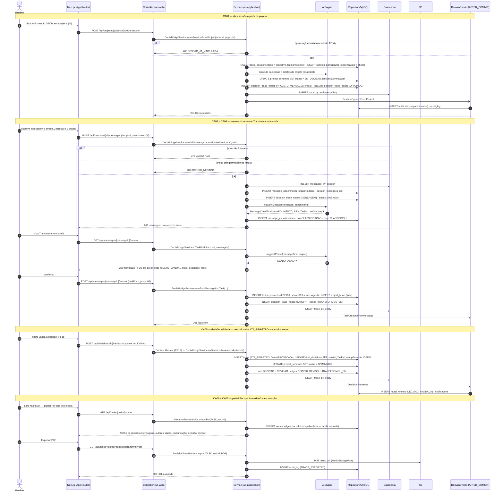
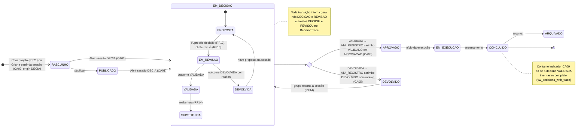
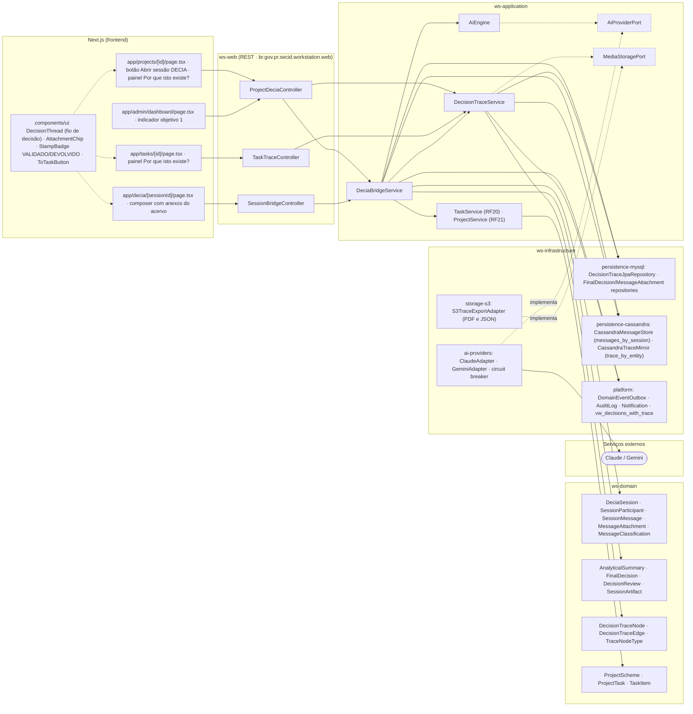

# RF29 — Integrar o DECIA ao Criador de Projetos — compartilhar tarefas/artefatos na sessão, abrir sessão a partir de um projeto, transformar argumentos/divergências/decisões em tarefas e manter o Rastro de Decisão

**HU:** HU29 · **Sprint (board Work Station):** 4 · **Equivalente FAI:** RF10 Copilot (origem COPILOT nos esquemas) — aqui elevado a **hub do app** · **Aba/rota:** sessão DECIA (`/decia/[sessionId]`), projeto (`/projects/[id]`, painel "Por que isto existe?"), tarefa (`/tasks/[id]`) — rotas a confirmar (o card não as fixa)

**Critérios de aceite cobertos:** RF29.CA01 · RF29.CA02 · RF29.CA03 · RF29.CA04 · RF29.CA05 · RF29.CA06 · RF29.CA07 · RF29.CA08 · RF29.CA09

> Contextos da TAXONOMIA: **5. DECIA** (`DeciaSession`, `SessionParticipant`, `SessionMessage`, `MessageClassification`, `MessageAttachment`, `AnalyticalSummary`, `FinalDecision`, `DecisionReview`, `SessionArtifact`, `DecisionTraceNode`, `DecisionTraceEdge`), **3. Criador de Projetos** (`ProjectScheme`, `ProjectTask`) e **2. Acervo** (`TaskItem`). O Rastro de Decisão é um grafo **append-only**: nós em `decision_trace_nodes` (MySQL) com espelho Cassandra `trace_by_entity`; arestas em `decision_trace_edges`. Visual: **fio de decisão** (RF38.CA07) — nós coloridos pela `MessageClass` (ARGUMENTO azul · DIVERGENCIA laranja · RISCO vermelho · CONSENSO verde · PERGUNTA roxo) e carimbo **VALIDADO** / **DEVOLVIDO** (`FinalDecision.stampJson`).

## 1. Diagrama de classes

```mermaid
classDiagram
  direction LR
  namespace ws-domain {
    class DeciaSession {
      <<entity>>
      +UUID id
      +String topic
      +UUID adminUserId
      +UUID companyId
      +UUID departmentId
      +SessionAccess accessMode
      +SessionStatus status
      +UUID linkedProjectId
      +UUID planAxisId
      +boolean indexedInMemory
    }
    class SessionParticipant {
      <<entity>>
      +UUID id
      +UUID sessionId
      +UUID userId
      +ParticipantRole role
      +UUID addedBy
    }
    class SessionMessage {
      <<entity>>
      +TIMEUUID id
      +UUID sessionId
      +UUID authorId
      +String authorKind
      +String bodyMd
      +Instant sentAt
      +JSON attachmentsJson
      +UUID classificationId
      +String correlationId
    }
    class MessageAttachment {
      <<entity>>
      +UUID id
      +UUID messageId
      +String targetType
      +UUID targetId
      +JSON snapshotJson
      +boolean usedInDecision
    }
    class MessageClassification {
      <<entity>>
      +UUID id
      +UUID messageId
      +MessageClass label
      +BigDecimal confidence
      +boolean hasEvidence
      +UUID linkedTaskId
      +UUID linkedProjectId
      +String rationale
      +UUID aiInferenceId
    }
    class AnalyticalSummary {
      <<entity>>
      +UUID id
      +UUID sessionId
      +int versionNumber
      +JSON recommendationsJson
      +UUID complianceResultId
      +String status
    }
    class FinalDecision {
      <<entity>>
      +UUID id
      +UUID sessionId
      +UUID summaryId
      +String decisionText
      +UUID chosenScenarioId
      +DecisionStatus status
      +UUID reviewId
      +UUID resultingTaskId
      +JSON stampJson
      +JSON citationsJson
    }
    class DecisionReview {
      <<entity>>
      +UUID id
      +UUID decisionId
      +UUID reviewerId
      +String outcome
      +String reason
      +Instant reviewedAt
    }
    class SessionArtifact {
      <<entity>>
      +UUID id
      +UUID sessionId
      +String kind
      +String title
      +UUID mediaObjectId
      +UUID convertedTaskId
    }
    class DecisionTraceNode {
      <<entity>>
      +UUID id
      +UUID sessionId
      +TraceNodeType nodeType
      +UUID refId
      +String label
      +String classLabel
      +UUID actorId
      +Instant at
      +JSON snapshotJson
    }
    class DecisionTraceEdge {
      <<entity>>
      +UUID id
      +UUID fromNodeId
      +UUID toNodeId
      +String relation
      +Instant at
    }
    class ProjectScheme {
      <<entity>>
      +UUID id
      +UUID ownerId
      +UUID departmentId
      +String title
      +String objective
      +SchemeOrigin origin
      +UUID sourceSessionId
      +ProjectStatus status
      +ProjectPhase currentPhase
      +UUID planAxisId
      +Instant lastDeciaEventAt
      +String lastDeciaEventLabel
    }
    class ProjectTask {
      <<entity>>
      +UUID id
      +UUID projectId
      +UUID taskId
      +ProjectPhase phase
      +UUID responsibleId
      +JSON snapshotJson
      +boolean removedByAuthor
      +UUID decisionTraceNodeId
    }
    class TaskItem {
      <<entity>>
      +UUID id
      +UUID ownerId
      +String title
      +TaskType type
      +TaskCategory category
      +SourceKind sourceKind
      +String sourceRef
      +TaskState state
      +UUID sourceProjectId
    }
    class TraceNodeType {
      <<enum>>
      MENSAGEM
      CLASSIFICACAO
      DIVERGENCIA
      PERGUNTA
      RESUMO
      CENARIO
      DECISAO
      REVISAO
      TAREFA
      PROJETO
      ARTEFATO
      ATA_VIVA
      CONFORMIDADE
    }
    class MessageClass {
      <<enum>>
      ARGUMENTO
      DIVERGENCIA
      RISCO
      CONSENSO
      PERGUNTA
      RUIDO
    }
    class DecisionStatus {
      <<enum>>
      PROPOSTA
      EM_REVISAO
      VALIDADA
      DEVOLVIDA
      SUBSTITUIDA
    }
    class ProjectStatus {
      <<enum>>
      RASCUNHO
      PUBLICADO
      EM_DECISAO
      APROVADO
      EM_EXECUCAO
      CONCLUIDO
      ARQUIVADO
      DEVOLVIDO
    }
    class SchemeOrigin {
      <<enum>>
      CRIAR_PROJETO
      DECIA
      REMIX
      AUTOPILOTO
      MODELO
      CENARIO
      DOSSIE
      ATA_VIVA
    }
  }
  namespace ws-application {
    class DeciaBridgeService {
      <<service>>
      +openSessionFromProject(actorId, projectId) DeciaSession
      +createProjectFromSession(actorId, sessionId) ProjectScheme
      +attachToMessage(actorId, sessionId, draft, targetRefs) SessionMessage
      +toTaskPrefill(actorId, messageId) TaskPrefillForm
      +transformMessageIntoTask(actorId, messageId, taskForm, projectId) TaskItem
      +onDecisionReviewed(decisionId) TaskItem
      +enrichSummaryWithTargets(summaryId) AnalyticalSummary
    }
    class DecisionTraceService {
      <<service>>
      +appendNode(sessionId, type, refId, label, classLabel, actorId, snapshot) DecisionTraceNode
      +appendEdge(fromId, toId, relation) DecisionTraceEdge
      +threadFor(targetType, targetId) DecisionThreadView
      +export(targetType, targetId, format) MediaObject
      +completenessIndicator(period, deptId) BigDecimal
    }
    class TaskService {
      <<service>>
      +create(ownerId, form) TaskItem
    }
    class ProjectService {
      <<service>>
      +create(ownerId, form) ProjectScheme
      +changeStatus(projectId, status, reason) ProjectScheme
    }
    class AiEngine {
      <<service>>
      +classifyMessage(message, attachments) MessageClassification
      +suggestPhase(messageText, project) ProjectPhase
      +composeFromSession(session, artifacts, decisions) ProjectDraft
    }
    class AiProviderPort {
      <<port>>
      +complete(prompt, mode, accessClass) AiResult
    }
    class MediaStoragePort {
      <<port>>
      +put(bytes, mimeType, accessClass) MediaObject
    }
  }
  namespace ws-web {
    class ProjectDeciaController {
      <<controller>>
      +openSession(projectId)
      +trace(projectId)
      +exportTrace(projectId, format)
    }
    class SessionBridgeController {
      <<controller>>
      +postMessage(sessionId, body, attachments)
      +toTaskPrefill(messageId)
      +transformIntoTask(messageId, form)
      +createProject(sessionId)
    }
    class TaskTraceController {
      <<controller>>
      +trace(taskId)
      +exportTrace(taskId, format)
    }
  }
  namespace ws-infrastructure {
    class DecisionTraceJpaRepository {
      <<adapter>>
    }
    class CassandraTraceMirror {
      <<adapter>>
      trace_by_entity
    }
    class CassandraMessageStore {
      <<adapter>>
      messages_by_session
    }
    class S3TraceExportAdapter {
      <<adapter>>
    }
  }
  DeciaSession --> ProjectScheme : linkedProjectId
  ProjectScheme --> DeciaSession : sourceSessionId
  DeciaSession "1" --> "*" SessionParticipant
  DeciaSession "1" --> "*" SessionMessage
  SessionMessage "1" --> "0..5" MessageAttachment : anexos do acervo
  SessionMessage "1" --> "1" MessageClassification
  MessageClassification --> TaskItem : linkedTaskId
  MessageClassification --> ProjectScheme : linkedProjectId
  MessageClassification --> MessageClass
  DeciaSession "1" --> "*" AnalyticalSummary
  FinalDecision --> AnalyticalSummary : summaryId
  FinalDecision --> DecisionReview : reviewId
  FinalDecision --> TaskItem : resultingTaskId ATA_REGISTRO
  FinalDecision --> DecisionStatus
  SessionArtifact --> TaskItem : convertedTaskId
  DecisionTraceNode "1" --> "*" DecisionTraceEdge : fromNodeId
  DecisionTraceNode "1" --> "*" DecisionTraceEdge : toNodeId
  DecisionTraceNode --> TraceNodeType
  ProjectTask --> DecisionTraceNode : decisionTraceNodeId
  ProjectScheme "1" --> "*" ProjectTask
  ProjectTask --> TaskItem : taskId ou snapshotJson
  ProjectScheme --> ProjectStatus
  ProjectScheme --> SchemeOrigin
  DeciaBridgeService ..> DeciaSession
  DeciaBridgeService ..> MessageAttachment
  DeciaBridgeService ..> FinalDecision
  DeciaBridgeService ..> TaskService : RF20
  DeciaBridgeService ..> ProjectService : RF21
  DeciaBridgeService ..> DecisionTraceService : todo vínculo gera nó e aresta
  DeciaBridgeService ..> AiEngine
  AiEngine ..> AiProviderPort
  DecisionTraceService ..> DecisionTraceNode
  DecisionTraceService ..> DecisionTraceEdge
  DecisionTraceService ..> MediaStoragePort : export PDF e JSON
  ProjectDeciaController ..> DeciaBridgeService
  ProjectDeciaController ..> DecisionTraceService
  SessionBridgeController ..> DeciaBridgeService
  TaskTraceController ..> DecisionTraceService
  DecisionTraceJpaRepository ..> DecisionTraceNode : MySQL
  CassandraTraceMirror ..> DecisionTraceNode : espelho append-only
  CassandraMessageStore ..> SessionMessage : partição sessionId
  S3TraceExportAdapter ..|> MediaStoragePort
  note for DecisionTraceEdge "relation ORIGINOU · CLASSIFICOU · RESPONDEU · RESUMIU · DECIDIU · REVISOU · TRANSFORMOU_EM · ANEXOU · VERIFICOU · imutável"
  note for FinalDecision "stampJson {kind VALIDADO ou DEVOLVIDO, date, reviewerName}"
  note for DeciaSession "tabela decia_sessions · .. +9 campos .."
  note for ProjectScheme "tabela project_schemes · .. +30 campos .."
  note for TaskItem "tabela tasks · .. +40 campos .."
```

## 2. Diagrama de atividades

```mermaid
flowchart TD
  subgraph L1["Ator humano"]
    U1["Dono ou responsável clica Abrir sessão DECIA no projeto"]
    U2["Participante escreve mensagem e anexa itens do acervo (busca rápida ou arrastar)"]
    U3["Participante clica Transformar em tarefa numa mensagem classificada"]
    U4["Participante revisa formulário RF20 pré-preenchido e salva"]
    U5["Chefe valida ou devolve a decisão final (RF15)"]
    U6["Participante clica Criar projeto a partir desta sessão"]
    U7["Qualquer usuário abre tarefa ou projeto e o painel Por que isto existe?"]
    U8["Auditor exporta o rastro em PDF ou JSON"]
    U9["ADMIN abre o dashboard RF18"]
  end
  subgraph L2["Web/BFF (Next.js App Router)"]
    W1["Anexos inline com thumbnail e ações RF26 · detalhe só com permissão"]
    W2["Fio de decisão: linha vertical, nós coloridos por classificação, carimbo VALIDADO ou DEVOLVIDO"]
    W3["Link para a mensagem original, mesmo em sessão ENCERRADA (RF17)"]
  end
  subgraph L3["ws-application"]
    S1{"Projeto já tem sessão ativa?"}
    S2["DeciaSession topic = objective · participantes = responsáveis + chefe do departamento · linkedProjectId"]
    S3["ProjectService.changeStatus EM_DECISAO · nó PROJETO → aresta ORIGINOU → nó sessão"]
    S4{"Até 5 anexos e todos acessíveis ao autor?"}
    S5["SessionMessage + MessageAttachment (snapshotJson) · nó MENSAGEM + arestas ANEXOU"]
    S6["MessageClassification com linkedTaskId ou linkedProjectId · nó CLASSIFICACAO · aresta CLASSIFICOU"]
    S7{"label em ARGUMENTO, DIVERGENCIA, RISCO, CONSENSO, PERGUNTA?"}
    S8["Pré-preenche RF20: tipo TEXTO_MANUAL ou ATA_REGISTRO · título · descrição = texto da mensagem · fase sugerida"]
    S9["TaskService.create (sourceKind DECIA, sourceRef = messageId) + ProjectTask na fase · nó TAREFA · aresta TRANSFORMOU_EM"]
    S10{"Decisão VALIDADA?"}
    S11["Cria TaskItem ATA_REGISTRO na fase APROVACAO do projeto vinculado · stampJson VALIDADO (data, revisor) · projeto APROVADO"]
    S12["Cria TaskItem ATA_REGISTRO com stampJson DEVOLVIDO e motivo · projeto DEVOLVIDO"]
    S13["Nós DECISAO e REVISAO · arestas DECIDIU, REVISOU, TRANSFORMOU_EM"]
    S14["ProjectScheme origin DECIA, sourceSessionId · tarefas a partir de SessionArtifact e FinalDecision nas fases sugeridas"]
    S15["DecisionTraceService.threadFor: percorre nós e arestas por refId (snapshot preserva tarefa excluída, RF23)"]
    S16["DecisionTraceService.export → PDF ou JSON · AuditLog TRACE_EXPORTED"]
    S17["enrichSummaryWithTargets: por recomendação, affectedTaskIds, affectedProjectIds, planAxisId"]
    S18["completenessIndicator: % projetos CONCLUIDO com decisão VALIDADA em sessão com rastro completo"]
    E1["409 SESSAO_JA_VINCULADA"]
    E2["422 VALIDACAO (máx. 5 anexos)"]
    E3["403 ACESSO_NEGADO (anexo sem permissão)"]
    E4["422 VALIDACAO (RUIDO não vira tarefa)"]
  end
  subgraph L4["IA (AiEngine)"]
    A1["Recebe tarefas do projeto como contexto da sessão"]
    A2["Classifica a mensagem (RF7) e liga o argumento à tarefa ou projeto citado ✦"]
    A3["Sugere a fase do projeto para a nova tarefa ✦"]
    A4["Compõe esqueleto a partir de artefatos e decisões, fases sugeridas ✦"]
    A5["Resumo analítico RF11 lista tarefas, projetos e eixo do plano por recomendação ✦"]
  end
  subgraph L5["Persistência"]
    D1[("MySQL: decia_sessions · session_participants · project_schemes · project_tasks · tasks")]
    D2[("Cassandra: messages_by_session · trace_by_entity")]
    D3[("MySQL: decision_trace_nodes · decision_trace_edges · message_attachments · message_classifications")]
    D4[("MySQL: final_decisions · decision_reviews · analytical_summaries · audit_log")]
    D5[("S3: export PDF ou JSON do rastro")]
    D6[("MySQL: vw_decisions_with_trace · metric_snapshots")]
  end
  U1 --> S1
  S1 -->|"sim"| E1
  S1 -->|"não"| S2 --> A1 --> S3 --> D1
  S3 --> D3
  U2 --> S4
  S4 -->|"mais de 5"| E2
  S4 -->|"sem permissão"| E3
  S4 -->|"ok"| S5 --> D2
  S5 --> D3
  S5 --> A2 --> S6 --> D3
  S6 --> W1
  U3 --> S7
  S7 -->|"não"| E4
  S7 -->|"sim"| A3 --> S8 --> U4 --> S9 --> D1
  S9 --> D3
  U5 --> S10
  S10 -->|"VALIDADA"| S11
  S10 -->|"DEVOLVIDA"| S12
  S11 --> S13
  S12 --> S13
  S13 --> D4
  S13 --> D3
  S13 --> D2
  U6 --> A4 --> S14 --> D1
  S14 --> D3
  U7 --> S15 --> D3
  S15 --> W2 --> W3
  U8 --> S16 --> D5
  S16 --> D4
  A5 --> S17 --> D4
  U9 --> S18 --> D6
  classDef err fill:#fde2e2,stroke:#b91c1c,color:#7f1d1d
  class E1,E2,E3,E4 err
```

## 3. Diagrama de sequência

## 4. Máquina de estados

Entidade central do RF: `ProjectScheme.status` (`ProjectStatus`), dirigida pelo sub-fluxo de `FinalDecision.status` (`DecisionStatus`) dentro de `EM_DECISAO`. O `DecisionTrace` em si não tem estados — é append-only (CA07).

## 5. Diagrama de componentes

## 6. Rastreabilidade

| CA | Elemento do diagrama (classe / passo / mensagem / transição / componente) |
|---|---|
| RF29.CA01 | Classes `DeciaSession.linkedProjectId`, `DeciaBridgeService.openSessionFromProject`, `ProjectService.changeStatus`; atividades `U1 → S1 → S2 → A1 → S3` (409 SESSAO_JA_VINCULADA); sequência bloco «CA01» (`POST /api/projects/{id}/decia-session`, topic = objective, participantes, EM_DECISAO, nós PROJETO/ORIGINOU); transições `RASCUNHO/PUBLICADO → EM_DECISAO`; componentes `app/projects/[id]`, `ProjectDeciaController` |
| RF29.CA02 | Classes `ProjectScheme.origin = DECIA`, `ProjectScheme.sourceSessionId`, `AiEngine.composeFromSession`, `SessionArtifact.convertedTaskId`, `DeciaBridgeService.createProjectFromSession`; atividades `U6 → A4 → S14`; transição inicial `[*] → RASCUNHO (origin DECIA)`; componente `SessionBridgeController.createProject` |
| RF29.CA03 | Classes `SessionMessage 1→0..5 MessageAttachment` (targetType TASK/PROJECT/PLAN, snapshotJson), `DeciaBridgeService.attachToMessage`; atividades `U2 → S4 → S5 → W1` (422 VALIDACAO máx. 5, 403 ACESSO_NEGADO); sequência bloco «CA03 e CA04» (`POST /api/sessions/{id}/messages`, alts 422/403); componentes `AttachmentChip`, `CassandraMessageStore` |
| RF29.CA04 | Classes `MessageClassification.label`, `MessageClass`, `DeciaBridgeService.toTaskPrefill/transformMessageIntoTask`, `TaskItem.sourceKind = DECIA`, `DecisionTraceEdge.relation = TRANSFORMOU_EM`; atividades `U3 → S7 → A3 → S8 → U4 → S9` (422 para RUIDO); sequência bloco «CA03 e CA04» (`GET/POST /api/messages/{id}/to-task`, suggestPhase ✦); componentes `ToTaskButton`, `TaskService (RF20)` |
| RF29.CA05 | Classes `FinalDecision.resultingTaskId`, `FinalDecision.stampJson`, `DecisionReview.outcome/reason`, `DeciaBridgeService.onDecisionReviewed`; atividades `U5 → S10 → S11/S12 → S13`; sequência bloco «CA05» (ATA_REGISTRO em APROVACAO, stamp VALIDADO, projeto APROVADO); transições `revisao → APROVADO` e `revisao → DEVOLVIDO`; componente `StampBadge` |
| RF29.CA06 | Classes `DecisionTraceService.threadFor`, `DecisionTraceNode.classLabel/actorId/at`, `ProjectTask.decisionTraceNodeId`; atividades `U7 → S15 → W2 → W3` (link à mensagem original mesmo com sessão ENCERRADA); sequência bloco «CA06 e CA07» (`GET /api/tasks/{id}/trace`); componentes `DecisionThread`, `app/tasks/[id]`, `app/projects/[id]` |
| RF29.CA07 | Classes `DecisionTraceNode`/`DecisionTraceEdge` (append-only, nota), `CassandraTraceMirror`, `DecisionTraceService.export`, `MediaStoragePort`, `DecisionTraceNode.snapshotJson`; atividades `U8 → S16 → D5/D4`, `S15` (snapshot RF23); sequência bloco «CA06 e CA07» (`GET .../trace/export?format=pdf`, S3, audit_log); componentes `S3TraceExportAdapter`, `persistence-cassandra` |
| RF29.CA08 | Classes `AnalyticalSummary.recommendationsJson` ({affectedTaskIds, affectedProjectIds, planAxisId}), `DeciaBridgeService.enrichSummaryWithTargets`, `DeciaSession.planAxisId`; atividades `A5 → S17 → D4`; componente `AnalyticalSummary` em `ws-domain E2` |
| RF29.CA09 | Classe `DecisionTraceService.completenessIndicator`; atividades `U9 → S18 → D6` (`vw_decisions_with_trace`, `metric_snapshots`); nota do estado `CONCLUIDO`; componentes `app/admin/dashboard`, `platform: vw_decisions_with_trace` |

> Dúvidas de modelagem registradas em `docs/DECISOES.md`: nome do enum da aresta (`relation`) não existe na TAXONOMIA (listado como nota); `409 SESSAO_JA_VINCULADA` e as rotas REST são propostas; `TaskService`/`ProjectService` (RF20/RF21) são dependências assumidas.

Tela/aba: `/projects/[id]` (esqueleto em `app/(shell)/projects/[id]/page.tsx`) · `/decia` (esqueleto em `app/(shell)/decia/page.tsx`) · `/decia/[sessionId]` (esqueleto em `app/(shell)/decia/[sessionId]/page.tsx`) · `/decia/review` (esqueleto em `app/(shell)/decia/review/page.tsx`) · `/lab/decia` (esqueleto em `app/(shell)/lab/decia/page.tsx`)
