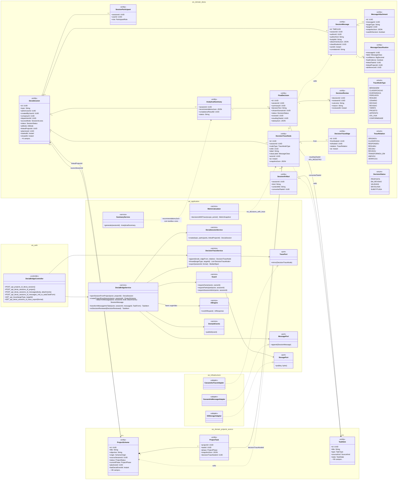
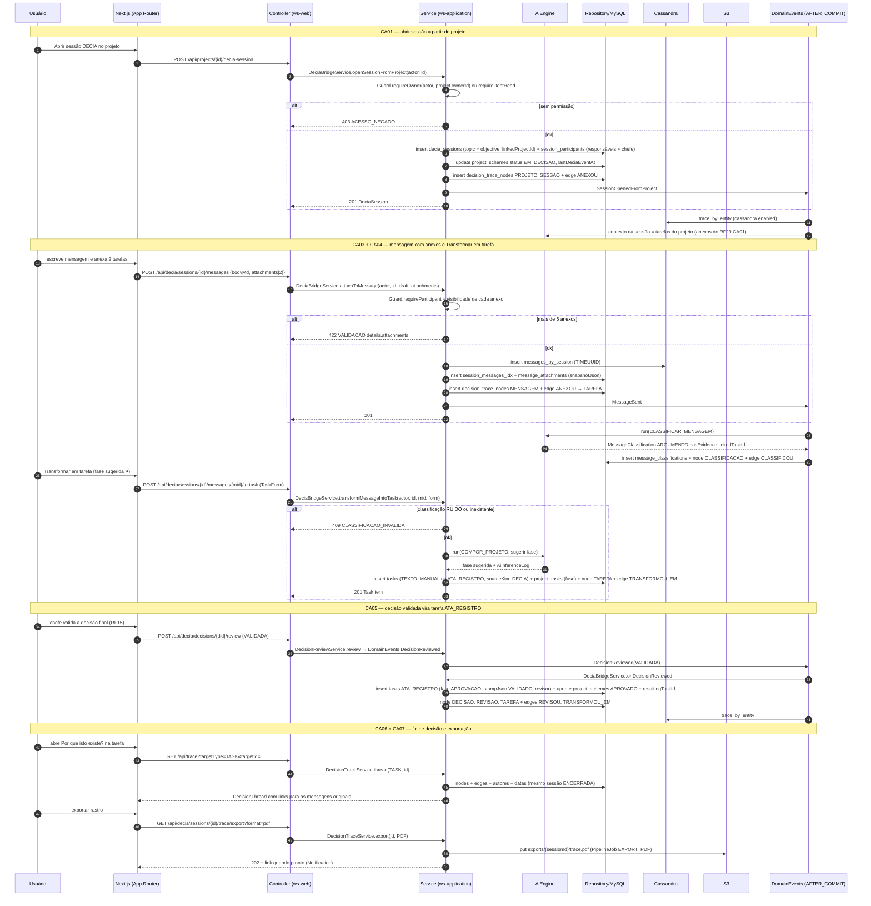
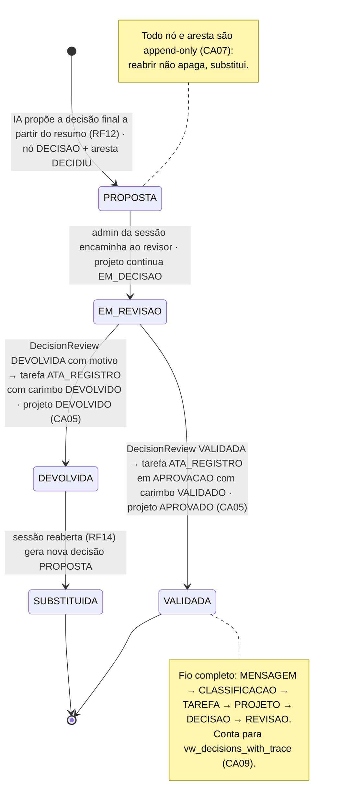
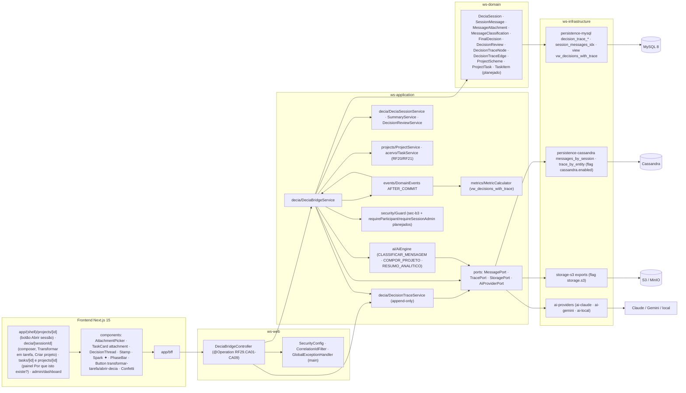

# RF29 — Integrar o DECIA ao Criador de Projetos — compartilhar tarefas/artefatos na sessão, abrir sessão a partir de um projeto, transformar argumentos/divergências/decisões em tarefas e manter o Rastro de Decisão
**HU:** HU29 · **Sprint (board Work Station):** Sprint 4 (comprometido) · **Equivalente FAI:** RF10 Copilot (origem COPILOT nos esquemas), aqui elevado a **hub do app** · **Aba/rota:** botão **Abrir sessão DECIA** no projeto (`/projects/[id]`, Mesa `/desk`), sessão (`/decia/[sessionId]`: composer com anexos do acervo, ação "Transformar em tarefa", "Criar projeto a partir desta sessão"), painel **Por que isto existe?** em `/tasks/[id]` e `/projects/[id]`, indicador em `/admin/dashboard` (RF18)
**Critérios de aceite cobertos:** RF29.CA01 · CA02 · CA03 · CA04 · CA05 · CA06 · CA07 · CA08 · CA09 (corpo do card, inalterado) — regra: o **título do card** define o RF e o corpo traz os próprios CAs. A sessão em si (tema, mensagens, classificação, resumo, decisão, revisão) está em `docs/produto/DECIA_SESSAO_E_MESA.md` e nos PlantUML `docs/produto/decia/*.puml`; aqui só a **ponte** com o Criador de Projetos e o **Rastro de Decisão**.

O **Rastro de Decisão** (`DecisionTrace`) é um grafo append-only — `DecisionTraceNode` (MENSAGEM · CLASSIFICACAO · DIVERGENCIA · PERGUNTA · RESUMO · CENARIO · DECISAO · REVISAO · TAREFA · PROJETO · ARTEFATO · ATA_VIVA · CONFORMIDADE) e `DecisionTraceEdge` (ORIGINOU · CLASSIFICOU · RESPONDEU · RESUMIU · DECIDIU · REVISOU · TRANSFORMOU_EM · ANEXOU · VERIFICOU) — gravado no MySQL e espelhado em Cassandra `trace_by_entity` (flag `cassandra.enabled`). Renderiza-se como o **fio de decisão** (`DecisionThread`, RF38.CA07): linha vertical, nós coloridos por `classLabel` (ARGUMENTO azul · DIVERGENCIA laranja · RISCO vermelho · CONSENSO verde · PERGUNTA roxo), carimbo VALIDADO/DEVOLVIDO no fim (`Stamp`). Imutável: nenhuma API de UPDATE/DELETE; exclusão de tarefa mantém o nó via `snapshotJson` (RF23).

## 1. Diagrama de classes

## 2. Diagrama de atividades

```mermaid
flowchart TD
  subgraph ATOR["Ator (dono do projeto · participante · chefe revisor)"]
    A0([No projeto]) --> A1["Clica Abrir sessão DECIA"]
    A2([Na sessão]) --> A3{"Ação"}
    A3 -->|escrever| A4["Mensagem + até 5 anexos do acervo (busca rápida ou arrastar)"]
    A3 -->|transformar| A5["Transformar em tarefa em mensagem classificada"]
    A3 -->|criar projeto| A6["Criar projeto a partir desta sessão"]
    A7([Chefe valida ou devolve a decisão final])
    A8([Em qualquer tarefa ou projeto]) --> A9["Abre painel Por que isto existe?"]
    A10["Exporta rastro PDF/JSON"]
  end

  subgraph FE["Next.js / BFF (app/(shell)/projects/[id] · decia/[sessionId] · tasks/[id])"]
    F1["POST /api/projects/{id}/decia-session"]
    F2["Composer: AttachmentPicker (TaskCard attachment) · POST /messages"]
    F3["Formulário do RF20 pré-preenchido (tipo, título, descrição = texto da mensagem, fase sugerida ✦)"]
    F4["POST /api/decia/sessions/{id}/project"]
    F5["DecisionThread (fio) + Stamp · navega até a mensagem original"]
    F6["GET /api/decia/sessions/{id}/trace/export?format=pdf|json"]
  end

  subgraph WEB["ws-web · DeciaBridgeController"]
    W1["JWT · CorrelationIdFilter · rate limit por usuário (mensagens)"]
    W2["GlobalExceptionHandler"]
  end

  subgraph APP["ws-application · DeciaBridgeService · DecisionTraceService"]
    P1{"Guard.requireOwner(projeto) ou requireDeptHead?"}
    P1 -->|não| E1["403 ACESSO_NEGADO"]
    P1 -->|sim| P2["DeciaSession(topic = objective, participantes = responsáveis + chefe, linkedProjectId) · anexa tarefas como contexto"]
    P2 --> P3["ProjectScheme.status = EM_DECISAO · DecisionTrace PROJETO → ANEXOU → SESSAO"]
    P4{"Guard.requireParticipant e sessão ATIVA/REABERTA?"}
    P4 -->|não| E2["409 SESSAO_NAO_ATIVA ou 403"]
    P5{"Anexos: até 5 e todos visíveis ao autor?"}
    P5 -->|mais de 5| E3["422 VALIDACAO details.attachments"]
    P5 -->|item sem permissão| E4["403 ACESSO_NEGADO"]
    P5 -->|ok| P6["SessionMessage + MessageAttachment com snapshotJson · DecisionTrace MENSAGEM → ANEXOU → TAREFA/PROJETO"]
    P7{"Mensagem classificada como ARGUMENTO · DIVERGENCIA · RISCO · CONSENSO · PERGUNTA?"}
    P7 -->|RUIDO ou sem classificação| E5["409 CLASSIFICACAO_INVALIDA"]
    P7 -->|sim| P8["TaskItem (TEXTO_MANUAL ou ATA_REGISTRO, sourceKind DECIA) + ProjectTask na fase sugerida · DecisionTrace MENSAGEM → TRANSFORMOU_EM → TAREFA"]
    P9["ProjectScheme origin DECIA + tarefas dos artefatos (RF13) e das decisões, fases sugeridas pela IA"]
    P10{"DecisionReview.outcome"}
    P10 -->|VALIDADA| P11["TaskItem ATA_REGISTRO na fase APROVACAO, stampJson VALIDADO (data, revisor) · projeto APROVADO"]
    P10 -->|DEVOLVIDA| P12["TaskItem ATA_REGISTRO com carimbo DEVOLVIDO e motivo · projeto DEVOLVIDO"]
    P13["DecisionTraceService.thread(target): nós + arestas + autores + datas · navegável até a mensagem (mesmo ENCERRADA/ARQUIVADA)"]
    P14["Export append-only: JSON canônico + PDF (PipelineJob EXPORT_PDF) · checksum"]
    P15["MetricCalculator: % projetos CONCLUIDO com decisão VALIDADA e rastro completo (objetivo 1)"]
  end

  subgraph IA["AiEngine"]
    I1["CLASSIFICAR_MENSAGEM liga argumento à tarefa/projeto citado (linkedTaskId)"]
    I2["COMPOR_PROJETO sugere fase da tarefa transformada ✦"]
    I3["RESUMO_ANALITICO lista por recomendação tarefas, projetos afetados e eixo do plano (RF24)"]
    I4["AiInferenceLog"]
  end

  subgraph DB["Persistência"]
    D1[("MySQL decia_sessions · session_messages_idx · message_attachments · decision_trace_nodes · decision_trace_edges · tasks · project_tasks")]
    D2[("Cassandra messages_by_session · trace_by_entity · flag cassandra.enabled")]
    D3[("S3 exports PDF/JSON · flag storage.s3")]
    D4[("MySQL view vw_decisions_with_trace · metric_snapshots")]
  end

  A1 --> F1 --> W1 --> P1
  P3 --> D1
  P3 --> D2
  A4 --> F2 --> W1 --> P4 -->|sim| P5
  P6 --> D1
  P6 --> D2
  P6 --> I1 --> I4
  A5 --> F3 --> W1 --> P4 --> P7
  P8 --> I2
  P8 --> D1
  A6 --> F4 --> W1 --> P4 --> P9 --> D1
  A7 --> P10
  P11 --> D1
  P12 --> D1
  A9 --> F5 --> W1 --> P13 --> D1
  A10 --> F6 --> W1 --> P14 --> D3
  I3 --> I4
  P15 --> D4
  E1 --> W2
  E2 --> W2
  E3 --> W2
  E4 --> W2
  E5 --> W2
```

## 3. Diagrama de sequência

## 4. Máquina de estados

Entidade central: `FinalDecision.status` (`DecisionStatus`) — é a decisão que fecha o fio e muda o `ProjectStatus` do projeto vinculado (`EM_DECISAO → APROVADO | DEVOLVIDO`). O `DecisionTraceNode` não tem estado: é append-only.

## 5. Diagrama de componentes

## 6. Rastreabilidade

| CA | Classe | Passo | Mensagem | Transição | Componente |
|---|---|---|---|---|---|
| RF29.CA01 | `DeciaBridgeService.openSessionFromProject`, `DeciaSession.linkedProjectId/topic`, `ProjectStatus EM_DECISAO`, nó PROJETO → ANEXOU → SESSAO | A1 → F1 → P1 (403) → P2 → P3 | 1–12 | `PROPOSTA (projeto EM_DECISAO)` | `BC`, `BS`, `SS` |
| RF29.CA02 | `DeciaBridgeService.createProjectFromSession`, `SchemeOrigin DECIA`, `ProjectScheme.sourceSessionId`, `SessionArtifact.convertedTaskId` | A6 → F4 → P4 → P9 | — (POST /sessions/{id}/project) | — | `BS`, `PS`, `AIE` |
| RF29.CA03 | `MessageAttachment` (≤ 5, `snapshotJson`), `DeciaBridgeService.attachToMessage`, `Guard.requireParticipant` | A4 → F2 → P4 → P5 (422/403) → P6 | 13–22 | — | `AttachmentPicker`, `TaskCard attachment`, `CASA` |
| RF29.CA04 | `DeciaBridgeService.transformMessageIntoTask`, `MessageClassification.label`, `TaskItem sourceKind DECIA`, `ProjectTask.phase`, aresta TRANSFORMOU_EM | A5 → F3 → P7 (409 CLASSIFICACAO_INVALIDA) → P8 → I2 | 23–34 | — | `BS`, `Button transformar-tarefa` |
| RF29.CA05 | `DeciaBridgeService.onDecisionReviewed`, `FinalDecision.resultingTaskId/stampJson`, `DecisionReview.outcome/reason`, `TaskType ATA_REGISTRO`, fase APROVACAO | A7 → P10 → P11/P12 | 35–41 | `EM_REVISAO → VALIDADA` · `EM_REVISAO → DEVOLVIDA` | `DE`, `Stamp`, `Confetti` |
| RF29.CA06 | `DecisionTraceService.thread`, `DecisionTraceNode.classLabel/actorId/at`, `DecisionTraceEdge` | A8 → A9 → F5 → P13 | 42–46 | nota de VALIDADA | `DecisionThread`, `TS` |
| RF29.CA07 | append-only (sem UPDATE/DELETE), `DecisionTraceService.export`, `snapshotJson`, `PipelineJob EXPORT_PDF` | A10 → F6 → P14 | 47–51 | nota de PROPOSTA | `S3A`, `TS` |
| RF29.CA08 | `AnalyticalSummary.recommendationsJson[].affectedTaskIds/affectedProjectIds/planAxisId`, `SummaryService` | I3 → I4 | — (RF11) | — | `SS`, `AIE` |
| RF29.CA09 | `MetricCalculator.decisionsWithTrace`, view `vw_decisions_with_trace`, `MetricSnapshot` | P15 → D4 | — (RF18) | nota de VALIDADA | `MC`, `MY`, `admin/dashboard` |
