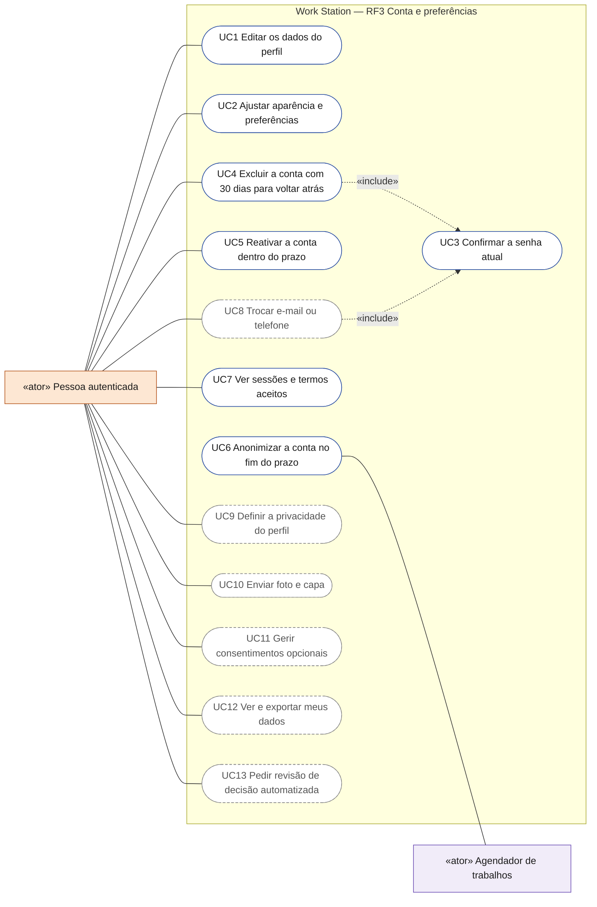
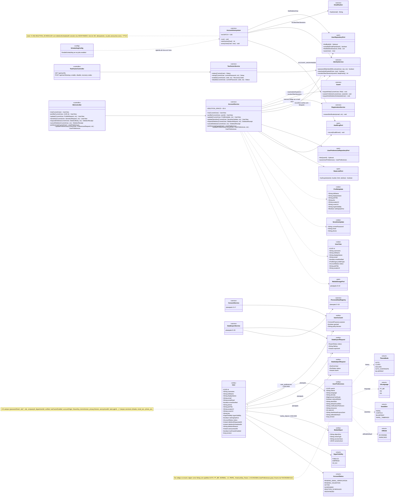
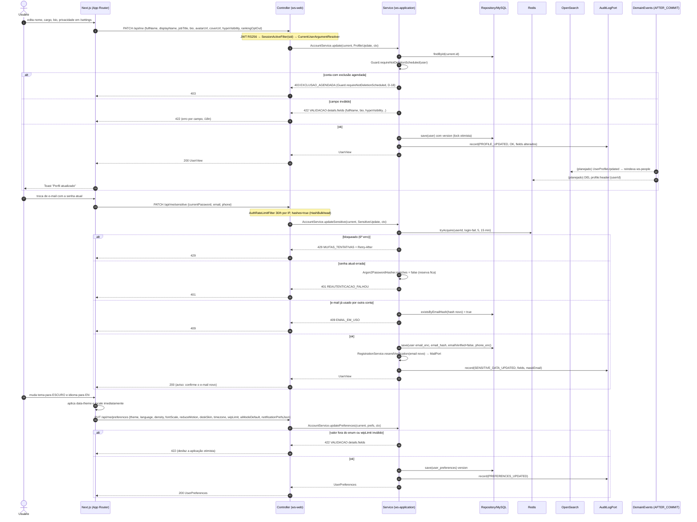
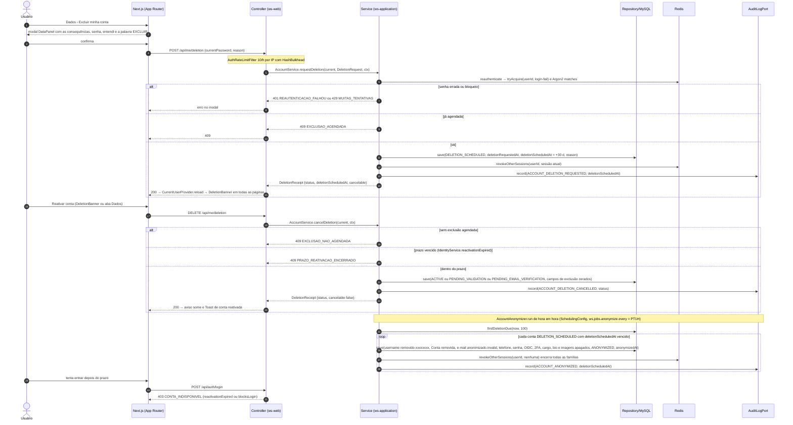
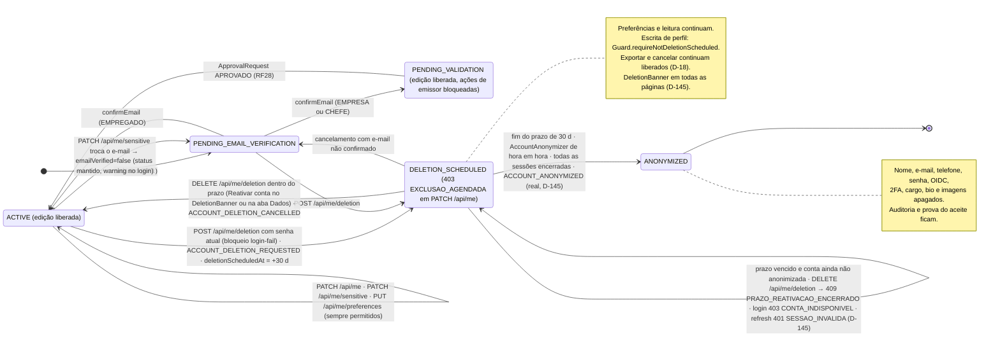
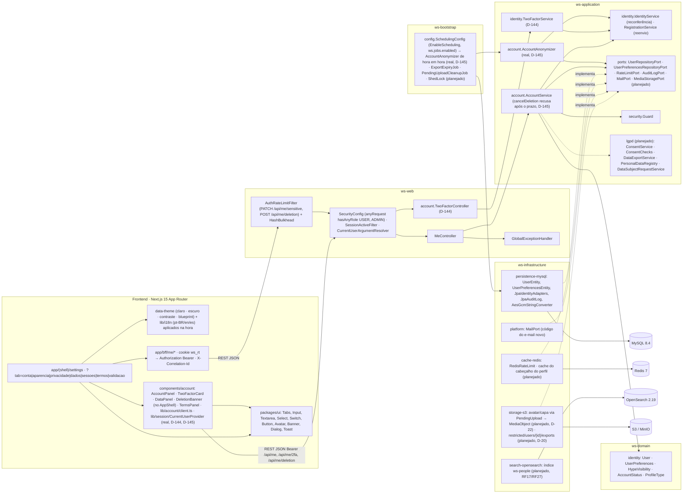
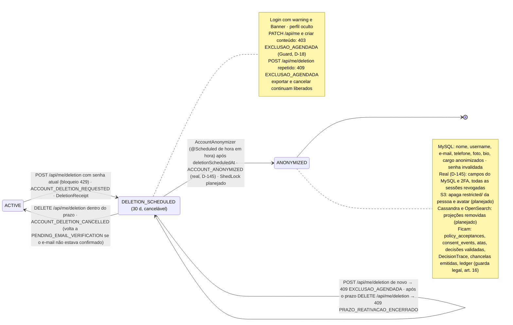

# RF3 — Editar informações pessoais e preferências do perfil do usuário
**HU:** HU3 · **Sprint (board Work Station):** 1 (card "SPRINT 1 — Cadastro, autenticação, perfil e abertura de sessão"; o shell + preferências é a fase (b) da ARQUITETURA §6, D-11) · **Equivalente FAI:** RF3 Editar perfil (`UserController PATCH /api/me`, `UserPreferences`) + o "RF23" Configurações/LGPD do FAI (Q-46) · **Aba/rota:** `/settings` com abas na URL `?tab=conta|aparencia|privacidade|dados|sessoes|termos|validacao` (ABAS_POR_PERFIL §9); API `GET|PATCH /api/me`, `PATCH /api/me/sensitive`, `GET|PUT /api/me/preferences`, `POST|DELETE /api/me/deletion`; **real desde 17/10/2026:** abas Conta (`AccountPanel` + `TwoFactorCard`, `GET /api/me/2fa`, `POST /api/me/2fa/setup|enable|disable|recovery-codes`), Dados (`DataPanel`) e Termos (`TermsPanel`) e o aviso `DeletionBanner` em todas as páginas (D-144, D-145)
**Critérios de aceite cobertos:** RF3.CA01 … RF3.CA06 (corpo do card vazio → derivados do título + HU3, todos "(CA a confirmar)") · RF3.CA07 … RF3.CA24 (§7, configurações e direitos do titular, D-15…D-21) — regra: o título do card define o RF; CAs alinhados ao código real do Bloco 3 (`MeController`, `AccountService`, `UserPreferences`, `Guard.requireNotDeletionScheduled`); atualização de 17/10/2026: fim do prazo de 30 dias (`AccountService.cancelDeletion` → `409 PRAZO_REATIVACAO_ENCERRADO`, `IdentityService.reactivationExpired`, `AccountAnonymizer`, D-145) e 2FA na aba Conta (D-144)

> **HU3** — COMO usuário autenticado no sistema POSSO editar minhas informações pessoais e preferências de perfil PARA manter meus dados atualizados e personalizar minha experiência na plataforma.

Classes **(real)** existem em `origin/main` (Bloco 3, PR #16); **(planejado)**: `UserConsent`/`ConsentEvent`/`ConsentChecks`, `DataExportRequest`/`DataExportWorker`, `DataSubjectRequest`, `PersonalDataRegistry`, upload de capa (`PendingUpload`, D-22; o avatar é real desde 25/10/2026, RF3.CA05), `PolicyGateFilter`. `GET/DELETE /api/auth/sessions` e a aba Sessões são reais desde o Bloco 4 (RF2 §8); o `AccountAnonymizationJob` do plano é real como `AccountAnonymizer` (D-145).

**Atualização 17/10/2026 (real, D-144, D-145, D-146):** as abas **Conta**, **Dados** e **Termos** de `app/(shell)/settings/page.tsx` deixaram de ser esqueleto — `components/account/AccountPanel.tsx` (perfil por `PATCH /api/me` e o cartão `TwoFactorCard.tsx` da verificação em duas etapas, RF2 §9), `components/account/DataPanel.tsx` (excluir a conta: modal com as consequências, senha atual, "entendi" e a palavra `EXCLUIR`) e `components/account/TermsPanel.tsx` (versões aceitas e links para `/termos` e `/privacidade` da Velion, D-143). `components/account/DeletionBanner.tsx` fica no topo de todas as páginas do shell (`components/shell/AppShell.tsx`) enquanto a conta está `DELETION_SCHEDULED`, com a data e "Reativar conta" (`useReactivate` → `DELETE /api/me/deletion`). A conta logada vem de `lib/session/CurrentUserProvider.tsx` (`/api/me`, `lib/account/client.ts`). No back: `AccountService.requestDeletion` (já existia; também encerra as outras sessões) e `cancelDeletion`, que agora recusa depois do prazo com `409 PRAZO_REATIVACAO_ENCERRADO`; login (`403 CONTA_INDISPONIVEL`) e refresh (`401 SESSAO_INVALIDA`) recusam conta com prazo vencido (`IdentityService.reactivationExpired`); `AccountAnonymizer` (agendado de hora em hora por `ws-bootstrap/.../config/SchedulingConfig.java`, propriedades `ws.jobs.enabled`, `ws.jobs.anonymize.every` = `PT1H`, `ws.jobs.anonymize.initial-delay` = `PT2M`) anonimiza a conta e encerra todas as sessões, com `AuditLog ACCOUNT_ANONYMIZED`. Testes: `AccountServiceTest.exclusaoAgendaTrintaDiasBloqueiaEdicaoECancelaVoltandoAoStatus`, `AccountServiceTest.depoisDosTrintaDiasNaoReativaNaoEntraEAContaEAnonimizada`, `components/account/account.test.tsx`. Evidência: `docs/auditoria/2026-10-17/evidencias/IDENTIDADE.json` passos 7, 11, 12 e 13 e capturas `id-08-excluir-modal-desktop.png`, `id-09-exclusao-agendada-desktop.png`, `id-10-conta-2fa-celular.png`, `id-11-excluir-modal-celular.png`.

## Critérios de aceite derivados da HU3 (todos "CA a confirmar")

| CA | Enunciado (Dado / Quando / Então) |
|---|---|
| **RF3.CA01** (CA a confirmar) | Dado o usuário autenticado (`CurrentUser`), quando edito `fullName` (3–160), `displayName` (≤ 80), `jobTitle` (≤ 120), `bio` (≤ 1000), `avatarUrl`/`coverUrl` (`https://` ou caminho interno) por `PATCH /api/me`, então `AccountService.update` valida e salva com lock otimista (`User.version`); `username` é imutável (`422 USERNAME_IMUTAVEL`); erros voltam como `422 VALIDACAO details.fields`; conta `DELETION_SCHEDULED` → `Guard.requireNotDeletionScheduled` (`403 EXCLUSAO_AGENDADA`, D-18). |
| **RF3.CA02** (CA a confirmar) | Dado a troca de e-mail ou telefone (`PATCH /api/me/sensitive {currentPassword, email, phone}`), então `IdentityService.reauthenticate` reconfere a senha atual com o **mesmo bloqueio do login** (`login-fail`, 6º erro → `429 MUITAS_TENTATIVAS` + `Retry-After`; errada → `401 REAUTENTICACAO_FALHOU`; `422 SENHA_ATUAL_INCORRETA` é só da troca de senha), o `emailHash` novo deve ser único (`409 EMAIL_EM_USO`), `emailVerified` volta a `false`, `RegistrationService.resendVerification` envia o código ao e-mail novo e `AuditLog SENSITIVE_DATA_UPDATED` grava os campos alterados com e-mail mascarado. |
| **RF3.CA03** (CA a confirmar) | Dado a aba Aparência, quando altero `theme` (`ThemeMode` AUTO·CLARO·ESCURO·ALTO_CONTRASTE·BLUEPRINT), `language` (PT_BR·EN·ES), `density`, `fontScale`, `reduceMotion`, `deskSkin` (`DeskSkin`), `defaultCardSkin`, `timezone`, `wipLimit`, `aiModeDefault` (ECONOMIA·AVANCADO), `notificationPrefsJson` (inclui `dailyTaskAt`, RF44.CA10) e `dashboardLayoutJson`, então o cliente aplica **na hora** (`data-theme`, i18n) e persiste por `PUT /api/me/preferences` (`AccountService.updatePreferences`, `AuditLog PREFERENCES_UPDATED`); `GET /api/me/preferences` devolve os padrões quando ainda não há linha. |
| **RF3.CA04** (CA a confirmar) | Dado a aba Privacidade, quando altero `hypeVisibility` (PUBLICO·EMPRESA·SO_EU, padrão SO_EU, RF45.CA06) e `rankingOptOut` (RF43.CA05) no mesmo `PATCH /api/me`, então valor inválido → `422 details.fields.hypeVisibility`, a mudança vale na próxima leitura do perfil/ranking e fica em `AuditLog PROFILE_UPDATED` (campos alterados, sem valores pessoais). |
| **RF3.CA05** (CA a confirmar) | Dado o upload de avatar ou capa (**planejado**, D-22), então o arquivo (≤ 5 MB, mime por magic bytes png/jpg/webp, reencode sem EXIF) vira `PendingUpload` → `MediaObject` com `accessClass PUBLIC`, `PipelineJob THUMBNAIL` gera as variantes e `avatarUrl`/`coverUrl` apontam para a variante; o anterior é removido quando substituído. **Real para o avatar (25/10/2026):** `POST /api/me/avatar` (multipart `file`) → `MediaUploadInspector` (magic bytes, teto de pixels) → `AvatarImage` (orientação EXIF aplicada, recorte quadrado, até 512 px, JPEG novo sem EXIF/GPS; WEBP lido pelo plugin imageio-webp) → `MediaUploadService` (antivírus, dedupe por dono, `MediaObject` PUBLIC); `avatarUrl` = `/api/people/{id}/avatar?v={mídia}`, lido por `GET /api/people/{id}/avatar` (regra do perfil público, 404 uniforme); `DELETE /api/me/avatar`; a anterior é apagada ao trocar, remover e anonimizar; `PATCH /api/me` só limpa a foto (URL externa recusada). Síncrono, sem `PendingUpload`/`PipelineJob` nem variantes múltiplas; capa segue planejada. |
| **RF3.CA06** (CA a confirmar) | Dado qualquer alteração de perfil, então `AuditLog PROFILE_UPDATED`/`PREFERENCES_UPDATED` com `correlationId` e, após o commit, o evento `UserProfileUpdated` (**planejado**) reindexa a pessoa no OpenSearch `ws-people` (RF17/RF27) e invalida o cache do cabeçalho do perfil (RF6/RF16); `GET /api/users/{id}` devolve o `UserView` público de terceiros (sem e-mail/telefone, `Guard.ownerOrAdmin` para os campos privados). |

## 0. Diagrama de casos de uso

A própria conta: perfil, preferências, privacidade, direitos do titular e a exclusão com 30 dias para reativar (D-145). Atores do catálogo em [`ATORES_E_ATRIBUTOS.md`](../../arquitetura/ATORES_E_ATRIBUTOS.md).

| Caso de uso | Ator(es) | CAs | Situação |
|---|---|---|---|
| UC1 Editar os dados do perfil | Pessoa autenticada | RF3.CA01, RF3.CA06, RF3.CA24 | real: Configurações › Conta (`AccountPanel`, `PATCH /api/me`) |
| UC2 Ajustar aparência e preferências | Pessoa autenticada | RF3.CA03, RF3.CA07 | real: abas Aparência, Notificações e Trabalho (`PUT /api/me/preferences`) |
| UC3 Confirmar a senha atual | Pessoa autenticada | RF3.CA08 | real: `IdentityService.reauthenticate`, mesmo bloqueio do login |
| UC4 Excluir a conta com 30 dias para voltar atrás | Pessoa autenticada | RF3.CA19, RF3.CA23 | real: modal com consequências, senha, "entendi" e EXCLUIR (`DataPanel`, `POST /api/me/deletion`) |
| UC5 Reativar a conta dentro do prazo | Pessoa autenticada | RF3.CA20 | real: aviso com "Reativar conta" em todas as páginas (`DELETE /api/me/deletion`); fora do prazo `409 PRAZO_REATIVACAO_ENCERRADO` |
| UC6 Anonimizar a conta no fim do prazo | Agendador de trabalhos | RF3.CA21 | real: `AccountAnonymizer` de hora em hora; login e refresh recusados depois do prazo |
| UC7 Ver sessões e termos aceitos | Pessoa autenticada | RF3.CA22 | real: abas Sessões e Termos |
| UC8 Trocar e-mail ou telefone | Pessoa autenticada | RF3.CA02, RF3.CA08 | planejado na tela: `PATCH /api/me/sensitive` existe |
| UC9 Definir a privacidade do perfil | Pessoa autenticada | RF3.CA04, RF3.CA09 | planejado na tela: `hypeVisibility` e `rankingOptOut` já vão no `PATCH /api/me` |
| UC10 Enviar foto e capa | Pessoa autenticada | RF3.CA05 | planejado (D-22) |
| UC11 Gerir consentimentos opcionais | Pessoa autenticada | RF3.CA10, RF3.CA11, RF3.CA12 | planejado (LGPD C) |
| UC12 Ver e exportar meus dados | Pessoa autenticada | RF3.CA13, RF3.CA14, RF3.CA15, RF3.CA16, RF3.CA17 | planejado (LGPD C) |
| UC13 Pedir revisão de decisão automatizada | Pessoa autenticada | RF3.CA18 | planejado (LGPD art. 20) |

## 1. Diagrama de classes

## 2. Diagrama de atividades

```mermaid
flowchart TD
  subgraph ATOR["Usuário autenticado"]
    A1["Abre /settings?tab=conta e edita nome, cargo, bio, avatar"]
    A2["Aba Privacidade: hypeVisibility, rankingOptOut"]
    A3["Aba Conta: trocar e-mail ou telefone (pede a senha atual)"]
    A4["Aba Aparência: tema, idioma, densidade, skin da Mesa, WIP, modo IA"]
    A5["Aba Dados: Excluir minha conta → modal com consequências, senha atual, entendi e a palavra EXCLUIR (DataPanel)"]
    A6["Clica Reativar conta no DeletionBanner (todas as páginas) ou na aba Dados"]
    A7["Aba Conta: cartão Verificação em duas etapas (TwoFactorCard) · fluxo no RF2 §3.1"]
  end
  subgraph FE["Next.js (App Router) · BFF"]
    F1["Tabs com aba na URL · formulário com erro por campo (422 details.fields)"]
    F2["PATCH /bff/me → PATCH /api/me"]
    F3["PATCH /api/me/sensitive"]
    F4["PUT /api/me/preferences · aplica data-theme e locale na hora (optimistic)"]
    F5["Toast de sucesso · Banner se DELETION_SCHEDULED"]
    F6["POST /api/me/deletion {currentPassword, reason}"]
    F7["DeletionBanner: data limite, dias restantes e Reativar conta · CurrentUserProvider.reload"]
    F8["DELETE /api/me/deletion (useReactivate)"]
    F9["GET /api/me/2fa · POST /api/me/2fa/setup, enable, disable, recovery-codes (RF2 §9)"]
  end
  subgraph WEB["ws-web"]
    W1["CorrelationIdFilter → JWT (SecurityConfig) → SessionActiveFilter → CurrentUserArgumentResolver"]
    W2["AuthRateLimitFilter: PATCH /api/me/sensitive 30/h · POST /api/me/deletion 10/h (hashes=true)"]
    W3["MeController.update / sensitive / updatePreferences / requestDeletion / cancelDeletion"]
    E401["401 NAO_AUTENTICADO / SESSAO_ENCERRADA"]
    E422["422 VALIDACAO details.fields"]
    E422U["422 USERNAME_IMUTAVEL"]
    E401R["401 REAUTENTICACAO_FALHOU"]
    E429["429 MUITAS_TENTATIVAS + Retry-After"]
    E409E["409 EMAIL_EM_USO"]
    E403D["403 EXCLUSAO_AGENDADA"]
    E409A["409 EXCLUSAO_AGENDADA (já agendada)"]
    E409P["409 PRAZO_REATIVACAO_ENCERRADO"]
    E403L["login 403 CONTA_INDISPONIVEL · refresh 401 SESSAO_INVALIDA (prazo vencido)"]
  end
  subgraph APP["ws-application · AccountService"]
    S1["findById(current.id) · Guard.requireNotDeletionScheduled"]
    S2{"DELETION_SCHEDULED?"}
    S3["Valida tamanhos (fullName 3–160, displayName 80, jobTitle 120, bio 1000, URLs https) e HypeVisibility"]
    S4{"Campos ok?"}
    S5["save(User) lock otimista · AuditLog PROFILE_UPDATED {fields}"]
    T1["IdentityService: tryAcquire(login-fail) → Argon2 matches senha atual"]
    T2{"bloqueado / senha errada?"}
    T3{"e-mail novo já existe (emailHash)?"}
    T4["email/phone cifrados · emailVerified=false · resendVerification · AuditLog SENSITIVE_DATA_UPDATED"]
    P1["updatePreferences: valida enums (ThemeMode, UiLanguage, DeskSkin, AiMode), wipLimit ≥ 1, fontScale · save · AuditLog PREFERENCES_UPDATED"]
    EV["(planejado) UserProfileUpdated AFTER_COMMIT → reindexa ws-people · invalida cache do cabeçalho"]
    X1["requestDeletion: reauthenticate (login-fail) · já agendada?"]
    X2["DELETION_SCHEDULED · deletionScheduledAt = +30 d · revokeOtherSessions (fica só esta) · ACCOUNT_DELETION_REQUESTED"]
    X3{"cancelDeletion: reactivationExpired (prazo vencido)?"}
    X4["volta a ACTIVE, PENDING_VALIDATION ou PENDING_EMAIL_VERIFICATION · ACCOUNT_DELETION_CANCELLED"]
    J1["AccountAnonymizer.run de hora em hora (SchedulingConfig, ws.jobs.*) · findDeletionDue(now, 100)"]
    J2["anonimiza nome, nome de exibição, e-mail, telefone, senha, OIDC, 2FA, cargo, bio, imagens · username removido-xxxxxxxx · ANONYMIZED · revokeOtherSessions(todas) · ACCOUNT_ANONYMIZED"]
  end
  subgraph PERS["Persistência"]
    D1[("MySQL: users (email_enc, phone_enc, hype_visibility, ranking_opt_out), user_preferences, audit_log")]
    D2[("Redis: balde login-fail (RateLimitPort)")]
    D3[("OpenSearch ws-people · Redis cache perfil (planejado)")]
    D4["MailPort: código ao e-mail novo"]
  end

  A1 --> F1 --> F2 --> W1 --> W3 --> S1 --> S2
  A2 --> F2
  W1 -->|"sem token ou família revogada"| E401
  S2 -->|"sim"| E403D
  S2 -->|"não"| S3 --> S4
  S4 -->|"não"| E422
  S3 -->|"username no corpo"| E422U
  S4 -->|"sim"| S5 --> F5
  S5 --> D1
  S5 --> EV --> D3
  A3 --> F3 --> W2 --> W1
  W2 -->|"excedeu IP"| E429
  W3 --> T1 --> T2
  T1 --> D2
  T2 -->|"6º erro"| E429
  T2 -->|"senha errada"| E401R
  T2 -->|"ok"| T3
  T3 -->|"sim"| E409E
  T3 -->|"não"| T4 --> D1
  T4 --> D4
  T4 --> F5
  A4 --> F4 --> W1
  A5 --> F6 --> W2
  W3 --> X1
  X1 -->|"senha errada ou bloqueio"| E401R
  X1 -->|"sim"| E409A
  X1 -->|"não"| X2 --> D1
  X2 --> F7
  A6 --> F8 --> W1
  W3 --> X3
  X3 -->|"sim"| E409P
  X3 -->|"não"| X4 --> D1
  X4 --> F5
  J1 --> J2 --> D1
  J1 -.->|"entre o fim do prazo e a anonimização"| E403L
  A7 --> F9 --> W1
  W3 --> P1 --> D1
  P1 --> F5
```

## 3. Diagrama de sequência

### 3.1 Exclusão, reativação e anonimização (real, D-145)

## 4. Máquina de estados

Entidade central: **`User.status`** (`AccountStatus`) no recorte do RF3 — a edição só é permitida fora de `DELETION_SCHEDULED`/`ANONYMIZED`; o pedido de exclusão (CA19–CA21) e a exportação (CA14–CA15) têm as máquinas completas em §7.3. `UserPreferences` não tem estados próprios.

## 5. Diagrama de componentes

## 6. Rastreabilidade

| CA | Classe (§1) | Passo da atividade (§2) | Mensagem da sequência (§3) | Transição de estado (§4) | Componente (§5) | Situação |
|---|---|---|---|---|---|---|
| RF3.CA01 | `MeController.update`, `AccountService.update`, `ProfileUpdate`, `Guard.requireNotDeletionScheduled`, `User.version` | `S1`→`S5`, `E422`, `E422U`, `E403D` | 2–17 | `ACT`→`ACT`, nota de `DEL` | `MC`, `AS`, `GD`, `UI` | real (Bloco 3, main) |
| RF3.CA02 | `AccountService.updateSensitive`, `SensitiveUpdate`, `IdentityService` (bloqueio), `RegistrationService.resendVerification`, `AesGcmStringConverter` | `A3`→`T1`→`T4`, `E429`, `E401R`, `E409E` | 21–38 | `ACT`→`PEV` (e-mail novo) | `ARL`, `AS`, `IS`, `PLT`, `MY` | real |
| RF3.CA03 | `UserPreferences`, `AccountService.updatePreferences/preferences`, `ThemeMode`, `UiLanguage`, `DeskSkin`, `AiMode` | `A4`→`F4`→`P1` | 39–48 | — | `TH`, `MC`, `MY` (`user_preferences` CASCADE) | real |
| RF3.CA04 | `ProfileUpdate.hypeVisibility/rankingOptOut`, `HypeVisibility` | `A2`→`F2`→`S3`→`S5` | 2–16 | — | `AS`, `UI` (`Switch`) | real (`AuditLog PROFILE_UPDATED`) |
| RF3.CA05 | `MediaStoragePort`, `MediaObject`, `PendingUpload`, `PipelineJob THUMBNAIL` | — | — | — | `S3`, `JOBS` | planejado (D-22) |
| RF3.CA06 | `AuditLogPort`, `AuditActions.PROFILE_UPDATED/PREFERENCES_UPDATED`, `UserView`, evento `UserProfileUpdated` | `S5`→`EV`→`D3` | 14, 18–19 | — | `OSE`, `RDS`, `MC.profile` | auditoria real; evento e índice planejados |
| RF3.CA07 | `Tabs` (`packages/ui`) | `F1` | — | — | `PG`, `UI`, `ACC` | parcial: abas Conta, Dados, Termos e Sessões reais com `?tab=` (`app/(shell)/settings/page.tsx`, D-144/D-145); Privacidade segue esqueleto |
| RF3.CA08 | `AccountService.updateSensitive`, balde `login-fail` | `T1`→`T2` | 25–38 | — | `ARL`, `IS` | real; aviso ao e-mail antigo planejado |
| RF3.CA09 | `User.hypeVisibility/rankingOptOut` | `S3`→`S5` | 14 | — | `AS` | real (grava `PROFILE_UPDATED`, não `PRIVACY_CHANGED`) |
| RF3.CA10 | `UserConsent`, `ConsentPurpose`, `ConsentService` | — | — | — | `LG` | planejado (D-17, Q-67) |
| RF3.CA11 | `ConsentEvent` | — | — | — | `LG`, `MY` | planejado |
| RF3.CA12 | `ConsentChecks`, `ConsentCoverageTest` | — | — | — | `LG` | planejado |
| RF3.CA13 | `PersonalDataRegistry`, `GET /api/me/data-map` | — | — | — | `LG` | planejado (D-18) |
| RF3.CA14 | `DataExportRequest`, `DataExportService`, `PipelineJob DATA_EXPORT` | — | — | §7.3 bloco 1 | `LG`, `S3`, `JOBS` | planejado (D-20) |
| RF3.CA15 | `DataExportRequest.fileKey/expiresAt`, `OwnMedia` | — | — | `READY`→`EXPIRED` | `S3` | planejado |
| RF3.CA16 | `PersonalDataRegistry.exportSection` | — | — | — | `LG` | planejado |
| RF3.CA17 | `PersonalDataRegistryCoverageTest` | — | — | — | `LG` | planejado |
| RF3.CA18 | `DataSubjectRequest`, `DsrKind`, `DsrStatus` | — | — | — | `LG` | planejado (Q-71) |
| RF3.CA19 | `AccountService.requestDeletion`, `DeletionRequest`, `DeletionReceipt`, `DELETION_GRACE`, `IdentityService.revokeOtherSessions` | `A5`→`F6`→`X1`→`X2`, `E409A`, `E401R` | §3.1 1–15 | `ACT`→`DEL`, §7.3 bloco 2 | `MC`, `AS`, `ARL` (10/h), `ACC` (`DataPanel`) | real (409 `EXCLUSAO_AGENDADA` se já agendada); modal com consequências, senha, "entendi" e `EXCLUIR` real (D-145): `AccountServiceTest.exclusaoAgendaTrintaDiasBloqueiaEdicaoECancelaVoltandoAoStatus`, `account.test.tsx` "o modal explica as consequências, exige senha, 'entendi' e a palavra…"; evidência `IDENTIDADE.json` passo 11, `id-08`, `id-09`, `id-11` |
| RF3.CA20 | `Guard.requireNotDeletionScheduled`, `Session.warnings`, `AccountService.cancelDeletion`, `IdentityService.reactivationExpired` | `S2`→`E403D`, `A6`→`F8`→`X3`→`X4`, `X3`→`E409P`, `F7` | 7–8; §3.1 16–24 | nota de `DEL`, `DEL`→`ACT`, `DEL`→`DEL` (prazo vencido) | `GD`, `UI` (`Banner`), `ACC` (`DeletionBanner`), `AS` | real (`403 EXCLUSAO_AGENDADA` em `PATCH /api/me`; demais rotas de conteúdo quando existirem); `DeletionBanner` com "Reativar conta" e `409 PRAZO_REATIVACAO_ENCERRADO` reais (D-145); evidência `IDENTIDADE.json` passo 12 (reativada no prazo) |
| RF3.CA21 | `AccountAnonymizer` (o `AccountAnonymizationJob` do plano), `SchedulingConfig`, `UserRepositoryPort.findDeletionDue`, `AccountStatus.ANONYMIZED` | `J1`→`J2`, `E403L` | §3.1 25–31 | `DEL`→`ANO` | `JOBS`, `AN`, `MY` | parcial real (D-145): anonimização no MySQL, sessões encerradas e `ACCOUNT_ANONYMIZED` (`AccountServiceTest.depoisDosTrintaDiasNaoReativaNaoEntraEAContaEAnonimizada`); ShedLock, S3 `restricted/`, Cassandra, OpenSearch e o teste com Testcontainers planejados |
| RF3.CA22 | `GET /api/auth/sessions`, `GET /api/me/policies`, `TermsPanel` | — | — | — | `PG` (abas Sessões e Termos), `ACC` | parcial: aba Sessões real (Bloco 4, RF2 §8); aba Termos real com as versões aceitas de `/api/me` (`termsVersion`, `privacyVersion`) e links para `/termos` e `/privacidade` (D-143); `GET /api/me/policies` planejado |
| RF3.CA23 | padrões LGPD de interface (`packages/ui`) | `F1` | — | — | `UI` | planejado |
| RF3.CA24 | `openapi-typescript` → `lib/api/types.gen.ts` | — | — | — | `BFF` | planejado (D-21) |

## 7. Configurações e direitos do titular — `/settings` (CA a confirmar, D-15…D-21; o "RF23" do FAI, Q-46)

Bloco **C** de `docs/produto/CADASTRO_E_LGPD.md`: a tela de configurações é o **ponto de cumprimento** da LGPD. Entidades em `TAXONOMIA.md` §1.12–1.14, §12.6 e §12.9 (**proposta**). O que já existe no Bloco 3: abas Conta (`PATCH /api/me`, `PATCH /api/me/sensitive`), Aparência (`PUT /api/me/preferences`), Privacidade sem consentimentos (`hypeVisibility`, `rankingOptOut`) e o pedido/cancelamento de exclusão (`POST|DELETE /api/me/deletion`, `DeletionReceipt`). O resto é **planejado**. Defeitos do FAI evitados: exclusão que nunca conclui (1), consentimentos não respeitados e histórico sobrescrito (6), front lendo campos que o back não manda (7), exportação síncrona com nome `.zip` e JSON dentro (8).

### 7.1 Abas (`Tabs`, aba atual na URL `?tab=`)

| Aba | O que tem | CAs | Código |
|---|---|---|---|
| **Conta** | RF3.CA01 e CA02 (correção, art. 18 III); troca de e-mail com senha atual e bloqueio; troca de senha (`PUT /api/auth/password`) encerra as outras sessões; verificação em duas etapas (`TwoFactorCard`, RF2.CA02, D-144) | CA08 | real (`AccountPanel`, 17/10/2026) |
| **Aparência** | RF3.CA03 aplicada na hora e persistida | CA03 | real |
| **Privacidade** | `hypeVisibility` (padrão SO_EU), `rankingOptOut` e os **consentimentos** | CA09–CA12 | parcial |
| **Seus dados** | "Quais dados temos", exportação, outros direitos (art. 20, oposição, compartilhamento), encerramento da conta | CA13–CA21 | exclusão real (`DataPanel`, reativação e anonimização, D-145); resto planejado |
| **Sessões** | RF2.CA05: lista e revogação por dispositivo | CA22 | real (Bloco 4, `SessionsPanel`, RF2 §8) |
| **Termos e políticas** | versões aceitas, datas, canal e links para `/termos` e `/privacidade` | CA22 | parcial real (`TermsPanel`: versões aceitas e links, D-143); datas e canal planejados (D-15/D-16) |
| **Validação** (só EMPRESA/CHEFE pendentes) | central de validação do RF28.CA11 | RF28 | planejado (D-19) |

### 7.2 Critérios de aceite (RF3.CA07–CA24)

| CA | Enunciado (Dado / Quando / Então) |
|---|---|
| **RF3.CA07** (CA a confirmar) | Dado `/settings`, então as abas usam `Tabs` de `packages/ui` com a aba atual na URL (`?tab=conta`), navegáveis por teclado; nenhuma aba contém HTML/CSS solto (D-11). |
| **RF3.CA08** (CA a confirmar) | Dado a troca de e-mail, então ela exige a **senha atual com o bloqueio** `login-fail` (`IdentityService.reauthenticate`: errada → `401 REAUTENTICACAO_FALHOU`, 6º erro → `429 MUITAS_TENTATIVAS` + `Retry-After`; **real**), envia o código ao e-mail novo (**real**, `resendVerification`) e um **aviso ao antigo** (planejado, Q-84); hoje o e-mail novo vale de imediato para login (sem coluna de e-mail pendente — divergência a confirmar); a troca de senha encerra as outras sessões (`SESSIONS_REVOKED`, real). |
| **RF3.CA09** (CA a confirmar) | Dado a aba Privacidade, então `hypeVisibility` nasce `SO_EU` e `rankingOptOut` `false`; alterar grava `AuditLog PROFILE_UPDATED` com os campos alterados (**real**; o nome `PRIVACY_CHANGED` do plano não existe em `AuditActions`) e vale na próxima leitura. |
| **RF3.CA10** (CA a confirmar, Q-67) | Dado os consentimentos, então existem só para **finalidades opcionais** (`ConsentPurpose`: `RESUMO_PROFISSIONAL_IA`, RF43.CA04; `GRAVACAO_REUNIOES_PADRAO`); cada uma mostra `title`, `description`, `legalBasis`, `article`, `sensitive`, `grantedAt`, `revokedAt`, `policyVersion` (iguais ao OpenAPI, CA24); **nunca vem marcada**; revogar tem o mesmo esforço que conceder (`PUT /api/me/consents/{purpose} {granted}`). |
| **RF3.CA11** (CA a confirmar) | Dado conceder ou revogar, então grava-se `consent_events` (append-only) e o estado em `user_consents`, mais `AuditLog CONSENT_GRANTED` ou `CONSENT_REVOKED`; o histórico aparece na aba. |
| **RF3.CA12** (CA a confirmar) | Dado o enum `ConsentPurpose`, então cada valor tem um **ponto de verificação** em `ConsentChecks`; `ConsentCoverageTest` falha o CI para finalidade sem checagem, e finalidade sem uso **não aparece** na tela. |
| **RF3.CA13** (CA a confirmar) | Dado "Quais dados temos" (art. 9º; art. 18 I e II), então a página lista, por categoria, finalidade, base legal, retenção e compartilhamento (IA mascarada, Google Workspace, Microsoft 365), tudo vindo do `PersonalDataRegistry` (`GET /api/me/data-map`). |
| **RF3.CA14** (CA a confirmar) | Dado "Exportar meus dados", então `POST /api/me/exports` cria `DataExportRequest REQUESTED` e enfileira `PipelineJob DATA_EXPORT`; limite **3 por dia por pessoa** (`RateLimitPort`, `429 LIMITE_EXPORTACOES`); `GET /api/me/exports` lista com `requestedAt` e `expiresAt`. |
| **RF3.CA15** (CA a confirmar) | Dado a exportação pronta, então o arquivo tem nome e tipo corretos (`.json` + `application/json`, ou ZIP real), sai no idioma da pessoa, fica em `restricted/users/{userId}/exports/`, só o dono baixa (`OwnMedia`, `403`), expira em **7 dias** (`410 EXPORTACAO_EXPIRADA`) e há notificação quando pronta. |
| **RF3.CA16** (CA a confirmar) | Dado o conteúdo, então inclui perfil, preferências, aceites, consentimentos; sessões, lotações; tarefas e projetos próprios e **as próprias mensagens** do DECIA; decisões, pontos, reconhecimentos; inferências de IA e auditoria sobre a pessoa. |
| **RF3.CA17** (CA a confirmar) | Dado uma entidade com coluna de pessoa, então ela está no `PersonalDataRegistry` ou em `EXCLUDED_WITH_REASON`; `PersonalDataRegistryCoverageTest` falha o CI para entidade nova sem classificação. |
| **RF3.CA18** (CA a confirmar, Q-71) | Dado "Outros direitos", então a pessoa abre `DataSubjectRequest` de **revisão de decisão automatizada** (art. 20: HSE, ranking, Hype, classificação IA), **oposição** e **informação sobre compartilhamento**; cada pedido tem `dueAt`, status, encarregado e `AuditLog DSR_OPENED`; o canal (`WS_LEGAL_DPO_CONTACT`) aparece na aba. |
| **RF3.CA19** (CA a confirmar, Q-68) | Dado "Encerrar minha conta", então o pedido exige a **senha atual com bloqueio** (**real**: `POST /api/me/deletion {currentPassword, reason}`, `AuditLog ACCOUNT_DELETION_REQUESTED`, `deletionScheduledAt = +30 d`, `DeletionReceipt.cancelable`); antes de confirmar, o `Dialog` mostra o que será anonimizado e o que fica (**real**, D-145: `DataPanel` lista as consequências e exige a senha atual, "entendi" e a palavra `EXCLUIR`); já agendada → `409 EXCLUSAO_AGENDADA`. |
| **RF3.CA20** (CA a confirmar) | Dado `DELETION_SCHEDULED`, então o login devolve `warnings` com a data (**real**), o `Banner` mostra a data e o botão cancelar (`DELETE /api/me/deletion`, **real**, `ACCOUNT_DELETION_CANCELLED`; sem agendamento → `409 EXCLUSAO_NAO_AGENDADA`), editar o perfil recebe `403 EXCLUSAO_AGENDADA` (`Guard.requireNotDeletionScheduled`, **real**) e criar conteúdo receberá o mesmo `403` quando as rotas existirem (D-18); o pedido também encerra as outras sessões. **Real (D-145):** o `DeletionBanner` aparece em todas as páginas com a data e "Reativar conta"; depois do prazo o cancelamento recebe `409 PRAZO_REATIVACAO_ENCERRADO`, o login `403 CONTA_INDISPONIVEL` e o refresh `401 SESSAO_INVALIDA` (`IdentityService.reactivationExpired`). |
| **RF3.CA21** (CA a confirmar) | Dado o prazo vencido, então o `AccountAnonymizationJob` roda por `@Scheduled` com **lock** (ShedLock); teste 1 prova o agendamento; teste 2 (Testcontainers) prova a anonimização no MySQL, S3 `restricted/`, Cassandra e OpenSearch, a revogação das sessões e `ACCOUNT_DELETION_COMPLETED`, mantendo `policy_acceptances`, `consent_events` e documentos públicos. **Real (parcial, D-145):** `AccountAnonymizer.run` com `@Scheduled` (de hora em hora, `ws.jobs.anonymize.every`; `SchedulingConfig` liga com `ws.jobs.enabled`), lote de 100, idempotente; anonimiza nome, nome de exibição, e-mail, telefone, senha, OIDC, 2FA, cargo, bio e imagens, troca o usuário por `removido-xxxxxxxx`, grava `anonymizedAt`, encerra todas as sessões e audita `ACCOUNT_ANONYMIZED` (não `ACCOUNT_DELETION_COMPLETED`); sem ShedLock (réplicas extras usam `ws.jobs.enabled=false`); S3, Cassandra, OpenSearch e o teste com Testcontainers seguem planejados. |
| **RF3.CA22** (CA a confirmar) | Dado as abas Sessões e Termos e políticas, então a primeira lista `refresh_tokens` por família (`deviceName`, `createdIp`, `lastUsedAt`, atual) com revogação, e a segunda mostra por documento a versão aceita, data, canal e link para a vigente (`GET /api/me/policies`). |
| **RF3.CA23** (CA a confirmar) | Dado qualquer controle, então valem os padrões LGPD: privacidade por padrão, aceitar e recusar com o **mesmo destaque**, sem texto que constranja quem recusa, foco visível, teclado e `reduceMotion`. |
| **RF3.CA24** (CA a confirmar) | Dado o contrato front/back, então os tipos TypeScript são **gerados do OpenAPI** (springdoc → `openapi-typescript`) e o CI falha se o gerado divergir do commitado ou se o front ler um campo que o back não declara (D-21). |

### 7.3 Máquinas de estado novas

**Bloco 1 — `DataExportRequest.status` (`ExportStatus`, planejado D-20)**

**Bloco 2 — `User.status` no encerramento da conta (`AccountStatus`, D-18; pedido e cancelamento reais; fim do prazo e anonimização reais desde 17/10/2026, D-145)**

Endpoints propostos da aba Seus dados: `GET /api/me/data-map` · `POST|GET /api/me/exports` · `GET /api/me/exports/{id}/download` · `POST|GET /api/me/requests` · `GET /api/me/policies` · `GET|PUT /api/me/consents/{purpose}`. Já existentes: `POST|DELETE /api/me/deletion`. Jobs agendados: `AccountAnonymizer` (**real**, de hora em hora, D-145, sem lock); `ExportExpiryJob` (horário, planejado) com `@Scheduled`, lock e teste de agendamento. Também reais desde 17/10/2026: `GET /api/me/2fa` e `POST /api/me/2fa/setup|enable|disable|recovery-codes` (aba Conta, RF2 §9).

Tela/aba: `/settings` (esqueleto em `app/(shell)/settings/page.tsx`)
