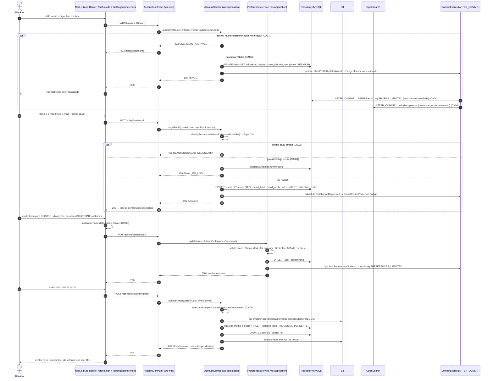
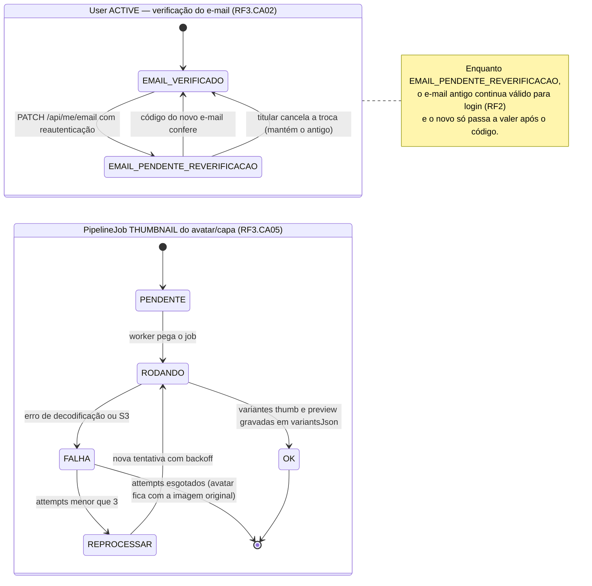
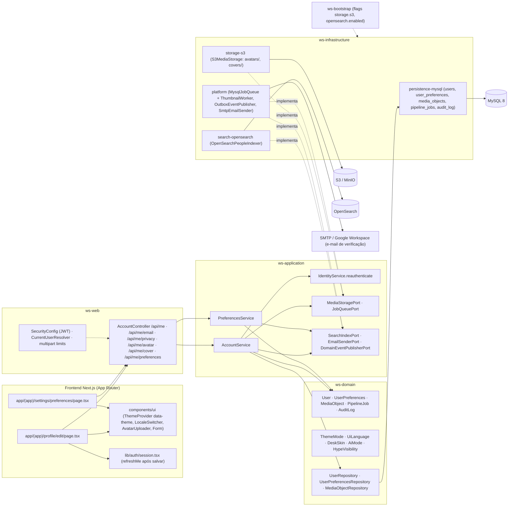
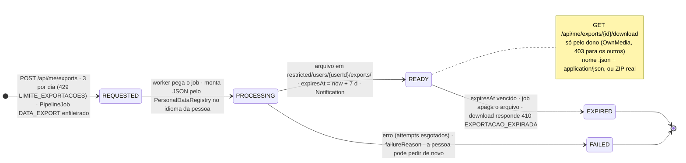
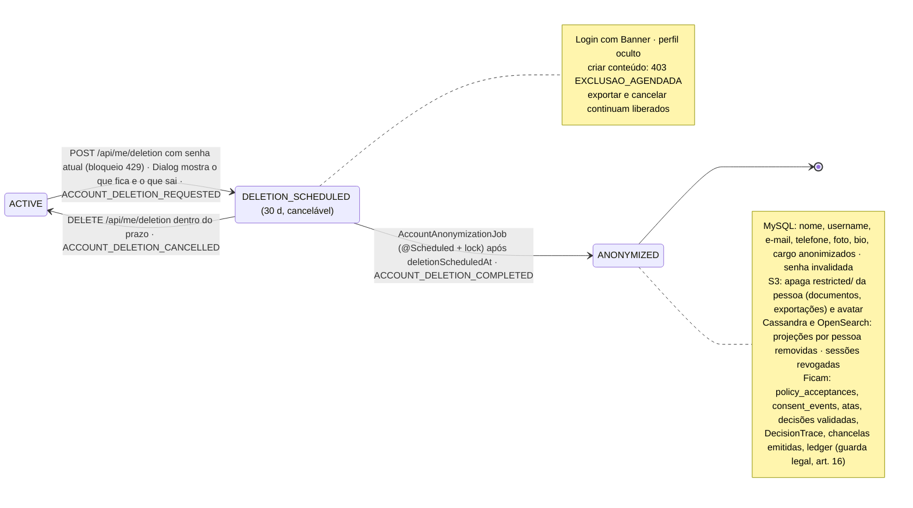

# RF3 — Editar informações pessoais e preferências do perfil do usuário
**HU:** HU3 · **Sprint (board Work Station):** 1 · **Equivalente FAI:** RF3 Preferências e conta (`AccountService`, `PreferencesService`, `user_preferences`, `MediaService` para avatar/capa; temas e skins do RF23 FAI) · **Aba/rota:** Meu perfil → Editar (`/profile/edit`) e **`/settings`** com abas na URL (`?tab=conta|aparencia|privacidade|dados|sessoes|termos`, §7; substitui `/settings/preferences`) — rotas sugeridas; a aba *Meu perfil* é `/profile` (RF19)
**Critérios de aceite cobertos:** RF3.CA01 … RF3.CA06 (RF1–RF18 não têm CAs no board: derivados da HU3 e marcados "CA a confirmar") · RF3.CA07–CA24 (§7, configurações e direitos do titular — o "RF23" do FAI, Q-46 —, D-15…D-21, "CA a confirmar")

> **HU3** — COMO usuário autenticado no sistema POSSO editar minhas informações pessoais e preferências de perfil PARA manter meus dados atualizados e personalizar minha experiência na plataforma.

## Critérios de aceite derivados da HU3 (todos "CA a confirmar")

| CA | Enunciado (Dado / Quando / Então) |
|---|---|
| **RF3.CA01** (CA a confirmar) | Dado o usuário autenticado, quando edito `fullName`, `displayName`, `jobTitle` (cargo), `bio`, `phone`, `avatarUrl`, `coverUrl`, então os campos são validados (tamanhos da TAXONOMIA, telefone E.164) e salvos via `PATCH /api/me`; `username` é **imutável após a verificação** (`422 USERNAME_IMUTAVEL`); erros voltam como `422 VALIDACAO` com `details` por campo. |
| **RF3.CA02** (CA a confirmar — **ajustado no Bloco 3**) | Dado a troca de e-mail/telefone (`PATCH /api/me/sensitive`), então é exigida a **senha atual** no mesmo bloqueio do login (`401 REAUTENTICACAO_FALHOU`; 6º erro → `429 MUITAS_TENTATIVAS` + `Retry-After`), o `emailHash` deve ser único (`409 EMAIL_EM_USO` — aceitável: a pessoa já está autenticada), `emailVerified` volta a `false` e um novo código é enviado. **Divergência a confirmar:** hoje o e-mail novo passa a valer imediatamente para login (não há coluna de "e-mail pendente" no V2); manter o antigo até confirmar exige V4. OIDC recente como reautenticação: Q-85. |
| **RF3.CA03** (CA a confirmar) | Dado a tela de preferências, quando altero `theme` (`ThemeMode` AUTO·CLARO·ESCURO·ALTO_CONTRASTE·BLUEPRINT), `language` (`UiLanguage` PT_BR·EN·ES), `density`, `fontScale`, `reduceMotion`, `deskSkin` (`DeskSkin`), `defaultCardSkin`, `timezone`, `wipLimit`, `aiModeDefault` (ECONOMIA·AVANCADO) e `notificationPrefsJson` (inclui `dailyTaskAt` 08:00, RF44.CA10), então elas são aplicadas **imediatamente** no cliente (sem recarregar) e persistidas em `user_preferences` (`PUT /api/me/preferences`), respeitando RF38.CA08. |
| **RF3.CA04** (CA a confirmar) | Dado as opções de privacidade, quando altero `hypeVisibility` (PUBLICO·EMPRESA·SO_EU, RF45.CA06) e `rankingOptOut` (RF43.CA05), então a mudança vale na próxima leitura do perfil/ranking e fica em `AuditLog PRIVACY_CHANGED`. |
| **RF3.CA05** (CA a confirmar) | Dado o upload de avatar ou capa, então o arquivo (≤ 5 MB, mime detectado pelo conteúdo: png/jpg/webp) vira `MediaObject` no S3/MinIO com `accessClass PUBLICO`, um `PipelineJob THUMBNAIL` gera as variantes de forma assíncrona e o `User.avatarUrl`/`coverUrl` aponta para a variante; o anterior é removido quando substituído. |
| **RF3.CA06** (CA a confirmar) | Dado qualquer alteração de perfil, então ela gera `AuditLog PROFILE_UPDATED` (sem valores sensíveis, com `correlationId`) e o evento `UserProfileUpdated` (AFTER_COMMIT) reindexa a pessoa na busca (OpenSearch, RF27) e invalida o cache do cabeçalho do perfil (RF19); campos LGPD (`email`, `phone`) permanecem cifrados com `AesGcmStringConverter`. |

## 1. Diagrama de classes

## 2. Diagrama de atividades

Raias: Usuário · Web/BFF · `ws-application` · Persistência (o RF3 não usa o AiEngine). Três sub-fluxos: dados pessoais, troca de e-mail e preferências/avatar.

## 3. Diagrama de sequência

Caminho feliz das preferências e do avatar, com os `alt` de erro do CA01 (username imutável) e do CA02 (reautenticação / e-mail em uso).

## 4. Máquina de estados

O RF3 não cria estados próprios; a entidade afetada é o **`User`** (verificação do e-mail dentro de `ACTIVE`) e o **`PipelineJob THUMBNAIL`** do avatar/capa (`MediaObject`). Os dois ciclos aparecem como estados compostos.

## 5. Diagrama de componentes

## 6. Rastreabilidade

| CA | Classe (§1) | Passo da atividade (§2) | Mensagem da sequência (§3) | Transição de estado (§4) | Componente (§5) |
|---|---|---|---|---|---|
| RF3.CA01 | `AccountService.updateProfile`, `User.fullName/displayName/jobTitle/bio/phone`, `User.username` (imutável) | `A3`, `B1`, `C1` → `E422a`/`E422`, `C2` | 1–9 (`PATCH /api/me`, `422 USERNAME_IMUTAVEL`) | — | `FE1`, `W1 /api/me`, `S1` |
| RF3.CA02 | `AccountService.changeEmail`, `IdentityService.reauthenticate`, `User.email/emailHash/emailVerified` | `A4`, `B2`, `C3` → `E401`, `C4` → `E409`, `C5` | 12–21 | `EMAIL_VERIFICADO → EMAIL_PENDENTE_REVERIFICACAO → EMAIL_VERIFICADO` | `W1 /api/me/email`, `S3`, `I4 SmtpEmailSender`, `X1` |
| RF3.CA03 | `PreferencesService.update`, `UserPreferences.*`, `ThemeMode`, `UiLanguage`, `DeskSkin`, `AiMode` | `A5`, `B3`, `C6`, `C7` | 22–29 (`PUT /api/me/preferences`) | — | `FE2`, `FE3 ThemeProvider`, `W1 /api/me/preferences`, `S2`, `I1 user_preferences` |
| RF3.CA04 | `AccountService.updatePrivacy`, `User.hypeVisibility`, `User.rankingOptOut`, `HypeVisibility`, `AuditLog` | `C2`, `C9` (PRIVACY_CHANGED) | 7, 10 (AuditLog) | — | `W1 /api/me/privacy`, `I4 OutboxEventPublisher` |
| RF3.CA05 | `AccountService.uploadAvatar/uploadCover`, `MediaObject`, `PipelineJob THUMBNAIL`, `MediaStoragePort`, `JobQueuePort` | `A6`, `B4`, `C8` → `E422b`, `C10`, `C11` | 30–39 | `PENDENTE → RODANDO → OK / FALHA → REPROCESSAR` | `FE3 AvatarUploader`, `W1 /api/me/avatar`, `I2 storage-s3`, `I4 ThumbnailWorker` |
| RF3.CA06 | `AuditLog`, `DomainEventPublisherPort`, `SearchIndexPort`/`OpenSearchPeopleIndexer`, `User.email/phone` (AES) | `C9`, `D3` | 8, 10–11 (AFTER_COMMIT → audit_log, reindexa) | — | `I3 search-opensearch`, `I4 OutboxEventPublisher`, `I1` |
| RF3.CA07 (CA a confirmar, D-11) | `SettingsPage` com `Tabs` (aba na URL) | — | — | — | `app/(app)/settings/page.tsx` (substitui `FE2`), `Tabs` de `packages/ui` |
| RF3.CA08 (CA a confirmar, D-14) | `IdentityService.reauthenticate` com bloqueio (SEG RN49.03), `AccountService.changeEmail` (código ao novo + aviso ao antigo), `changePassword` (revoga outras famílias, RF2.CA05) | `C3` → `E401` ganha `429 MUITAS_TENTATIVAS` | 15–17 | `EMAIL_VERIFICADO → EMAIL_PENDENTE_REVERIFICACAO` | `W1 /api/me/email`, `PUT /api/auth/password` |
| RF3.CA09 (CA a confirmar) | `AccountService.updatePrivacy` (`hypeVisibility` padrão SO_EU, `rankingOptOut`), `AuditLog PRIVACY_CHANGED` | `C2`, `C9` | 7, 10 | — | `W1 /api/me/privacy`, `Switch` |
| RF3.CA10 (CA a confirmar, D-17) | `UserConsent`, `ConsentPurpose`, `ConsentService.list/set` (`GET/PUT /api/me/consents/{purpose}`) | §7 passo "interruptor nunca pré-marcado" | — | — | `W1 /api/me/consents`, `Switch` |
| RF3.CA11 (CA a confirmar, D-17) | `ConsentEvent` (append-only), `AuditLog CONSENT_GRANTED/CONSENT_REVOKED` | — | — | — | `I1 consent_events` |
| RF3.CA12 (CA a confirmar, D-17) | `ConsentChecks` (mapa finalidade → checagem), `ConsentCoverageTest` | — | — | — | CI (`mvn verify`) |
| RF3.CA13 (CA a confirmar, D-18) | `PersonalDataRegistry` (`GET /api/me/data-map`) | — | — | — | aba Seus dados → "Quais dados temos" |
| RF3.CA14 (CA a confirmar, D-20) | `DataExportRequest`, `ExportStatus`, `PipelineJob DATA_EXPORT`, `ExportService.request/list` (3/dia) | — | — | §7.3 bloco 1 `REQUESTED → PROCESSING → READY → EXPIRED \| FAILED` | `W1 /api/me/exports`, `I4 MysqlJobQueue` + `DataExportWorker` |
| RF3.CA15 (CA a confirmar, D-20) | `ExportService.download` (`OwnMedia`, `restricted/users/{id}/exports/`, `410 EXPORTACAO_EXPIRADA`), `expiresAt +7 d` | — | — | `READY → EXPIRED` | `I2 storage-s3 restricted/`, `Notification` |
| RF3.CA16 (CA a confirmar, D-18) | `PersonalDataRegistry.exportSection` (conteúdo da exportação) | — | — | `PROCESSING` | `DataExportWorker` |
| RF3.CA17 (CA a confirmar, D-18) | `PersonalDataRegistryCoverageTest` (entidade com coluna de pessoa fora do registro quebra o CI) | — | — | — | CI |
| RF3.CA18 (CA a confirmar) | `DataSubjectRequest`, `DsrKind/DsrTarget/DsrStatus`, `DsrService.open` (`POST /api/me/requests`), `AuditLog DSR_OPENED` | — | — | — | aba Seus dados → "Outros direitos", `WS_LEGAL_DPO_CONTACT` |
| RF3.CA19 (CA a confirmar, D-18) | `AccountService.requestDeletion/cancelDeletion` (reconferência com bloqueio), `User.deletionScheduledAt`, `AuditLog ACCOUNT_DELETION_REQUESTED/CANCELLED` | — | — | §7.3 bloco 2 `ACTIVE → DELETION_SCHEDULED → ACTIVE` | `W1 /api/me/deletion`, `Dialog` com o que fica e o que sai |
| RF3.CA20 (CA a confirmar, D-18) | `Guard.requireNotDeletionScheduled` (`403 EXCLUSAO_AGENDADA`), `Banner` no login, perfil oculto | — | — | `DELETION_SCHEDULED` (nota) | `Banner` de `packages/ui`, `W2` |
| RF3.CA21 (CA a confirmar, D-18) | `AccountAnonymizationJob` (`@Scheduled` + lock), `AnonymizationJobScheduledTest`, `AccountAnonymizationIT` (MySQL, Cassandra, OpenSearch, S3), `AuditLog ACCOUNT_DELETION_COMPLETED` | — | — | §7.3 bloco 2 `DELETION_SCHEDULED → ANONYMIZED` | `I4 platform` (job), `I1`, `I2`, `I3`, Cassandra |
| RF3.CA22 (CA a confirmar, D-15) | `PolicyAcceptance` (aba Termos e políticas: `GET /api/me/policies`), RF2.CA05 (aba Sessões) | — | — | — | `W1 /api/me/policies`, RF2 `/api/auth/sessions` |
| RF3.CA23 (CA a confirmar, D-11) | padrões de interface LGPD (`Switch`, `Dialog`, `Banner` com foco visível, `reduceMotion`) | — | — | — | `packages/ui` |
| RF3.CA24 (CA a confirmar, D-21) | tipos TS gerados do OpenAPI (`openapi-typescript`), `ContractDriftTest` no CI | — | — | — | CI (`npm run api:types -- --check`) |

## 7. Configurações e direitos do titular — `/settings` (CA a confirmar, D-15…D-21; o "RF23" do FAI, Q-46)

Bloco **C** do brief `PROMPT_DECIA_CADASTRO_LGPD`: a tela de configurações é o **ponto de cumprimento** da LGPD
(FAI `padroes-interface-lgpd.html`, RF3.CA01–CA24 do FAI adaptados). Entidades em `TAXONOMIA.md` §1.12–1.14, §12.6 e
§12.9 (**proposta**). Os diagramas §1–§5 não foram reescritos: a rota `/settings/preferences` (`FE2`) vira a aba
Aparência de `/settings`, e os dois blocos de estados novos estão em §7.3. Defeitos do FAI evitados aqui: exclusão que
nunca conclui (1), consentimentos não respeitados e histórico sobrescrito (6), front lendo campos que o back não manda
(7), exportação síncrona com nome `.zip` e JSON dentro (8).

### 7.1 Abas (`Tabs`, aba atual na URL `?tab=`)

| Aba | O que tem | CAs |
|---|---|---|
| **Conta** | RF3.CA01 e CA02 (correção, art. 18 III); troca de e-mail com senha atual e bloqueio; troca de senha encerra as outras sessões | CA08 |
| **Aparência** | RF3.CA03 aplicada na hora e persistida | CA03 |
| **Privacidade** | `hypeVisibility` (padrão SO_EU, RF45.CA06), `rankingOptOut` (RF43.CA05) e os **consentimentos** | CA09–CA12 |
| **Seus dados** | "Quais dados temos" (transparência), exportação, outros direitos (revisão art. 20, oposição, informação sobre compartilhamento), encerramento da conta | CA13–CA21 |
| **Sessões** | RF2.CA05: lista e revogação | CA22 |
| **Termos e políticas** | versões aceitas, datas, canal e links para `/termos` e `/privacidade` | CA22 |
| **Validação** (só EMPRESA/CHEFE pendentes) | central de validação do RF28.CA11 | RF28 |

### 7.2 Critérios de aceite (RF3.CA07–CA24)

| CA | Enunciado (Dado / Quando / Então) |
|---|---|
| **RF3.CA07** (CA a confirmar) | Dado `/settings`, então as abas usam `Tabs` de `packages/ui` com a aba atual na URL (`?tab=conta`), navegáveis por teclado; nenhuma aba contém HTML/CSS solto (D-11). |
| **RF3.CA08** (CA a confirmar) | Dado a troca de e-mail, então ela exige a **senha atual com o bloqueio** da SEG RN49.03 (6º erro → `429 MUITAS_TENTATIVAS` + `Retry-After`), envia um código ao e-mail novo e um **aviso ao antigo**; a troca de senha encerra as outras sessões (RF2.CA05). Refina o CA02. |
| **RF3.CA09** (CA a confirmar) | Dado a aba Privacidade, então `hypeVisibility` nasce `SO_EU` e `rankingOptOut` `false`; alterar grava `AuditLog PRIVACY_CHANGED` e vale na próxima leitura (refina o CA04). |
| **RF3.CA10** (CA a confirmar, Q-67) | Dado os consentimentos, então existem só para **finalidades opcionais** (`ConsentPurpose` proposto: `RESUMO_PROFISSIONAL_IA`, RF43.CA04; `GRAVACAO_REUNIOES_PADRAO`, preferência — o consentimento por reunião continua no RF37); cada uma mostra `title`, `description`, `legalBasis`, `article`, `sensitive`, `grantedAt`, `revokedAt` e `policyVersion` (campos **iguais** aos do OpenAPI, CA24); **nunca vem marcada**; revogar tem o mesmo esforço que conceder (`PUT /api/me/consents/{purpose} {granted}`). |
| **RF3.CA11** (CA a confirmar) | Dado conceder ou revogar, então grava-se uma linha em `consent_events` (append-only) e o estado em `user_consents`, mais `AuditLog CONSENT_GRANTED` ou `CONSENT_REVOKED`; o histórico aparece na própria aba. |
| **RF3.CA12** (CA a confirmar) | Dado o enum `ConsentPurpose`, então cada valor tem um **ponto de verificação registrado** em `ConsentChecks` (mapa finalidade → método que o serviço chama antes do tratamento); `ConsentCoverageTest` falha o CI para finalidade sem checagem, e finalidade sem uso **não aparece** na tela. |
| **RF3.CA13** (CA a confirmar) | Dado "Quais dados temos" (art. 9º; art. 18 I e II), então a página lista, por categoria, finalidade, base legal, retenção e com quem é compartilhada (provedores de IA com mascaramento, Google Workspace, Microsoft 365), tudo vindo do `PersonalDataRegistry` (`GET /api/me/data-map`) — o mesmo registro que a exportação usa. |
| **RF3.CA14** (CA a confirmar) | Dado "Exportar meus dados", então `POST /api/me/exports` cria `DataExportRequest REQUESTED` e enfileira `PipelineJob DATA_EXPORT` (assíncrona); limite **3 por dia por pessoa** (`429 LIMITE_EXPORTACOES`); estados `REQUESTED → PROCESSING → READY → EXPIRED \| FAILED`; `GET /api/me/exports` lista com `requestedAt` e `expiresAt`. |
| **RF3.CA15** (CA a confirmar) | Dado a exportação pronta, então o arquivo tem nome e tipo corretos (`.json` + `application/json`, ou um ZIP de verdade), sai no idioma da pessoa, fica em `restricted/users/{userId}/exports/`, só o dono baixa (`OwnMedia`, `403` para os outros), o link expira em **7 dias** (`410 EXPORTACAO_EXPIRADA`) e há notificação quando fica pronta. |
| **RF3.CA16** (CA a confirmar) | Dado o conteúdo, então inclui perfil, preferências, aceites, consentimentos e histórico; sessões, lotações e nomeações; tarefas e projetos de autoria própria e **as próprias mensagens** do DECIA (nunca as de outras pessoas); decisões de que participou, pontos, reconhecimentos; inferências de IA sobre a pessoa e a auditoria sobre ela. |
| **RF3.CA17** (CA a confirmar) | Dado uma entidade com coluna de pessoa (`userId`, `authorId`, `actorId`, `ownerId`, `recipientId`…), então ela está no `PersonalDataRegistry` ou em `EXCLUDED_WITH_REASON`; `PersonalDataRegistryCoverageTest` falha o CI para entidade nova sem classificação. |
| **RF3.CA18** (CA a confirmar, Q-71) | Dado "Outros direitos", então a pessoa pode abrir `DataSubjectRequest` de **revisão de decisão automatizada** (art. 20: HSE, ranking, Hype ou classificação por IA, com `targetId`), **oposição** e **informação sobre compartilhamento**; cada pedido tem prazo (`dueAt`), status, encarregado responsável e `AuditLog DSR_OPENED`; o canal do encarregado (`WS_LEGAL_DPO_CONTACT`) aparece na aba. Correção é pela aba Conta. |
| **RF3.CA19** (CA a confirmar, Q-68) | Dado "Encerrar minha conta", então o pedido exige a **senha atual com bloqueio**, e **antes de confirmar** o `Dialog` mostra o que será anonimizado e o que fica guardado e por quê (documentos públicos com guarda legal: atas, decisões validadas, `DecisionTrace`, chancelas emitidas, ledger; e os aceites — art. 16 e tabela de temporalidade); a conta vai a `DELETION_SCHEDULED` por 30 dias, cancelável; `AuditLog ACCOUNT_DELETION_REQUESTED` / `ACCOUNT_DELETION_CANCELLED`. |
| **RF3.CA20** (CA a confirmar) | Dado `DELETION_SCHEDULED`, então o login mostra um `Banner` com a data e o botão de cancelar, criar conteúdo recebe `403 EXCLUSAO_AGENDADA` e o perfil fica oculto (busca, rankings, Mural). |
| **RF3.CA21** (CA a confirmar) | Dado o prazo vencido, então o `AccountAnonymizationJob` roda por `@Scheduled` com **lock** (ShedLock) que impede execução dupla em várias réplicas; **teste 1** prova que o método está agendado; **teste 2** (Testcontainers) prova que ele anonimiza os dados pessoais no MySQL, apaga arquivos e documentos de `restricted/`, limpa as projeções no Cassandra e no OpenSearch, revoga as sessões e grava `ACCOUNT_DELETION_COMPLETED`, mantendo `policy_acceptances`, `consent_events` e os documentos públicos. |
| **RF3.CA22** (CA a confirmar) | Dado as abas Sessões e Termos e políticas, então a primeira reaproveita RF2.CA05 e a segunda mostra, por documento, a versão aceita, a data, o canal e o link para a versão vigente (`GET /api/me/policies`). |
| **RF3.CA23** (CA a confirmar) | Dado qualquer controle da tela, então valem os padrões LGPD: privacidade por padrão, aceitar e recusar com o **mesmo destaque**, nenhum texto que constranja quem recusa, foco visível, navegação por teclado e `reduceMotion` respeitado. |
| **RF3.CA24** (CA a confirmar) | Dado o contrato front/back, então os tipos TypeScript do front são **gerados do OpenAPI** (springdoc → `openapi-typescript`) e o CI falha se o arquivo gerado divergir do commitado ou se o front ler um campo que o back não declara (defeito 7 do FAI). |

### 7.2.1 Implementação (Bloco 3, PR sec-b3) — o que já existe de RF3

| CA | Classe(s) | Teste(s) | Observação |
|---|---|---|---|
| CA01 / CA06 | `AccountService.me/profile/update` (422 por campo; `username` não é editável), `MeController` (`GET/PATCH /api/me`, `GET /api/users/{id}`), `Guard.ownerOrAdmin` (403 `ACESSO_NEGADO`), `AuditActions.PROFILE_UPDATED` | `AccountServiceTest.perfilPorIdSoParaODonoOuAdmin`, `.atualizaCamposNaoSensiveisComValidacaoEAuditoria`, `MeControllerWebTest` (401 e 403 em **todos** os endpoints) | evento `UserProfileUpdated`/reindexação: RF27 |
| CA02 / CA08 | `AccountService.updateSensitive` → `IdentityService.reauthenticate` (mesmo `login-fail`) | `AccountServiceTest.dadosSensiveisExigemSenhaAtualNoMesmoBloqueioDoLogin` | aviso ao e-mail antigo: Q-84 |
| CA03 | `AccountService.preferences/updatePreferences` (valores validados contra os CHECKs do V2), `MeController` (`GET/PUT /api/me/preferences`) | `AccountServiceTest.preferenciasNascemComOsPadroesDoV2ESaoValidadas` | aplicação imediata no cliente: Bloco 4 |
| CA04 / CA09 | `AccountService.update` (`hypeVisibility`, `rankingOptOut`) | idem CA01 | auditoria sai como `PROFILE_UPDATED` com os nomes dos campos (não há `PRIVACY_CHANGED` separado ainda) |
| CA19 / CA20 | `AccountService.requestDeletion/cancelDeletion` (`DELETION_SCHEDULED`, `deletion_scheduled_at = +30 d`, outras sessões encerradas), `Guard.requireNotDeletionScheduled` (`403 EXCLUSAO_AGENDADA` no `PATCH /api/me`), `MeController` (`POST/DELETE /api/me/deletion`) | `AccountServiceTest.exclusaoAgendaTrintaDiasBloqueiaEdicaoECancelaVoltandoAoStatus`, `GuardTest` | `AccountAnonymizationJob`, `Dialog` prévio e perfil oculto: bloco LGPD C / Bloco 4 |

### 7.3 Máquinas de estado novas

**Bloco 1 — `DataExportRequest.status` (`ExportStatus`)**

**Bloco 2 — `User.status` no encerramento da conta (`AccountStatus`, D-18)**

Endpoints propostos da aba Seus dados: `GET /api/me/data-map` · `POST|GET /api/me/exports` ·
`GET /api/me/exports/{id}/download` · `POST|GET /api/me/requests` (DataSubjectRequest) · `POST|DELETE /api/me/deletion`
· `GET /api/me/policies` · `GET|PUT /api/me/consents/{purpose}`. Jobs agendados: `AccountAnonymizationJob` (diário),
`ExportExpiryJob` (horário), ambos com `@Scheduled`, lock e teste de agendamento.

Tela/aba: `/settings` (esqueleto em `app/(shell)/settings/page.tsx`)
