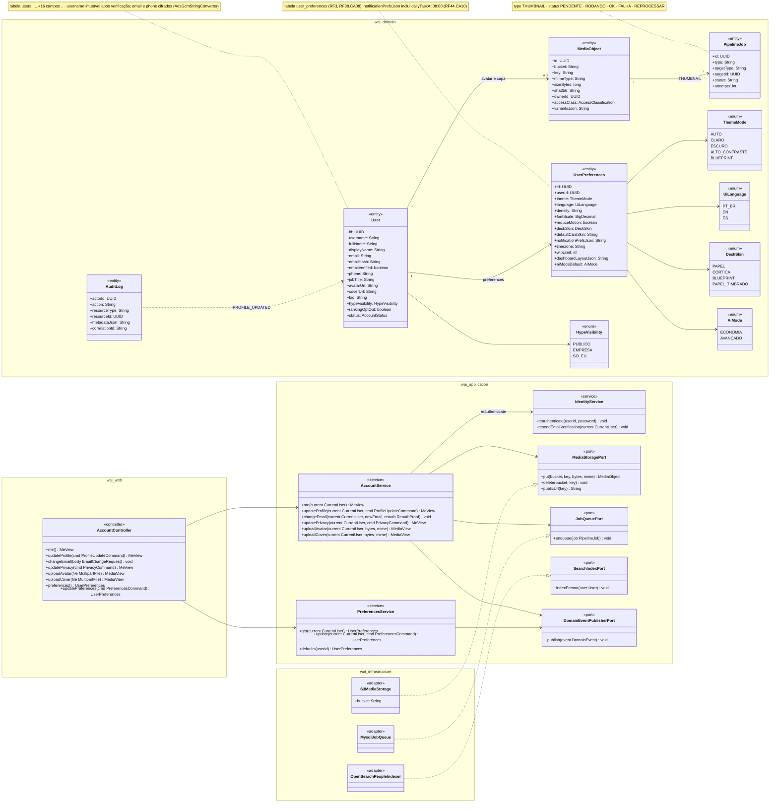
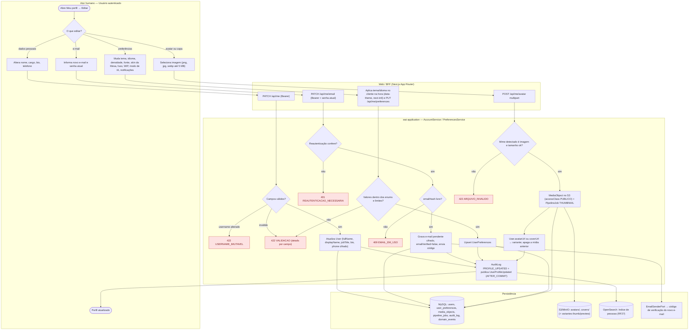
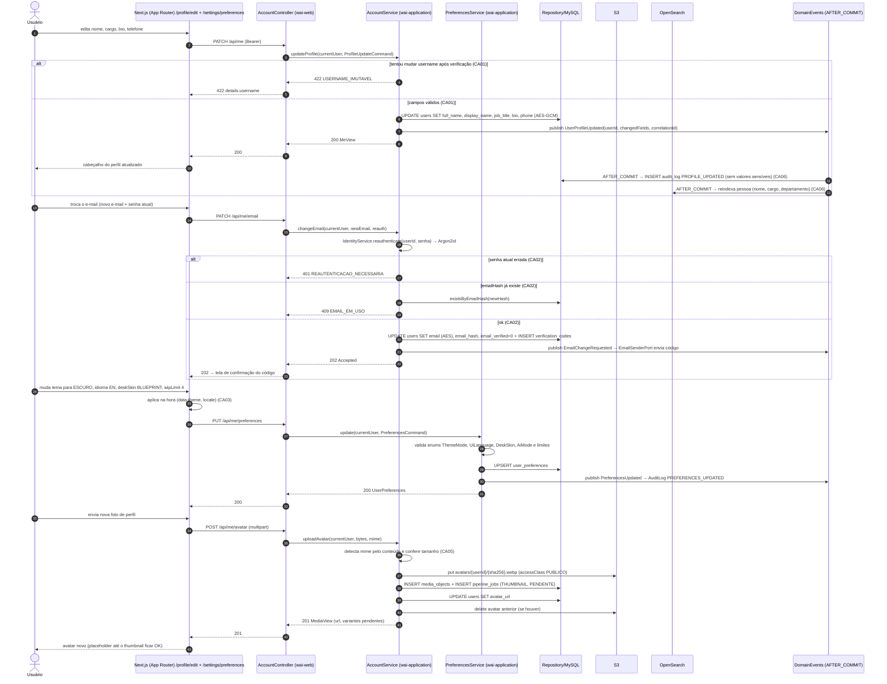
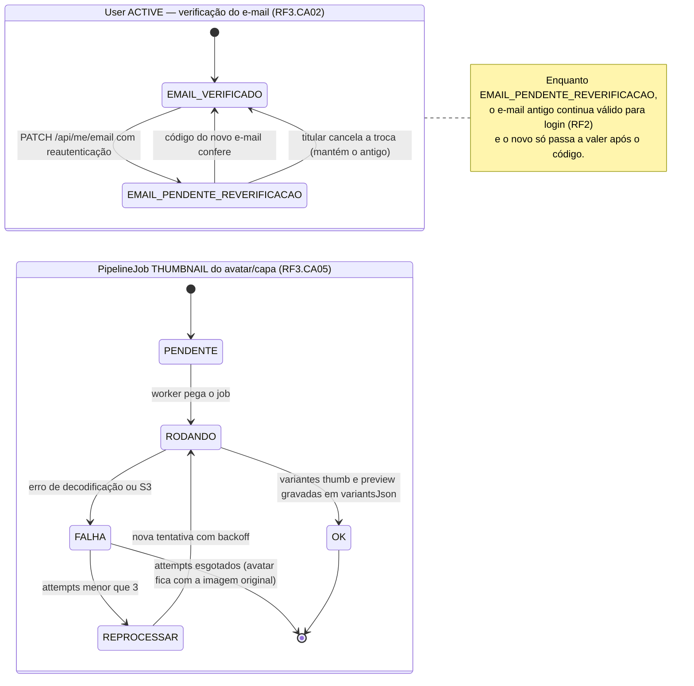

# RF3 — Editar informações pessoais e preferências do perfil do usuário
**HU:** HU3 · **Sprint (board Work Station):** 1 · **Equivalente FAI:** RF3 Preferências e conta (`AccountService`, `PreferencesService`, `user_preferences`, `MediaService` para avatar/capa; temas e skins do RF23 FAI) · **Aba/rota:** Meu perfil → Editar (`/profile/edit`) e Preferências (`/settings/preferences`) — rotas sugeridas; a aba *Meu perfil* é `/profile` (RF19)
**Critérios de aceite cobertos:** RF3.CA01 … RF3.CA06 (RF1–RF18 não têm CAs no board: derivados da HU3 e marcados "CA a confirmar")

> **HU3** — COMO usuário autenticado no sistema POSSO editar minhas informações pessoais e preferências de perfil PARA manter meus dados atualizados e personalizar minha experiência na plataforma.

## Critérios de aceite derivados da HU3 (todos "CA a confirmar")

| CA | Enunciado (Dado / Quando / Então) |
|---|---|
| **RF3.CA01** (CA a confirmar) | Dado o usuário autenticado, quando edito `fullName`, `displayName`, `jobTitle` (cargo), `bio`, `phone`, `avatarUrl`, `coverUrl`, então os campos são validados (tamanhos da TAXONOMIA, telefone E.164) e salvos via `PATCH /api/me`; `username` é **imutável após a verificação** (`422 USERNAME_IMUTAVEL`); erros voltam como `422 VALIDACAO` com `details` por campo. |
| **RF3.CA02** (CA a confirmar) | Dado a troca de e-mail, quando informo o novo e-mail, então é exigida **reautenticação** (senha atual ou OIDC recente — `401 REAUTENTICACAO_NECESSARIA`), o `emailHash` deve ser único (`409 EMAIL_EM_USO`), `emailVerified` volta a `false` e um novo código é enviado; até confirmar, o e-mail antigo continua valendo para login. |
| **RF3.CA03** (CA a confirmar) | Dado a tela de preferências, quando altero `theme` (`ThemeMode` AUTO·CLARO·ESCURO·ALTO_CONTRASTE·BLUEPRINT), `language` (`UiLanguage` PT_BR·EN·ES), `density`, `fontScale`, `reduceMotion`, `deskSkin` (`DeskSkin`), `defaultCardSkin`, `timezone`, `wipLimit`, `aiModeDefault` (ECONOMIA·AVANCADO) e `notificationPrefsJson` (inclui `dailyTaskAt` 08:00, RF44.CA10), então elas são aplicadas **imediatamente** no cliente (sem recarregar) e persistidas em `user_preferences` (`PUT /api/me/preferences`), respeitando RF38.CA08. |
| **RF3.CA04** (CA a confirmar) | Dado as opções de privacidade, quando altero `hypeVisibility` (PUBLICO·EMPRESA·SO_EU, RF45.CA06) e `rankingOptOut` (RF43.CA05), então a mudança vale na próxima leitura do perfil/ranking e fica em `AuditLog PRIVACY_CHANGED`. |
| **RF3.CA05** (CA a confirmar) | Dado o upload de avatar ou capa, então o arquivo (≤ 5 MB, mime detectado pelo conteúdo: png/jpg/webp) vira `MediaObject` no S3/MinIO com `accessClass PUBLICO`, um `PipelineJob THUMBNAIL` gera as variantes de forma assíncrona e o `User.avatarUrl`/`coverUrl` aponta para a variante; o anterior é removido quando substituído. |
| **RF3.CA06** (CA a confirmar) | Dado qualquer alteração de perfil, então ela gera `AuditLog PROFILE_UPDATED` (sem valores sensíveis, com `correlationId`) e o evento `UserProfileUpdated` (AFTER_COMMIT) reindexa a pessoa na busca (OpenSearch, RF27) e invalida o cache do cabeçalho do perfil (RF19); campos LGPD (`email`, `phone`) permanecem cifrados com `AesGcmStringConverter`. |

## 1. Diagrama de classes

## 2. Diagrama de atividades

Raias: Usuário · Web/BFF · `wai-application` · Persistência (o RF3 não usa o AiEngine). Três sub-fluxos: dados pessoais, troca de e-mail e preferências/avatar.

## 3. Diagrama de sequência

Caminho feliz das preferências e do avatar, com os `alt` de erro do CA01 (username imutável) e do CA02 (reautenticação / e-mail em uso).

## 4. Máquina de estados

O RF3 não cria estados próprios; a entidade afetada é o **`User`** (verificação do e-mail dentro de `ACTIVE`) e o **`PipelineJob THUMBNAIL`** do avatar/capa (`MediaObject`). Os dois ciclos aparecem como estados compostos.

## 5. Diagrama de componentes

## 6. Rastreabilidade

| CA | Classe (§1) | Passo da atividade (§2) | Mensagem da sequência (§3) | Transição de estado (§4) | Componente (§5) |
|---|---|---|---|---|---|
| RF3.CA01 | `AccountService.updateProfile`, `User.fullName/displayName/jobTitle/bio/phone`, `User.username` (imutável) | `A3`, `B1`, `C1` → `E422a`/`E422`, `C2` | 1–9 (`PATCH /api/me`, `422 USERNAME_IMUTAVEL`) | — | `FE1`, `W1 /api/me`, `S1` |
| RF3.CA02 | `AccountService.changeEmail`, `IdentityService.reauthenticate`, `User.email/emailHash/emailVerified` | `A4`, `B2`, `C3` → `E401`, `C4` → `E409`, `C5` | 12–21 | `EMAIL_VERIFICADO → EMAIL_PENDENTE_REVERIFICACAO → EMAIL_VERIFICADO` | `W1 /api/me/email`, `S3`, `I4 SmtpEmailSender`, `X1` |
| RF3.CA03 | `PreferencesService.update`, `UserPreferences.*`, `ThemeMode`, `UiLanguage`, `DeskSkin`, `AiMode` | `A5`, `B3`, `C6`, `C7` | 22–29 (`PUT /api/me/preferences`) | — | `FE2`, `FE3 ThemeProvider`, `W1 /api/me/preferences`, `S2`, `I1 user_preferences` |
| RF3.CA04 | `AccountService.updatePrivacy`, `User.hypeVisibility`, `User.rankingOptOut`, `HypeVisibility`, `AuditLog` | `C2`, `C9` (PRIVACY_CHANGED) | 7, 10 (AuditLog) | — | `W1 /api/me/privacy`, `I4 OutboxEventPublisher` |
| RF3.CA05 | `AccountService.uploadAvatar/uploadCover`, `MediaObject`, `PipelineJob THUMBNAIL`, `MediaStoragePort`, `JobQueuePort` | `A6`, `B4`, `C8` → `E422b`, `C10`, `C11` | 30–39 | `PENDENTE → RODANDO → OK / FALHA → REPROCESSAR` | `FE3 AvatarUploader`, `W1 /api/me/avatar`, `I2 storage-s3`, `I4 ThumbnailWorker` |
| RF3.CA06 | `AuditLog`, `DomainEventPublisherPort`, `SearchIndexPort`/`OpenSearchPeopleIndexer`, `User.email/phone` (AES) | `C9`, `D3` | 8, 10–11 (AFTER_COMMIT → audit_log, reindexa) | — | `I3 search-opensearch`, `I4 OutboxEventPublisher`, `I1` |
