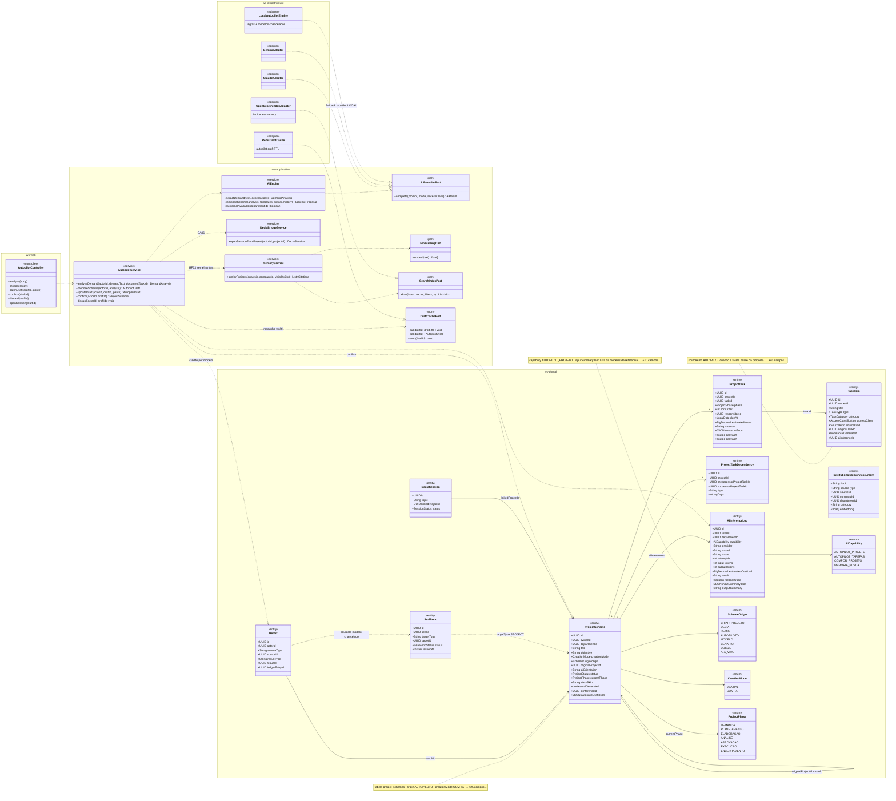
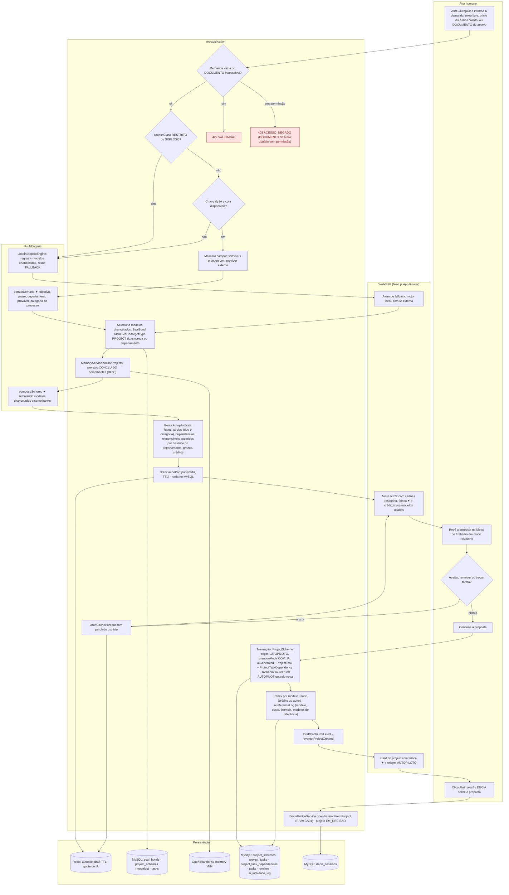
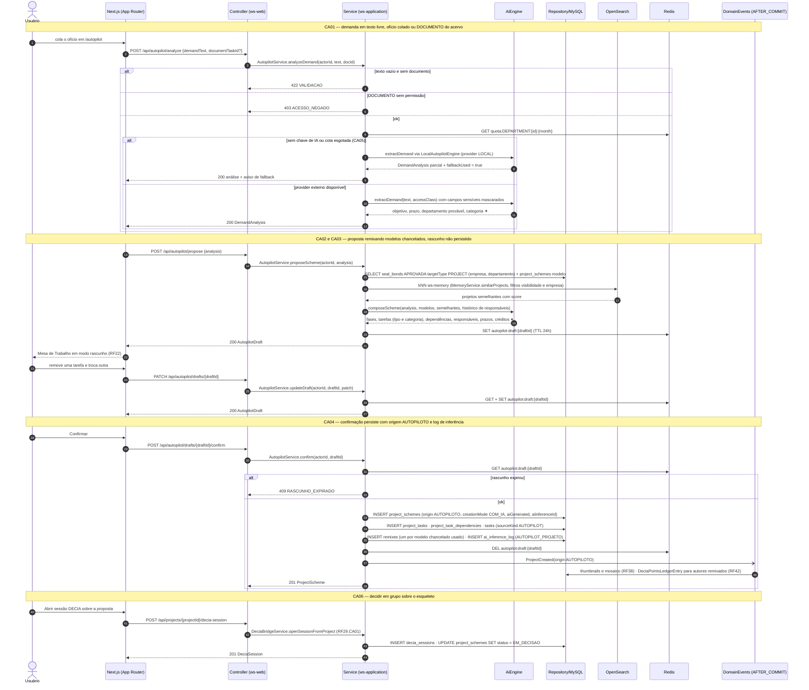
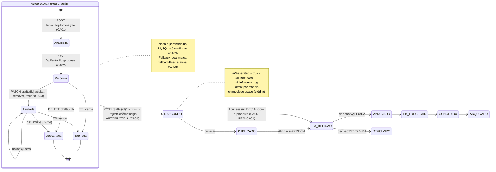
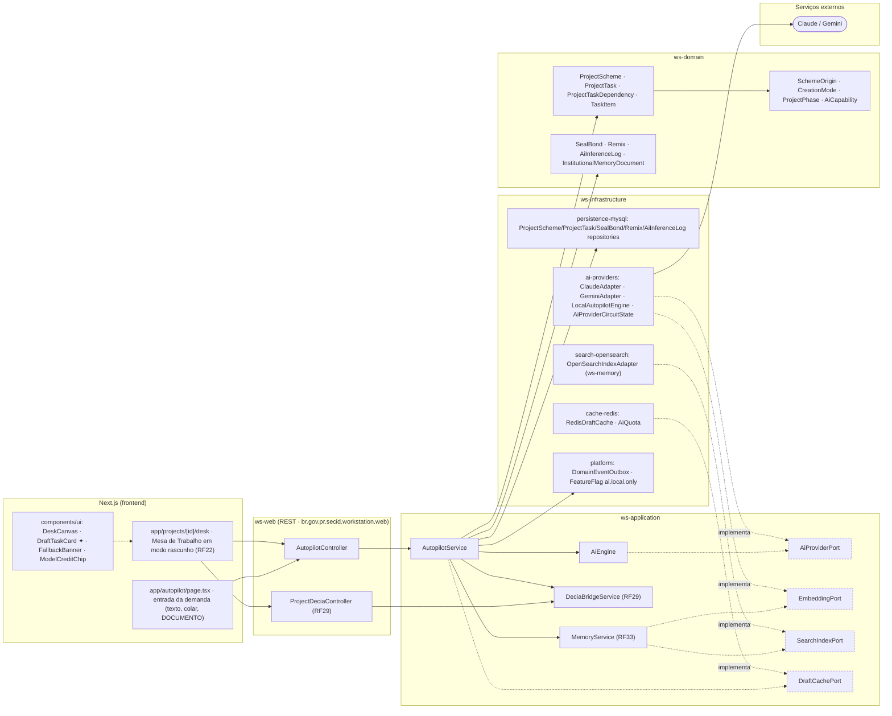

# RF30 — Gerar um Esquema de Projeto completo com o Autopiloto de Projeto a partir de uma demanda (ofício, e-mail ou frase), reutilizando modelos chancelados

**HU:** HU30 · **Sprint (board Work Station):** Product Backlog (pós-Sprint 4, a priorizar) · **Equivalente FAI:** Autopiloto + "Vista-me" (RF28) · **Aba/rota:** Autopiloto (`/autopilot`); proposta exibida na Mesa de Trabalho (RF22) em modo rascunho

**Critérios de aceite cobertos:** RF30.CA01 · RF30.CA02 · RF30.CA03 · RF30.CA04 · RF30.CA05 · RF30.CA06

> Contextos da TAXONOMIA: **3. Criador de Projetos** (`ProjectScheme` com `origin = AUTOPILOTO`, `ProjectTask`, `ProjectTaskDependency`), **2. Acervo** (`TaskItem` com `sourceKind = AUTOPILOT`), **6. Chancelas** (`SealBond APROVADA` = modelos chancelados), **8. Social** (`Remix` = crédito a cada modelo usado) e **10. IA do sistema** (`AiInferenceLog` capability `AUTOPILOT_PROJETO`, `InstitutionalMemoryDocument` para "projetos semelhantes", RF33). A proposta **não é persistida** no MySQL até o usuário confirmar (CA03): vive em Redis (`autopilot:draft:{draftId}`, TTL) — decisão a confirmar em `DECISOES.md`.

## 1. Diagrama de classes

## 2. Diagrama de atividades

## 3. Diagrama de sequência

## 4. Máquina de estados

Entidade central: `ProjectScheme.status` (`ProjectStatus`) — precedida pelos estados **voláteis** do `AutopilotDraft` (Redis, fora do MySQL), que não são estados da entidade e existem só até a confirmação (CA03).

## 5. Diagrama de componentes

## 6. Rastreabilidade

| CA | Elemento do diagrama (classe / passo / mensagem / transição / componente) |
|---|---|
| RF30.CA01 | Classes `AutopilotService.analyzeDemand`, `AiEngine.extractDemand`, `TaskItem` (DOCUMENTO de entrada, `accessClass`); atividades `U1 → S1 → S2/S3 → S4 → A1` (422 VALIDACAO, 403 ACESSO_NEGADO); sequência bloco «CA01» (`POST /api/autopilot/analyze`); transição `[*] → Analisada`; componente `app/autopilot`, `AutopilotController.analyze` |
| RF30.CA02 | Classes `SealBond APROVADA` (modelos chancelados), `MemoryService.similarProjects`, `AiEngine.composeScheme`, `Remix` (crédito), `ProjectTaskDependency`, `ProjectTask.responsibleId/dueAt`; atividades `S5 → S6 → A2 → S7`; sequência bloco «CA02 e CA03» (SELECT seal_bonds, kNN ws-memory, composeScheme ✦); transição `Analisada → Proposta`; componentes `MemoryService`, `search-opensearch`, `ModelCreditChip` |
| RF30.CA03 | Classes `DraftCachePort`, `RedisDraftCache`, `AutopilotService.updateDraft/discard`; atividades `S8 → W2 → U2 → U3 → S9` (nada no MySQL); sequência bloco «CA02 e CA03» (`SET autopilot:draft` TTL, `PATCH /api/autopilot/drafts/{id}`); estados voláteis `Proposta → Ajustada → Descartada/Expirada`; componentes `DeskCanvas`, `DraftTaskCard`, `cache-redis` |
| RF30.CA04 | Classes `ProjectScheme.origin = AUTOPILOTO`, `creationMode = COM_IA`, `aiGenerated`, `aiInferenceId`, `AiInferenceLog` (modelo, custo, latência, `inputSummaryJson` com modelos de referência); atividades `U4 → S10 → S11 → S12 → W3`; sequência bloco «CA04» (INSERT project_schemes, remixes, ai_inference_log; 409 RASCUNHO_EXPIRADO); transição `Draft → RASCUNHO` e nota; componente `persistence-mysql` |
| RF30.CA05 | Classes `LocalAutopilotEngine ..|> AiProviderPort`, `AiInferenceLog.fallbackUsed/result FALLBACK`, `AiEngine.isExternalAvailable`; atividades `S2/S3 → A3 → W1` (sem chave ou cota, ou RESTRITO/SIGILOSO); sequência bloco «CA01» alt «sem chave de IA ou cota esgotada»; nota do estado `Draft`; componentes `FallbackBanner`, `ai-providers`, `FeatureFlag ai.local.only` |
| RF30.CA06 | Classes `DeciaBridgeService.openSessionFromProject`, `DeciaSession.linkedProjectId`; atividades `W3 → U5 → S13 → D5`; sequência bloco «CA06» (`POST /api/projects/{id}/decia-session`, EM_DECISAO); transição `RASCUNHO → EM_DECISAO`; componente `ProjectDeciaController (RF29)` |

> Dúvidas para `docs/DECISOES.md`: onde vive o rascunho não persistido (Redis com TTL vs. somente cliente vs. `ProjectScheme.autosaveDraftJson` — esta última contradiz CA03); `DraftCachePort` e `409 RASCUNHO_EXPIRADO` são propostas; TaskItems novos criados pela proposta recebem `sourceKind AUTOPILOT`, mas tarefas reaproveitadas de modelos entram como `REMIX`.

Tela/aba: `/autopilot` (esqueleto em `app/(shell)/autopilot/page.tsx`)
