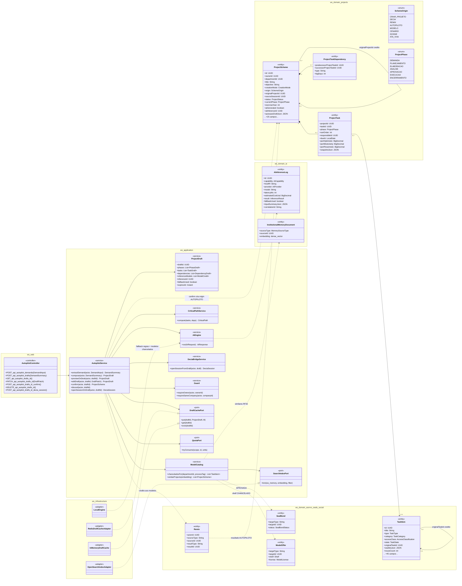
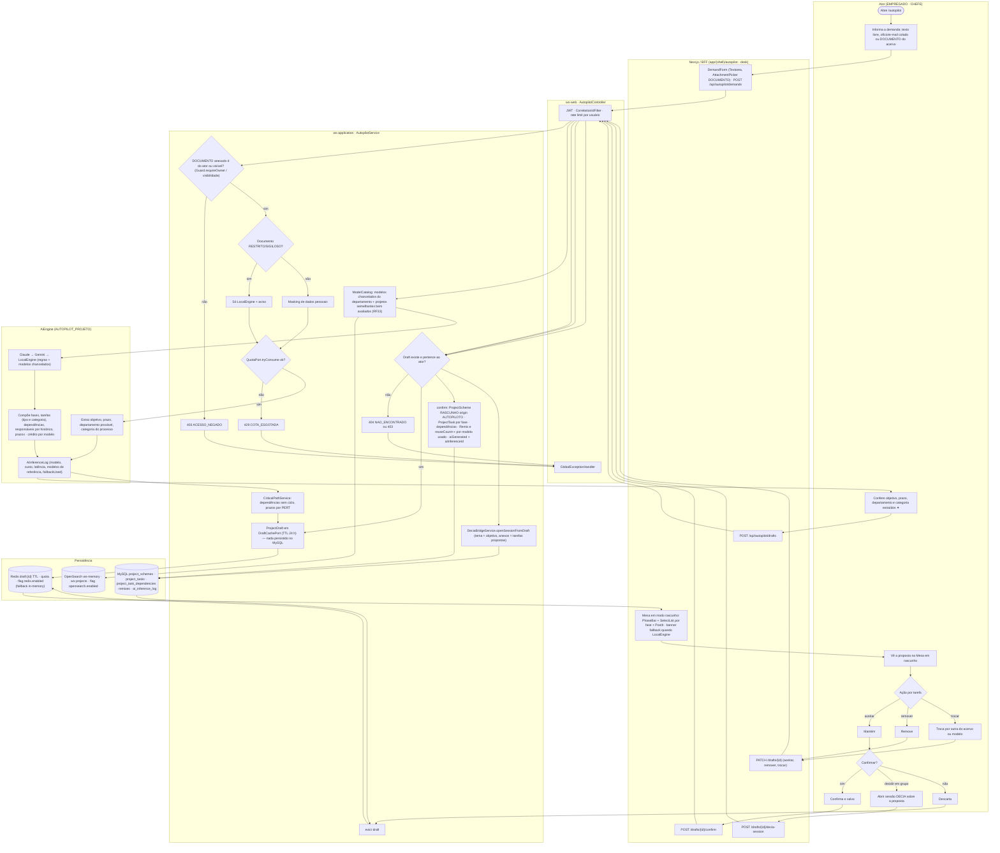
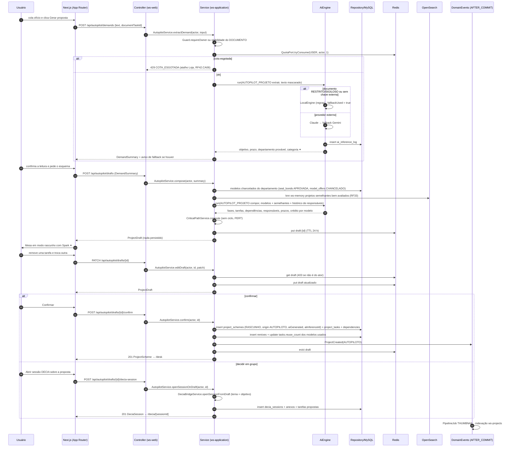
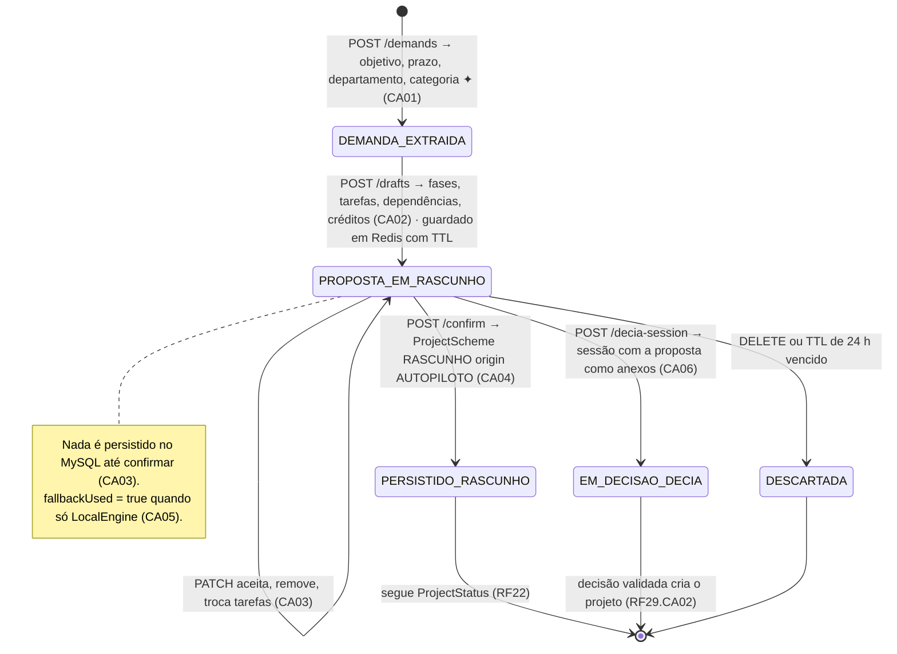
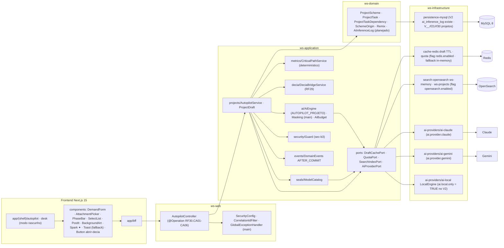

# RF30 — Gerar um Esquema de Projeto completo com o Autopiloto de Projeto a partir de uma demanda (ofício, e-mail ou frase), reutilizando modelos chancelados
**HU:** HU30 · **Sprint (board Work Station):** Product Backlog (não comprometido na Sprint 4) · **Equivalente FAI:** Autopiloto + "Vista-me" (RF28) · **Aba/rota:** Autopiloto (`/autopilot`), proposta aberta na Mesa em modo rascunho (`/desk?draft=`), botão **Abrir sessão DECIA sobre a proposta** (RF29)
**Critérios de aceite cobertos:** RF30.CA01 · CA02 · CA03 · CA04 · CA05 · CA06 (corpo do card, inalterado) — regra: o **título do card** define o RF e o corpo traz os próprios CAs. O RF43 §7 estende o Autopilot (tarefas em lote e Ficha de Viabilidade); o RF26 (Copilot) é a porta de entrada nos criadores.

Fluxo: demanda (texto, ofício/e-mail colado ou `TaskItem` DOCUMENTO do acervo) → `AiEngine` capability `AUTOPILOT_PROJETO` extrai objetivo, prazo, departamento provável e categoria (CA01) → compõe fases, tarefas, dependências, responsáveis sugeridos e prazos **remixando modelos chancelados** (`SealBond APROVADA`, `ModelOffer shelf CHANCELADO`) e projetos semelhantes da Memória Institucional (RF33) com **crédito** a cada modelo (`ProjectScheme.originalProjectId`, `TaskItem.originalTaskId`, `Remix`) (CA02) → proposta mostrada na Mesa em **rascunho não persistido** (`ProjectDraft` em Redis com TTL; flag `redis.enabled`, fallback em memória) até o usuário confirmar (CA03) → `ProjectScheme origin AUTOPILOTO`, faísca ✦ e `AiInferenceLog` (CA04). Sem chave externa: `LocalEngine` (regras + modelos chancelados) com aviso (CA05).

## 1. Diagrama de classes

## 2. Diagrama de atividades

## 3. Diagrama de sequência

## 4. Máquina de estados

Entidade central: a proposta (`ProjectDraft`, só em cache) até virar `ProjectScheme`; depois vale `ProjectStatus` (máquina do RF22). Aqui os estados do rascunho do Autopiloto:

## 5. Diagrama de componentes

## 6. Rastreabilidade

| CA | Classe | Passo | Mensagem | Transição | Componente |
|---|---|---|---|---|---|
| RF30.CA01 | `AutopilotService.extractDemand`, `DemandInput` (texto · colado · `TaskItem` DOCUMENTO), `AiCapability AUTOPILOT_PROJETO` | A1 → F1 → P1 (403) → P2 → P5 (429) → I1 → A2 | 1–15 | `[*] → DEMANDA_EXTRAIDA` | `DemandForm`, `AC`, `AIE` |
| RF30.CA02 | `AutopilotService.compose`, `ModelCatalog.chanceladosFor/similarProjects`, `SealBond APROVADA`, `ModelOffer CHANCELADO`, `Remix`, `ProjectTaskDependency`, `CriticalPathService` | A2 → F2 → P6 → I2 → I3 → P7 | 16–24 | `DEMANDA_EXTRAIDA → PROPOSTA_EM_RASCUNHO` | `MCAT`, `CP`, `OSA` |
| RF30.CA03 | `ProjectDraft`, `DraftCachePort` (TTL, nada no MySQL), `AutopilotService.editDraft` | A3 → A4 → F3/F4 → P8 → P9 | 25–31 | `PROPOSTA_EM_RASCUNHO → self` | `RD`, `desk` modo rascunho, `SelectList`, `PostIt` |
| RF30.CA04 | `SchemeOrigin AUTOPILOTO`, `ProjectScheme.aiGenerated/aiInferenceId`, `AiInferenceLog` (modelo, custo, latência, modelos de referência) | A9 → F5 → P10 → D1 | 32–38 | `PROPOSTA_EM_RASCUNHO → PERSISTIDO_RASCUNHO` | `Spark ✦`, `MY` |
| RF30.CA05 | `LocalEngine`, `AiInferenceLog.fallbackUsed`, aviso no front | P2 → P3 · I2 (fallback) · F3 banner | 9–10 | nota de PROPOSTA_EM_RASCUNHO | `AIL`, `Toast` |
| RF30.CA06 | `AutopilotService.openSessionOnDraft`, `DeciaBridgeService.openSessionFromDraft` | A10 → F6 → P9 → P11 | 39–44 | `PROPOSTA_EM_RASCUNHO → EM_DECISAO_DECIA` | `BS`, `Button abrir-decia` |

Tela/aba: `/autopilot` (esqueleto em `app/(shell)/autopilot/page.tsx`)
