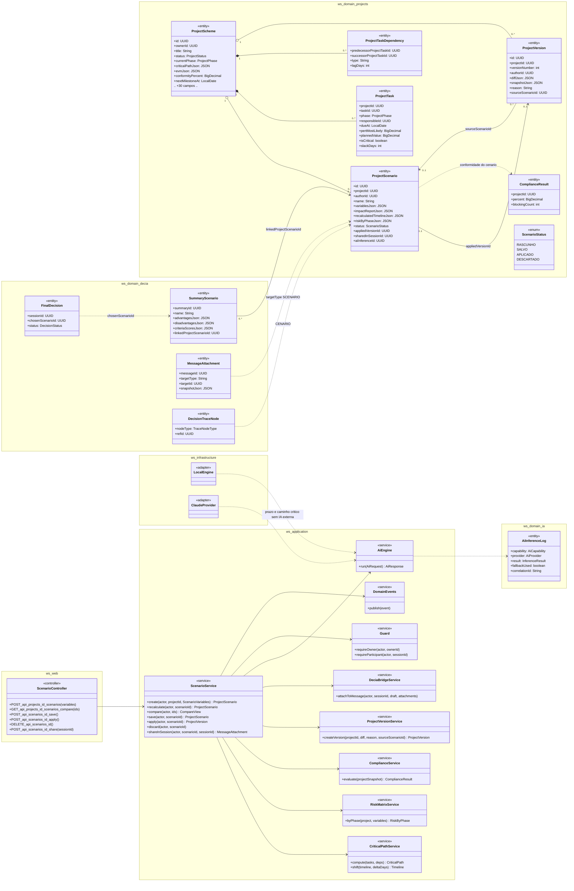
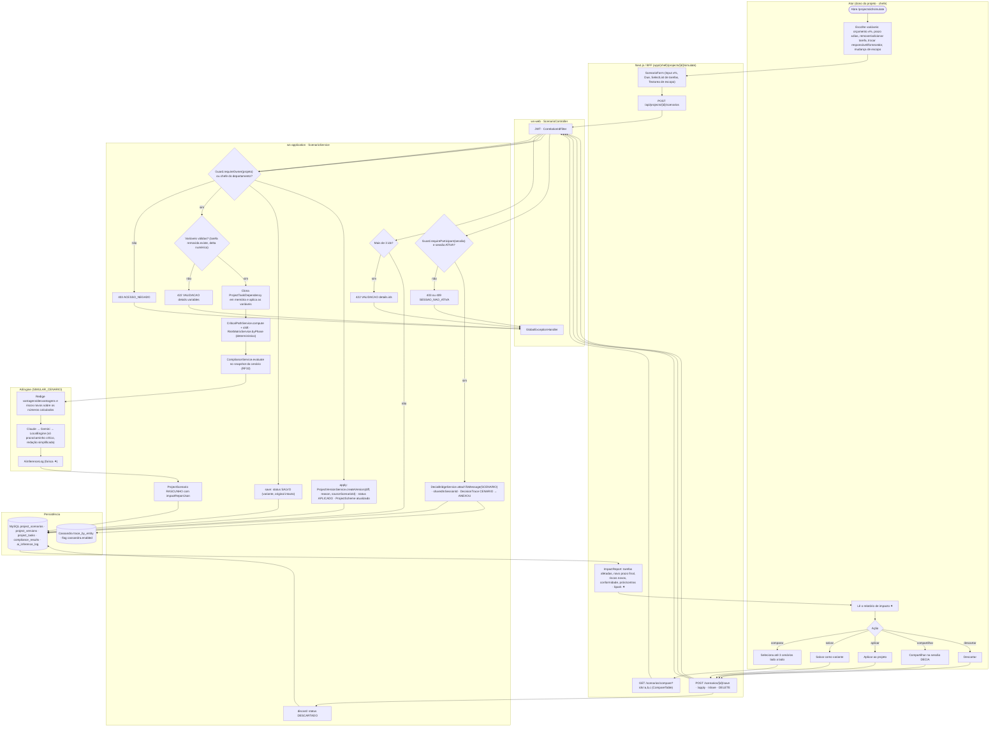
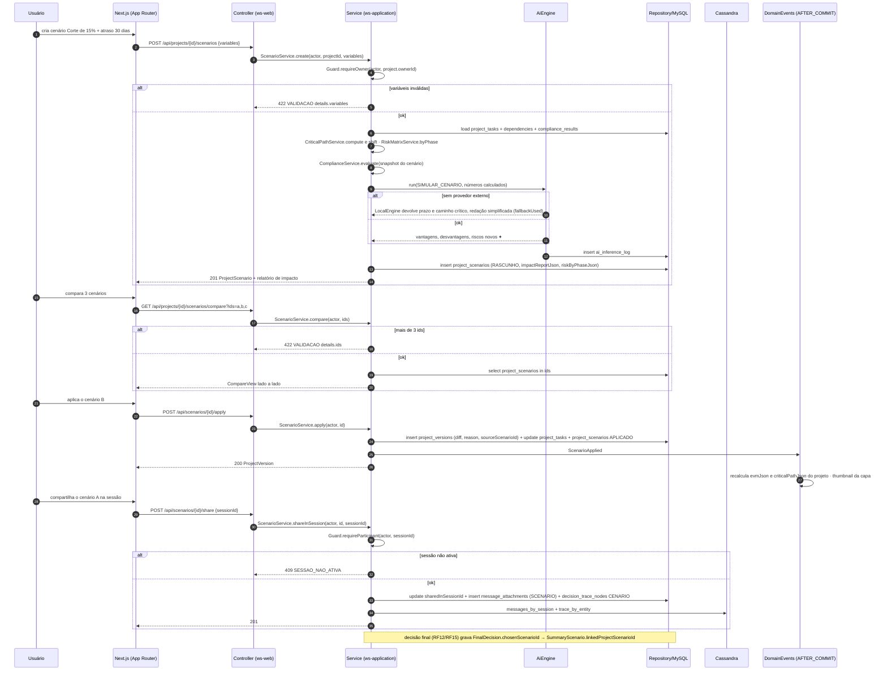
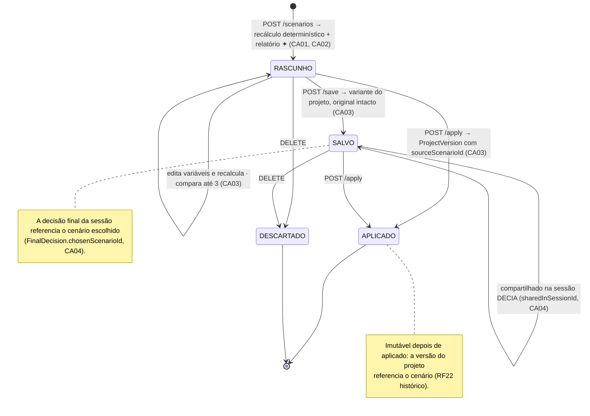
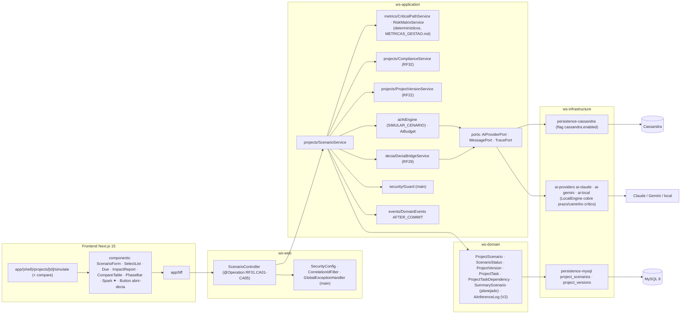

# RF31 — Simular cenários sobre um Esquema de Projeto (corte de orçamento, atraso, troca de fornecedor, mudança de escopo) antes de enviá-lo à aprovação
**HU:** HU31 · **Sprint (board Work Station):** Product Backlog (não comprometido na Sprint 4) · **Equivalente FAI:** RF18 Provador 2D (experimentar antes de decidir) · **Aba/rota:** Simulador de Cenários (`/projects/[id]/simulate`, comparação `?compare=a,b,c`), compartilhar na sessão (`/decia/[sessionId]`, RF29)
**Critérios de aceite cobertos:** RF31.CA01 · CA02 · CA03 · CA04 · CA05 (corpo do card, inalterado) — regra: o **título do card** define o RF e o corpo traz os próprios CAs.

Um `ProjectScenario` guarda as variáveis (`variablesJson`: `budgetDeltaPct`, `scheduleDeltaDays`, `removedTaskIds`, `addedTasksJson`, `responsibleSwaps`, `supplierSwaps`, `scopeChangeText`) e o **relatório de impacto** (`impactReportJson`) no mesmo formato dos cenários do resumo analítico (RF11, `SummaryScenario`). O recálculo de linha do tempo, caminho crítico e risco por fase é **determinístico** (`CriticalPathService`, `RiskMatrixService`, D-12); a IA (`SIMULAR_CENARIO`) só redige vantagens/desvantagens e cruza com o Espelho (RF32). **Salvar** cria uma variante (não altera o original); **aplicar** gera `ProjectVersion` com `sourceScenarioId` (RF22). Compartilhar na sessão cria `MessageAttachment` tipo SCENARIO e `SummaryScenario.linkedProjectScenarioId`.

## 1. Diagrama de classes

## 2. Diagrama de atividades

## 3. Diagrama de sequência

## 4. Máquina de estados

Entidade central: `ProjectScenario.status` (`ScenarioStatus`). O projeto segue `ProjectStatus` (RF22); aplicar um cenário não muda o status do projeto, só cria versão.

## 5. Diagrama de componentes

## 6. Rastreabilidade

| CA | Classe | Passo | Mensagem | Transição | Componente |
|---|---|---|---|---|---|
| RF31.CA01 | `ProjectScenario.variablesJson` (budgetDeltaPct, scheduleDeltaDays, removedTaskIds, addedTasksJson, responsibleSwaps, supplierSwaps, scopeChangeText), `ScenarioService.create` | A1 → F1 → F2 → P1 (403) → P2 (422) → P3 | 1–6 | `[*] → RASCUNHO` | `ScenarioForm`, `SC` |
| RF31.CA02 | `CriticalPathService`, `RiskMatrixService`, `ComplianceService.evaluate`, `impactReportJson` (formato `SummaryScenario`), `AiCapability SIMULAR_CENARIO` | P4 → P5 → I1 → I2 → P6 → F3 | 7–16 | `RASCUNHO` | `CP`, `CS`, `AIE`, `ImpactReport` |
| RF31.CA03 | `ScenarioService.compare/save/apply`, `ScenarioStatus SALVO/APLICADO`, `ProjectVersion.sourceScenarioId` | A4 → F4 → P7 (422) · A5 → P8 · A6 → P9 | 17–30 | `RASCUNHO → SALVO → APLICADO` | `CompareTable`, `PV` |
| RF31.CA04 | `ScenarioService.shareInSession`, `MessageAttachment SCENARIO`, `sharedInSessionId`, `SummaryScenario.linkedProjectScenarioId`, `FinalDecision.chosenScenarioId`, nó CENARIO | A7 → F5 → P10 (403/409) → P11 | 31–40 | `SALVO → self (compartilhado)` + nota | `BS`, `CASA` |
| RF31.CA05 | `AiInferenceLog` (faísca ✦), `LocalEngine` (prazo/caminho crítico sem IA externa) | I2 → I3 | 11–14 | — | `AIP`, `Spark ✦` |
