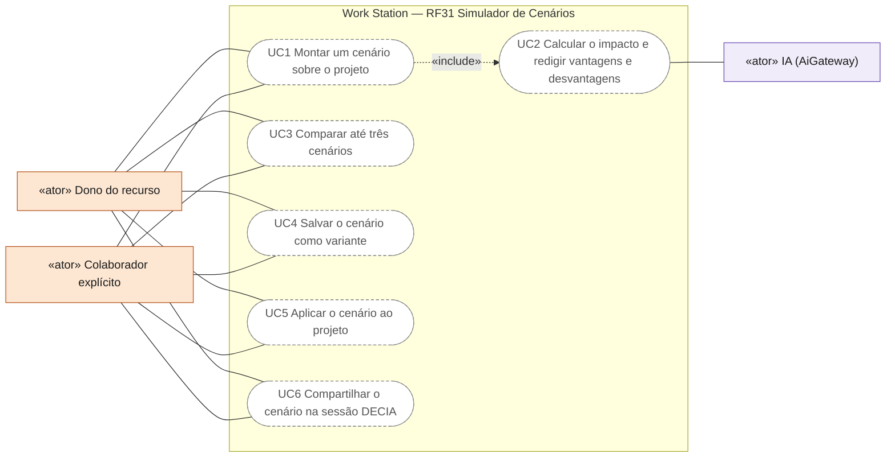
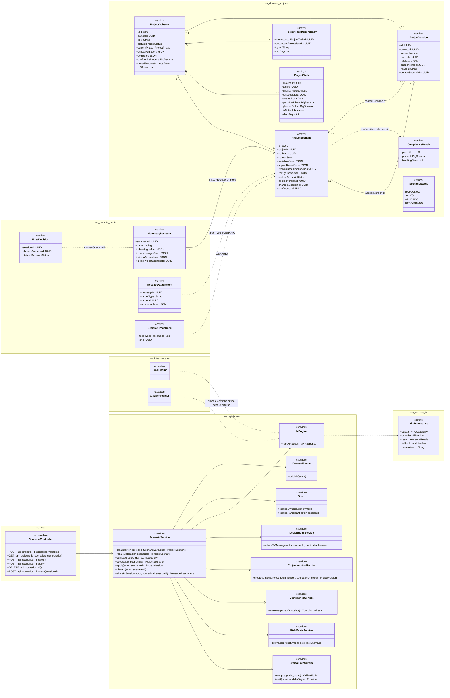
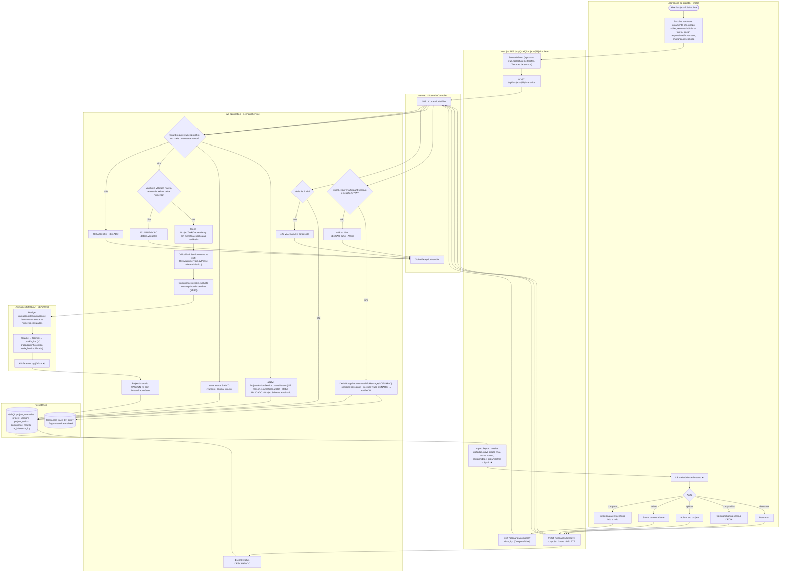
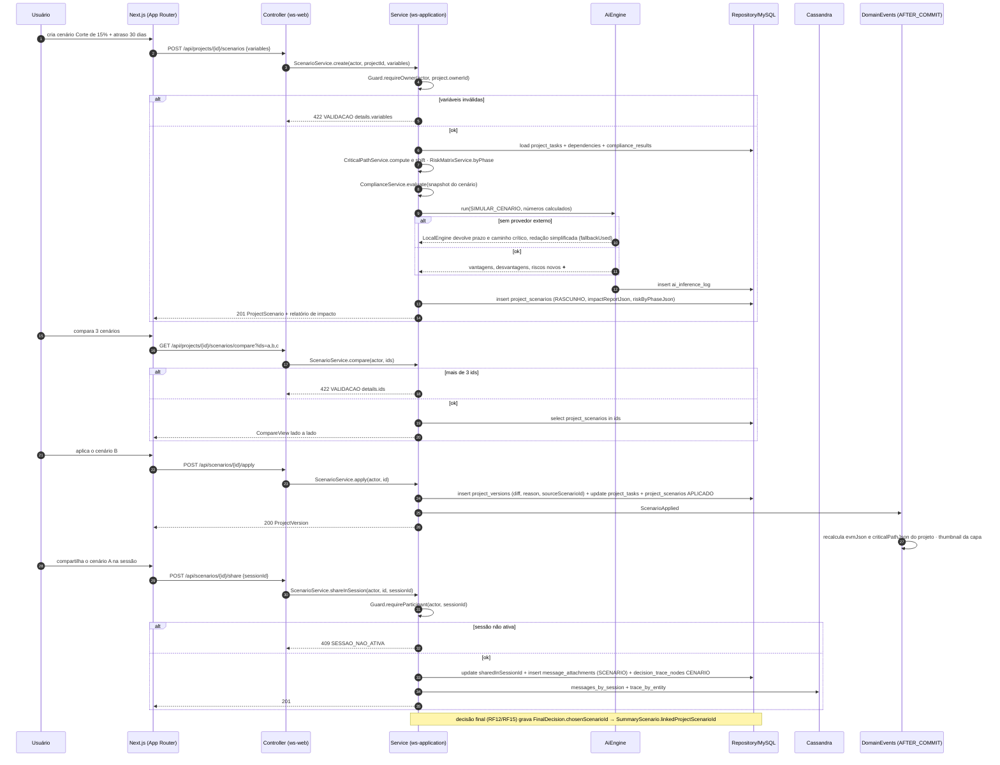
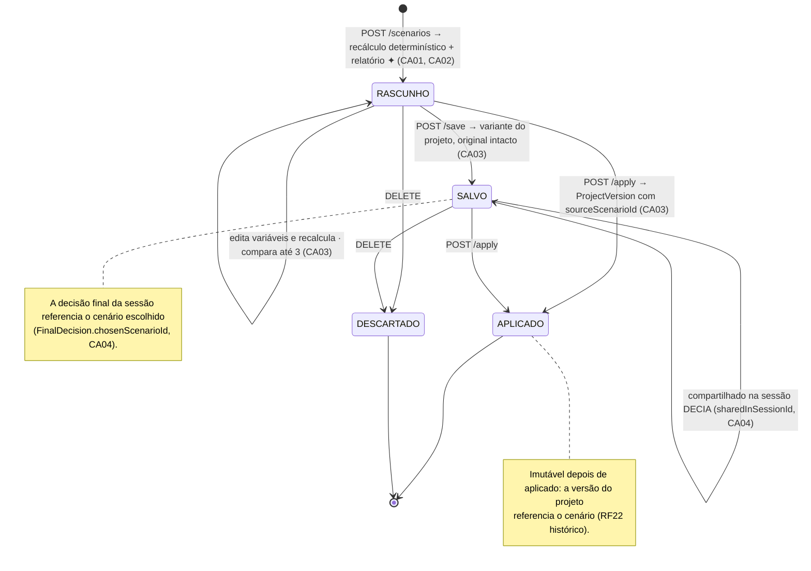
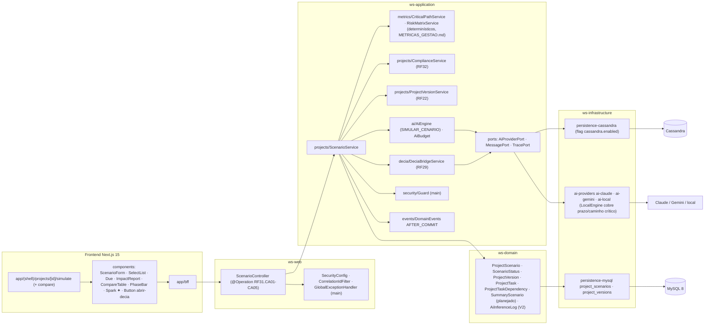

# RF31 — Simular cenários sobre um Esquema de Projeto (corte de orçamento, atraso, troca de fornecedor, mudança de escopo) antes de enviá-lo à aprovação
**HU:** HU31 · **Sprint (board Work Station):** Product Backlog (não comprometido na Sprint 4) · **Equivalente FAI:** RF18 Provador 2D (experimentar antes de decidir) · **Aba/rota:** Simulador de Cenários (`/projects/[id]/simulate`, comparação `?compare=a,b,c`), compartilhar na sessão (`/decia/[sessionId]`, RF29)
**Critérios de aceite cobertos:** RF31.CA01 · CA02 · CA03 · CA04 · CA05 (corpo do card, inalterado) — regra: o **título do card** define o RF e o corpo traz os próprios CAs.

Um `ProjectScenario` guarda as variáveis (`variablesJson`: `budgetDeltaPct`, `scheduleDeltaDays`, `removedTaskIds`, `addedTasksJson`, `responsibleSwaps`, `supplierSwaps`, `scopeChangeText`) e o **relatório de impacto** (`impactReportJson`) no mesmo formato dos cenários do resumo analítico (RF11, `SummaryScenario`). O recálculo de linha do tempo, caminho crítico e risco por fase é **determinístico** (`CriticalPathService`, `RiskMatrixService`, D-12); a IA (`SIMULAR_CENARIO`) só redige vantagens/desvantagens e cruza com o Espelho (RF32). **Salvar** cria uma variante (não altera o original); **aplicar** gera `ProjectVersion` com `sourceScenarioId` (RF22). Compartilhar na sessão cria `MessageAttachment` tipo SCENARIO e `SummaryScenario.linkedProjectScenarioId`.

## 0. Diagrama de casos de uso

Casos de uso derivados dos CAs. Todos são planejados: `/projects/[id]/simulate` é página-esqueleto. Só quem tem acesso de edição ao projeto (dono ou colaborador) simula.

| Caso de uso | Ator(es) | CAs | Situação |
|---|---|---|---|
| UC1 Montar um cenário sobre o projeto | `dono`, `colaborador` | RF31.CA01 | planejado |
| UC2 Calcular o impacto e redigir vantagens e desvantagens | `ia` | RF31.CA02, RF31.CA05 | planejado (recálculo determinístico; a IA só redige) |
| UC3 Comparar até três cenários | `dono`, `colaborador` | RF31.CA03 | planejado |
| UC4 Salvar o cenário como variante | `dono`, `colaborador` | RF31.CA03 | planejado |
| UC5 Aplicar o cenário ao projeto | `dono`, `colaborador` | RF31.CA03 | planejado (gera `ProjectVersion`) |
| UC6 Compartilhar o cenário na sessão DECIA | `dono`, `colaborador` | RF31.CA04 | planejado |

## 1. Diagrama de classes

## 2. Diagrama de atividades

## 3. Diagrama de sequência

## 4. Máquina de estados

Entidade central: `ProjectScenario.status` (`ScenarioStatus`). O projeto segue `ProjectStatus` (RF22); aplicar um cenário não muda o status do projeto, só cria versão.

## 5. Diagrama de componentes

## 6. Rastreabilidade

| CA | Classe | Passo | Mensagem | Transição | Componente |
|---|---|---|---|---|---|
| RF31.CA01 | `ProjectScenario.variablesJson` (budgetDeltaPct, scheduleDeltaDays, removedTaskIds, addedTasksJson, responsibleSwaps, supplierSwaps, scopeChangeText), `ScenarioService.create` | A1 → F1 → F2 → P1 (403) → P2 (422) → P3 | 1–6 | `[*] → RASCUNHO` | `ScenarioForm`, `SC` |
| RF31.CA02 | `CriticalPathService`, `RiskMatrixService`, `ComplianceService.evaluate`, `impactReportJson` (formato `SummaryScenario`), `AiCapability SIMULAR_CENARIO` | P4 → P5 → I1 → I2 → P6 → F3 | 7–16 | `RASCUNHO` | `CP`, `CS`, `AIE`, `ImpactReport` |
| RF31.CA03 | `ScenarioService.compare/save/apply`, `ScenarioStatus SALVO/APLICADO`, `ProjectVersion.sourceScenarioId` | A4 → F4 → P7 (422) · A5 → P8 · A6 → P9 | 17–30 | `RASCUNHO → SALVO → APLICADO` | `CompareTable`, `PV` |
| RF31.CA04 | `ScenarioService.shareInSession`, `MessageAttachment SCENARIO`, `sharedInSessionId`, `SummaryScenario.linkedProjectScenarioId`, `FinalDecision.chosenScenarioId`, nó CENARIO | A7 → F5 → P10 (403/409) → P11 | 31–40 | `SALVO → self (compartilhado)` + nota | `BS`, `CASA` |
| RF31.CA05 | `AiInferenceLog` (faísca ✦), `LocalEngine` (prazo/caminho crítico sem IA externa) | I2 → I3 | 11–14 | — | `AIP`, `Spark ✦` |

Tela/aba: `/projects/[id]/simulate` (esqueleto em `app/(shell)/projects/[id]/simulate/page.tsx`)

## Estado da implementação (12/11/2026)

Frontend funcional com dados DEMO (sem API de cenários; `ScenarioService`/`ScenarioController` seguem planejados). A página
`/projects/[id]/simulate` deixou de ser esqueleto (o bloco de CAs fica recolhido embaixo).

- **Motor determinístico** (`lib/projects/simulation/`, D-12): um cenário é uma lista de alavancas aplicada a uma CÓPIA do
  `ProjectModel` (o projeto nunca muda). Alavancas: corte de orçamento (% do orçamento total ou valor; tirado da reserva gerencial e
  depois da contingência, das linhas do trabalho sem cortar escopo, ou do escopo não iniciado Won't → Could → Should, Must nunca),
  atraso de fornecedor (entrega atrasada = "não começa antes de", ou duração maior; por atividades escolhidas, palavra no título ou
  risco ligado), mudança de escopo (retirar entregas/atividades não iniciadas religando as dependências, incluir entrega com
  "depois de/antes de", % de esforço só no que falta), indisponibilidade de pessoa (ausência pausa/adia; capacidade reduzida estica)
  e reajuste de preço (linha de orçamento = custo certo; atividade = no que falta). Ordem canônica: escopo → pessoas → fornecedor →
  preço → corte. Resultado frente à LINHA DE BASE (o projeto sem alavancas, pelo mesmo motor): término e caminho crítico pelo CPM
  (`engine/schedule.ts`, o que entrou/saiu e o que ficou comandado pela restrição), P50/P80 e chance de cumprir o prazo-alvo por
  Monte Carlo Beta-PERT com semente fixa 31 e a mesma em todos os cenários (`engine/montecarlo.ts`), ENT/VNT/IDPT pelo valor
  agregado (`engine/evm.ts`), uso da reserva de contingência e falta além dela, riscos que disparam (prazo, chance < 50 %, reserva
  estourada, reserva < VME, IDPT > 1,1, corte descoberto, Must retirado, risco registrado ligado a atividade atingida, caminho
  crítico, conformidade) marcados "novo"/"já existia", e o porquê de cada número. Cruza com o Espelho (RF32): itens de conformidade
  que o cenário perde ou ganha.
- **Tela** (`components/projects/simulate/`): linha de base e premissas (prazo-alvo, sorteios, custo indireto por dia de atraso);
  até 3 cenários em abas, cada um com editor de alavancas (erro de validação visível) e relatório de impacto; comparação lado a lado
  em tabela acessível e dois gráficos SVG (prazo com faixa P50–P80 e prazo-alvo; ENT com orçamento aprovado e contingência);
  `?compare=a,b,c` (até 3; id desconhecido ou excedente é avisado); cenários salvos em repositório DEMO (`store.ts`, com retrato dos
  números e versão do projeto). Leitura ✦ da IA simulada montada só com os números do motor (`narrative.ts`), respeitando a
  autonomia pessoal (padrão "sob solicitação", D-136).
- **Enviar à aprovação** (CA03): o cenário vira `CHANGE_REQUEST` normal (impacto nas seis restrições calculado; 7 Rs preenchidos)
  e é levado ao comitê pelo `openChangeDecision` do DECIA (`lib/projects/decia.ts`); atividades, orçamento e linha de base não
  mudam antes da decisão. O cenário salvo guarda a mudança e a decisão abertas.
- **Fora desta entrega**: aplicar o cenário gerando `ProjectVersion.sourceScenarioId` (hoje a aprovação segue o fluxo normal de
  mudança da Mesa: Controle › Implementar), compartilhar na sessão DECIA (CA04: `MessageAttachment SCENARIO`), `AiInferenceLog`
  (CA05) e a API (`/api/projects/{id}/scenarios`).
- **Testes**: `lib/projects/simulation/simulation.test.ts` (cada alavanca, determinismo da semente, projeto pequeno e DEMO, envio à
  aprovação sem mudar o plano) e `components/projects/simulate/simulate.test.tsx` (tela e página).
