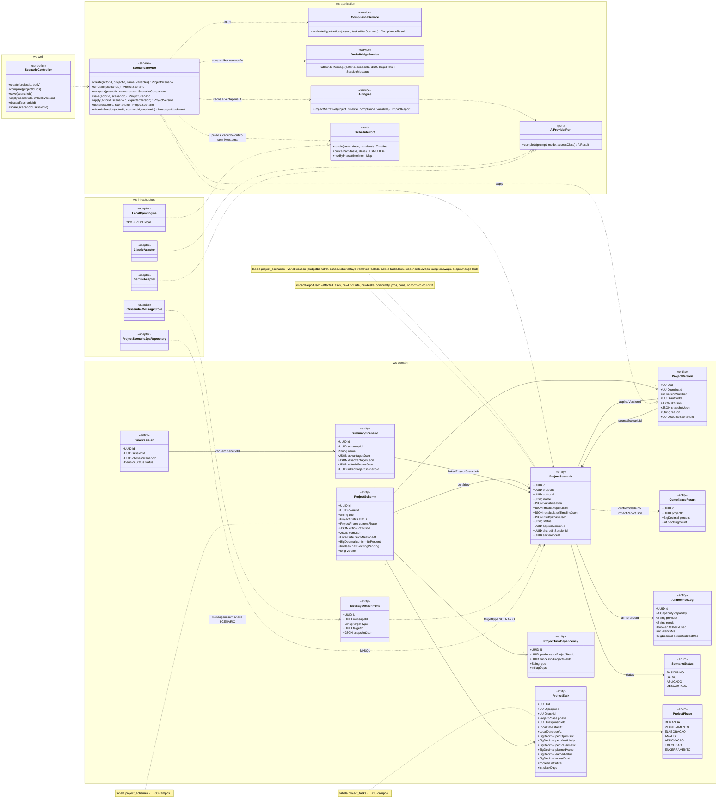
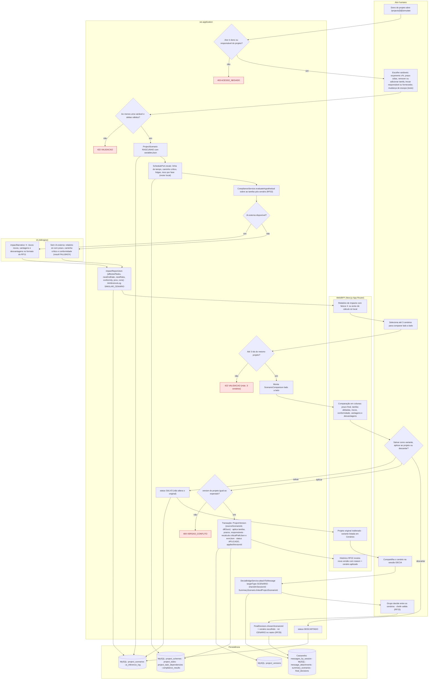
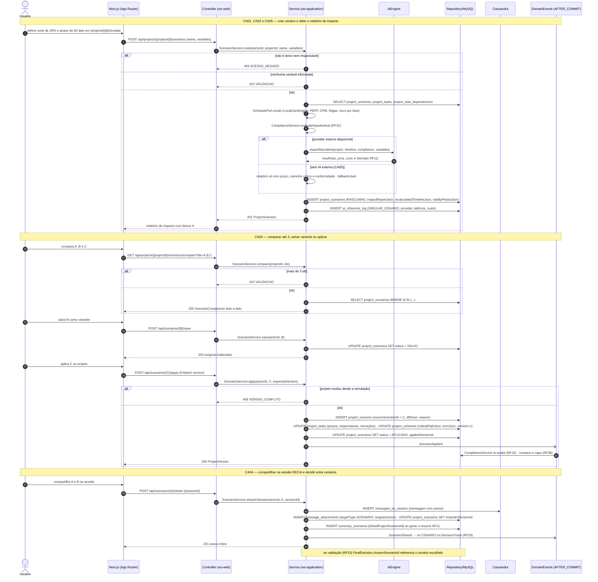
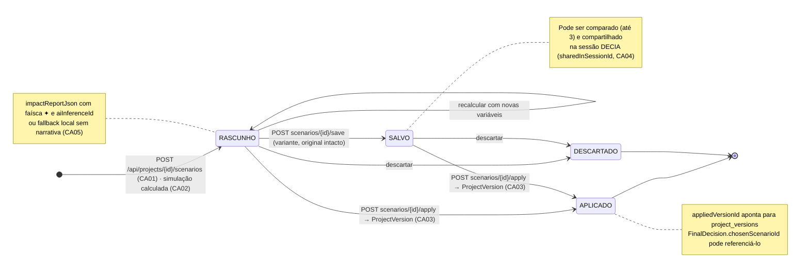
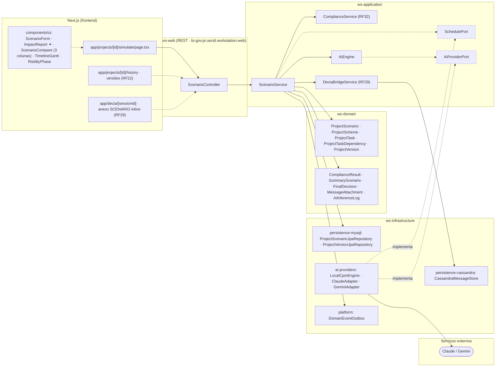

# RF31 — Simular cenários sobre um Esquema de Projeto (corte de orçamento, atraso, troca de fornecedor, mudança de escopo) antes de enviá-lo à aprovação

**HU:** HU31 · **Sprint (board Work Station):** Product Backlog (pós-Sprint 4, a priorizar) · **Equivalente FAI:** RF18 Provador 2D (experimentar antes de decidir) · **Aba/rota:** Simulador de Cenários (`/projects/[id]/simulate`)

**Critérios de aceite cobertos:** RF31.CA01 · RF31.CA02 · RF31.CA03 · RF31.CA04 · RF31.CA05

> Contextos da TAXONOMIA: **3. Criador de Projetos** (`ProjectScenario`, `ProjectScheme`, `ProjectTask` com PERT/EVM, `ProjectTaskDependency`, `ProjectVersion.sourceScenarioId`, `ComplianceResult`), **5. DECIA** (`SummaryScenario.linkedProjectScenarioId`, `FinalDecision.chosenScenarioId`, `MessageAttachment targetType SCENARIO`) e **10. IA** (`AiInferenceLog` capability `SIMULAR_CENARIO`). O **motor local** (CPM/PERT) cobre linha do tempo e caminho crítico sem IA externa; a IA externa acrescenta riscos novos e vantagens/desvantagens no formato dos cenários do RF11 (`SummaryScenario`).

## 1. Diagrama de classes

## 2. Diagrama de atividades

## 3. Diagrama de sequência

## 4. Máquina de estados

Entidade central: `ProjectScenario.status`. Compartilhar na sessão (CA04) não muda o status — grava `sharedInSessionId` em qualquer estado não descartado.

## 5. Diagrama de componentes

## 6. Rastreabilidade

| CA | Elemento do diagrama (classe / passo / mensagem / transição / componente) |
|---|---|
| RF31.CA01 | Classes `ProjectScenario.variablesJson` (budgetDeltaPct, scheduleDeltaDays, removedTaskIds, addedTasksJson, responsibleSwaps, supplierSwaps, scopeChangeText), `ScenarioService.create`; atividades `U1 → S1 → U2 → S2 → S3` (403 ACESSO_NEGADO, 422 VALIDACAO); sequência bloco «CA01, CA02 e CA05» (`POST /api/projects/{id}/scenarios`); transição `[*] → RASCUNHO`; componentes `ScenarioForm`, `app/projects/[id]/simulate` |
| RF31.CA02 | Classes `SchedulePort.recalc/criticalPath/riskByPhase`, `ProjectScenario.impactReportJson/recalculatedTimelineJson/riskByPhaseJson`, `ComplianceService.evaluateHypothetical`, `AiEngine.impactNarrative`, `ProjectTask.pert*/isCritical/slackDays`; atividades `S4 → S5 → S6 → A1/A2 → S7 → W1`; sequência bloco «CA01, CA02 e CA05» (recalc, evaluateHypothetical, impactNarrative ✦); componentes `ImpactReport`, `TimelineGantt`, `RiskByPhase`, `LocalCpmEngine` |
| RF31.CA03 | Classes `ScenarioService.compare/save/apply`, `ProjectVersion.sourceScenarioId`, `ProjectScenario.appliedVersionId`, `ScenarioStatus`; atividades `U3 → S8 → S9 → W2`, `U4 → S10/S11 → S12 → W4` (422 máx. 3, 409 VERSAO_CONFLITO); sequência bloco «CA03»; transições `RASCUNHO/SALVO → APLICADO` e `→ SALVO`; componentes `ScenarioCompare`, `app/projects/[id]/history` |
| RF31.CA04 | Classes `MessageAttachment targetType SCENARIO`, `ProjectScenario.sharedInSessionId`, `SummaryScenario.linkedProjectScenarioId`, `FinalDecision.chosenScenarioId`, `ScenarioService.shareInSession`, `DeciaBridgeService`; atividades `U5 → S14 → U6 → S15`; sequência bloco «CA04» (nó CENARIO no rastro); nota do estado `SALVO`; componentes `app/decia/[sessionId]`, `CassandraMessageStore` |
| RF31.CA05 | Classes `AiInferenceLog` (SIMULAR_CENARIO, fallbackUsed), `ProjectScenario.aiInferenceId`, `LocalCpmEngine ..|> SchedulePort`; atividades `S6 → A2 → S7` e `W1` (aviso de cálculo só local); sequência bloco «CA01, CA02 e CA05» alt «sem IA externa»; nota do estado `RASCUNHO`; componente `ai-providers: LocalCpmEngine` |

> Dúvidas para `docs/DECISOES.md`: `ScenarioStatus` não é enum nomeado na TAXONOMIA (status listado inline em `ProjectScenario`); `SchedulePort` e `409 VERSAO_CONFLITO` (optimistic lock por `ProjectScheme.version`) são propostas; quem pode simular um projeto alheio (chefe revisor, RF32.CA06) — aqui só dono/responsável criam cenários.
