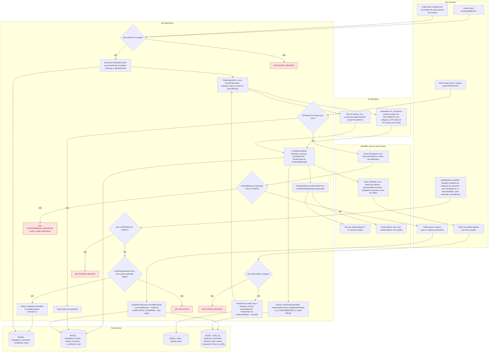
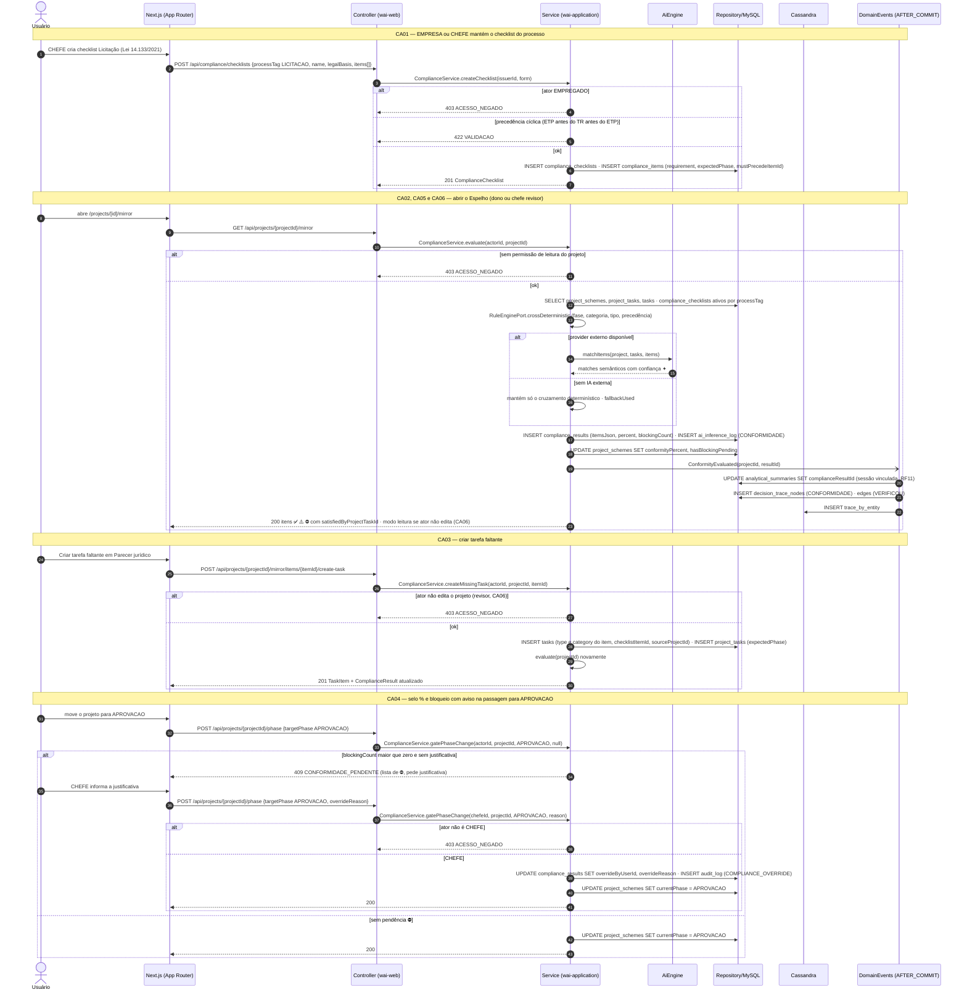
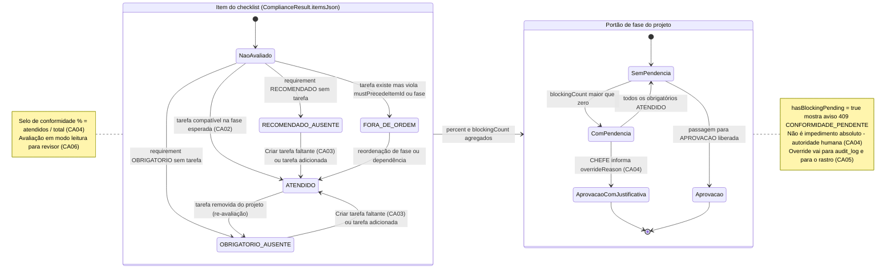
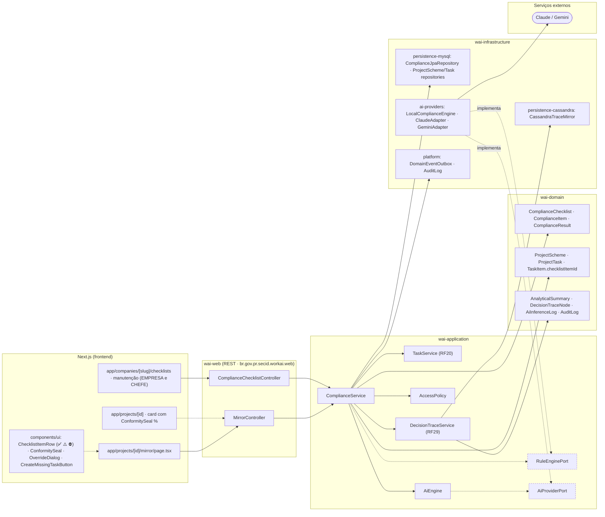

# RF32 — Verificar a conformidade de um Esquema de Projeto no Espelho de Conformidade (checklists legais e do departamento) e sugerir as tarefas faltantes

**HU:** HU32 · **Sprint (board Work Station):** Product Backlog (pós-Sprint 4, a priorizar) · **Equivalente FAI:** Espelho / Smart Mirror (RF28) — a IA "olha" o projeto e diz o que falta · **Aba/rota:** Espelho de Conformidade (`/projects/[id]/mirror`); manutenção de checklists na página da empresa/departamento (`/companies/[slug]/checklists`, rota a confirmar)

**Critérios de aceite cobertos:** RF32.CA01 · RF32.CA02 · RF32.CA03 · RF32.CA04 · RF32.CA05 · RF32.CA06

> Contextos da TAXONOMIA: **3. Criador de Projetos** (`ComplianceChecklist`, `ComplianceItem`, `ComplianceResult`, `ProjectScheme.conformityPercent/hasBlockingPending`, `ProjectTask`), **2. Acervo** (`TaskItem.checklistItemId` = tarefa faltante criada pelo Espelho), **5. DECIA** (`AnalyticalSummary.complianceResultId`, `DecisionTraceNode CONFORMIDADE`, aresta `VERIFICOU`) e **10. IA** (`AiInferenceLog` capability `CONFORMIDADE`). Exemplos de checklist do card: licitação — Lei 14.133/2021 (ETP antes do TR, parecer jurídico antes da APROVACAO, pesquisa de preços); obra — licença ambiental, ART/RRT, projeto básico antes da EXECUCAO. O bloqueio em ⛔ é **aviso, não impedimento**: o chefe aprova com `overrideReason` (autoridade humana).

## 1. Diagrama de classes

```mermaid
classDiagram
  direction LR
  namespace wai-domain {
    class ComplianceChecklist {
      <<entity>>
      +UUID id
      +UUID companyId
      +UUID departmentId
      +ProcessTag processTag
      +String name
      +String legalBasis
      +boolean active
      +int version
    }
    class ComplianceItem {
      <<entity>>
      +UUID id
      +UUID checklistId
      +String label
      +String requirement
      +ProjectPhase expectedPhase
      +TaskCategory expectedCategory
      +TaskType expectedType
      +UUID mustPrecedeItemId
      +int sortOrder
    }
    class ComplianceResult {
      <<entity>>
      +UUID id
      +UUID projectId
      +UUID checklistId
      +Instant evaluatedAt
      +JSON itemsJson
      +BigDecimal percent
      +int blockingCount
      +UUID overrideByUserId
      +String overrideReason
      +UUID aiInferenceId
    }
    class ProjectScheme {
      <<entity>>
      +UUID id
      +UUID ownerId
      +UUID companyId
      +UUID departmentId
      +Set~ProcessTag~ processTags
      +ProjectStatus status
      +ProjectPhase currentPhase
      +BigDecimal conformityPercent
      +boolean hasBlockingPending
    }
    class ProjectTask {
      <<entity>>
      +UUID id
      +UUID projectId
      +UUID taskId
      +ProjectPhase phase
      +int sortOrder
      +JSON snapshotJson
    }
    class TaskItem {
      <<entity>>
      +UUID id
      +UUID ownerId
      +String title
      +TaskType type
      +TaskCategory category
      +TaskState state
      +UUID checklistItemId
      +UUID sourceProjectId
    }
    class AnalyticalSummary {
      <<entity>>
      +UUID id
      +UUID sessionId
      +UUID complianceResultId
    }
    class DecisionTraceNode {
      <<entity>>
      +UUID id
      +TraceNodeType nodeType
      +UUID refId
      +String label
    }
    class AiInferenceLog {
      <<entity>>
      +UUID id
      +AiCapability capability
      +String provider
      +String result
      +boolean fallbackUsed
    }
    class AuditLog {
      <<entity>>
      +UUID id
      +UUID actorId
      +String action
      +UUID resourceId
    }
    class ItemStatus {
      <<enum>>
      ATENDIDO
      RECOMENDADO_AUSENTE
      OBRIGATORIO_AUSENTE
      FORA_DE_ORDEM
    }
    class Requirement {
      <<enum>>
      OBRIGATORIO
      RECOMENDADO
    }
    class ProjectPhase {
      <<enum>>
      DEMANDA
      PLANEJAMENTO
      ELABORACAO
      ANALISE
      APROVACAO
      EXECUCAO
      ENCERRAMENTO
    }
  }
  namespace wai-application {
    class ComplianceService {
      <<service>>
      +createChecklist(issuerId, form) ComplianceChecklist
      +upsertItem(issuerId, checklistId, itemForm) ComplianceItem
      +evaluate(actorId, projectId) ComplianceResult
      +evaluateHypothetical(project, tasks) ComplianceResult
      +createMissingTask(actorId, projectId, itemId) TaskItem
      +gatePhaseChange(actorId, projectId, targetPhase, overrideReason) ComplianceResult
    }
    class TaskService {
      <<service>>
      +create(ownerId, form) TaskItem
    }
    class DecisionTraceService {
      <<service>>
      +appendNode(sessionId, type, refId, label, classLabel, actorId, snapshot) DecisionTraceNode
    }
    class AccessPolicy {
      <<service>>
      +requireIssuer(user) void
      +canEditProject(user, project) boolean
    }
    class AiEngine {
      <<service>>
      +matchItems(project, tasks, items) List~ItemMatch~
    }
    class AiProviderPort {
      <<port>>
      +complete(prompt, mode, accessClass) AiResult
    }
    class RuleEnginePort {
      <<port>>
      +crossDeterministic(tasks, items) List~ItemMatch~
    }
  }
  namespace wai-web {
    class ComplianceChecklistController {
      <<controller>>
      +create(body)
      +upsertItem(checklistId, body)
      +list(companyId, processTag)
    }
    class MirrorController {
      <<controller>>
      +evaluate(projectId)
      +createMissingTask(projectId, itemId)
      +changePhase(projectId, body)
    }
  }
  namespace wai-infrastructure {
    class LocalComplianceEngine {
      <<adapter>>
      cruzamento determinístico
    }
    class ClaudeAdapter {
      <<adapter>>
    }
    class ComplianceJpaRepository {
      <<adapter>>
    }
    class CassandraTraceMirror {
      <<adapter>>
    }
  }
  ComplianceChecklist "1" --> "*" ComplianceItem
  ComplianceItem --> ComplianceItem : mustPrecedeItemId
  ComplianceItem --> Requirement : requirement
  ComplianceItem --> ProjectPhase : expectedPhase
  ComplianceResult --> ComplianceChecklist : checklistId
  ComplianceResult --> ProjectScheme : projectId
  ComplianceResult ..> ItemStatus : itemsJson status
  ComplianceResult --> AiInferenceLog : aiInferenceId
  ProjectScheme "1" --> "*" ProjectTask
  ProjectTask --> TaskItem : taskId satisfiedByProjectTaskId
  TaskItem --> ComplianceItem : checklistItemId
  AnalyticalSummary --> ComplianceResult : complianceResultId
  DecisionTraceNode ..> ComplianceResult : nodeType CONFORMIDADE
  ComplianceService ..> ComplianceChecklist
  ComplianceService ..> ComplianceResult
  ComplianceService ..> RuleEnginePort : cruzamento base
  ComplianceService ..> AiEngine : match semântico ✦
  ComplianceService ..> TaskService : tarefa faltante RF20
  ComplianceService ..> DecisionTraceService : nó CONFORMIDADE
  ComplianceService ..> AccessPolicy
  ComplianceService ..> AuditLog : override
  AiEngine ..> AiProviderPort
  ComplianceChecklistController ..> ComplianceService
  MirrorController ..> ComplianceService
  LocalComplianceEngine ..|> RuleEnginePort
  ClaudeAdapter ..|> AiProviderPort
  ComplianceJpaRepository ..> ComplianceResult : MySQL
  CassandraTraceMirror ..> DecisionTraceNode : espelho
  note for ComplianceResult "itemsJson [{itemId, status, satisfiedByProjectTaskId}] · percent · blockingCount · overrideReason (CA04)"
  note for ComplianceChecklist "tabela compliance_checklists · departmentId null = checklist da empresa"
  note for ProjectScheme "tabela project_schemes · .. +30 campos .."
```

## 2. Diagrama de atividades

## 3. Diagrama de sequência

## 4. Máquina de estados

Entidades centrais: o **status de cada item** em `ComplianceResult.itemsJson` (não há enum nomeado na TAXONOMIA — valores ATENDIDO · RECOMENDADO_AUSENTE · OBRIGATORIO_AUSENTE · FORA_DE_ORDEM) e o **portão de fase** do projeto derivado de `ProjectScheme.hasBlockingPending`.

## 5. Diagrama de componentes

## 6. Rastreabilidade

| CA | Elemento do diagrama (classe / passo / mensagem / transição / componente) |
|---|---|
| RF32.CA01 | Classes `ComplianceChecklist` (processTag, legalBasis, departmentId null = empresa), `ComplianceItem` (requirement, expectedPhase, expectedCategory, expectedType, mustPrecedeItemId), `ComplianceService.createChecklist/upsertItem`, `AccessPolicy.requireIssuer`; atividades `U1 → S1 → S2 → S3` (403 ACESSO_NEGADO, 422 VALIDACAO); sequência bloco «CA01»; componentes `app/companies/[slug]/checklists`, `ComplianceChecklistController` |
| RF32.CA02 | Classes `ComplianceService.evaluate`, `RuleEnginePort`, `AiEngine.matchItems`, `ComplianceResult.itemsJson` (ATENDIDO com satisfiedByProjectTaskId, RECOMENDADO_AUSENTE, OBRIGATORIO_AUSENTE, FORA_DE_ORDEM); atividades `U2 → S4 → S5 → S6 → A1/A2 → S7 → W1`; sequência bloco «CA02, CA05 e CA06»; transições de `NaoAvaliado` no estado `Item`; componentes `ChecklistItemRow`, `LocalComplianceEngine` |
| RF32.CA03 | Classes `ComplianceService.createMissingTask`, `TaskItem.checklistItemId`, `TaskService.create`, `ProjectTask.phase = expectedPhase`; atividades `U3 → S9 → S10 → S6` (403 para revisor); sequência bloco «CA03»; transições `*_AUSENTE → ATENDIDO`; componente `CreateMissingTaskButton` |
| RF32.CA04 | Classes `ProjectScheme.conformityPercent/hasBlockingPending`, `ComplianceResult.percent/blockingCount/overrideByUserId/overrideReason`, `ComplianceService.gatePhaseChange`, `AuditLog`; atividades `S8 → W2`, `U4 → S11 → W3 → S12 → U5 → S13` (409 CONFORMIDADE_PENDENTE como aviso); sequência bloco «CA04»; estado `Gate` (`ComPendencia → AprovacaoComJustificativa`); componentes `ConformitySeal`, `OverrideDialog` |
| RF32.CA05 | Classes `AnalyticalSummary.complianceResultId`, `DecisionTraceNode nodeType CONFORMIDADE`, `DecisionTraceService.appendNode`; atividade `S7 → S15 → D4`; sequência bloco «CA02, CA05 e CA06» (evento ConformityEvaluated → analytical_summaries, decision_trace_nodes, trace_by_entity); nota do estado `Gate`; componentes `DecisionTraceService (RF29)`, `CassandraTraceMirror` |
| RF32.CA06 | Classe `AccessPolicy.canEditProject`; atividades `U6 → S4 → ... → S8 → W4` (modo leitura) e `S9 → E4`; sequência bloco «CA02, CA05 e CA06» (resposta em modo leitura) e bloco «CA03» alt 403 para revisor; nota do estado `Item`; componente `MirrorController` |

> Dúvidas para `docs/DECISOES.md`: `ItemStatus` e `Requirement` não são enums nomeados na TAXONOMIA (valores inline); `RuleEnginePort` e `409 CONFORMIDADE_PENDENTE` são propostas (o card pede "aviso, não impedimento" — alternativa: 200 com flag `requiresOverride`); a tarefa faltante recebe `sourceProjectId` mas não há `SourceKind` específico para "criada pelo Espelho".
