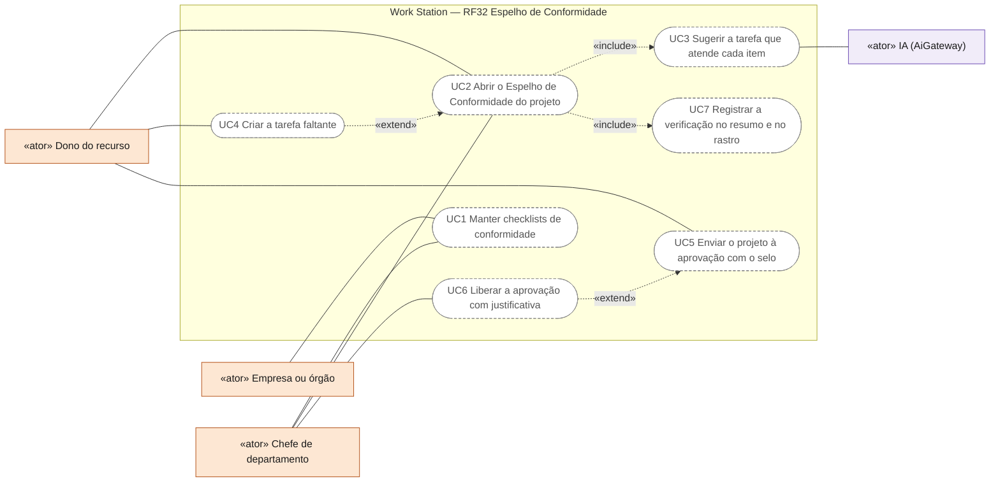
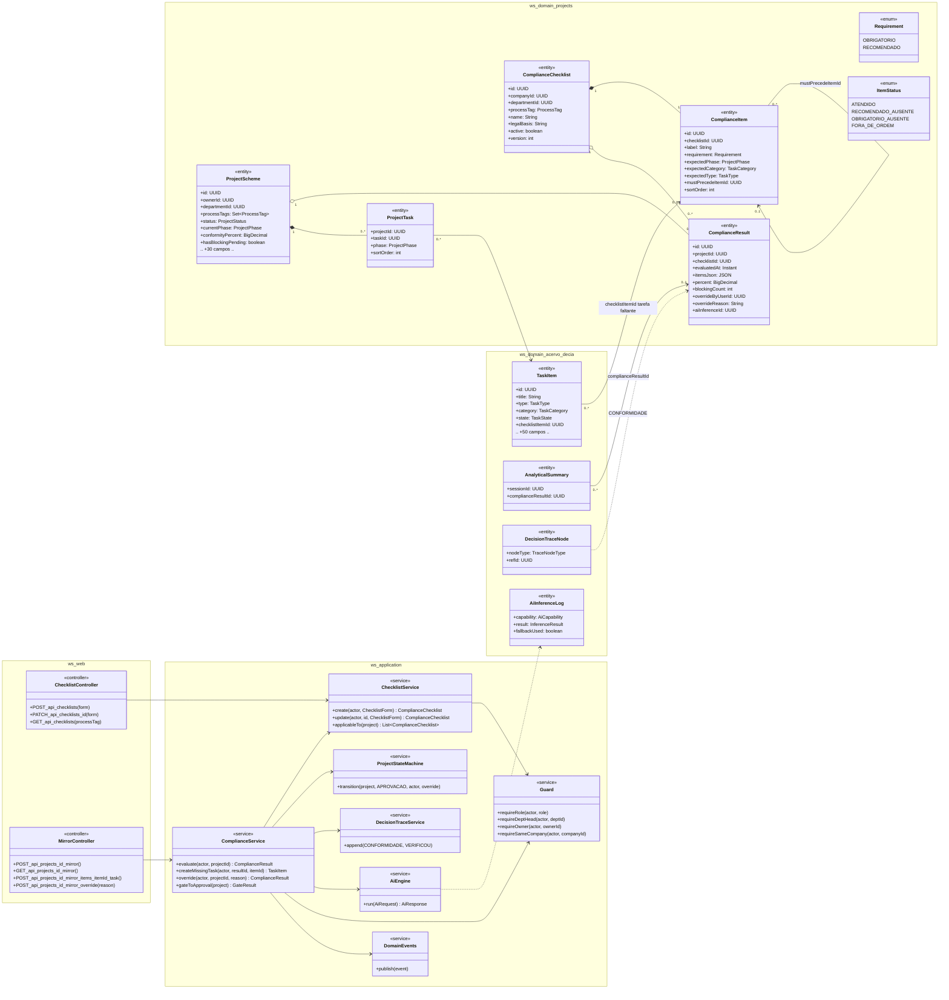
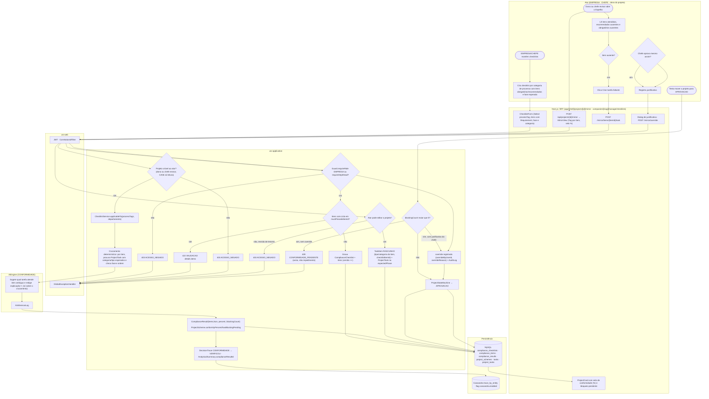
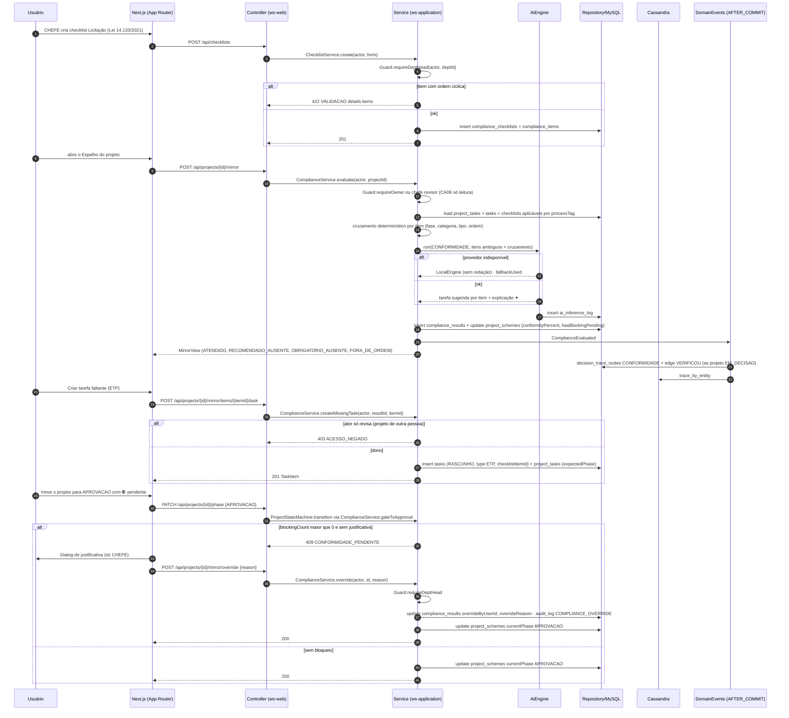
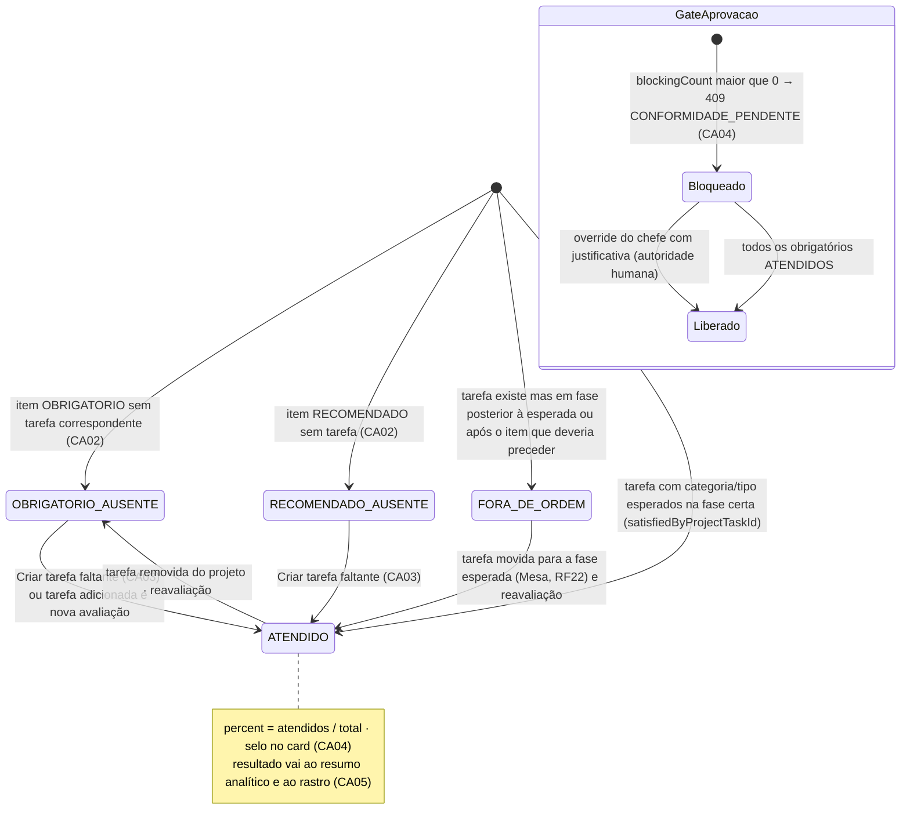
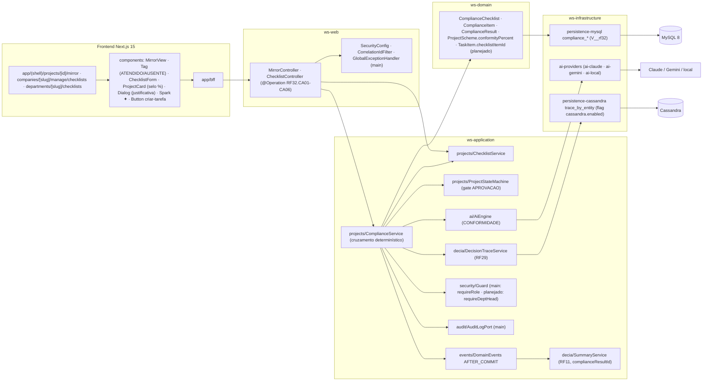

# RF32 — Verificar a conformidade de um Esquema de Projeto no Espelho de Conformidade (checklists legais e do departamento) e sugerir as tarefas faltantes
**HU:** HU32 · **Sprint (board Work Station):** Product Backlog (não comprometido na Sprint 4) · **Equivalente FAI:** Espelho / Smart Mirror (RF28) · **Aba/rota:** Espelho de Conformidade (`/projects/[id]/mirror`), gestão de checklists na página da empresa/departamento (`/companies/[slug]/manage/checklists`, `/departments/[slug]/checklists`), selo de conformidade no `ProjectCard`
**Critérios de aceite cobertos:** RF32.CA01 · CA02 · CA03 · CA04 · CA05 · CA06 (corpo do card, inalterado) — regra: o **título do card** define o RF e o corpo traz os próprios CAs.

`ComplianceChecklist` (por `processTag`, empresa ou departamento, com `legalBasis`, ex.: Lei 14.133/2021) tem `ComplianceItem`s (OBRIGATORIO · RECOMENDADO, `expectedPhase`, `expectedCategory`, `expectedType`, `mustPrecedeItemId`). Abrir o Espelho gera um `ComplianceResult` (`itemsJson` com ATENDIDO · RECOMENDADO_AUSENTE · OBRIGATORIO_AUSENTE · FORA_DE_ORDEM, `percent`, `blockingCount`). O cruzamento é **determinístico** (`ComplianceService`); a IA (`CONFORMIDADE`) só sugere qual tarefa atende cada item e redige a explicação ✦. O selo (%) vai para `ProjectScheme.conformityPercent/hasBlockingPending`; a passagem para APROVACAO com ⛔ pendente exige **justificativa do chefe** (`overrideByUserId/overrideReason`, autoridade humana). O resultado entra no resumo analítico (`AnalyticalSummary.complianceResultId`) e no rastro (nó CONFORMIDADE → VERIFICOU).

## 0. Diagrama de casos de uso

Casos de uso derivados dos CAs. Todos são planejados: `/projects/[id]/mirror` é página-esqueleto e a gestão de checklists ainda não tem rota.

| Caso de uso | Ator(es) | CAs | Situação |
|---|---|---|---|
| UC1 Manter checklists de conformidade | `empresa`, `chefe` | RF32.CA01 | planejado |
| UC2 Abrir o Espelho de Conformidade do projeto | `dono`, `chefe` | RF32.CA02, RF32.CA06 | planejado (o chefe revisor só lê) |
| UC3 Sugerir a tarefa que atende cada item | `ia` | RF32.CA02 | planejado |
| UC4 Criar a tarefa faltante | `dono` | RF32.CA03, RF32.CA06 | planejado |
| UC5 Enviar o projeto à aprovação com o selo | `dono` | RF32.CA04 | planejado |
| UC6 Liberar a aprovação com justificativa | `chefe` | RF32.CA04 | planejado |
| UC7 Registrar a verificação no resumo e no rastro | — (incluído por UC2) | RF32.CA05 | planejado |

## 1. Diagrama de classes

## 2. Diagrama de atividades

## 3. Diagrama de sequência

## 4. Máquina de estados

Entidade central: a avaliação de um item (`ItemStatus` dentro de `ComplianceResult.itemsJson`); o projeto segue `ProjectStatus`/`ProjectPhase` (RF22) com o **gate** para APROVACAO.

## 5. Diagrama de componentes

## 6. Rastreabilidade

| CA | Classe | Passo | Mensagem | Transição | Componente |
|---|---|---|---|---|---|
| RF32.CA01 | `ComplianceChecklist`, `ComplianceItem` (requirement, expectedPhase, mustPrecedeItemId), `ChecklistService.create/update`, `Guard.requireRole/requireDeptHead` | A1 → F1 → P1 (403) → P2 (422) → P3 | 1–8 | — | `CL`, `ChecklistForm`, `MY` |
| RF32.CA02 | `ComplianceService.evaluate`, `ComplianceResult.itemsJson` (`ItemStatus`), `AiCapability CONFORMIDADE` | A2 → F2 → P4 → P5 → P6 → I1 → P7 | 9–22 | `[*] → ATENDIDO / RECOMENDADO_AUSENTE / OBRIGATORIO_AUSENTE / FORA_DE_ORDEM` | `CS`, `MirrorView`, `AIE` |
| RF32.CA03 | `ComplianceService.createMissingTask`, `TaskItem.checklistItemId`, `ProjectTask.phase = expectedPhase` | A4 → A5 → F3 → P8 (403) → P9 | 25–31 | `*_AUSENTE → ATENDIDO` | `Button criar-tarefa`, `CS` |
| RF32.CA04 | `ProjectScheme.conformityPercent/hasBlockingPending`, `ComplianceService.gateToApproval/override`, `overrideByUserId/overrideReason`, `AuditLog COMPLIANCE_OVERRIDE` | A6 → P10 (409 CONFORMIDADE_PENDENTE) → A7 → A8 → F4 → P11 → P12 · F5 | 32–44 | `GateAprovacao: Bloqueado → Liberado` | `PSM`, `ProjectCard`, `Dialog`, `AUD` |
| RF32.CA05 | `AnalyticalSummary.complianceResultId`, nó `CONFORMIDADE` + aresta `VERIFICOU`, `DomainEvents ComplianceEvaluated` | P13 | 20–24 | nota de ATENDIDO | `TS`, `SUM`, `CASA` |
| RF32.CA06 | `Guard` (chefe revisor lê, não edita), `ComplianceService.createMissingTask` 403 para revisor | P4 → P8 (403) | 12, 27–28 | — | `GD` |

Tela/aba: `/projects/[id]/mirror` (esqueleto em `app/(shell)/projects/[id]/mirror/page.tsx`)
