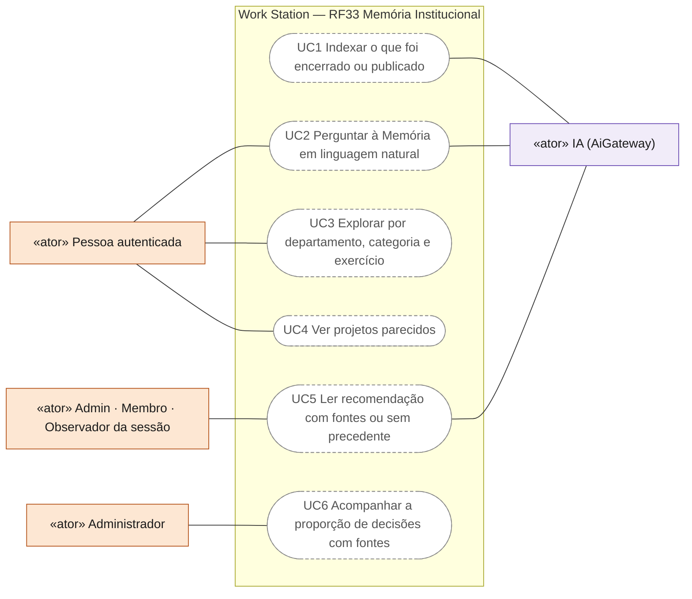
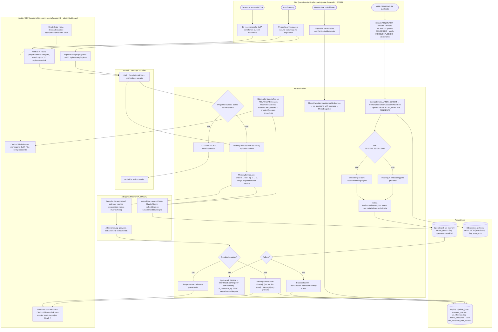
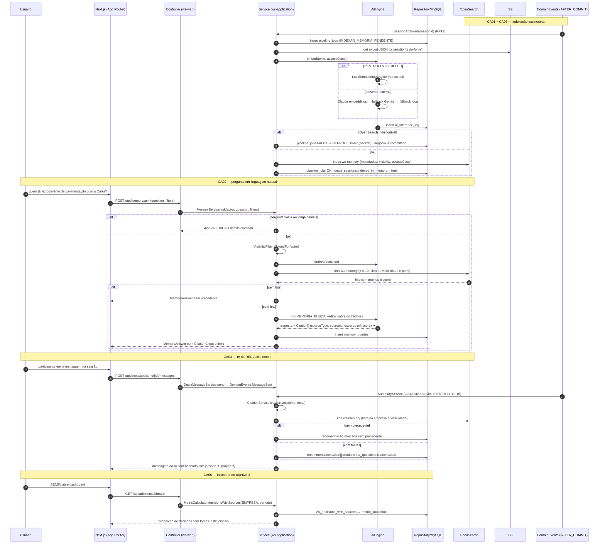
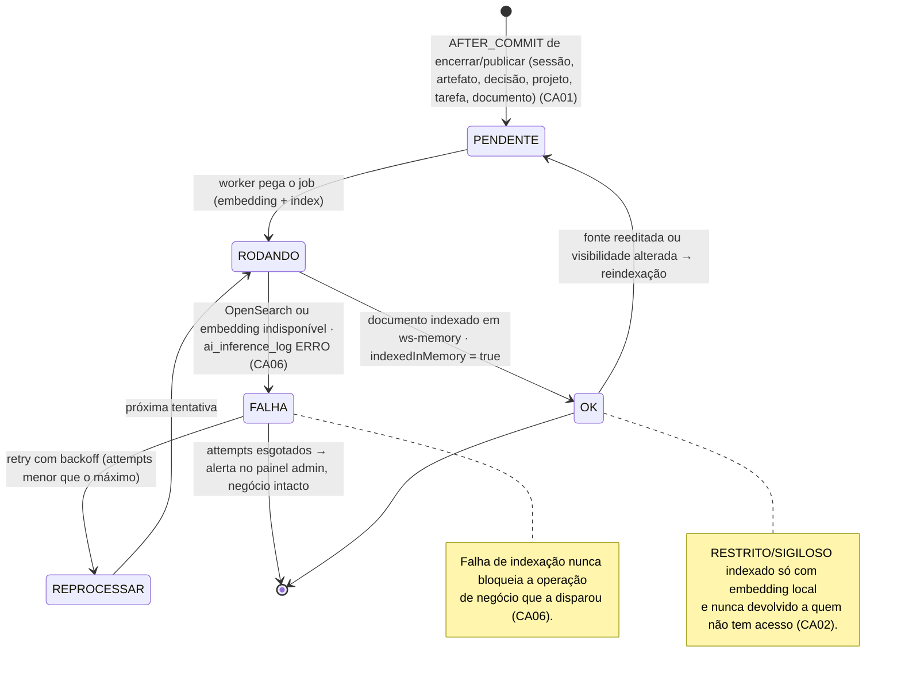
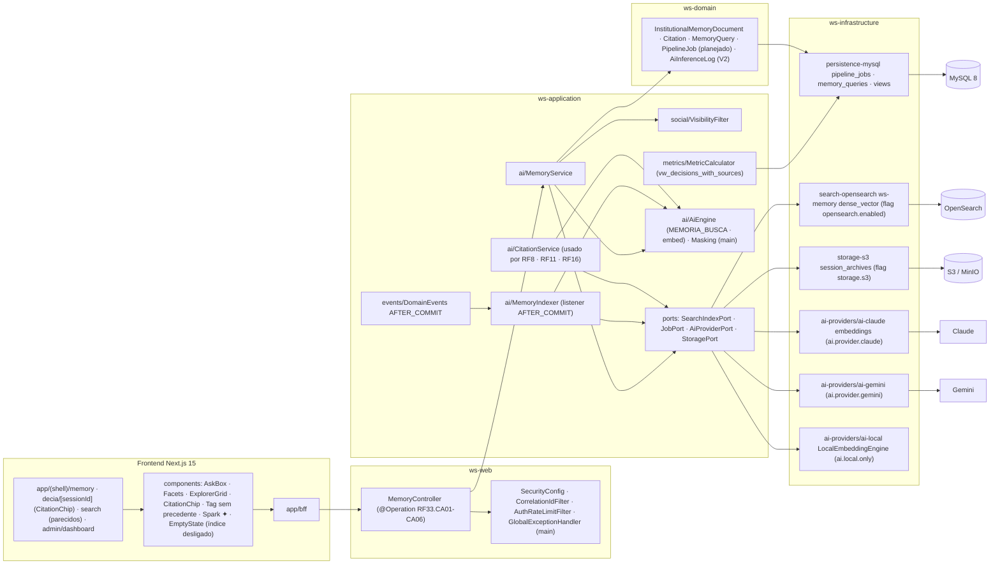

# RF33 — Consultar a Memória Institucional (busca semântica sobre sessões encerradas, artefatos, projetos e tarefas) e fazer a IA do DECIA citar fontes institucionais
**HU:** HU33 · **Sprint (board Work Station):** Product Backlog (não comprometido na Sprint 4) · **Equivalente FAI:** RF26 Explorador Global + RF24 IA (serviços externos) · **Aba/rota:** Memória Institucional (`/memory`: pergunta em linguagem natural, explorador visual por departamento/categoria/exercício), citações dentro da sessão (`/decia/[sessionId]`), "projetos parecidos" em `/search` (RF27.CA05), indicador em `/admin/dashboard` (RF18)
**Critérios de aceite cobertos:** RF33.CA01 · CA02 · CA03 · CA04 · CA05 · CA06 (corpo do card, inalterado) — regra: o **título do card** define o RF e o corpo traz os próprios CAs. Base do objetivo 3 (justificativa rastreável correlacionada à base de conhecimento institucional).

Índice OpenSearch `ws-memory` (`InstitutionalMemoryDocument`: `sourceType` SESSAO · ARTEFATO · DECISAO · PROJETO · TAREFA · DOCUMENTO, `embedding dense_vector`, metadados empresa/departamento/categoria/exercício/autor/data, `visibility`, `accessClass`). Indexação **assíncrona** por `PipelineJob INDEXAR_MEMORIA` disparado AFTER_COMMIT quando algo é encerrado/publicado (sessão ARQUIVADA, artefato, decisão VALIDADA, projeto CONCLUIDO, tarefa MODELO_PUBLICO, documento indexável); falha não bloqueia o negócio (`PipelineJob FALHA/REPROCESSAR`, log em `ai_inference_log`). Toda consulta passa pelo filtro de visibilidade/perfil; RESTRITO/SIGILOSO nunca é embeddado por provedor externo (só `LocalEngine`). Respostas carregam `Citation[]` (sourceType, sourceId, excerpt, url, score); vazio = **"sem precedente"**. Flag `opensearch.enabled`; sem ela, `/memory` mostra EmptyState "índice desligado" e a IA marca tudo "sem precedente".

## 0. Diagrama de casos de uso

Casos de uso derivados dos CAs. Todos são planejados: `/memory` é página-esqueleto e não há índice `ws-memory` nem `MemoryService`.

| Caso de uso | Ator(es) | CAs | Situação |
|---|---|---|---|
| UC1 Indexar o que foi encerrado ou publicado | `ia` | RF33.CA01, RF33.CA06 | planejado (assíncrono; falha não bloqueia o negócio) |
| UC2 Perguntar à Memória em linguagem natural | `autenticado`, `ia` | RF33.CA02 | planejado |
| UC3 Explorar por departamento, categoria e exercício | `autenticado` | RF33.CA04 | planejado |
| UC4 Ver projetos parecidos | `autenticado` | RF33.CA04 | planejado (em `/search`, RF27.CA05) |
| UC5 Ler recomendação com fontes ou sem precedente | `participante_sessao`, `ia` | RF33.CA03 | planejado |
| UC6 Acompanhar a proporção de decisões com fontes | `admin` | RF33.CA05 | planejado |

## 1. Diagrama de classes

```mermaid
classDiagram
direction LR

namespace ws_domain_ia {
  class InstitutionalMemoryDocument {
    <<entity>>
    +docId: String
    +sourceType: MemorySourceType
    +sourceId: UUID
    +companyId: UUID
    +departmentId: UUID
    +category: String
    +exerciseYear: int
    +authorId: UUID
    +title: String
    +text: String
    +embedding: dense_vector
    +visibility: Visibility
    +accessClass: AccessClassification
    +indexedAt: Instant
  }
  class Citation {
    <<entity>>
    +sourceType: MemorySourceType
    +sourceId: UUID
    +excerpt: String
    +url: String
    +score: BigDecimal
  }
  class MemoryQuery {
    <<entity>>
    +id: UUID
    +userId: UUID
    +queryText: String
    +filtersJson: JSON
    +resultsJson: JSON
    +aiInferenceId: UUID
    +at: Instant
  }
  class AiInferenceLog {
    <<entity>>
    +capability: AiCapability
    +provider: AiProvider
    +result: InferenceResult
    +fallbackUsed: boolean
    +correlationId: String
  }
  class MetricSnapshot {
    <<entity>>
    +metricCode: String
    +scope: MetricScope
    +value: BigDecimal
  }
  class MemorySourceType {
    <<enum>>
    SESSAO
    ARTEFATO
    DECISAO
    PROJETO
    TAREFA
    DOCUMENTO
  }
}

namespace ws_domain_fontes {
  class DeciaSession {
    <<entity>>
    +id: UUID
    +status: SessionStatus
    +indexedInMemory: boolean
  }
  class SessionArtifact {
    <<entity>>
    +sessionId: UUID
    +kind: String
    +contentMd: String
  }
  class FinalDecision {
    <<entity>>
    +sessionId: UUID
    +status: DecisionStatus
    +citationsJson: JSON
  }
  class AnalyticalSummary {
    <<entity>>
    +sessionId: UUID
    +recommendationsJson: JSON
  }
  class AiQuestion {
    <<entity>>
    +sessionId: UUID
    +citationsJson: JSON
  }
  class ProjectScheme {
    <<entity>>
    +id: UUID
    +status: ProjectStatus
    +visibility: Visibility
  }
  class TaskItem {
    <<entity>>
    +id: UUID
    +state: TaskState
    +accessClass: AccessClassification
  }
  class SessionArchive {
    <<entity>>
    +sessionId: UUID
    +exportJsonMediaId: UUID
  }
}

namespace ws_domain_platform {
  class PipelineJob {
    <<entity>>
    +id: UUID
    +type: String
    +targetType: String
    +targetId: UUID
    +status: PipelineJobStatus
    +attempts: int
    +lastError: String
  }
  class PipelineJobStatus {
    <<enum>>
    PENDENTE
    RODANDO
    OK
    FALHA
    REPROCESSAR
  }
}

namespace ws_application {
  class MemoryService {
    <<service>>
    +ask(actor, question, filters) MemoryAnswer
    +explore(actor, facets) ExplorerView
    +similar(actor, projectId) List~Citation~
  }
  class MemoryIndexer {
    <<service>>
    +onClosedOrPublished(event) PipelineJob
    +index(job) InstitutionalMemoryDocument
  }
  class CitationService {
    <<service>>
    +citeFor(sessionId, text) List~Citation~
    +markNoPrecedent(recommendation)
  }
  class VisibilityFilter {
    <<service>>
    +allowedFor(viewer) Filter
  }
  class MetricCalculator {
    <<service>>
    +decisionsWithSources(scope, period) MetricSnapshot
  }
  class AiEngine {
    <<service>>
    +run(AiRequest) AiResponse
    +embed(text, accessClass) float[]
  }
  class SearchIndexPort {
    <<port>>
    +index(ws_memory, doc)
    +knn(ws_memory, embedding, filter, k)
  }
  class JobPort {
    <<port>>
    +enqueue(PipelineJob)
  }
  class DomainEvents {
    <<service>>
    +publish(event)
  }
}

namespace ws_web {
  class MemoryController {
    <<controller>>
    +POST_api_memory_ask(question, filters)
    +GET_api_memory_explore(facets)
    +GET_api_memory_similar(projectId)
  }
}

namespace ws_infrastructure {
  class OpenSearchIndexAdapter {
    <<adapter>>
  }
  class LocalEmbeddingEngine {
    <<adapter>>
  }
  class ClaudeProvider {
    <<adapter>>
  }
}

DeciaSession ..> InstitutionalMemoryDocument : SESSAO
SessionArtifact ..> InstitutionalMemoryDocument : ARTEFATO
FinalDecision ..> InstitutionalMemoryDocument : DECISAO
ProjectScheme ..> InstitutionalMemoryDocument : PROJETO CONCLUIDO
TaskItem ..> InstitutionalMemoryDocument : TAREFA MODELO_PUBLICO
SessionArchive ..> InstitutionalMemoryDocument : texto exportado
PipelineJob ..> InstitutionalMemoryDocument : INDEXAR_MEMORIA
FinalDecision "1" o-- "0..*" Citation : citationsJson
AnalyticalSummary "1" o-- "0..*" Citation : recommendationsJson citations
AiQuestion "1" o-- "0..*" Citation : citationsJson
MemoryQuery "1" o-- "0..*" Citation : resultsJson
MemoryController --> MemoryService
MemoryService --> VisibilityFilter
MemoryService --> AiEngine
MemoryService --> SearchIndexPort
MemoryService ..> MemoryQuery
MemoryIndexer --> JobPort
MemoryIndexer --> AiEngine
MemoryIndexer --> SearchIndexPort
DomainEvents ..> MemoryIndexer : AFTER_COMMIT
CitationService --> SearchIndexPort
CitationService --> AiEngine
MetricCalculator ..> FinalDecision : vw_decisions_with_sources
AiEngine ..> AiInferenceLog
OpenSearchIndexAdapter ..|> SearchIndexPort
LocalEmbeddingEngine ..> AiEngine : RESTRITO SIGILOSO
ClaudeProvider ..> AiEngine
```

## 2. Diagrama de atividades

## 3. Diagrama de sequência

## 4. Máquina de estados

Entidade central: `PipelineJob.status` (`PipelineJobStatus`) do job `INDEXAR_MEMORIA` — a Memória em si é um índice sem estado; `DeciaSession.indexedInMemory` espelha o OK.

## 5. Diagrama de componentes

## 6. Rastreabilidade

| CA | Classe | Passo | Mensagem | Transição | Componente |
|---|---|---|---|---|---|
| RF33.CA01 | `InstitutionalMemoryDocument` (sourceType, metadados), `MemoryIndexer.onClosedOrPublished/index`, `PipelineJob INDEXAR_MEMORIA`, `DeciaSession.indexedInMemory` | A1 → P1 → P2 → P3/P4 → P5 → P8 | 1–13 | `[*] → PENDENTE → RODANDO → OK` | `MI`, `OSA`, `S3A` |
| RF33.CA02 | `MemoryService.ask`, `Citation` (excerpt, url, score), `MemoryQuery`, `VisibilityFilter` | A3 → F1 → P9 (422) → P10 → P11 → P12 → P13/P14 → F3 | 14–28 | nota de OK (visibilidade) | `MS`, `AskBox`, `CitationChip`, `VF` |
| RF33.CA03 | `CitationService.citeFor/markNoPrecedent`, `AnalyticalSummary.recommendationsJson[].citations`, `AiQuestion.citationsJson`, `FinalDecision.citationsJson` | A5 → F4 · P15 | 29–37 | — | `CIT`, `Tag sem precedente` |
| RF33.CA04 | `MemoryService.explore/similar`, facets departamento/categoria/exercício, RF27.CA05 | A3 → F2 → P10 | — (GET /explore, /similar) | — | `ExplorerGrid`, `Facets` |
| RF33.CA05 | `MetricCalculator.decisionsWithSources`, view `vw_decisions_with_sources`, `MetricSnapshot` | A7 → P16 | 38–42 | — | `MC2`, `MY`, `admin/dashboard` |
| RF33.CA06 | `DomainEvents` AFTER_COMMIT, `PipelineJob FALHA/REPROCESSAR`, `AiInferenceLog ERRO` | P1 → P6 → P7 | 1, 9–11 | `RODANDO → FALHA → REPROCESSAR` + nota | `DE`, `MI`, `MY` |

Tela/aba: `/memory` (esqueleto em `app/(shell)/memory/page.tsx`)

## Estado da implementação (12/11/2026)

Front DEMO, sem API nem OpenSearch: `/memory` é funcional sobre um **índice vetorial determinístico e local** (`lib/memory`, sem serviço externo nem embeddings de provedor — o mesmo caminho vale para RESTRITO/SIGILOSO). Acervo da aba = corpus de exemplo fictício (24 documentos: relatórios, portarias, atas, normas internas, sessão, projeto, tarefa-modelo e artefatos; unidades SECID, SECID-UTS, CPOE, GOF, AJUR; exercícios 2023–2026; PÚBLICO a SIGILOSO) + decisões encerradas do DECIA DEMO + documentos ingeridos na aba. Trecho = janela de até 2 frases com sobreposição, posições exatas (`body.slice(start, end) === text`); nota 0–1 = 0,45 · cosseno TF-IDF dos radicais (radicalização leve do português, sinônimos do serviço público com peso 0,6, grafia aproximada por Dice de trigramas) + 0,20 · cosseno de trigramas de caracteres por hashing (FNV-1a, 2^18) + 0,35 · BM25 normalizado (k1 = 1,2; b = 0,75). Mínimo padrão 0,05; abaixo disso nada volta. A Q-21 continua aberta; no DEMO valem: índice local (sem provedor de embeddings), nota mínima 0,05 para a busca e 0,2 com cobertura de 60 % dos termos da pergunta para a IA citar.

| CA | Situação | Onde |
|---|---|---|
| RF33.CA01 | DEMO: documento da Memória com tipo, unidade, exercício, data, classe de acesso, origem e público restrito; indexação local na hora. Decisões do DECIA DEMO já decididas (DECIDIDA → ARQUIVADA) viram documentos por adaptador somente leitura, relidos quando o repositório do DECIA muda (decisão PRIVADA só para participantes, salvo lição compartilhada). Ingestão local de texto colado ou .txt/.md (até 400 KB) com classe de acesso. `PipelineJob INDEXAR_MEMORIA`, OpenSearch `ws-memory`, `indexedInMemory` e indexação automática de sessão arquivada/projeto concluído/tarefa modelo público não feitos | `lib/memory/corpus.ts`, `lib/memory/adapters.ts`, `lib/memory/ingest.ts`, `lib/memory/store.ts`, `lib/memory/engine.ts` |
| RF33.CA02 | DEMO: pergunta em linguagem natural (vazia ou acima de 500 caracteres recusada), trechos exatos com destaque, citação curta ("Portaria 12/2025 — SECID, art. 3º"), link para o leitor, pontuação e "por que entrou" (termos casados — exato, sinônimo, aproximado —, cobertura, componentes da nota). Filtro de visibilidade ANTES da nota: PÚBLICO para visitante; RESTRITO só da própria unidade (EMPRESA lê todas); SIGILOSO nunca sem concessão; ADMIN não lê restrito. `MemoryQuery` persistida e rate limit dependem da API | `lib/memory/engine.ts`, `lib/memory/access.ts`, `components/memory/MemoryResults.tsx`, `components/memory/MemoryWorkspace.tsx` |
| RF33.CA03 | DEMO: contrato `searchMemory` ligado à implementação real (`lib/memory/index.ts` registra; no navegador o contrato se liga sozinho ao ser carregado) — a sessão do DECIA e a Transição citam por ele. "Perguntar à IA ✦" em `/memory`: resposta simulada só com frases exatas dos trechos, citações numeradas [1], [2] que levam ao cartão do trecho; sem trecho relevante, "sem fonte" (D-12). Respeita a autonomia da IA (Manual desliga). `citationsJson` em resumo/decisão final no servidor não feito | `lib/memory/answer.ts`, `lib/memory/index.ts`, `lib/memory/search.ts`, `components/memory/MemoryAnswer.tsx` |
| RF33.CA04 | DEMO: explorador visual com contagens só do que a pessoa lê — tipos com contagem e grade unidade × exercício (tabela acessível; a célula filtra e lista os documentos) —, filtros de tipo, unidade e exercício na busca e leitor com o trecho citado destacado (`/memory?doc=<id>&trecho=<início>-<fim>`). "Projetos parecidos" em `/search` (RF27.CA05) não feito | `lib/memory/explore.ts`, `components/memory/MemoryExplorer.tsx`, `components/memory/MemoryReader.tsx` |
| RF33.CA05 | Não feito: indicador de decisões com fontes no painel do administrador (`vw_decisions_with_sources`) | — |
| RF33.CA06 | Não se aplica ao DEMO (índice síncrono na aba; ingestão inválida não muda nada). Fila assíncrona com FALHA/REPROCESSAR e `ai_inference_log` dependem do backend | — |

Testes: `lib/memory/*.test.ts` (trecho exato, ordenação numa pergunta conhecida, acento/flexão/erro de digitação, sinônimo, filtro de acesso, mínimo, determinismo, resposta citada e "sem fonte", adaptador do DECIA, ingestão, contrato) e `components/memory/memory.test.tsx` (tela e página).
