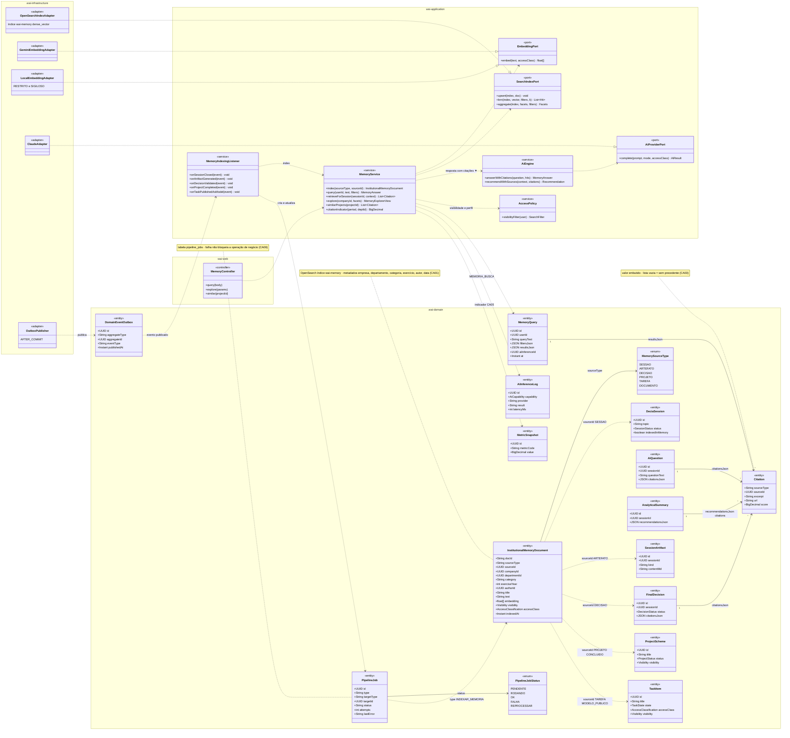
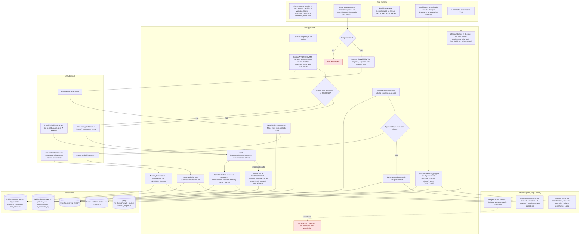
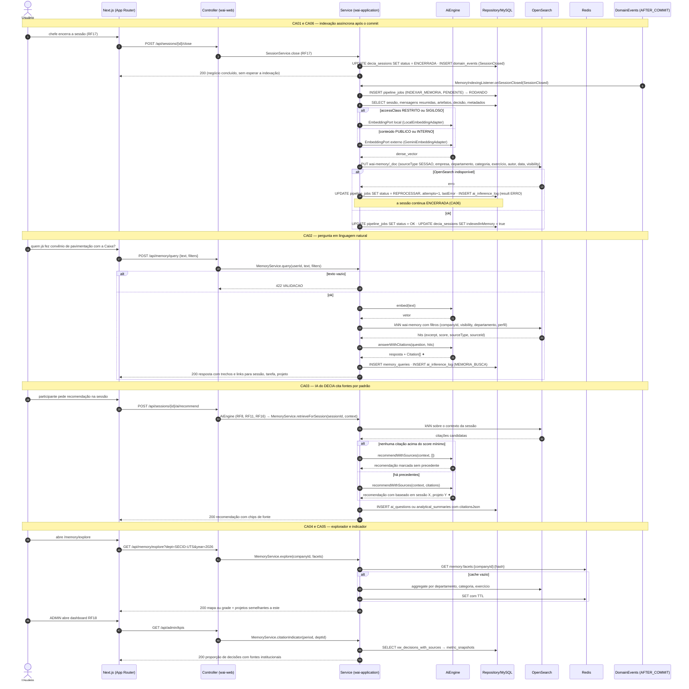
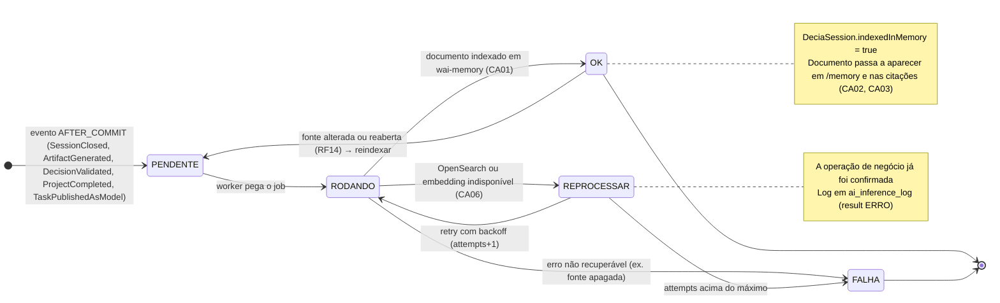
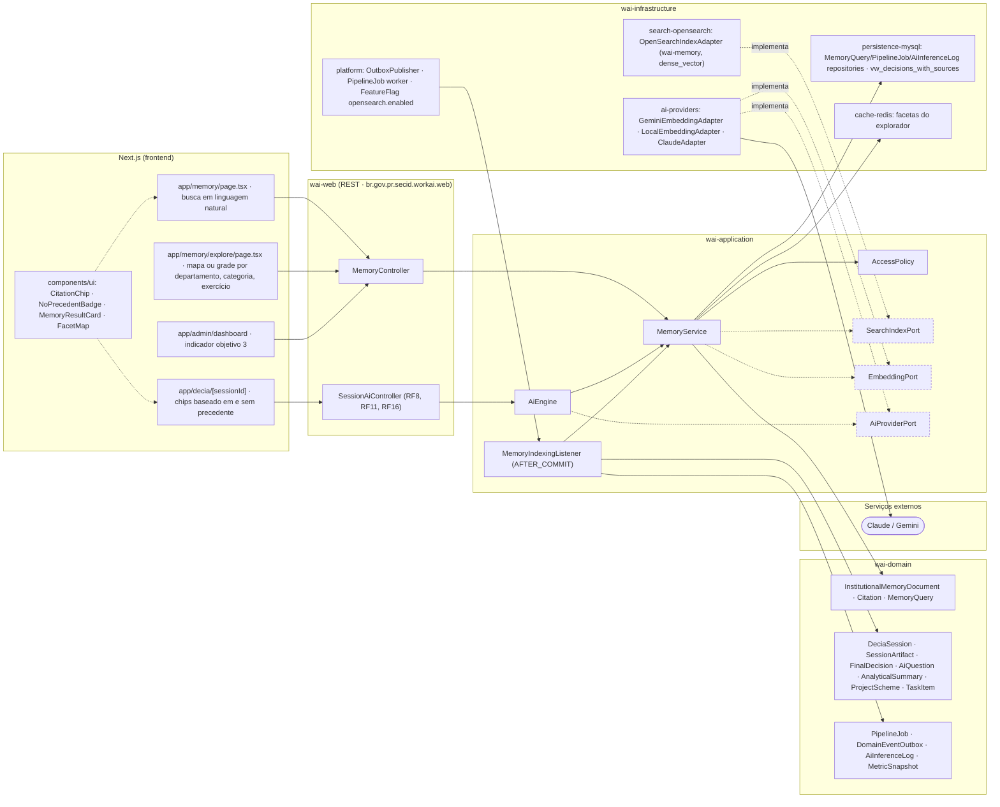

# RF33 — Consultar a Memória Institucional (busca semântica sobre sessões encerradas, artefatos, projetos e tarefas) e fazer a IA do DECIA citar fontes institucionais

**HU:** HU33 · **Sprint (board Work Station):** Product Backlog (pós-Sprint 4, a priorizar) · **Equivalente FAI:** RF26 Explorador Global + RF24 IA (serviços externos) · **Aba/rota:** Memória Institucional (`/memory`); explorador visual em `/memory/explore` (rota a confirmar)

**Critérios de aceite cobertos:** RF33.CA01 · RF33.CA02 · RF33.CA03 · RF33.CA04 · RF33.CA05 · RF33.CA06

> Contextos da TAXONOMIA: **10. IA do sistema** (`InstitutionalMemoryDocument` no índice OpenSearch `wai-memory`, `Citation` valor embutido, `MemoryQuery`, `AiInferenceLog` capability `MEMORIA_BUSCA`), **5. DECIA** (`DeciaSession.indexedInMemory`, `AiQuestion.citationsJson`, `AnalyticalSummary.recommendationsJson[].citations`, `FinalDecision.citationsJson`, `SessionArtifact`), **12. Plataforma** (`DomainEventOutbox`, `PipelineJob INDEXAR_MEMORIA`, `FeatureFlag opensearch.enabled`). Base do **objetivo 3**: recomendação sem fonte é marcada **"sem precedente"**; indexação é assíncrona (`AFTER_COMMIT`) e nunca bloqueia a operação de negócio. Conteúdo `RESTRITO`/`SIGILOSO` nunca vai a IA externa: indexa só metadados ou usa embedding local.

## 1. Diagrama de classes

## 2. Diagrama de atividades

## 3. Diagrama de sequência

## 4. Máquina de estados

`InstitutionalMemoryDocument` não tem estados próprios (é um documento de índice). A máquina abaixo é a do **`PipelineJob` do tipo `INDEXAR_MEMORIA`** que o produz, com o reflexo em `DeciaSession.indexedInMemory`.

## 5. Diagrama de componentes

## 6. Rastreabilidade

| CA | Elemento do diagrama (classe / passo / mensagem / transição / componente) |
|---|---|
| RF33.CA01 | Classes `InstitutionalMemoryDocument` (metadados empresa, departamento, categoria, exercício, autor, indexedAt, embedding), `MemorySourceType`, `MemoryIndexingListener.on*`, `DeciaSession.indexedInMemory`; atividades `U1 → S1 → S2 → S3 → A1/A2 → S4 → S5`; sequência bloco «CA01 e CA06» (PUT wai-memory/_doc); transições `PENDENTE → RODANDO → OK`; componentes `search-opensearch`, `MemoryIndexingListener` |
| RF33.CA02 | Classes `MemoryService.query`, `Citation` (excerpt, url, score), `MemoryQuery`, `AccessPolicy.visibilityFilter`, `AiEngine.answerWithCitations`; atividades `U2 → S7 → S8 → A5 → S9 → A3 → S10 → W1` (422 VALIDACAO, 403 ACESSO_NEGADO ao abrir fonte); sequência bloco «CA02»; nota do estado `OK`; componentes `app/memory`, `MemoryResultCard`, `MemoryController` |
| RF33.CA03 | Classes `MemoryService.retrieveForSession`, `AiEngine.recommendWithSources`, `AiQuestion.citationsJson`, `AnalyticalSummary.recommendationsJson[].citations`, `FinalDecision.citationsJson`, nota de `Citation` (vazio = sem precedente); atividades `U3 → S11 → S12 → S13/S14 → W2`; sequência bloco «CA03»; componentes `CitationChip`, `NoPrecedentBadge`, `SessionAiController` |
| RF33.CA04 | Classes `MemoryService.explore/similarProjects`, `SearchIndexPort.aggregate`; atividades `U4 → S15 → D2/D4 → W3`; sequência bloco «CA04 e CA05» (aggregate + cache Redis); componentes `app/memory/explore`, `FacetMap`, `cache-redis` |
| RF33.CA05 | Classes `MemoryService.citationIndicator`, `MetricSnapshot`; atividades `U5 → S16 → D5` (`vw_decisions_with_sources`); sequência bloco «CA04 e CA05» (GET /api/admin/kpis); componentes `app/admin/dashboard`, `persistence-mysql: vw_decisions_with_sources` |
| RF33.CA06 | Classes `DomainEventOutbox`, `PipelineJob` (status, attempts, lastError), `PipelineJobStatus`, `AiInferenceLog result ERRO`, `OutboxPublisher`; atividades `S2`, `S4 -.-> S6` (negócio intacto); sequência bloco «CA01 e CA06» alt «OpenSearch indisponível»; transições `RODANDO → REPROCESSAR → RODANDO/FALHA` e nota; componentes `platform: OutboxPublisher · PipelineJob worker` |

> Dúvidas para `docs/DECISOES.md`: Claude não oferece API de embeddings — `EmbeddingPort` precisa de Gemini (text-embedding) ou modelo local (`ai.local.only`), e a TAXONOMIA lista só CLAUDE · GEMINI · LOCAL como providers; comportamento com `opensearch.enabled = false` (fallback MySQL FULLTEXT sem semântica ou funcionalidade desativada); `MemorySourceType` e `PipelineJobStatus` não são enums nomeados na TAXONOMIA; score mínimo para "sem precedente" é parâmetro a definir.
