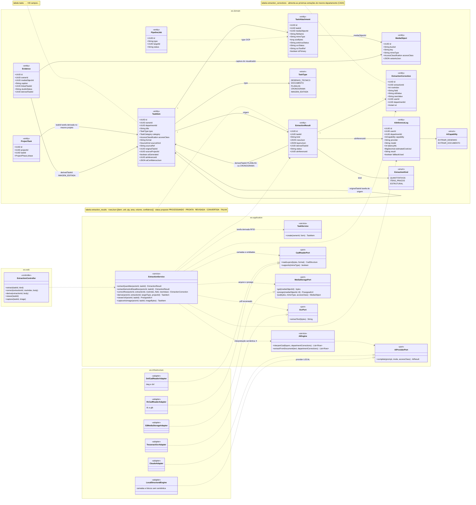
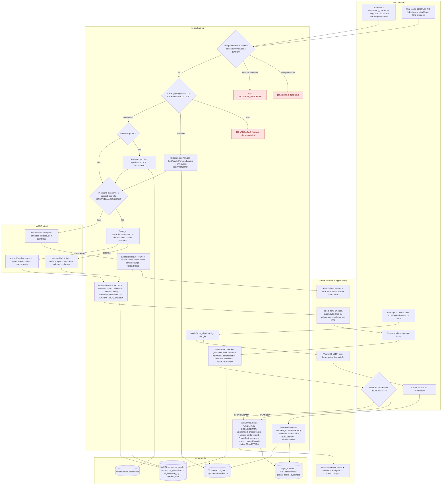
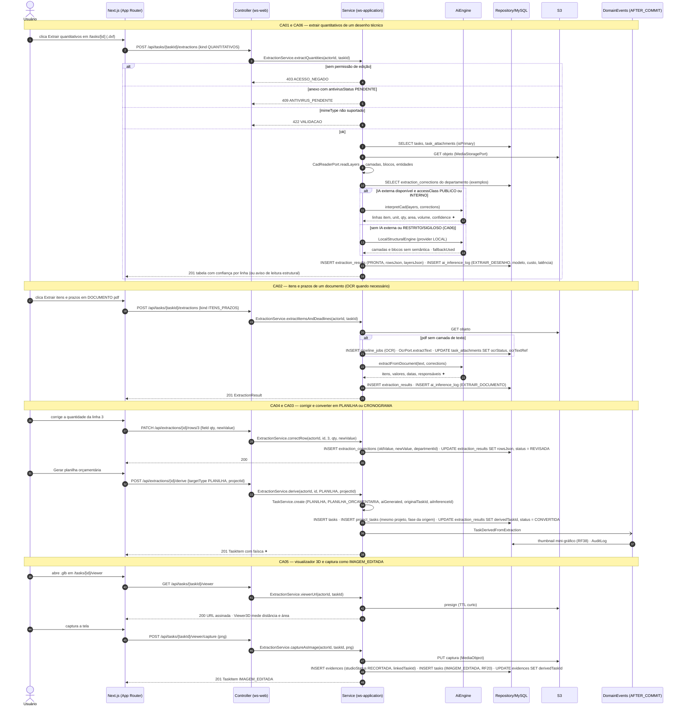
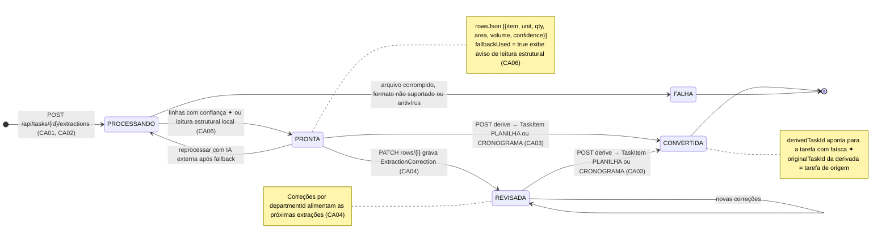
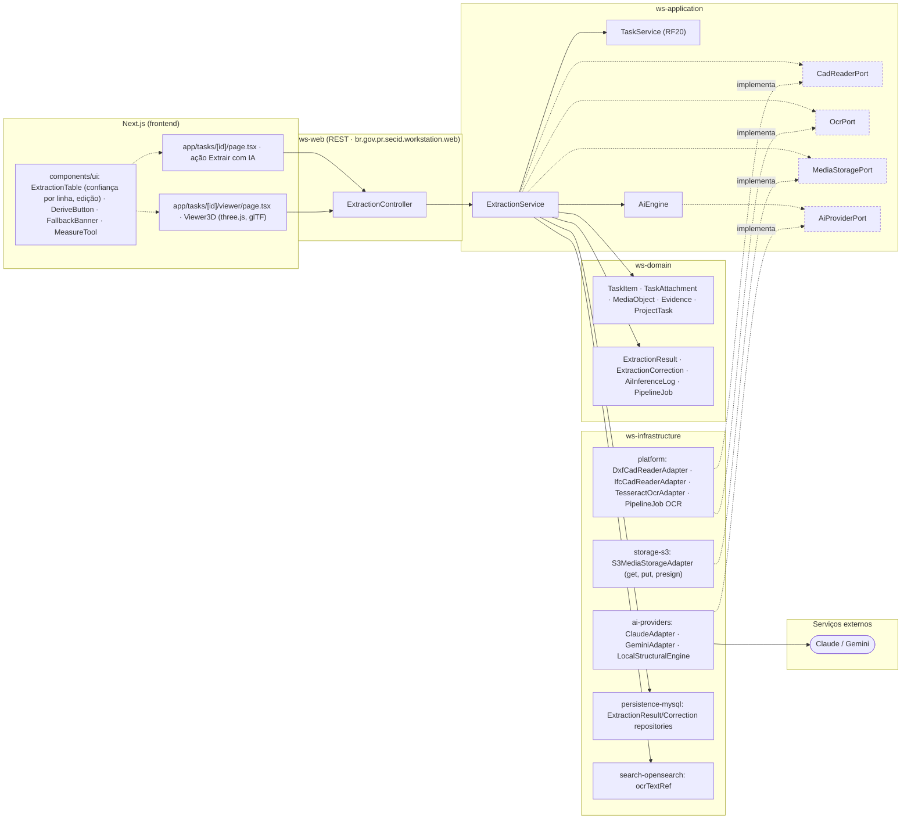

# RF34 — Extrair informações de desenhos técnicos e documentos (dwg/dxf/ifc/glb/pdf) com IA para gerar quantitativos, planilha orçamentária e cronograma pré-preenchidos

**HU:** HU34 · **Sprint (board Work Station):** Product Backlog (pós-Sprint 4, a priorizar) · **Equivalente FAI:** pipelines de imagem do RF4 (Flat Lay, Estúdio, filtro de logos) e RF16 Geração 3D — aplicados ao artefato de trabalho · **Aba/rota:** ação "Extrair com IA" na tarefa DESENHO_TECNICO / DOCUMENTO (`/tasks/[id]`, RF20); visualizador 3D (`/tasks/[id]/viewer`, rota a confirmar)

**Critérios de aceite cobertos:** RF34.CA01 · RF34.CA02 · RF34.CA03 · RF34.CA04 · RF34.CA05 · RF34.CA06

> Contextos da TAXONOMIA: **2. Acervo** (`TaskItem` tipos DESENHO_TECNICO · DOCUMENTO · PLANILHA · CRONOGRAMA · IMAGEM_EDITADA, `TaskAttachment` com `mimeType`, `antivirusStatus`, `ocrStatus`, `Evidence.studioStatus`), **3. Criador de Projetos** (`ProjectTask` da tarefa derivada no mesmo projeto), **10. IA** (`ExtractionResult` kind QUANTITATIVOS · ITENS_PRAZOS · ESTRUTURAL, `ExtractionCorrection`, `AiInferenceLog` capability `EXTRAIR_DESENHO` / `EXTRAIR_DOCUMENTO`) e **12. Plataforma** (`MediaObject`, `PipelineJob OCR`). Sem IA externa o **motor local** lê camadas/blocos (ESTRUTURAL) sem interpretação semântica e avisa. `RESTRITO`/`SIGILOSO` nunca vai a IA externa.

## 1. Diagrama de classes

## 2. Diagrama de atividades

## 3. Diagrama de sequência

## 4. Máquina de estados

Entidade central: `ExtractionResult.status`. A TAXONOMIA lista o campo `status` sem valores — os estados abaixo são **proposta** (registrar em `DECISOES.md`).

## 5. Diagrama de componentes

## 6. Rastreabilidade

| CA | Elemento do diagrama (classe / passo / mensagem / transição / componente) |
|---|---|
| RF34.CA01 | Classes `ExtractionService.extractQuantities`, `CadReaderPort.readLayers`, `ExtractionResult.kind = QUANTITATIVOS`, `rowsJson` (item, unit, qty, area, volume, confidence), `layersJson`, `AiEngine.interpretCad`; atividades `U1 → S1 → S2 → S3 → S6 → S7 → A1 → S8 → W1` (403, 409 ANTIVIRUS_PENDENTE, 422 formato); sequência bloco «CA01 e CA06»; transição `[*] → PROCESSANDO → PRONTA`; componentes `ExtractionTable`, `DxfCadReaderAdapter`, `IfcCadReaderAdapter` |
| RF34.CA02 | Classes `ExtractionService.extractItemsAndDeadlines`, `OcrPort`, `TaskAttachment.ocrStatus/ocrTextRef`, `PipelineJob OCR`, `AiEngine.extractFromDocument`, `ExtractionResult.kind = ITENS_PRAZOS`; atividades `U2 → S1 → S2 → S4 → S5 → S6 → A2 → S8`; sequência bloco «CA02»; componentes `TesseractOcrAdapter`, `search-opensearch: ocrTextRef` |
| RF34.CA03 | Classes `ExtractionService.derive`, `ExtractionResult.derivedTaskId`, `TaskItem.originalTaskId/aiGenerated/aiInferenceId`, `ProjectTask` (mesmo projeto), `TaskService.create`; atividades `U4 → S11 → W3`; sequência bloco «CA04 e CA03» (`POST /api/extractions/{id}/derive`, evento thumbnail RF38); transições `PRONTA/REVISADA → CONVERTIDA` e nota; componente `DeriveButton` |
| RF34.CA04 | Classes `ExtractionCorrection` (rowIndex, field, oldValue, newValue, departmentId), `ExtractionService.correctRow`, `AiEngine.*(…, departmentCorrections)`; atividades `U3 → S10`, `S7` (correções como exemplos); sequência bloco «CA04 e CA03» (`PATCH /api/extractions/{id}/rows/{i}`) e SELECT extraction_corrections no bloco «CA01»; transição `PRONTA → REVISADA` e nota; componente `ExtractionTable` (edição) |
| RF34.CA05 | Classes `ExtractionService.viewerUrl/captureAsImage`, `MediaStoragePort.presign/put`, `Evidence.studioStatus/derivedTaskId`, `TaskType.IMAGEM_EDITADA`; atividades `U5 → S12 → W4 → U6 → S13`; sequência bloco «CA05»; componentes `app/tasks/[id]/viewer`, `Viewer3D`, `MeasureTool`, `storage-s3` |
| RF34.CA06 | Classes `AiInferenceLog` (EXTRAIR_DESENHO / EXTRAIR_DOCUMENTO, modelo, custo, latência, fallbackUsed), `LocalStructuralEngine ..|> AiProviderPort`, `TaskItem.accessClass`; atividades `S6 → A3 → S9 → W2`; sequência bloco «CA01 e CA06» alt «sem IA externa ou RESTRITO/SIGILOSO»; transição `PROCESSANDO → PRONTA` (leitura estrutural) e nota; componentes `FallbackBanner`, `ai-providers: LocalStructuralEngine` |

> Dúvidas para `docs/DECISOES.md`: valores de `ExtractionResult.status` (proposta PROCESSANDO · PRONTA · REVISADA · CONVERTIDA · FALHA); vínculo da tarefa derivada com a origem — usei `TaskItem.originalTaskId` (campo de crédito de remix) por não existir `SourceKind` de extração (alternativa: novo `SourceKind.EXTRACAO`); `OcrPort`, `MediaStoragePort`, `409 ANTIVIRUS_PENDENTE` e bibliotecas CAD (ezdxf, IfcOpenShell) são propostas; `.dwg` exige conversão prévia para `.dxf` (ODA File Converter) — confirmar licenciamento.
