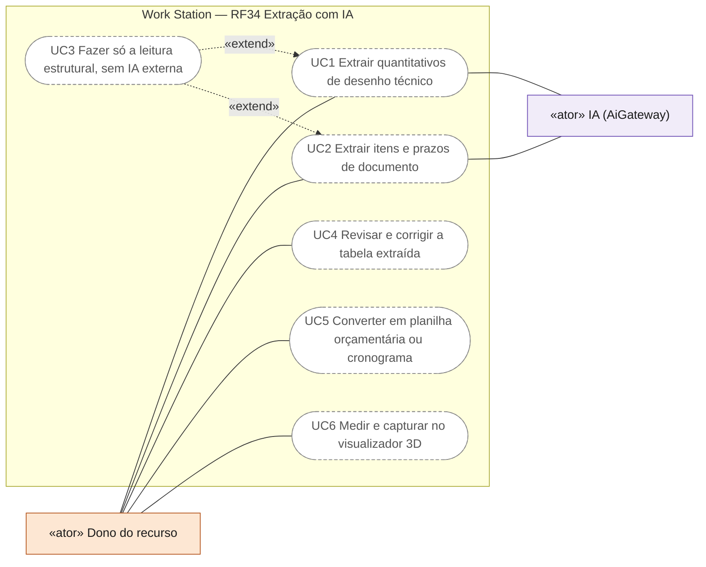
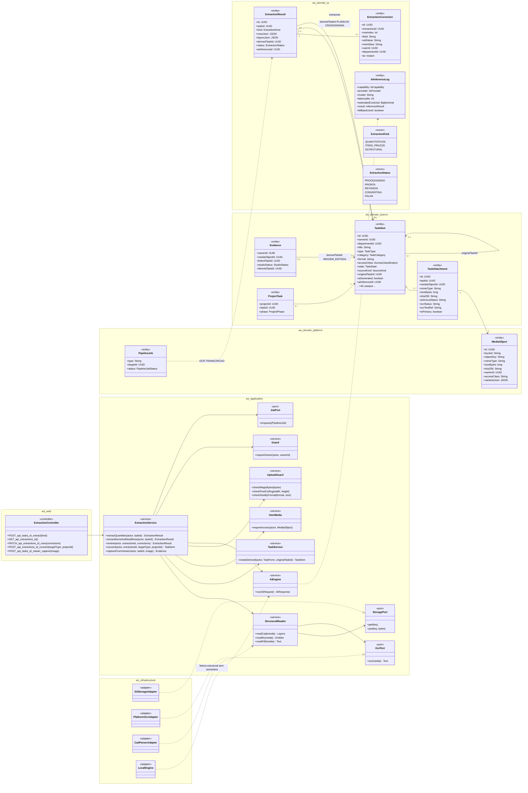
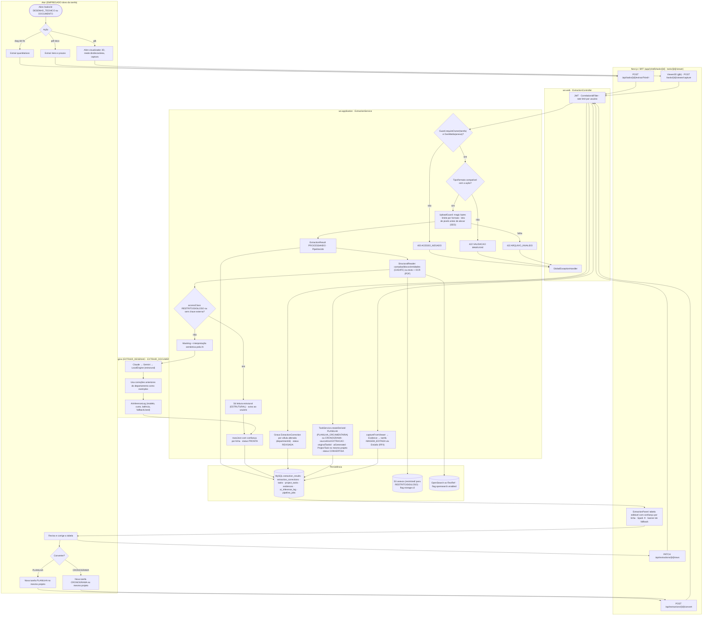
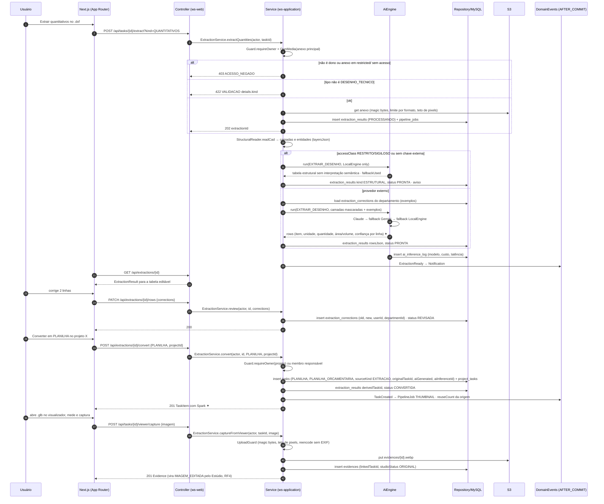
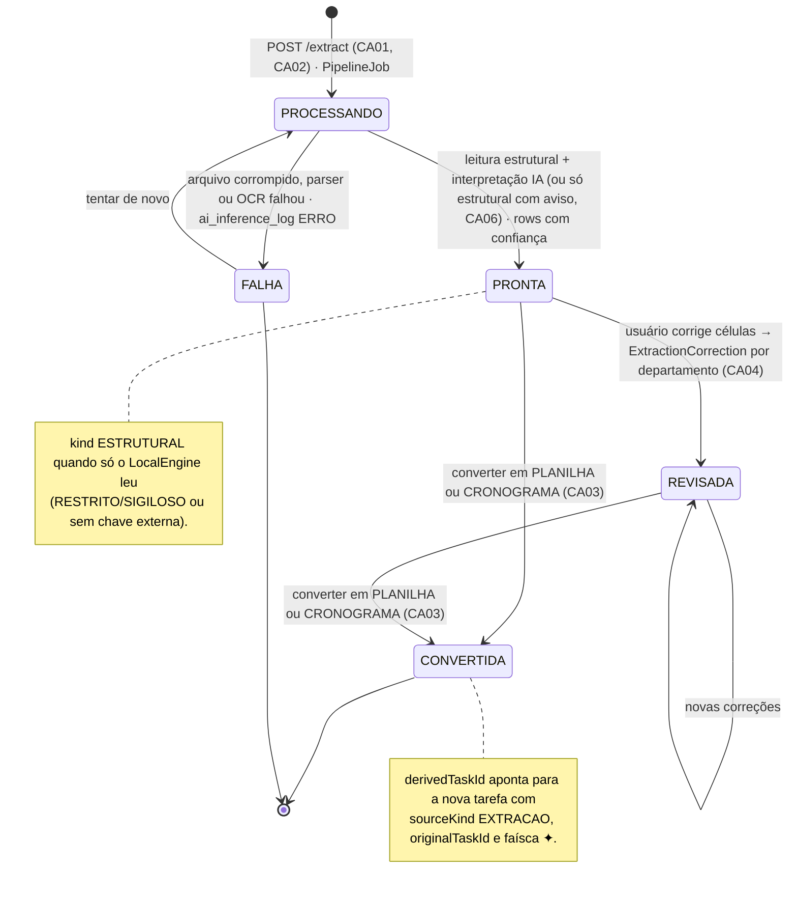
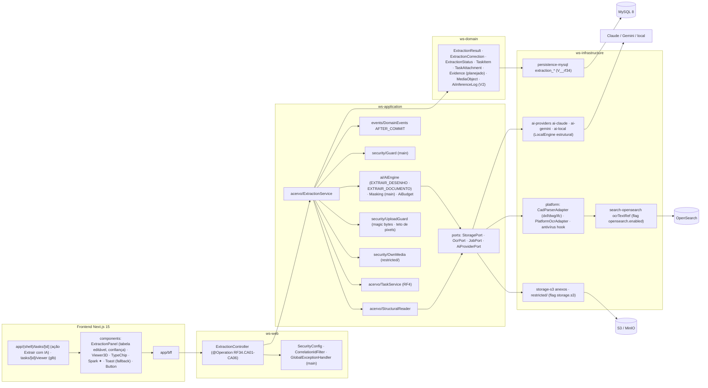

# RF34 — Extrair informações de desenhos técnicos e documentos (dwg/dxf/ifc/glb/pdf) com IA para gerar quantitativos, planilha orçamentária e cronograma pré-preenchidos
**HU:** HU34 · **Sprint (board Work Station):** Product Backlog (não comprometido na Sprint 4) · **Equivalente FAI:** pipelines de imagem do RF4 (Flat Lay, Estúdio, filtro de logos) e RF16 Geração 3D · **Aba/rota:** ação **Extrair com IA** no detalhe da tarefa DESENHO_TECNICO / DOCUMENTO (`/tasks/[id]`, painel `ExtractionPanel`), visualizador 3D (`/tasks/[id]/viewer`), resultado vira tarefa PLANILHA/CRONOGRAMA no mesmo projeto (RF4/RF5)
**Critérios de aceite cobertos:** RF34.CA01 · CA02 · CA03 · CA04 · CA05 · CA06 (corpo do card, inalterado) — regra: o **título do card** define o RF e o corpo traz os próprios CAs.

`ExtractionResult` (kind QUANTITATIVOS · ITENS_PRAZOS · ESTRUTURAL; `rowsJson` com confiança por linha; `layersJson`; `status` `ExtractionStatus` PROCESSANDO · PRONTA · REVISADA · CONVERTIDA · FALHA) nasce de uma `TaskItem` DESENHO_TECNICO (.dwg/.dxf/.ifc) ou DOCUMENTO (.pdf/.docx). A leitura **estrutural** (camadas/blocos/entidades, OCR) é feita pelo `platform` (parsers + OCR) e pelo `LocalEngine`; a **interpretação semântica** (item, unidade, quantidade, datas, responsáveis) usa `AiEngine` capabilities `EXTRAIR_DESENHO`/`EXTRAIR_DOCUMENTO`; sem provedor externo só a estrutural, com aviso (CA06). O arquivo passa por `OwnMedia` (`restricted/` quando RESTRITO/SIGILOSO), magic bytes, limite por formato e **teto de pixels** antes de alocar (SEG). Correções do usuário (`ExtractionCorrection`) ficam por departamento e alimentam as próximas extrações (few-shot/regras locais). Converter cria `TaskItem` PLANILHA (PLANILHA_ORCAMENTARIA) ou CRONOGRAMA com `sourceKind EXTRACAO`, `originalTaskId` = tarefa de origem, faísca ✦, e `ProjectTask` no mesmo projeto.

## 0. Diagrama de casos de uso

Casos de uso derivados dos CAs. Todos são planejados: o detalhe da tarefa existe, mas não há `ExtractionPanel`, visualizador 3D nem `ExtractionService`. Só o dono da tarefa extrai.

| Caso de uso | Ator(es) | CAs | Situação |
|---|---|---|---|
| UC1 Extrair quantitativos de desenho técnico | `dono`, `ia` | RF34.CA01 | planejado |
| UC2 Extrair itens e prazos de documento | `dono`, `ia` | RF34.CA02 | planejado |
| UC3 Fazer só a leitura estrutural, sem IA externa | — (estende UC2) | RF34.CA06 | planejado |
| UC4 Revisar e corrigir a tabela extraída | `dono` | RF34.CA04 | planejado |
| UC5 Converter em planilha orçamentária ou cronograma | `dono` | RF34.CA03 | planejado |
| UC6 Medir e capturar no visualizador 3D | `dono` | RF34.CA05 | planejado |

## 1. Diagrama de classes

## 2. Diagrama de atividades

## 3. Diagrama de sequência

## 4. Máquina de estados

Entidade central: `ExtractionResult.status` (`ExtractionStatus`).

## 5. Diagrama de componentes

## 6. Rastreabilidade

| CA | Classe | Passo | Mensagem | Transição | Componente |
|---|---|---|---|---|---|
| RF34.CA01 | `ExtractionService.extractQuantities`, `StructuralReader.readCad/readIfc`, `ExtractionResult.rowsJson` (item, unidade, quantidade, área/volume, confiança), `ExtractionKind QUANTITATIVOS` | A2 → F1 → P1 (403) → P2 (422) → P3 → P4 → P5 → P8 → I1 → P9 | 1–25 | `[*] → PROCESSANDO → PRONTA` | `ES`, `SR`, `PLAT (CadParserAdapter)`, `ExtractionPanel` |
| RF34.CA02 | `ExtractionService.extractItemsAndDeadlines`, `StructuralReader.readPdf`, `OcrPort`, `ExtractionKind ITENS_PRAZOS` | A3 → F1 → P5 (OCR) → P8 | — (mesmo fluxo com kind ITENS_PRAZOS) | `PROCESSANDO → PRONTA` | `PLAT (PlatformOcrAdapter)`, `OSA` |
| RF34.CA03 | `ExtractionService.convert`, `TaskService.createDerived`, `TaskType PLANILHA/CRONOGRAMA`, `SourceKind EXTRACAO`, `originalTaskId`, `ProjectTask`, `derivedTaskId` | A6 → A7/A8 → F4 → P11 | 30–37 | `PRONTA/REVISADA → CONVERTIDA` | `TS`, `Spark ✦` |
| RF34.CA04 | `ExtractionService.review`, `ExtractionCorrection` (departmentId), exemplos nas próximas extrações | A5 → F3 → P10 · I2 | 26–29, 16 | `PRONTA → REVISADA` | `ExtractionPanel`, `MY` |
| RF34.CA05 | `ExtractionService.captureFromViewer`, `Evidence`, `UploadGuard`, tarefa IMAGEM_EDITADA (RF4) | A4 → F5 → P12 | 38–43 | — | `Viewer3D`, `UG`, `S3A` |
| RF34.CA06 | `AiInferenceLog` (modelo, custo, latência), `LocalEngine` (estrutural sem semântica), `ExtractionKind ESTRUTURAL`, aviso | P6 → P7 · I3 | 13–16, 22 | nota de PRONTA | `AIP`, `Toast` |

Tela/aba: `/tasks/[id]` (esqueleto em `app/(shell)/tasks/[id]/page.tsx`) · `/tasks/new` (esqueleto em `app/(shell)/tasks/new/page.tsx`)
