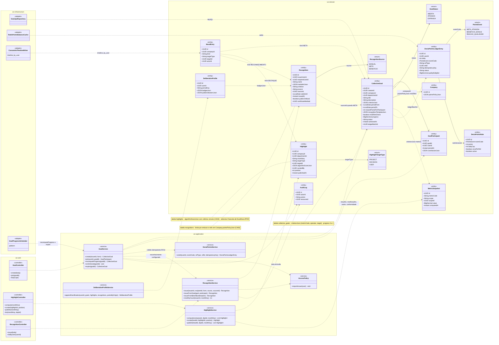
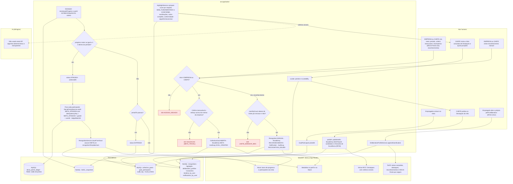
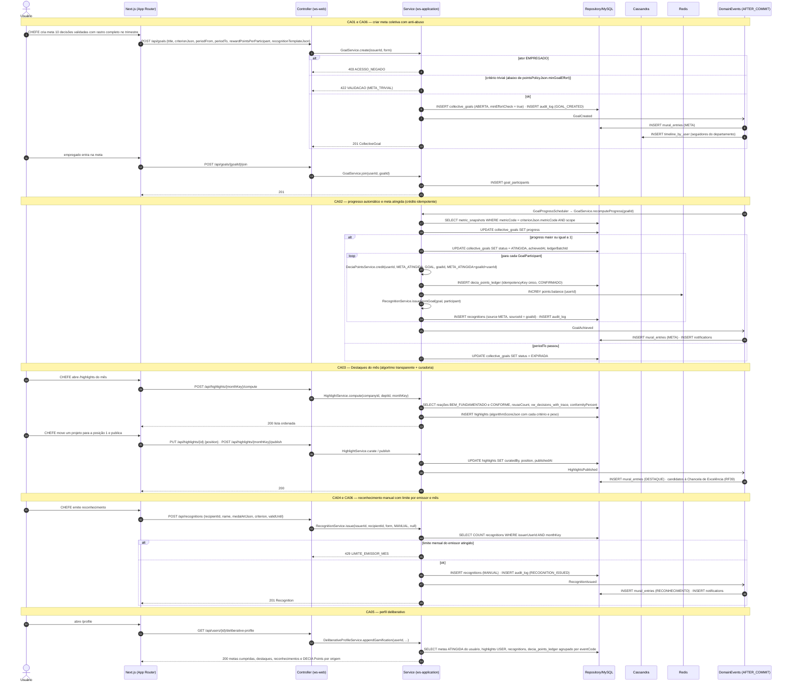
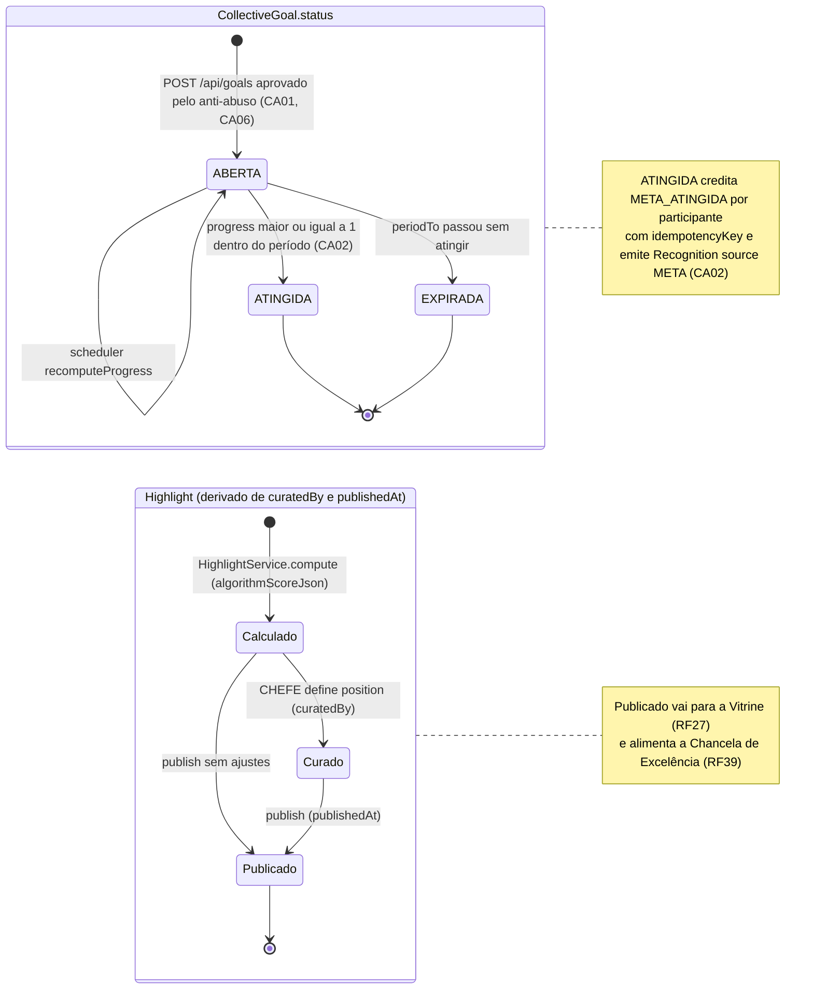
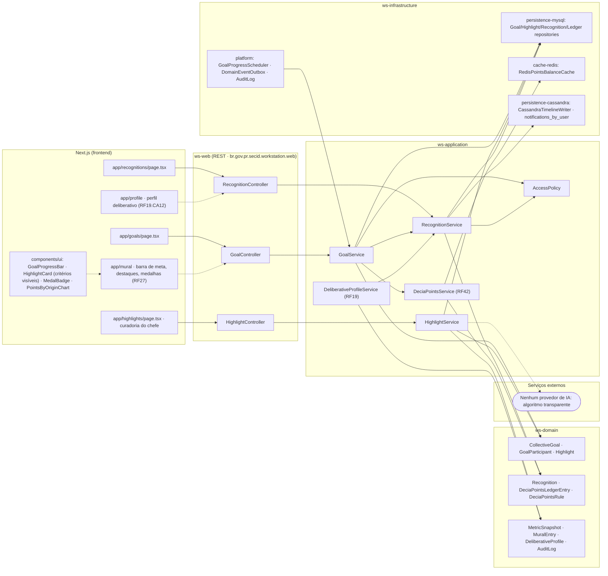

# RF35 — Participar de Metas coletivas, aparecer nos Destaques e receber Reconhecimentos (gamificação ligada ao perfil deliberativo, com DECIA Points como moeda)

**HU:** HU35 · **Sprint (board Work Station):** Product Backlog (pós-Sprint 4, a priorizar) · **Equivalente FAI:** RF32 Desafios + Destaques + RF38 Cupons · **Aba/rota:** Metas coletivas (`/goals`), Destaques (`/highlights`), Reconhecimentos (`/recognitions`)

**Critérios de aceite cobertos:** RF35.CA01 · RF35.CA02 · RF35.CA03 · RF35.CA04 · RF35.CA05 · RF35.CA06

> Contextos da TAXONOMIA: **9. Gamificação & Reputação** (`CollectiveGoal`, `GoalParticipant`, `Highlight`, `DeliberativeProfile`), **6. Chancelas & Benefícios** (`Recognition` source MANUAL · META · BENEFICIO, `Benefit`), **7. DECIA Points** (`DeciaPointsLedgerEntry` eventCode `META_ATINGIDA` idempotente, `DeciaPointsRule`), **8. Social** (`MuralEntry` kind META · DESTAQUE · RECONHECIMENTO, `Reaction` BEM_FUNDAMENTADO/CONFORME), **10/12** (`MetricSnapshot`, `AuditLog`). Destaques usam **algoritmo transparente** (critérios visíveis em `algorithmScoreJson`), não IA externa. Anti-abuso: `minEffortCheck` contra critério trivial, limite de reconhecimentos por emissor/mês em `Company.pointsPolicyJson`, tudo em `audit_log`.

## 1. Diagrama de classes

## 2. Diagrama de atividades

## 3. Diagrama de sequência

## 4. Máquina de estados

Entidade central: `CollectiveGoal.status`. O `Highlight` não tem enum de status — seu ciclo deriva de `curatedBy`/`publishedAt` e aparece como composto auxiliar. `Recognition` não tem estados (só `validUntil`).

## 5. Diagrama de componentes

## 6. Rastreabilidade

| CA | Elemento do diagrama (classe / passo / mensagem / transição / componente) |
|---|---|
| RF35.CA01 | Classes `CollectiveGoal` (criterionJson, periodFrom/To, rewardPointsPerParticipant, recognitionTemplateJson, progress), `GoalParticipant`, `GoalService.create/join/recomputeProgress`, `MuralEntry kind META`; atividades `U1 → S1 → S2 → S3 → W1`, `U2 → S4`, `S5 → S6/S7`; sequência bloco «CA01 e CA06» e início do bloco «CA02»; transições `[*] → ABERTA → ABERTA`; componentes `app/goals`, `GoalProgressBar`, `GoalProgressScheduler` |
| RF35.CA02 | Classes `DeciaPointsLedgerEntry` (eventCode META_ATINGIDA, idempotencyKey), `CollectiveGoal.ledgerBatchId/achievedAt`, `DeciaPointsService.credit`, `RecognitionService.issueFromGoal`; atividades `S6 → S8 → S9 → S10`; sequência bloco «CA02» (loop por participante, idempotencyKey único, INCRBY Redis); transição `ABERTA → ATINGIDA` e nota; componentes `DeciaPointsService (RF42)`, `cache-redis` |
| RF35.CA03 | Classes `Highlight` (monthKey, targetType PROJECT/DECISION/USER, algorithmScoreJson, curatedBy, position, publishedAt), `HighlightService.compute/curate/publish`; atividades `S12 → U3 → S13 → U4 → S14 → W2` (A1: sem IA); sequência bloco «CA03»; estado `HL` (`Calculado → Curado → Publicado`) e nota (Vitrine, Chancela de Excelência RF39); componentes `app/highlights`, `HighlightCard` |
| RF35.CA04 | Classes `Recognition` (name, medalArtJson, criterion, validUntil, source MANUAL/META/BENEFICIO, publicOnMural), `RecognitionService.issue/issueFromGoal/issueFromBenefit`, `MuralEntry kind RECONHECIMENTO`; atividades `U5 → S1 → S15 → S16 → W3`, `S10 → W3`; sequência bloco «CA04 e CA06»; componentes `app/recognitions`, `MedalBadge`, `RecognitionController` |
| RF35.CA05 | Classes `DeliberativeProfile.badgesJson/publicIndicatorsJson`, `DeliberativeProfileService.appendGamification`; atividades `U6 → S17 → W4`; sequência bloco «CA05» (metas ATINGIDA, highlights USER, recognitions, ledger por eventCode); componentes `app/profile`, `PointsByOriginChart` |
| RF35.CA06 | Classes `CollectiveGoal.minEffortCheck`, `Company.pointsPolicyJson` (mínimo de esforço, limite por emissor/mês), `RecognitionService.monthlyCount`, `AuditLog`; atividades `S2 → E2` (422 META_TRIVIAL), `S15 → E3` (429 LIMITE_EMISSOR_MES), `S3`/`S16` (AuditLog); sequência blocos «CA01 e CA06» e «CA04 e CA06» (alts de anti-abuso, INSERT audit_log); transição `[*] → ABERTA` condicionada ao anti-abuso; componente `platform: AuditLog` |

> Dúvidas para `docs/DECISOES.md`: `GoalStatus`, `RecognitionSource` e `HighlightTargetType` não são enums nomeados na TAXONOMIA (valores inline); `DeciaPointsService` (RF42) e `DeliberativeProfileService` (RF19) são dependências assumidas; código HTTP do limite mensal (429 LIMITE_EMISSOR_MES vs. 409) e onde fica o mínimo de esforço (`Company.pointsPolicyJson`) são propostas; `Highlight` não tem campo de status — se precisar de rascunho/publicado explícito, acrescentar.

Tela/aba: `/goals` (esqueleto em `app/(shell)/goals/page.tsx`) · `/highlights` (esqueleto em `app/(shell)/highlights/page.tsx`) · `/recognitions` (esqueleto em `app/(shell)/recognitions/page.tsx`) · `/curation` (esqueleto em `app/(shell)/curation/page.tsx`)
