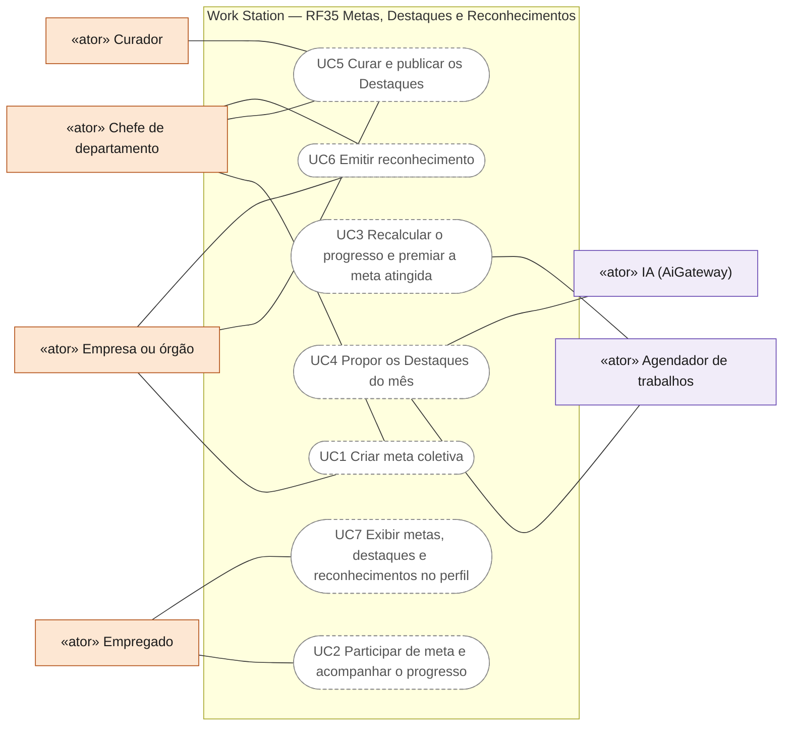
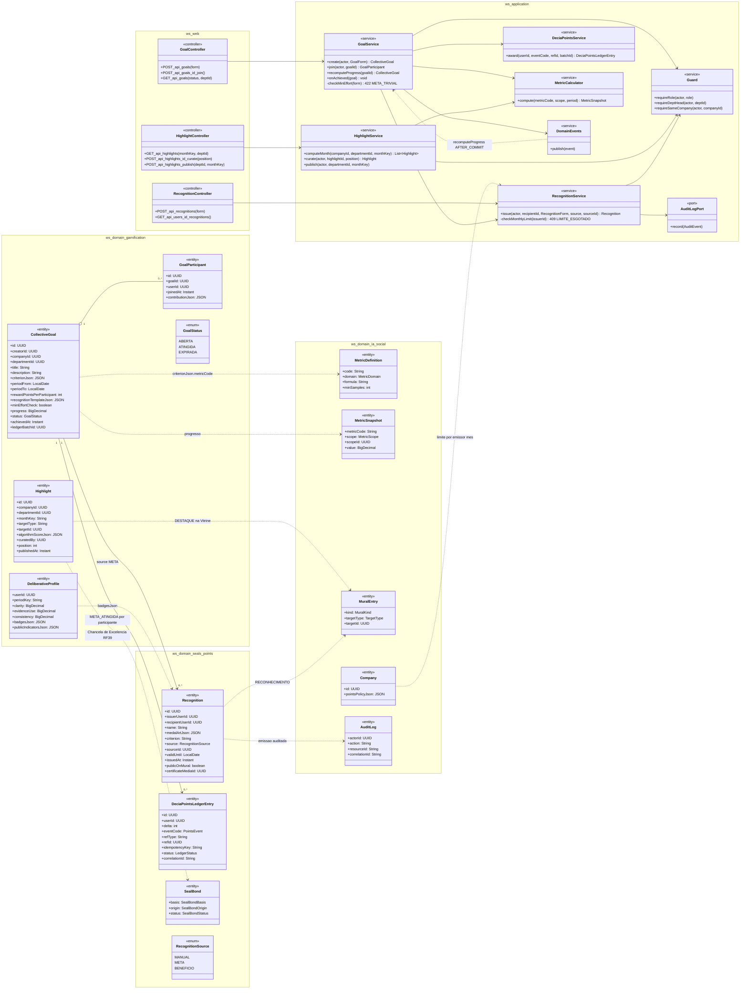
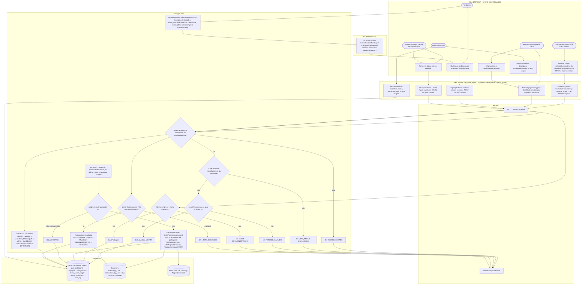
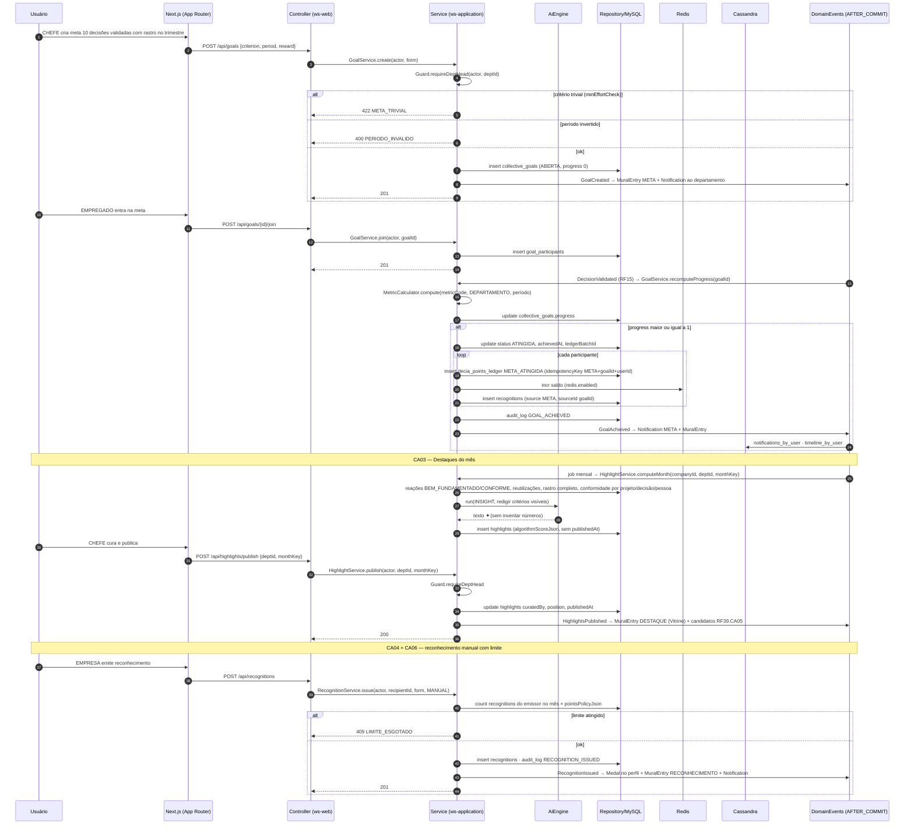
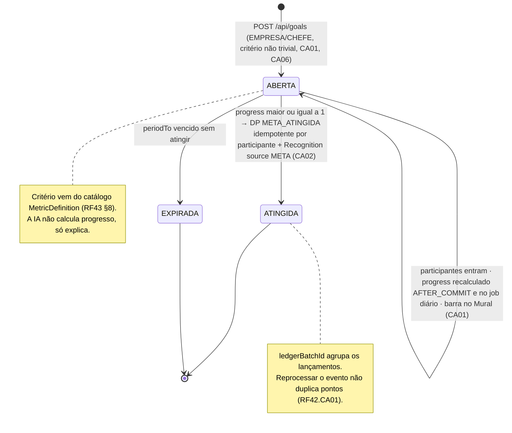
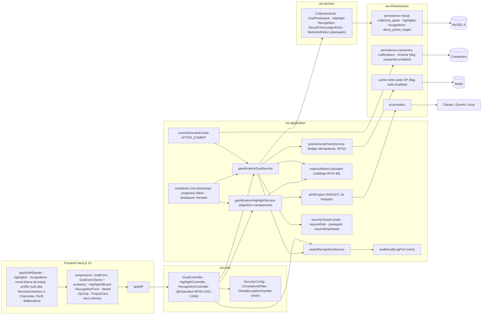

# RF35 — Participar de Metas coletivas, aparecer nos Destaques e receber Reconhecimentos (gamificação ligada ao perfil deliberativo, com DECIA Points como moeda)
**HU:** HU35 · **Sprint (board Work Station):** Product Backlog (não comprometido na Sprint 4) · **Equivalente FAI:** RF32 Desafios + Destaques + RF38 Cupons · **Aba/rota:** Metas coletivas (`/goals`), Destaques (`/highlights`), Reconhecimentos (`/recognitions`), barra de progresso no Mural (`/mural`), medalhas no perfil (`/profile?tab=reconhecimentos`, RF26 corpo/RF19)
**Critérios de aceite cobertos:** RF35.CA01 · CA02 · CA03 · CA04 · CA05 · CA06 (corpo do card, inalterado) — regra: o **título do card** define o RF e o corpo traz os próprios CAs. A moeda é o **DECIA Points** (RF42); a HU35 ainda diz "Pontos de Contribuição" (nome antigo).

`CollectiveGoal` (criador EMPRESA/CHEFE; `criterionJson {metricCode, operator, target}` sobre o catálogo `MetricDefinition`; `minEffortCheck` anti-trivial; `progress` 0–1 calculado por `MetricCalculator` em job agendado e AFTER_COMMIT dos eventos relevantes) com `GoalParticipant`s. Meta ATINGIDA → `DeciaPointsLedgerEntry META_ATINGIDA` por participante com `idempotencyKey` (`ledgerBatchId`) e `Recognition source META`. `Highlight` do mês por departamento: algoritmo **transparente** (`algorithmScoreJson` com critérios visíveis: reações BEM_FUNDAMENTADO/CONFORME, reutilizações, rastro completo, conformidade) + curadoria do chefe (`curatedBy`); aparece na Vitrine (RF27) e alimenta a Chancela de Excelência (RF39.CA05). `Recognition` (= cupom/medalha) emitido manualmente, por meta ou por benefício; limite por emissor/mês (`Company.pointsPolicyJson`) e tudo em `AuditLog`.

## 0. Diagrama de casos de uso

Casos de uso derivados dos CAs. Todos são planejados: `/goals`, `/highlights` e `/recognitions` são páginas-esqueleto.

| Caso de uso | Ator(es) | CAs | Situação |
|---|---|---|---|
| UC1 Criar meta coletiva | `empresa`, `chefe` | RF35.CA01, RF35.CA06 | planejado |
| UC2 Participar de meta e acompanhar o progresso | `empregado` | RF35.CA01 | planejado |
| UC3 Recalcular o progresso e premiar a meta atingida | `agendador` | RF35.CA01, RF35.CA02 | planejado (DP com `idempotencyKey`) |
| UC4 Propor os Destaques do mês | `agendador`, `ia` | RF35.CA03 | planejado (algoritmo transparente) |
| UC5 Curar e publicar os Destaques | `empresa`, `chefe`, `curador` | RF35.CA03 | planejado (curador só com escopo PREMIACAO) |
| UC6 Emitir reconhecimento | `empresa`, `chefe` | RF35.CA04, RF35.CA06 | planejado |
| UC7 Exibir metas, destaques e reconhecimentos no perfil | `empregado` | RF35.CA05 | planejado |

## 1. Diagrama de classes

## 2. Diagrama de atividades

## 3. Diagrama de sequência

## 4. Máquina de estados

Entidade central: `CollectiveGoal.status` (`GoalStatus`). `Highlight` e `Recognition` não têm enum de estado (publicado = `publishedAt` preenchido; reconhecimento vence em `validUntil`).

## 5. Diagrama de componentes

## 6. Rastreabilidade

| CA | Classe | Passo | Mensagem | Transição | Componente |
|---|---|---|---|---|---|
| RF35.CA01 | `CollectiveGoal` (criterionJson, period, rewardPointsPerParticipant, recognitionTemplateJson, progress), `GoalParticipant`, `GoalService.create/join/recomputeProgress`, `MetricCalculator`, `MuralEntry META` | A1 → F1 → P1 (403) → P2 → P3 (400) → P4 · A2 → F2 → P5 → P6 · P7 | 1–16, 17–19 | `[*] → ABERTA → self` | `GS`, `MC`, `GoalCard`, `SCH` |
| RF35.CA02 | `GoalStatus ATINGIDA`, `DeciaPointsService.award META_ATINGIDA` (idempotencyKey, `ledgerBatchId`), `Recognition source META` | P8 → P9 | 20–28 | `ABERTA → ATINGIDA` + nota | `DPS`, `RD`, `CASA` |
| RF35.CA03 | `Highlight.algorithmScoreJson/curatedBy/position`, `HighlightService.computeMonth/curate/publish`, `MuralEntry DESTAQUE`, candidatos RF39.CA05 | A4 → P11 → I1 → A5 → F3 → P12 | 29–40 | — | `HS`, `HighlightsBoard`, `SCH` |
| RF35.CA04 | `Recognition` (name, medalArtJson, criterion, validUntil), `RecognitionSource MANUAL/META/BENEFICIO`, `RecognitionService.issue`, `MuralEntry RECONHECIMENTO` | A6 → A7 → F4 → P13 → P14 | 41–49 | — | `RS`, `Medal`, `RecognitionForm` |
| RF35.CA05 | `DeliberativeProfile.badgesJson/publicIndicatorsJson`, `DeciaPointsLedgerEntry.eventCode` por origem | A8 → A9 → F5 | — (RF19/RF43 leem) | — | `R1 profile`, `DpChip` |
| RF35.CA06 | `GoalService.checkMinEffort` (422 META_TRIVIAL), `RecognitionService.checkMonthlyLimit` (409 LIMITE_ESGOTADO, `Company.pointsPolicyJson`), `AuditLog GOAL_ACHIEVED/RECOGNITION_ISSUED` | P2 → E2 · P13 → E5 · P14 | 5–6, 27, 44–47 | nota de ABERTA | `AUD`, `GD` |
