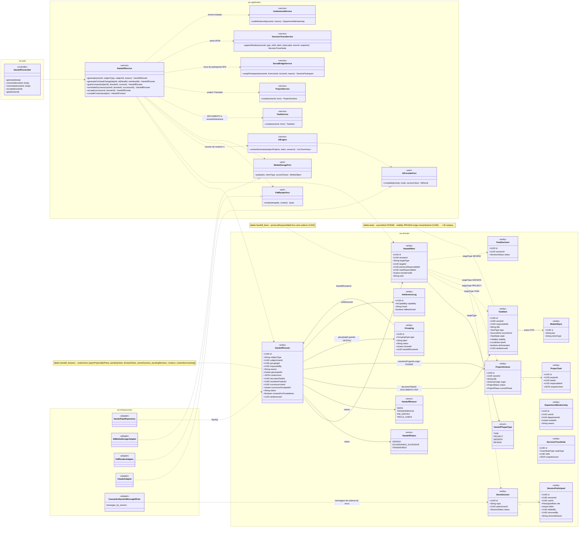
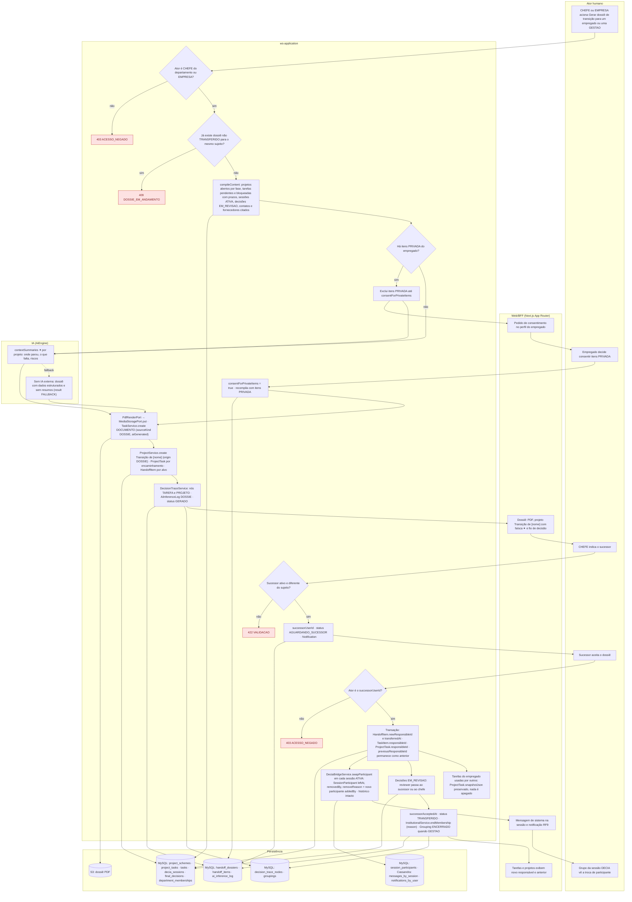
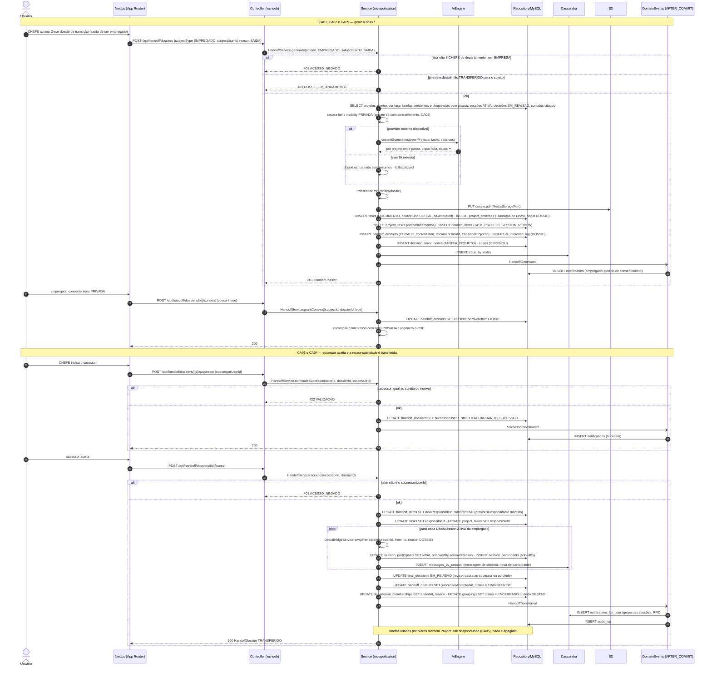
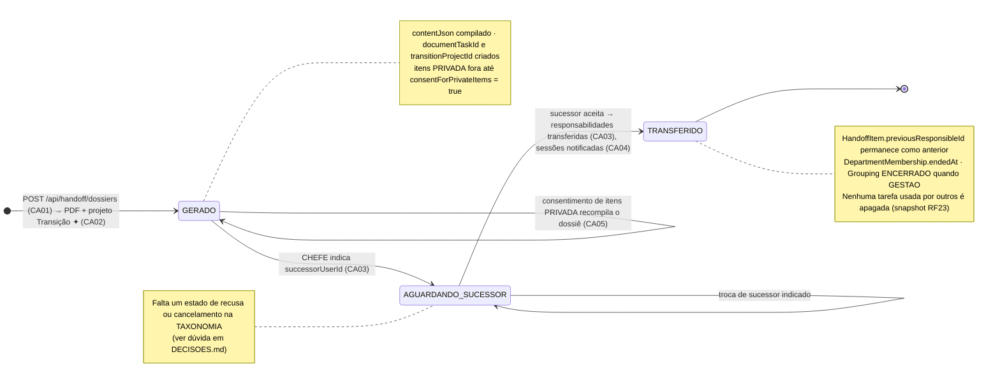
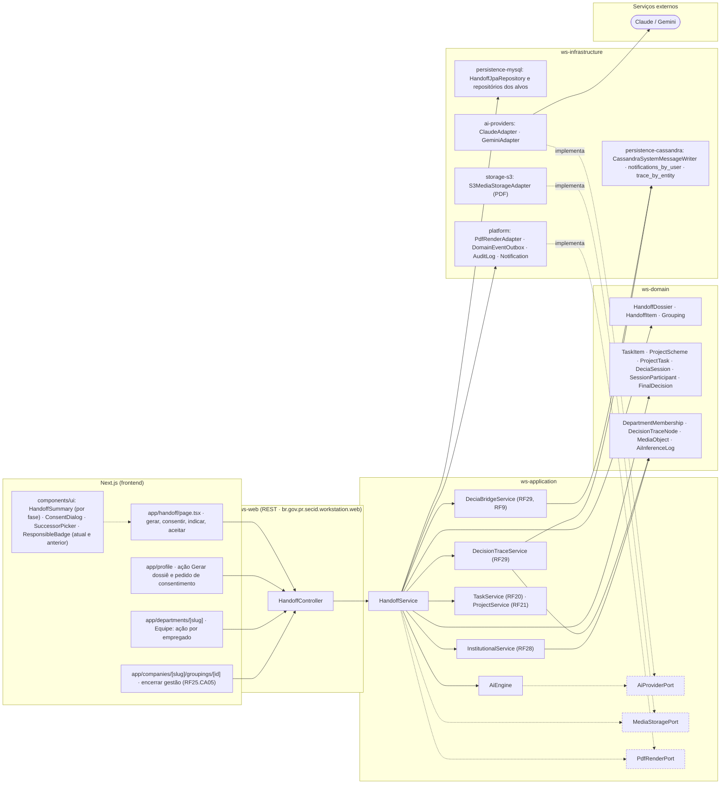

# RF36 — Gerar o Dossiê de Transição (handoff) quando um empregado muda de departamento, sai ou uma gestão encerra, transferindo projetos, tarefas e pendências com contexto

**HU:** HU36 · **Sprint (board Work Station):** Product Backlog (pós-Sprint 4, a priorizar) · **Equivalente FAI:** sem equivalente direto (ideia nova; usa Agrupamentos/Eras RF34 e o histórico RF17) · **Aba/rota:** ação no perfil/departamento (`/handoff`); gestão em `/companies/[slug]/groupings/[id]` (RF25.CA05, rota a confirmar)

**Critérios de aceite cobertos:** RF36.CA01 · RF36.CA02 · RF36.CA03 · RF36.CA04 · RF36.CA05

> Contextos da TAXONOMIA: **11. Transição & Memória** (`HandoffDossier`, `HandoffItem`), **4. Planejamento** (`Grouping.handoffDossierId`, status ENCERRADO), **2/3** (`TaskItem` DOCUMENTO PDF com `sourceKind DOSSIE`, `ProjectScheme` "Transição de [nome]" com `origin DOSSIE`, `ProjectTask.responsibleId/snapshotJson`), **5. DECIA** (`DeciaSession` ATIVA, `SessionParticipant` com `addedBy/removedBy`, `FinalDecision EM_REVISAO`, `DecisionTraceNode`), **1** (`DepartmentMembership.endedAt`), **10/12** (`AiInferenceLog` capability `DOSSIE`, `MediaObject`, `Notification`). Itens `PRIVADA` do empregado só entram com `consentForPrivateItems`; a saída nunca apaga tarefas usadas por outros (snapshot RF23).

## 1. Diagrama de classes

## 2. Diagrama de atividades

## 3. Diagrama de sequência

## 4. Máquina de estados

Entidade central: `HandoffDossier.status` (GERADO · AGUARDANDO_SUCESSOR · TRANSFERIDO). O consentimento é um flag (`consentForPrivateItems`), não um estado.

## 5. Diagrama de componentes

## 6. Rastreabilidade

| CA | Elemento do diagrama (classe / passo / mensagem / transição / componente) |
|---|---|
| RF36.CA01 | Classes `HandoffDossier` (subjectType EMPREGADO/GESTAO, reason, contentJson {openProjectsByPhase, pendingTasks, blockedTasks, activeSessions, pendingReviews, contacts, contextSummaries[]}), `Grouping.handoffDossierId`, `HandoffService.generate/compileContent`, `AiEngine.contextSummaries`; atividades `U1 → S1 → S2 → S3 → A1/A2` (403 ACESSO_NEGADO, 409 DOSSIE_EM_ANDAMENTO); sequência bloco «CA01, CA02 e CA05»; transição `[*] → GERADO`; componentes `app/handoff`, `HandoffSummary`, `app/companies/[slug]/groupings/[id]` |
| RF36.CA02 | Classes `HandoffDossier.documentTaskId/transitionProjectId/aiInferenceId`, `TaskItem` (DOCUMENTO, sourceKind DOSSIE, aiGenerated), `ProjectScheme origin DOSSIE`, `ProjectTask` (encaminhamentos), `PdfRenderPort`, `MediaStoragePort`, `DecisionTraceService`; atividades `S6 → S7 → S8 → W1`; sequência bloco «CA01, CA02 e CA05» (PUT dossie.pdf, INSERT tasks/project_schemes/decision_trace_nodes); nota do estado `GERADO`; componentes `storage-s3`, `PdfRenderAdapter`, `DecisionTraceService (RF29)` |
| RF36.CA03 | Classes `HandoffDossier.successorUserId/successorAcceptedAt`, `HandoffItem.previousResponsibleId/newResponsibleId/transferredAt`, `HandoffService.nominateSuccessor/accept`, `TaskItem.responsibleId`, `ProjectTask.responsibleId`; atividades `U3 → S10 → S11 → U4 → S12 → S13 → S16 → W3` (422, 403); sequência bloco «CA03 e CA04»; transições `GERADO → AGUARDANDO_SUCESSOR → TRANSFERIDO` e nota; componentes `SuccessorPicker`, `ResponsibleBadge` |
| RF36.CA04 | Classes `SessionParticipant` (leftAt, removedBy, removeReason, addedBy), `DeciaBridgeService.swapParticipant`, `HandoffItem targetType SESSION`, `CassandraSystemMessageWriter`; atividades `S13 → S14 → W4 → U5`; sequência bloco «CA03 e CA04» (loop por sessão ATIVA, mensagem de sistema, notifications_by_user RF9); transição `AGUARDANDO_SUCESSOR → TRANSFERIDO`; componentes `persistence-cassandra`, `DeciaBridgeService (RF29, RF9)` |
| RF36.CA05 | Classes `HandoffDossier.consentForPrivateItems`, `TaskItem.visibility`, `ProjectTask.snapshotJson`, `HandoffService.grantConsent`; atividades `S4 → S5 → W2 → U2 → S9`, `S13 → S17`; sequência bloco «CA01, CA02 e CA05» (separa PRIVADA, `POST .../consent`) e nota final do bloco «CA03 e CA04» (snapshot preservado); transição `GERADO → GERADO` e notas de `GERADO`/`TRANSFERIDO`; componente `ConsentDialog` |

> Dúvidas para `docs/DECISOES.md`: `HandoffStatus`, `HandoffReason` e `HandoffTargetType` não são enums nomeados na TAXONOMIA (valores inline); falta estado de recusa/cancelamento do dossiê (sucessor recusa, chefe cancela) — propor `RECUSADO`/`CANCELADO`; `PdfRenderPort`, `409 DOSSIE_EM_ANDAMENTO` e as rotas são propostas; quem herda decisões EM_REVISAO quando o sujeito era o revisor (sucessor vs. chefe); se o dossiê de GESTAO (RF25.CA05) exige sucessor ou encerra direto em TRANSFERIDO.
