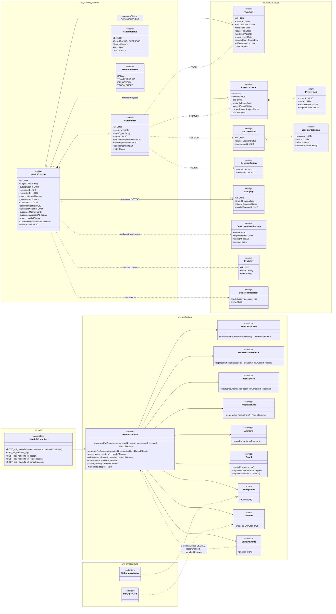
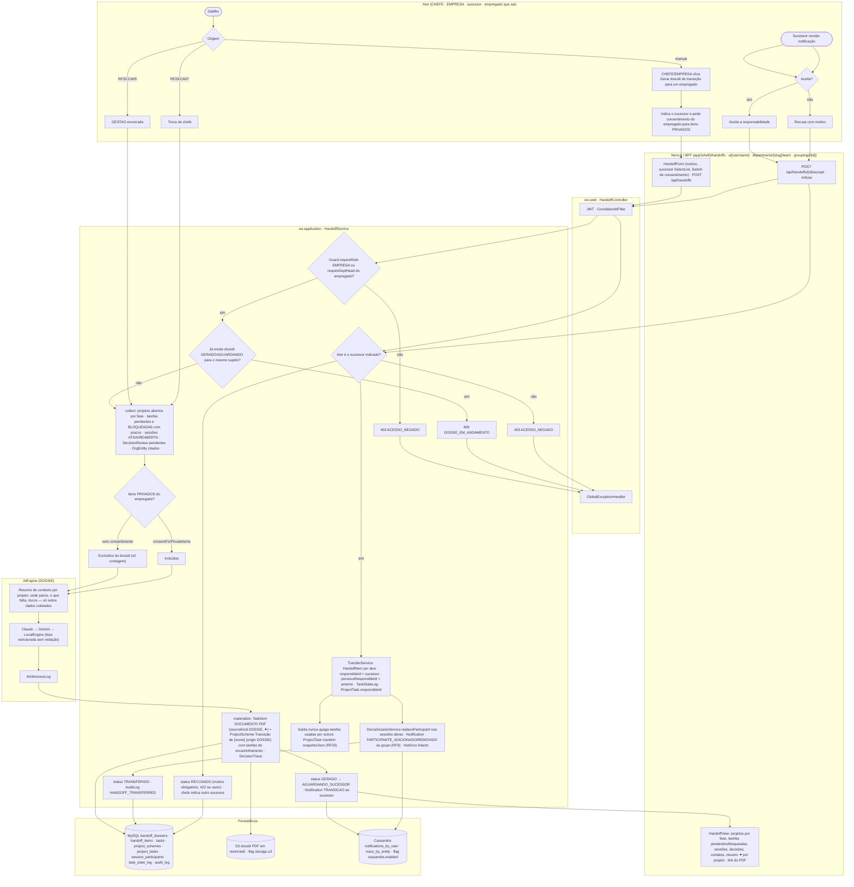
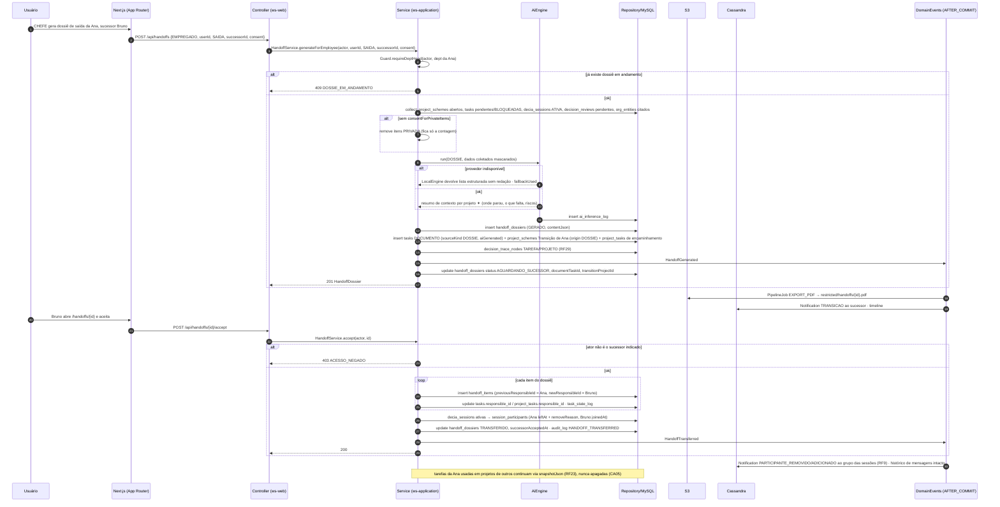
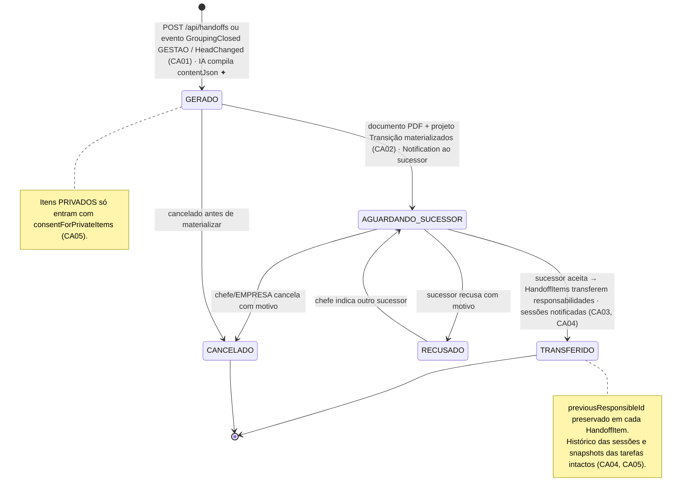
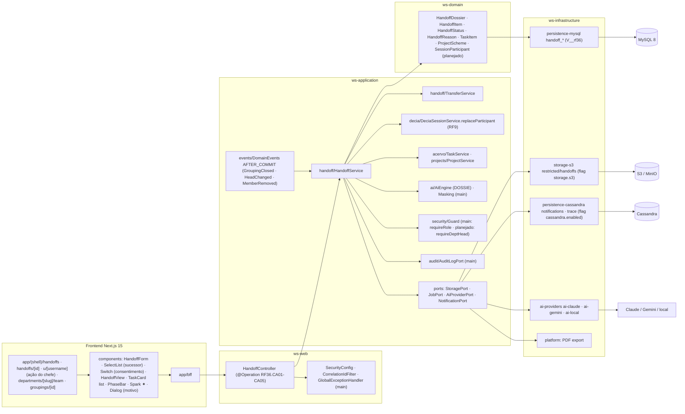

# RF36 — Gerar o Dossiê de Transição (handoff) quando um empregado muda de departamento, sai ou uma gestão encerra, transferindo projetos, tarefas e pendências com contexto
**HU:** HU36 · **Sprint (board Work Station):** Product Backlog (não comprometido na Sprint 4) · **Equivalente FAI:** — (ideia nova; usa Agrupamentos/Eras RF34 e o histórico RF17 do FAI) · **Aba/rota:** ação **Gerar dossiê de transição** no perfil do empregado visto pelo chefe (`/u/[username]`), na página do departamento (`/departments/[slug]/team`) e na GESTAO (`/groupings/[id]`); lista e detalhe em `/handoffs`, `/handoffs/[id]`; aceite do sucessor por notificação
**Critérios de aceite cobertos:** RF36.CA01 · CA02 · CA03 · CA04 · CA05 (corpo do card, inalterado) — regra: o **título do card** define o RF e o corpo traz os próprios CAs. Gatilhos externos: RF25.CA05 (encerrar GESTAO), RF28.CA07 (troca de chefe), RF9 (chefe remove empregado).

`HandoffDossier` (`subjectType` EMPREGADO · GESTAO; `reason` `HandoffReason` SAIDA · TRANSFERENCIA · FIM_GESTAO · TROCA_CHEFE; `status` `HandoffStatus` GERADO · AGUARDANDO_SUCESSOR · TRANSFERIDO · RECUSADO · CANCELADO) compila em `contentJson` projetos abertos por fase, tarefas pendentes/bloqueadas com prazos, sessões DECIA em andamento, decisões pendentes de revisão, contatos/fornecedores (`OrgEntity`) citados e um **resumo de contexto** por projeto redigido pela IA (`DOSSIE`) **sobre dados do sistema**. Materializa-se em `TaskItem` DOCUMENTO (PDF, `sourceKind DOSSIE`, faísca ✦) e `ProjectScheme` "Transição de [nome]" (`origin DOSSIE`) com as tarefas de encaminhamento, ligados ao rastro (nó TAREFA/PROJETO). O sucessor aceita → `HandoffItem`s transferem `responsibleId` (antigo fica `previousResponsibleId`), sessões ativas notificam a troca de participante (RF9), histórico intacto. Itens PRIVADOS só com `consentForPrivateItems`; saída nunca apaga tarefas usadas por outros (snapshot RF23).

## 1. Diagrama de classes

## 2. Diagrama de atividades

## 3. Diagrama de sequência

## 4. Máquina de estados

Entidade central: `HandoffDossier.status` (`HandoffStatus`).

## 5. Diagrama de componentes

## 6. Rastreabilidade

| CA | Classe | Passo | Mensagem | Transição | Componente |
|---|---|---|---|---|---|
| RF36.CA01 | `HandoffService.generateForEmployee/generateForGrouping/collect`, `HandoffDossier.contentJson` (openProjectsByPhase, pendingTasks, blockedTasks, activeSessions, pendingReviews, contacts, contextSummaries), `HandoffReason`, `AiCapability DOSSIE` | A1 → A2/A3/A4 → F1 → P1 (403) → P2 (409) → P3 → I1 → I2 | 1–14 | `[*] → GERADO` | `HS`, `AIE`, `HandoffForm` |
| RF36.CA02 | `HandoffService.materialize`, `TaskItem` DOCUMENTO `sourceKind DOSSIE` + `aiGenerated`, `ProjectScheme origin DOSSIE`, `DecisionTraceNode`, `PipelineJob EXPORT_PDF` | P7 → P8 | 15–21 | `GERADO → AGUARDANDO_SUCESSOR` | `TS`, `S3A`, `PLAT`, `Spark ✦` |
| RF36.CA03 | `HandoffDossier.successorUserId/successorAcceptedAt`, `HandoffService.accept/refuse`, `TransferService`, `HandoffItem.previousResponsibleId/newResponsibleId`, `TaskStateLog` | A6 → A7 → A8 → F3 → P9 (403) → P10 → P12 · A9 → P13 | 22–33 | `AGUARDANDO_SUCESSOR → TRANSFERIDO / RECUSADO` | `TRS`, `AUD`, `HandoffView` |
| RF36.CA04 | `DeciaSessionService.replaceParticipant`, `SessionParticipant.leftAt/removeReason`, `Notification PARTICIPANTE_*` (RF9), histórico intacto | P11 | 30, 34 | nota de TRANSFERIDO | `DSS`, `CASA` |
| RF36.CA05 | `HandoffDossier.consentForPrivateItems`, `Visibility PRIVADA`, `ProjectTask.snapshotJson` (RF23), nunca DELETE de tarefas usadas por outros | A5 → P4 → P5/P6 · P14 | 8–9, 35 | nota de GERADO + nota de TRANSFERIDO | `Switch (consentimento)`, `HS` |
