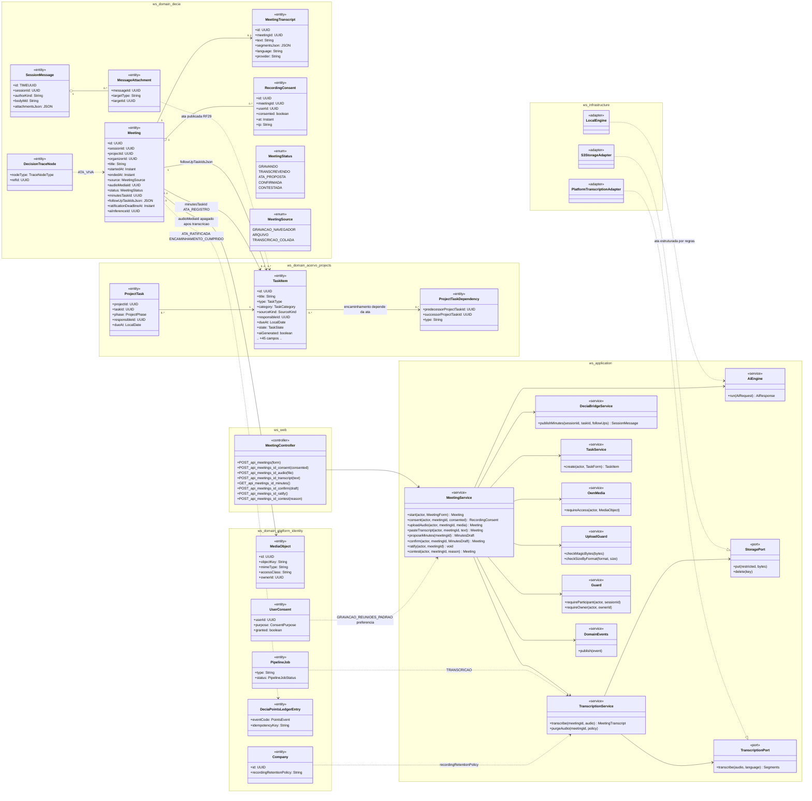
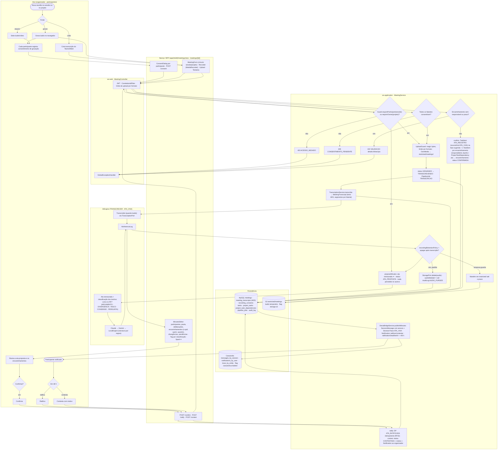
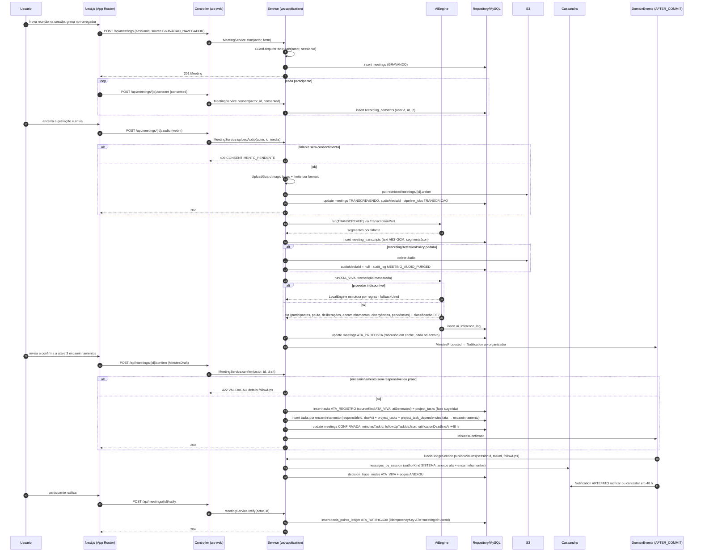
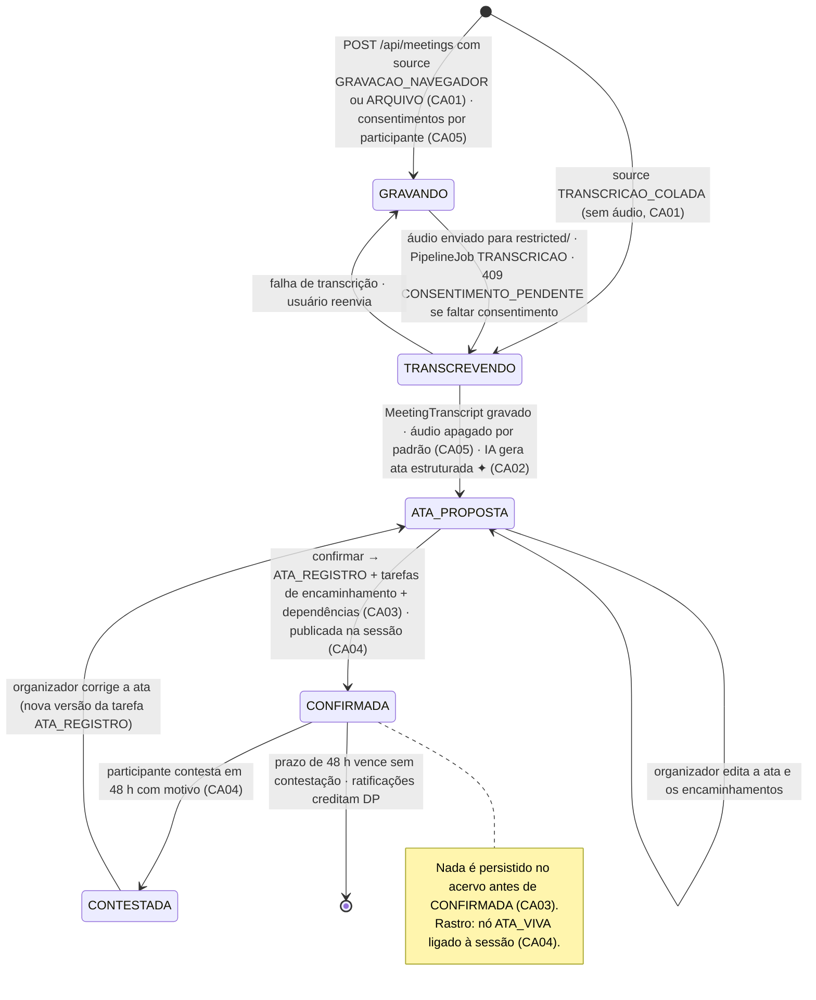
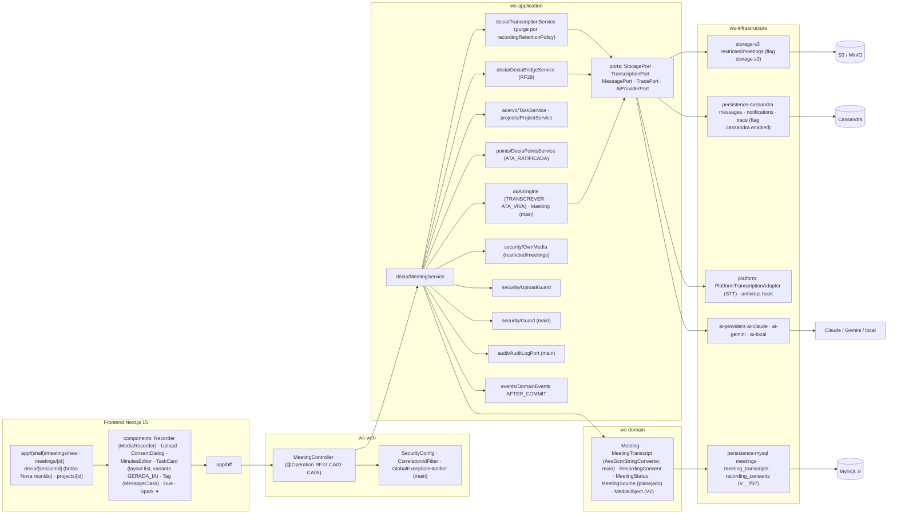

# RF37 — Registrar reuniões com a Ata Viva (transcrição ou gravação → ata como tarefa + tarefas de encaminhamento com responsável e prazo dentro do projeto)
**HU:** HU37 · **Sprint (board Work Station):** Product Backlog (não comprometido na Sprint 4) · **Equivalente FAI:** RF13 artefatos automáticos (ata) + RF36 foto com manequim (captura do mundo real para dentro do sistema) · **Aba/rota:** ação **Nova reunião** na sessão DECIA (`/decia/[sessionId]`) ou no projeto (`/projects/[id]`), fluxo em `/meetings/new`, `/meetings/[id]` (gravação, upload, transcrição colada, ata proposta, ratificação)
**Critérios de aceite cobertos:** RF37.CA01 · CA02 · CA03 · CA04 · CA05 (corpo do card, inalterado) — regra: o **título do card** define o RF e o corpo traz os próprios CAs.

`Meeting` (`sessionId` ou `projectId`, `source` GRAVACAO_NAVEGADOR · ARQUIVO · TRANSCRICAO_COLADA, `status` `MeetingStatus` GRAVANDO · TRANSCREVENDO · ATA_PROPOSTA · CONFIRMADA · CONTESTADA, `audioMediaId`, `minutesTaskId`, `followUpTaskIdsJson`, `ratificationDeadlineAt` 48 h) com `MeetingTranscript` (texto AES-GCM, `segmentsJson` por falante classificado como no RF7) e `RecordingConsent` por participante (LGPD). Áudio vai para `restricted/` (`OwnMedia`), passa por magic bytes e limite por formato, e é **apagado após a transcrição** por padrão (`Company.recordingRetentionPolicy`). A IA (`TRANSCREVER`, `ATA_VIVA`) gera a **ata estruturada** (participantes, pauta, deliberações, encaminhamentos o quê/quem/quando, divergências, pendências); o usuário **confirma antes de persistir**: ata → `TaskItem` ATA_REGISTRO (`sourceKind ATA_VIVA`) no projeto; cada encaminhamento → `TaskItem` com `responsibleId` e `dueAt` + `ProjectTaskDependency` para a ata. A ata é publicada na sessão como mensagem com anexos (RF29) e entra no rastro (nó ATA_VIVA); participantes ratificam ou contestam em 48 h (`Notification`), e ratificação credita DP (`ATA_RATIFICADA`, RF42).

## 1. Diagrama de classes

## 2. Diagrama de atividades

## 3. Diagrama de sequência

## 4. Máquina de estados

Entidade central: `Meeting.status` (`MeetingStatus`).

## 5. Diagrama de componentes

## 6. Rastreabilidade

| CA | Classe | Passo | Mensagem | Transição | Componente |
|---|---|---|---|---|---|
| RF37.CA01 | `Meeting` (sessionId/projectId, `MeetingSource`), `MeetingService.start/uploadAudio/pasteTranscript`, `UploadGuard`, `OwnMedia` | A0 → A1 → A2/A3/A4 → F1 → P1 (403) → P3 → P4 | 1–6, 11–18 | `[*] → GRAVANDO / TRANSCREVENDO` | `Recorder`, `Upload`, `MS`, `S3A` |
| RF37.CA02 | `TranscriptionService.transcribe`, `MeetingTranscript.segmentsJson` (classLabel RF7), `AiCapability TRANSCREVER/ATA_VIVA`, `MeetingService.proposeMinutes` | P5 → I1 · P9 → I2 → I3 → I4 → F3 | 19–21, 26–31 | `TRANSCREVENDO → ATA_PROPOSTA` | `TRS`, `PLAT`, `AIE`, `MinutesEditor` |
| RF37.CA03 | `MeetingService.confirm`, `TaskItem ATA_REGISTRO sourceKind ATA_VIVA`, tarefas de encaminhamento (`responsibleId`, `dueAt`), `ProjectTaskDependency`, `minutesTaskId/followUpTaskIdsJson` | A6 → A7 → A8 → F4 → P10 (422) → P11 | 32–40 | `ATA_PROPOSTA → CONFIRMADA` + nota | `TS`, `TaskCard`, `Due` |
| RF37.CA04 | `DeciaBridgeService.publishMinutes`, `SessionMessage` + `MessageAttachment`, nó `ATA_VIVA`, `Notification`, `ratificationDeadlineAt`, `MeetingService.ratify/contest`, DP `ATA_RATIFICADA` | P12 → A9 → A10 → A11/A12 → P13 | 41–49 | `CONFIRMADA → CONTESTADA → ATA_PROPOSTA` · `CONFIRMADA → [*]` | `BS`, `CASA`, `DPS` |
| RF37.CA05 | `RecordingConsent`, `MeetingService.consent` (409 CONSENTIMENTO_PENDENTE), `TranscriptionService.purgeAudio`, `Company.recordingRetentionPolicy`, `AuditLog MEETING_AUDIO_PURGED`, `UserConsent GRAVACAO_REUNIOES_PADRAO` | A5 → F2 → P2 (409) · P6 → P7/P8 | 7–10, 13–14, 22–25 | nota de GRAVANDO | `ConsentDialog`, `OM`, `AUD`, `S3A` |
