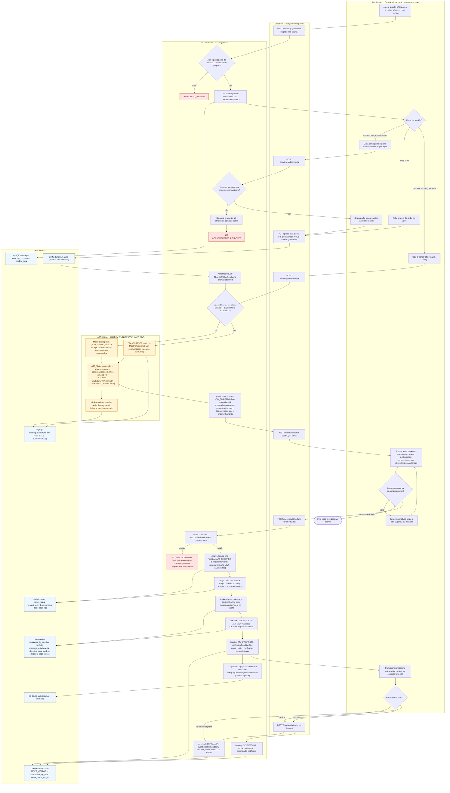
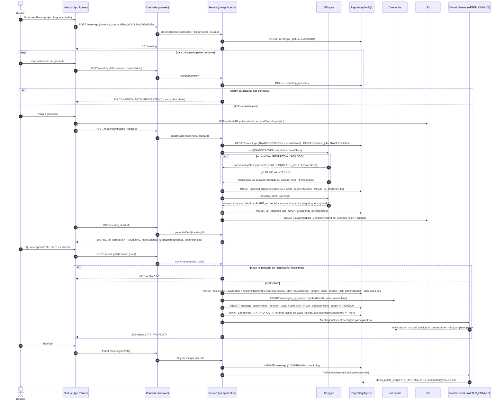
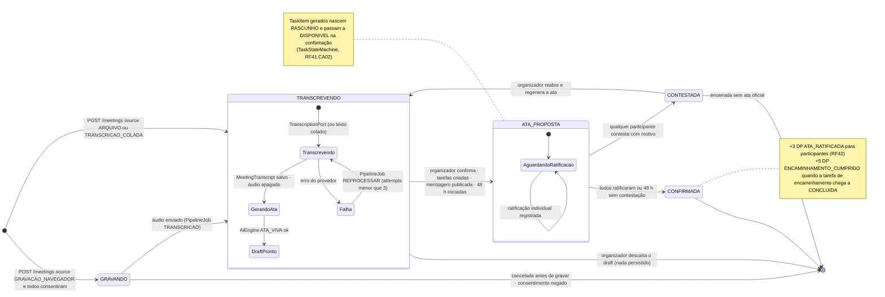
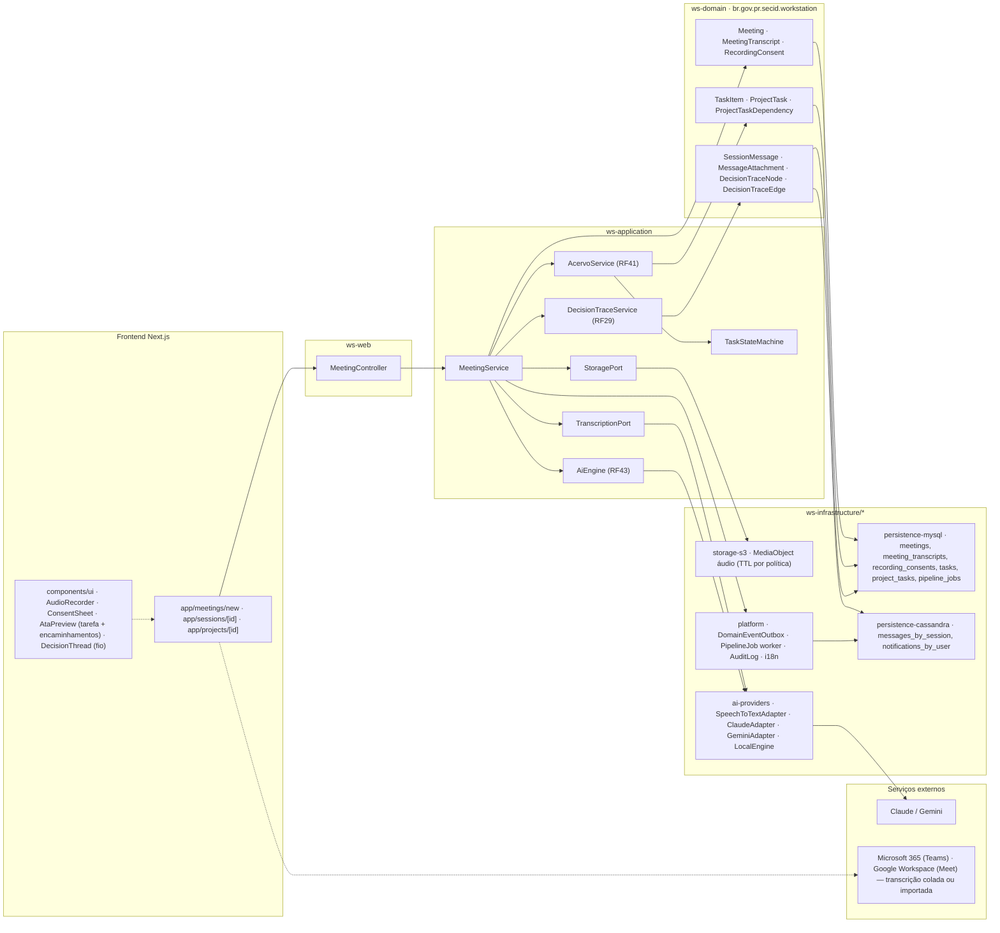

# RF37 — Registrar reuniões com a Ata Viva (transcrição ou gravação → ata como tarefa + tarefas de encaminhamento com responsável e prazo dentro do projeto)
**HU:** HU37 · **Sprint (board Work Station):** Product Backlog (não priorizado — pós-Sprint 4) · **Equivalente FAI:** RF13 artefatos automáticos (ata) + RF36 foto com manequim (captura do mundo real para dentro do sistema) · **Aba/rota:** ação "Nova reunião" na sessão DECIA ou no projeto (`/meetings/new`)
**Critérios de aceite cobertos:** RF37.CA01 · RF37.CA02 · RF37.CA03 · RF37.CA04 · RF37.CA05

> Contexto DECIA (bounded context 5). Entidade central: `Meeting` (status GRAVANDO → TRANSCREVENDO → ATA_PROPOSTA → CONFIRMADA | CONTESTADA). A ata vira `TaskItem` do tipo `ATA_REGISTRO` com `sourceKind = ATA_VIVA`; cada encaminhamento vira `TaskItem` ligado por `ProjectTaskDependency` à ata. A publicação na sessão reaproveita `SessionMessage` + `MessageAttachment` (RF29) e cria o nó `ATA_VIVA` no `DecisionTrace`. Pontos: `ATA_RATIFICADA` (+3) e `ENCAMINHAMENTO_CUMPRIDO` (+5) via RF42.

## 1. Diagrama de classes

```mermaid
classDiagram
  direction LR

  class Meeting {
    <<entity>>
    +UUID id
    +UUID sessionId
    +UUID projectId
    +UUID organizerId
    +String title
    +Instant startedAt
    +Instant endedAt
    +MeetingSource source
    +UUID audioMediaId
    +MeetingStatus status
    +UUID minutesTaskId
    +List~UUID~ followUpTaskIdsJson
    +Instant ratificationDeadlineAt
    +UUID aiInferenceId
  }
  class MeetingTranscript {
    <<entity>>
    +UUID id
    +UUID meetingId
    +String text
    +List~Segment~ segmentsJson
    +String language
    +String provider
  }
  class RecordingConsent {
    <<entity>>
    +UUID id
    +UUID meetingId
    +UUID userId
    +boolean consented
    +Instant at
    +String ip
  }
  class TaskItem {
    <<entity>>
    +UUID id
    +UUID ownerId
    +String title
    +TaskType type
    +TaskCategory category
    +SourceKind sourceKind
    +String sourceRef
    +UUID responsibleId
    +LocalDate dueAt
    +TaskState state
    +AccessClassification accessClass
    +boolean aiGenerated
    +UUID aiInferenceId
  }
  class ProjectTask {
    <<entity>>
    +UUID id
    +UUID projectId
    +UUID taskId
    +ProjectPhase phase
    +int sortOrder
    +UUID responsibleId
    +LocalDate dueAt
    +UUID decisionTraceNodeId
  }
  class ProjectTaskDependency {
    <<entity>>
    +UUID id
    +UUID projectId
    +UUID predecessorProjectTaskId
    +UUID successorProjectTaskId
    +String type
    +int lagDays
  }
  class SessionMessage {
    <<entity>>
    +TimeUUID id
    +UUID sessionId
    +UUID authorId
    +String authorKind
    +String bodyMd
    +Instant sentAt
    +List~UUID~ attachmentsJson
    +UUID classificationId
    +String correlationId
  }
  class MessageAttachment {
    <<entity>>
    +UUID id
    +UUID messageId
    +String targetType
    +UUID targetId
    +String snapshotJson
    +boolean usedInDecision
  }
  class MessageClassification {
    <<entity>>
    +UUID id
    +UUID messageId
    +MessageClass label
    +BigDecimal confidence
    +boolean hasEvidence
    +UUID linkedTaskId
    +UUID aiInferenceId
  }
  class DecisionTraceNode {
    <<entity>>
    +UUID id
    +UUID sessionId
    +TraceNodeType nodeType
    +UUID refId
    +String label
    +String classLabel
    +UUID actorId
    +Instant at
  }
  class DecisionTraceEdge {
    <<entity>>
    +UUID id
    +UUID fromNodeId
    +UUID toNodeId
    +String relation
    +Instant at
  }
  class Notification {
    <<entity>>
    +UUID id
    +UUID recipientId
    +NotificationType type
    +String category
    +String resourceType
    +UUID resourceId
    +String groupKey
    +boolean read
  }
  class PipelineJob {
    <<entity>>
    +UUID id
    +String type
    +String targetType
    +UUID targetId
    +String status
    +int attempts
    +String lastError
  }
  class MediaObject {
    <<entity>>
    +UUID id
    +String bucket
    +String key
    +String mimeType
    +long sizeBytes
    +String sha256
    +AccessClassification accessClass
  }
  class AiInferenceLog {
    <<entity>>
    +UUID id
    +AiCapability capability
    +String provider
    +String model
    +String result
    +boolean fallbackUsed
    +String maskedFields
    +String correlationId
  }
  class Company {
    <<entity>>
    +UUID id
    +String legalName
    +String recordingRetentionPolicy
  }
  class DeciaPointsLedgerEntry {
    <<entity>>
    +UUID id
    +UUID userId
    +int delta
    +PointsEvent eventCode
    +String idempotencyKey
    +String status
  }

  class MeetingStatus {
    <<enum>>
    GRAVANDO
    TRANSCREVENDO
    ATA_PROPOSTA
    CONFIRMADA
    CONTESTADA
  }
  class MeetingSource {
    <<enum>>
    GRAVACAO_NAVEGADOR
    ARQUIVO
    TRANSCRICAO_COLADA
  }
  class TaskType {
    <<enum>>
    ATA_REGISTRO
    TEXTO_IA
    DOCUMENTO
    ...13 valores
  }
  class SourceKind {
    <<enum>>
    ATA_VIVA
    DECIA
    AUTOPILOT
    ...11 valores
  }
  class MessageClass {
    <<enum>>
    ARGUMENTO
    DIVERGENCIA
    RISCO
    CONSENSO
    PERGUNTA
    RUIDO
  }
  class TraceNodeType {
    <<enum>>
    ATA_VIVA
    MENSAGEM
    TAREFA
    DECISAO
    ...9 valores
  }
  class AiCapability {
    <<enum>>
    TRANSCREVER
    ATA_VIVA
    CLASSIFICAR_MENSAGEM
    ...24 valores
  }
  class PointsEvent {
    <<enum>>
    ATA_RATIFICADA
    ENCAMINHAMENTO_CUMPRIDO
    ...17 valores
  }

  class MeetingController {
    <<controller>>
    +POST meetings
    +POST meetings_id_consents
    +POST meetings_id_audio
    +POST meetings_id_transcript
    +GET meetings_id_draft
    +POST meetings_id_confirm
    +POST meetings_id_ratify
    +POST meetings_id_contest
  }
  class MeetingService {
    <<service>>
    +start(actor, sessionId, projectId, source) Meeting
    +registerConsent(meetingId, userId, consented, ip) RecordingConsent
    +attachAudio(meetingId, mediaId) PipelineJob
    +pasteTranscript(meetingId, text) MeetingTranscript
    +generateDraft(meetingId) AtaDraft
    +confirm(meetingId, draft) Meeting
    +publishInSession(meetingId) SessionMessage
    +ratify(meetingId, userId) Meeting
    +contest(meetingId, userId, reason) Meeting
    +purgeAudio(meetingId) void
  }
  class TranscriptionPort {
    <<port>>
    +transcribe(mediaId, language) MeetingTranscript
  }
  class SpeechToTextAdapter {
    <<adapter>>
    +transcribe(mediaId, language) MeetingTranscript
  }
  class AiEngine {
    <<service>>
    +run(capability, input, accessClass) AiResult
  }
  class AcervoService {
    <<service>>
    +createFromDraft(owner, draftTask) TaskItem
  }
  class TaskStateMachine {
    <<service>>
    +transition(taskId, toState, actor, reason) TaskStateLog
  }
  class DecisionTraceService {
    <<service>>
    +appendNode(sessionId, nodeType, refId) DecisionTraceNode
    +link(fromNodeId, toNodeId, relation) DecisionTraceEdge
  }

  Meeting "1" --> "0..1" MeetingTranscript : transcript
  Meeting "1" --> "*" RecordingConsent : consents
  Meeting "1" --> "0..1" TaskItem : minutesTaskId
  Meeting "1" --> "*" TaskItem : followUpTaskIdsJson
  Meeting "1" --> "0..1" MediaObject : audioMediaId
  Meeting --> MeetingStatus : status
  Meeting --> MeetingSource : source
  Meeting ..> AiInferenceLog : aiInferenceId
  Meeting ..> Company : recordingRetentionPolicy
  TaskItem --> TaskType : type
  TaskItem --> SourceKind : sourceKind
  TaskItem "1" --> "*" ProjectTask : taskId
  ProjectTask "1" --> "*" ProjectTaskDependency : predecessor
  ProjectTask "1" --> "*" ProjectTaskDependency : successor
  ProjectTask ..> DecisionTraceNode : decisionTraceNodeId
  SessionMessage "1" --> "*" MessageAttachment : attachmentsJson
  SessionMessage "1" --> "0..1" MessageClassification : classificationId
  MessageClassification --> MessageClass : label
  DecisionTraceNode --> TraceNodeType : nodeType
  DecisionTraceNode "1" --> "*" DecisionTraceEdge : fromNodeId
  PipelineJob ..> Meeting : TRANSCRICAO
  AiInferenceLog --> AiCapability : capability
  DeciaPointsLedgerEntry --> PointsEvent : eventCode
  Notification ..> Meeting : ratificar ou contestar 48 h

  MeetingController --> MeetingService
  MeetingService --> TranscriptionPort
  TranscriptionPort <|.. SpeechToTextAdapter : implementa
  MeetingService --> AiEngine : ATA_VIVA
  MeetingService --> AcervoService
  MeetingService --> TaskStateMachine
  MeetingService --> DecisionTraceService
  MeetingService ..> Meeting
  MeetingService ..> RecordingConsent
  MeetingService ..> SessionMessage
  MeetingService ..> Notification
  MeetingService ..> DeciaPointsLedgerEntry : via RF42

  note for Meeting "tabela meetings · audioMediaId apagado após transcrição (política da empresa)"
  note for MeetingTranscript "tabela meeting_transcripts · text com AesGcmStringConverter · segmentsJson speaker, start, end, classLabel"
  note for RecordingConsent "tabela recording_consents · RF37.CA05 · 1 linha por participante"
  note for TaskItem "tabela tasks · +45 campos · ATA_REGISTRO e encaminhamentos com sourceKind ATA_VIVA"
  note for SessionMessage "Cassandra messages_by_session + índice MySQL session_messages_idx"
  note for MeetingStatus "nome do enum a confirmar · TAXONOMIA só lista os valores em Meeting.status"
```

## 2. Diagrama de atividades

## 3. Diagrama de sequência

## 4. Máquina de estados

Entidade central: `Meeting.status`. A caixa pontilhada mostra o efeito colateral sobre `TaskItem.state` das tarefas geradas (RF41).

## 5. Diagrama de componentes

## 6. Rastreabilidade

| CA | Elemento do diagrama (classe / passo / mensagem / transição / componente) |
|---|---|
| RF37.CA01 | Classes `Meeting.sessionId`, `Meeting.projectId`, `MeetingSource` (GRAVACAO_NAVEGADOR, ARQUIVO, TRANSCRICAO_COLADA); atividades U1→U2→U3/U4/U5, W1, W3, W4, A1 (403 ACESSO_NEGADO); sequência msgs 1–5 e 11–13; transições `[*] → GRAVANDO` e `[*] → TRANSCREVENDO`; componentes `app/meetings/new`, `AudioRecorder`, `storage-s3`, `Microsoft 365 / Google Workspace`. |
| RF37.CA02 | Classes `MeetingTranscript.segmentsJson`, `TranscriptionPort`, `SpeechToTextAdapter`, `AiEngine`, `AiCapability` (TRANSCREVER, ATA_VIVA), `MessageClass`; atividades A5, I1, I2, I4, A7; sequência msgs 14–22; estado composto `TRANSCREVENDO` (Transcrevendo → GerandoAta → DraftPronto, Falha → REPROCESSAR); componentes `ai-providers`, `PipelineJob worker`. |
| RF37.CA03 | Classes `TaskItem` (type ATA_REGISTRO, sourceKind ATA_VIVA, responsibleId, dueAt), `ProjectTask.phase`, `ProjectTaskDependency`, `AcervoService.createFromDraft`, `TaskStateMachine`; atividades U7→U8→U9, W5, W6, A7, A8 (422 VALIDACAO), A9, A10; sequência msgs 24–31; transição `TRANSCREVENDO → ATA_PROPOSTA` (organizador confirma) e nota sobre RASCUNHO → DISPONIVEL; componentes `AtaPreview`, `AcervoService`, `TaskStateMachine`. |
| RF37.CA04 | Classes `SessionMessage`, `MessageAttachment`, `DecisionTraceNode` (TraceNodeType ATA_VIVA), `DecisionTraceEdge` (ORIGINOU), `Notification`, `Meeting.ratificationDeadlineAt`, `DeciaPointsLedgerEntry` (ATA_RATIFICADA); atividades A11, A12, A13, U10, U11, A15, A16; sequência msgs 32–43; estados `ATA_PROPOSTA` → `CONFIRMADA` / `CONTESTADA` e nota de pontos; componentes `DecisionTraceService`, `persistence-cassandra`, `DomainEventOutbox`, `DecisionThread`. |
| RF37.CA05 | Classes `RecordingConsent` (consented, at, ip), `Company.recordingRetentionPolicy`, `MediaObject.accessClass`, `MeetingTranscript.text` (AES-GCM), `AiInferenceLog.maskedFields`; atividades U6, W2, A3, A4 (409 CONSENTIMENTO_PENDENTE), A6, I3, A14, D7; sequência msgs 6–10, 17 (motor local) e 23 (DELETE áudio); transição `GRAVANDO → [*]` por consentimento negado e `Transcrevendo → GerandoAta` (áudio apagado); componentes `ConsentSheet`, `storage-s3` (TTL por política), `AuditLog`. |

Tela/aba: `/decia` (esqueleto em `app/(shell)/decia/page.tsx`) · `/decia/[sessionId]` (esqueleto em `app/(shell)/decia/[sessionId]/page.tsx`) · `/lab/decia` (esqueleto em `app/(shell)/lab/decia/page.tsx`)
