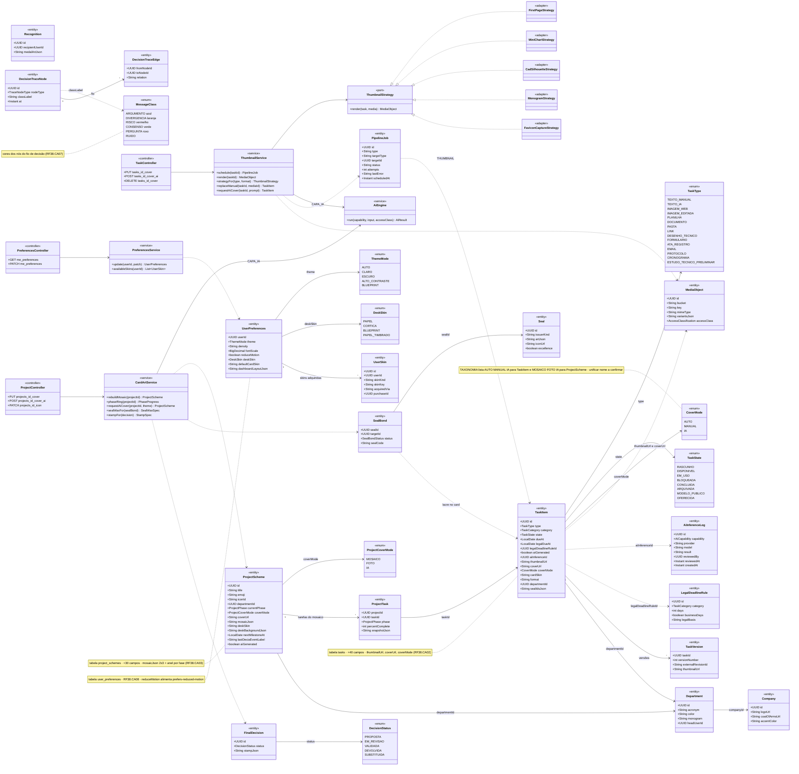
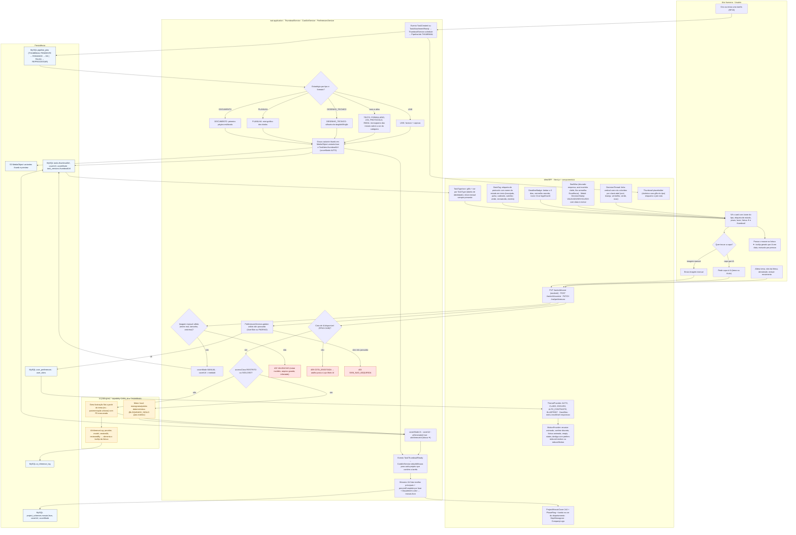
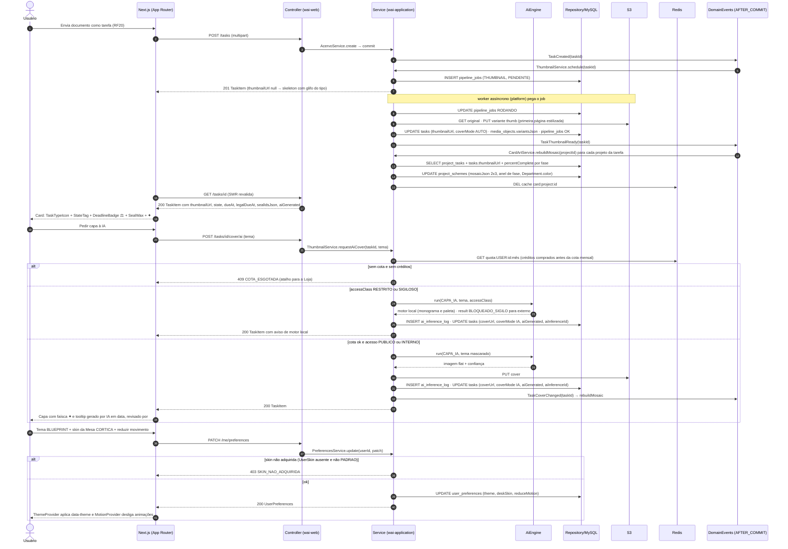
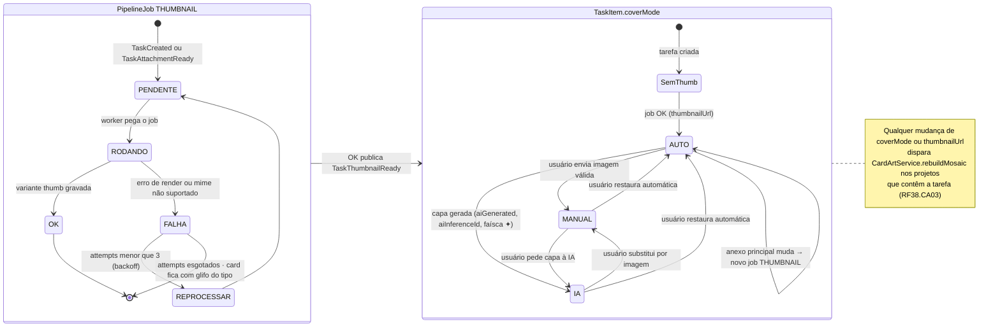
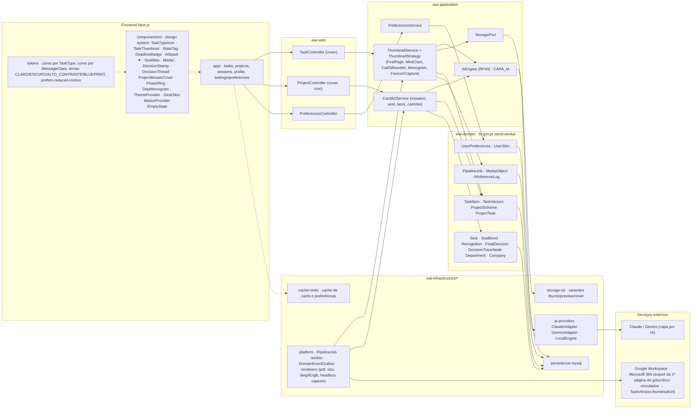

# RF38 — Aplicar a identidade visual do Work AI — ícones por tipo de tarefa, thumbnails automáticos, capa-mosaico de projeto, fio de decisão, lacres, etiquetas de estado, temas e skins da Mesa
**HU:** HU38 · **Sprint (board Work Station):** Product Backlog (não priorizado — pós-Sprint 4) · **Equivalente FAI:** anatomia dos cards (v17), anatomia do DNA, Background Studio (RF11), skins de card, temas (RF23 preferências) · **Aba/rota:** transversal (design system em `components/ui`); capa manual/IA em `/tasks/[id]` e `/projects/[id]`; temas e skins em `/settings/preferences`
**Critérios de aceite cobertos:** RF38.CA01 · RF38.CA02 · RF38.CA03 · RF38.CA04 · RF38.CA05 · RF38.CA06 · RF38.CA07 · RF38.CA08 · RF38.CA09 · RF38.CA10

> Conceito "a repartição do futuro": papelaria pública (carimbo, protocolo, pasta suspensa, clipe, lacre) em flat/duotone; tudo que a IA gerou carrega a **faísca âmbar ✦**. O RF é majoritariamente frontend (componentes do design system), com três pontos de backend: o **thumbnail assíncrono** (`PipelineJob THUMBNAIL` → `ThumbnailService`), a **capa-mosaico** recalculada por evento (`CardArtService`) e a **capa por IA** (`AiEngine CAPA_IA`). Preferências visuais vivem em `UserPreferences`; skins adquiridas em `UserSkin`.

## 1. Diagrama de classes

## 2. Diagrama de atividades

## 3. Diagrama de sequência

## 4. Máquina de estados

O RF não tem entidade com estado próprio. Usa-se o `PipelineJob.status` do job `THUMBNAIL` e o `TaskItem.coverMode` que ele afeta (o mesmo vale para `ProjectScheme.coverMode` MOSAICO → FOTO → IA).

## 5. Diagrama de componentes

## 6. Rastreabilidade

| CA | Elemento do diagrama (classe / passo / mensagem / transição / componente) |
|---|---|
| RF38.CA01 | Enum `TaskType` (15 valores) e `TaskItem.type`; atividade W1 (TaskTypeIcon com rótulo textual) e U2; sequência msg 18 (card com TaskTypeIcon); componentes `TaskTypeIcon`, `tokens · cores por TaskType`; o mesmo ícone é reutilizado em `DecisionThread` e anexos de mensagem (W5). |
| RF38.CA02 | Classes `ThumbnailService`, `ThumbnailStrategy` + 5 adapters, `PipelineJob` (THUMBNAIL), `MediaObject.variantsJson`, `TaskItem.thumbnailUrl/coverUrl/coverMode`, `CoverMode`; atividades A1→A2→A3..A7→A8, W10, U3→U4/U5, A11 (422 VALIDACAO), A13 (409 COTA_ESGOTADA), A14, A15; sequência msgs 1–10 e 19–34; máquina de estados `PipelineJob THUMBNAIL` e `TaskItem.coverMode`; componentes `ThumbnailService`, `PipelineJob worker`, `storage-s3`, `renderers`. |
| RF38.CA03 | Classes `ProjectScheme.mosaicJson/coverUrl/coverMode`, `ProjectCoverMode`, `ProjectTask.percentComplete/phase`, `Department.color`, `CardArtService.rebuildMosaic/phaseRing`; atividades A9, A10, W6; sequência msgs 11–15 (TaskThumbnailReady → rebuildMosaic → DEL cache) e 32; nota da máquina de estados (qualquer mudança dispara rebuild); componentes `CardArtService`, `ProjectMosaicCover`, `PhaseRing`. |
| RF38.CA04 | Classes `TaskItem.aiGenerated/aiInferenceId`, `ProjectScheme.aiGenerated`, `AiInferenceLog.createdAt/model/reviewedBy/reviewedAt`; atividades U7, I3, A15; sequência msgs 31 e 34 (tooltip gerado por IA em data, revisado por); transição `AUTO → IA` (faísca ✦); componentes `AiSpark ✦`. |
| RF38.CA05 | Enum `TaskState` (8 valores), `TaskItem.dueAt/legalDueAt/legalDeadlineRuleId`, `LegalDeadlineRule`; atividades W2 (nome do estado em texto, estilos tracejado/pulso/cadeado/carimbo/esmaecido/estrela) e W3 (âmbar 3 dias, vermelho vencido, ⚖); sequência msg 18; componentes `StateTag`, `DeadlineBadge`. |
| RF38.CA06 | Classes `Seal.artJson/issuerKind/excellence`, `SealBond.status/sealCode`, `Recognition.medalArtJson`, `FinalDecision.stampJson/status`, `DecisionStatus`, `CardArtService.sealWaxFor/stampFor`; atividade W4; sequência msg 18 (SealWax); componentes `SealWax`, `Medal`, `DecisionStamp`. |
| RF38.CA07 | Classes `DecisionTraceNode.classLabel`, `DecisionTraceEdge`, enum `MessageClass` com cores; atividade W5; componentes `DecisionThread`, `tokens · cores por MessageClass`. |
| RF38.CA08 | Classes `UserPreferences.theme/deskSkin/density/fontScale`, `ThemeMode` (inclui BLUEPRINT), `DeskSkin` (PAPEL, CORTICA, BLUEPRINT, PAPEL_TIMBRADO), `UserSkin`, `PreferencesService`, `PreferencesController`; atividades U6, W7 (menu recolhível responsivo), A16 (403 SKIN_NAO_ADQUIRIDA); sequência msgs 35–41; componentes `ThemeProvider`, `DeskSkin`, `settings/preferences`, `cache-redis`. |
| RF38.CA09 | Classes `Department.monogram/color/acronym`, `Company.logoUrl/coatOfArmsUrl/accentColor`, `TaskItem.departmentId`, `ProjectScheme.departmentId`; atividades A10 (borda na cor do departamento) e W6 (DeptMonogram, CompanyLogo); componente `DeptMonogram`. |
| RF38.CA10 | Classe `UserPreferences.reduceMotion`; atividade W8 (encaixe animado, confete, faísca animada, empty states; desliga com prefers-reduced-motion); sequência msg 41 (MotionProvider desliga animações); componentes `MotionProvider`, `EmptyState`, `tokens · prefers-reduced-motion`. |
