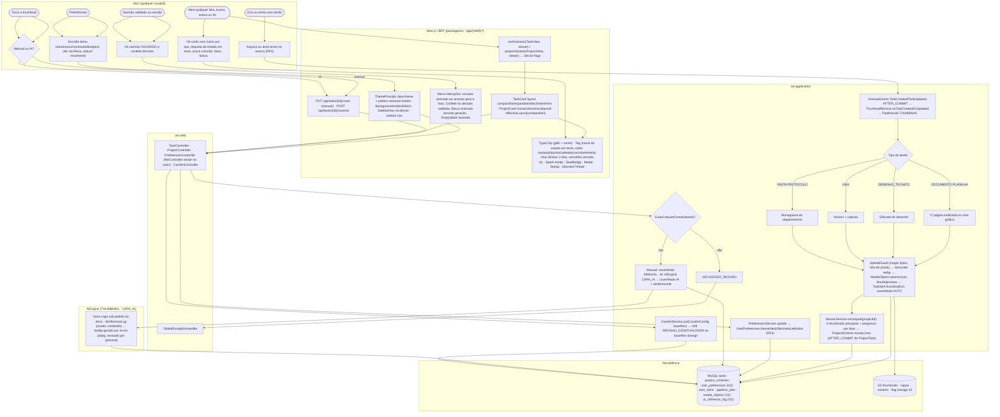
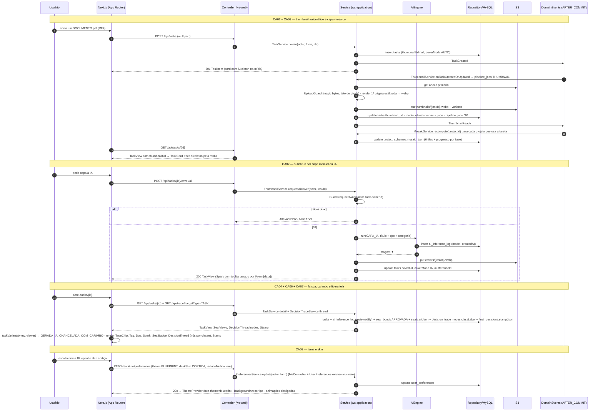
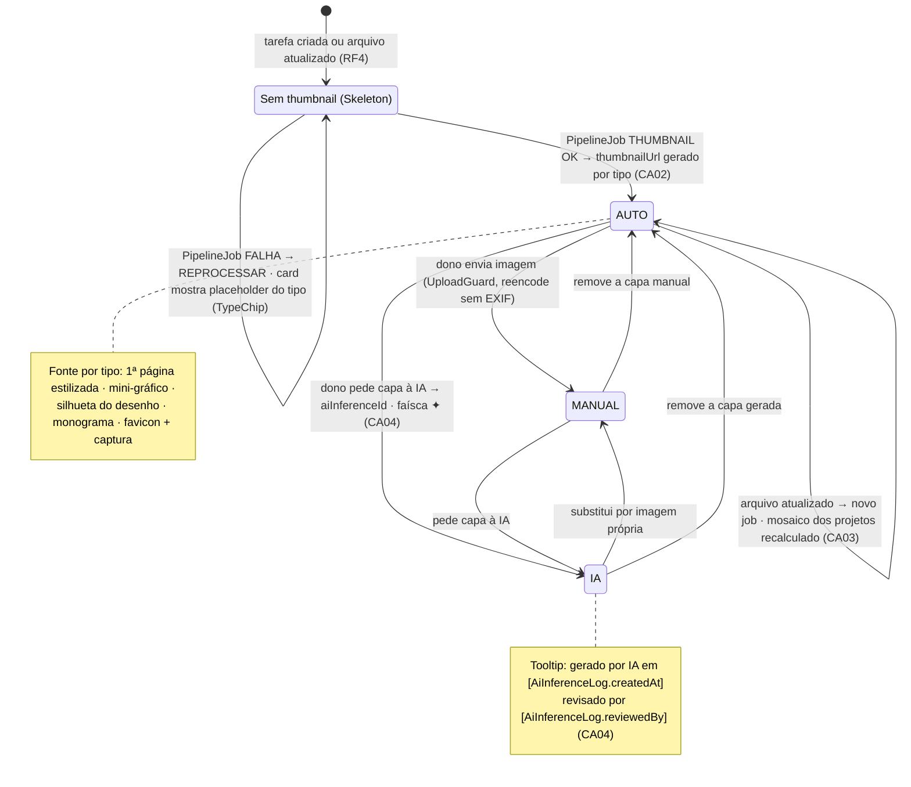
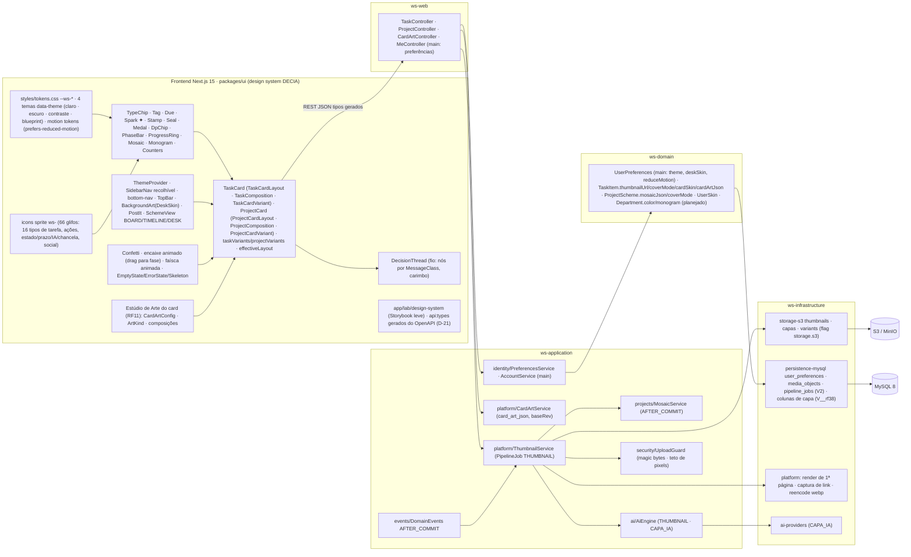

# RF38 — Aplicar a identidade visual do Work AI — ícones por tipo de tarefa, thumbnails automáticos, capa-mosaico de projeto, fio de decisão, lacres, etiquetas de estado, temas e skins da Mesa
**HU:** HU38 · **Sprint (board Work Station):** Product Backlog (transversal; o design system v2 entra antes de qualquer tela, D-11) · **Equivalente FAI:** anatomia dos cards (v17), anatomia do DNA, Background Studio (RF11), skins de card, temas (RF23 preferências) · **Aba/rota:** transversal — todo card, lista, busca, anexo de mensagem e fio de decisão; preferências em `/settings` (tema, skin da Mesa, reduceMotion); Estúdio de Arte do card (RF11, `/tasks/[id]/art`, `/projects/[id]/art`); galeria `/lab/design-system`
**Critérios de aceite cobertos:** RF38.CA01 · CA02 · CA03 · CA04 · CA05 · CA06 · CA07 · CA08 · CA09 · CA10 (corpo do card, inalterado) — regra: o **título do card** define o RF e o corpo traz os próprios CAs. Fontes de detalhe: `docs/design-system/DESIGN_SYSTEM.md` (§2 tokens, §3 catálogo de componentes, §4 glifos), `ANATOMIA_CARDS.md`, `ANATOMIAS_E_ESTUDIO.md` v3 (enums `TaskCardLayout`, `ProjectCardLayout`, `TaskComposition`, `ProjectComposition`, `SchemeView`, `TaskCardVariant`, `ProjectCardVariant`, `CardArtConfig`), `GLYPHS.md`, `TOKENS.md`.

Regra do design system: **nenhum HTML/CSS solto** nas telas (D-11); todo elemento visual vem de `packages/ui` com tokens `--ws-*` e 4 temas via `data-theme` (claro · escuro · contraste · blueprint). As **variações** dos cards são **flags derivadas dos dados** (`taskVariants(TaskView, viewer)`, `projectVariants(ProjectView, viewer)`), nunca escritas à mão; tipos vêm do OpenAPI (D-21). O backend contribui com: `TaskType` → glifo/cor (`TypeChip`), `PipelineJob THUMBNAIL` assíncrono (`TaskItem.thumbnailUrl/coverMode`), `ProjectScheme.mosaicJson/coverMode` (mosaico 2×3 recomputado AFTER_COMMIT), `aiGenerated/aiInferenceId/reviewedBy` (faísca ✦), `TaskState`/`ProjectStatus` (etiquetas com nome em texto), `legalDueAt` (⚖), `SealBond`/`Seal.artJson` (lacre), `Recognition.medalArtJson` (medalha), `FinalDecision.stampJson` (carimbo), `DecisionTraceNode.classLabel` (fio), `Department.color/monogram`, `Company.logoUrl`, `UserPreferences.theme/deskSkin/reduceMotion`, `UserSkin` (skins compradas, RF42) e `CardArtConfig` (`card_art_json`, Estúdio, proposta Q-58).

## 1. Diagrama de classes

```mermaid
classDiagram
direction LR

namespace ws_domain_dados_visuais {
  class TaskItem {
    <<entity>>
    +id: UUID
    +type: TaskType
    +state: TaskState
    +departmentId: UUID
    +dueAt: LocalDate
    +legalDueAt: LocalDate
    +thumbnailUrl: String
    +coverUrl: String
    +coverMode: CoverMode
    +cardSkin: String
    +cardArtJson: JSON
    +aiGenerated: boolean
    +aiInferenceId: UUID
    +sealIdsJson: JSON
    .. +40 campos ..
  }
  class ProjectScheme {
    <<entity>>
    +id: UUID
    +status: ProjectStatus
    +currentPhase: ProjectPhase
    +departmentId: UUID
    +emoji: String
    +iconId: String
    +coverMode: ProjectCoverMode
    +coverUrl: String
    +mosaicJson: JSON
    +deskSkin: String
    +deskBackgroundJson: JSON
    +cardArtJson: JSON
    +aiGenerated: boolean
    .. +28 campos ..
  }
  class DecisionTraceNode {
    <<entity>>
    +nodeType: TraceNodeType
    +classLabel: MessageClass
    +actorId: UUID
    +at: Instant
  }
  class FinalDecision {
    <<entity>>
    +stampJson: JSON
    +status: DecisionStatus
  }
  class SealBond {
    <<entity>>
    +sealId: UUID
    +status: SealBondStatus
    +basis: SealBondBasis
  }
  class Seal {
    <<entity>>
    +issuerKind: String
    +artJson: JSON
    +excellence: boolean
  }
  class Recognition {
    <<entity>>
    +medalArtJson: JSON
    +name: String
  }
  class Department {
    <<entity>>
    +color: String
    +monogram: String
  }
  class Company {
    <<entity>>
    +logoUrl: String
    +accentColor: String
  }
  class AiInferenceLog {
    <<entity>>
    +id: UUID
    +model: String
    +createdAt: Instant
    +reviewedBy: UUID
    +reviewedAt: Instant
  }
}

namespace ws_domain_preferencias_plataforma {
  class UserPreferences {
    <<entity>>
    +theme: ThemeMode
    +language: UiLanguage
    +density: String
    +fontScale: BigDecimal
    +reduceMotion: boolean
    +deskSkin: DeskSkin
    +defaultCardSkin: String
  }
  class UserSkin {
    <<entity>>
    +userId: UUID
    +skinKind: String
    +skinKey: String
    +acquiredVia: String
  }
  class PipelineJob {
    <<entity>>
    +type: String
    +targetType: String
    +targetId: UUID
    +status: PipelineJobStatus
  }
  class MediaObject {
    <<entity>>
    +objectKey: String
    +variantsJson: JSON
  }
  class ThemeMode {
    <<enum>>
    AUTO
    CLARO
    ESCURO
    ALTO_CONTRASTE
    BLUEPRINT
  }
  class DeskSkin {
    <<enum>>
    PAPEL
    CORTICA
    BLUEPRINT
    PAPEL_TIMBRADO
  }
  class CoverMode {
    <<enum>>
    AUTO
    MANUAL
    IA
  }
  class ProjectCoverMode {
    <<enum>>
    MOSAICO
    FOTO
    IA
  }
}

namespace ws_application {
  class ThumbnailService {
    <<service>>
    +onTaskCreatedOrUpdated(event) PipelineJob
    +render(task) MediaObject
    +replaceManual(actor, taskId, media) TaskItem
    +requestAiCover(actor, taskId) TaskItem
  }
  class MosaicService {
    <<service>>
    +recompute(projectId) ProjectScheme
  }
  class CardArtService {
    <<service>>
    +get(actor, kind, id) CardArtConfig
    +put(actor, kind, id, CardArtConfig, baseRev) CardArtConfig
    +effectiveLayout(card) Composition
  }
  class PreferencesService {
    <<service>>
    +update(actor, PreferencesForm) UserPreferences
  }
  class AiEngine {
    <<service>>
    +run(CAPA_IA) AiResponse
  }
  class Guard {
    <<service>>
    +requireOwner(actor, ownerId)
  }
  class UploadGuard {
    <<service>>
    +checkMagicBytes(bytes)
    +checkPixelCeiling(w, h)
  }
  class StoragePort {
    <<port>>
    +put(key, bytes)
  }
  class JobPort {
    <<port>>
    +enqueue(THUMBNAIL)
  }
}

namespace packages_ui {
  class TaskCard {
    <<component>>
    +layout: TaskCardLayout
    +variants: Set~TaskCardVariant~
    +composition: TaskComposition
    +family: String
  }
  class ProjectCard {
    <<component>>
    +layout: ProjectCardLayout
    +variants: Set~ProjectCardVariant~
    +composition: ProjectComposition
    +cover: String
  }
  class TypeChip {
    <<component>>
    +type: TaskType
  }
  class Tag {
    <<component>>
    +state: TaskState
    +status: ProjectStatus
    +classLabel: MessageClass
    +pulse: boolean
  }
  class Due {
    <<component>>
    +date: LocalDate
    +kind: String
    +legal: boolean
  }
  class Spark {
    <<component>>
    +generatedAt: Instant
    +model: String
    +reviewedBy: String
  }
  class Stamp {
    <<component>>
    +kind: String
    +date: LocalDate
    +reviewer: String
  }
  class SealBadge {
    <<component>>
    +issuer: String
    +excellence: boolean
  }
  class Medal {
    <<component>>
    +name: String
  }
  class Mosaic {
    <<component>>
    +tiles: List
  }
  class ProgressRing {
    <<component>>
    +value: int
    +total: int
  }
  class DecisionThread {
    <<component>>
    +nodes: List
    +stamp: String
  }
  class BackgroundArt {
    <<component>>
    +skin: DeskSkin
  }
  class Monogram {
    <<component>>
    +initials: String
    +dept: String
  }
  class ThemeProvider {
    <<component>>
    +dataTheme: String
    +reduceMotion: boolean
  }
  class Confetti {
    <<component>>
  }
  class TaskCardLayout {
    <<enum>>
    compact
    list
    expanded
    attachment
    mini
  }
  class ProjectCardLayout {
    <<enum>>
    mosaic
    hero
    mural
    postit
  }
  class TaskComposition {
    <<enum>>
    PAGINA
    GRADE
    PRANCHA
    MENSAGEM
    FICHA
  }
  class ProjectComposition {
    <<enum>>
    MOSAICO
    LINHA_TEMPO
    KANBAN_MINI
    PAINEL_METRICAS
    CAPA_FOTO
  }
  class SchemeView {
    <<enum>>
    BOARD
    TIMELINE
    DESK
  }
}

TaskItem ..> TypeChip : type
TaskItem ..> Tag : state
TaskItem ..> Due : dueAt legalDueAt
TaskItem ..> Spark : aiGenerated aiInferenceId
AiInferenceLog ..> Spark : model createdAt reviewedBy
ProjectScheme ..> Mosaic : mosaicJson
ProjectScheme ..> ProgressRing : currentPhase
ProjectScheme ..> Tag : status
DecisionTraceNode ..> DecisionThread : classLabel cor do no
FinalDecision ..> Stamp : stampJson
SealBond ..> SealBadge : status APROVADA
Seal ..> SealBadge : artJson excellence
Recognition ..> Medal : medalArtJson
Department ..> Monogram : color monogram
Department ..> TaskCard : borda na cor
Company ..> ThemeProvider : logoUrl accentColor
UserPreferences ..> ThemeProvider : theme reduceMotion
UserPreferences ..> BackgroundArt : deskSkin
UserSkin ..> BackgroundArt : skins compradas
TaskCard *-- TypeChip
TaskCard *-- Tag
TaskCard *-- Due
TaskCard *-- Spark
TaskCard *-- SealBadge
TaskCard --> TaskCardLayout
TaskCard --> TaskComposition
ProjectCard *-- Mosaic
ProjectCard *-- ProgressRing
ProjectCard *-- Stamp
ProjectCard --> ProjectCardLayout
ProjectCard --> ProjectComposition
ThumbnailService --> JobPort
ThumbnailService --> StoragePort
ThumbnailService --> AiEngine
ThumbnailService --> UploadGuard
ThumbnailService ..> TaskItem : thumbnailUrl coverMode
MosaicService ..> ProjectScheme : mosaicJson
CardArtService ..> TaskItem : cardArtJson
CardArtService ..> ProjectScheme : cardArtJson
CardArtService --> Guard
PreferencesService ..> UserPreferences
PipelineJob ..> ThumbnailService : THUMBNAIL
MediaObject ..> TaskItem : variantsJson thumb
```

## 2. Diagrama de atividades

## 3. Diagrama de sequência

## 4. Máquina de estados

Entidade central: `TaskItem.coverMode` (`CoverMode`) e o `PipelineJob THUMBNAIL` que o alimenta; as etiquetas de estado (CA05) renderizam as máquinas de `TaskState` (RF41) e `ProjectStatus` (RF22), não têm máquina própria.

## 5. Diagrama de componentes

## 6. Rastreabilidade

| CA | Classe | Passo | Mensagem | Transição | Componente |
|---|---|---|---|---|---|
| RF38.CA01 | `TaskType` → `TypeChip`, sprite `ws-<nome>` (16 glifos de tipo), `TaskCard` em cards/listas/busca/anexos (`TaskCardLayout`), `DecisionThread` | A2 → A3 → F1 → F2 → F3 | 40–44 | — | `GL`, `ATOMS (TypeChip)`, `CARDS` |
| RF38.CA02 | `ThumbnailService.onTaskCreatedOrUpdated/render/replaceManual/requestAiCover`, `PipelineJob THUMBNAIL`, `TaskItem.thumbnailUrl/coverUrl/coverMode`, `MediaObject.variantsJson`, `AiCapability CAPA_IA` | A1 → P1 → P2 → P3..P6 → P7 · A8 → A9 → F6 → P9 → P10 → I1 | 1–17, 18–30 | `SEM → AUTO → MANUAL / IA` | `TH`, `PLAT`, `S3A`, `AIP` |
| RF38.CA03 | `MosaicService.recompute`, `ProjectScheme.mosaicJson/coverMode MOSAICO`, `ProjectCard layout mosaic`, `Mosaic`, `ProgressRing`, borda `Department.color` | P8 | 14–15 | `AUTO → self (mosaico recalculado)` | `MO`, `ATOMS (Mosaic, ProgressRing)` |
| RF38.CA04 | `Spark` (generatedAt, model, reviewedBy), `TaskItem.aiGenerated/aiInferenceId`, `AiInferenceLog.model/createdAt/reviewedBy`, variante `GERADA_IA` | P10 → I1 · F3 | 25–30, 44 | nota de IA | `ATOMS (Spark ✦)` |
| RF38.CA05 | `Tag` (nome do estado em texto, estilos por `TaskState`/`ProjectStatus`), `Due` (âmbar ≤ 3 dias, vermelho vencido, ⚖ `legalDueAt`), variantes `PRAZO_LEGAL`, `BLOQUEADA`… | F3 | 44 | máquinas de RF41/RF22 renderizadas | `ATOMS (Tag, Due)` |
| RF38.CA06 | `Seal.artJson/issuerKind/excellence` + `SealBond APROVADA` → `Seal` (lacre dourado/azul-marinho), `Recognition.medalArtJson` → `Medal`, `FinalDecision.stampJson` → `Stamp` (VALIDADO/DEVOLVIDO, data, revisor), variantes `CHANCELADA`, `COM_CARIMBO` | F3 | 40–44 | — | `ATOMS (Seal, Medal, Stamp)` |
| RF38.CA07 | `DecisionTraceNode.classLabel` (ARGUMENTO azul · DIVERGENCIA laranja · RISCO vermelho · CONSENSO verde · PERGUNTA roxo) → `DecisionThread` | F3 | 41–44 | — | `THREAD` |
| RF38.CA08 | `UserPreferences.theme/deskSkin/reduceMotion` (existe no main), `ThemeMode` (4 temas + AUTO), `DeskSkin`, `UserSkin`, `ThemeProvider`, `BackgroundArt`, `SidebarNav` recolhível | A6 → A7 → F4 → P11 | 45–49 | — | `TOK`, `SHELL`, `PR`, `MeController` |
| RF38.CA09 | `Department.color/monogram`, `Company.logoUrl/accentColor` → `Monogram`, borda do card na cor do departamento | F3 (TaskCard/ProjectCard) | 40–44 | — | `ATOMS (Monogram)`, `CARDS` |
| RF38.CA10 | `Confetti` (decisão validada), encaixe animado (drag para fase, `SchemeView BOARD`), faísca animada (geração), `EmptyState` ilustrado, `prefers-reduced-motion` + `UserPreferences.reduceMotion` | A4 → A5 → F5 · F4 | 49 | — | `FX`, `TOK (motion)` |
