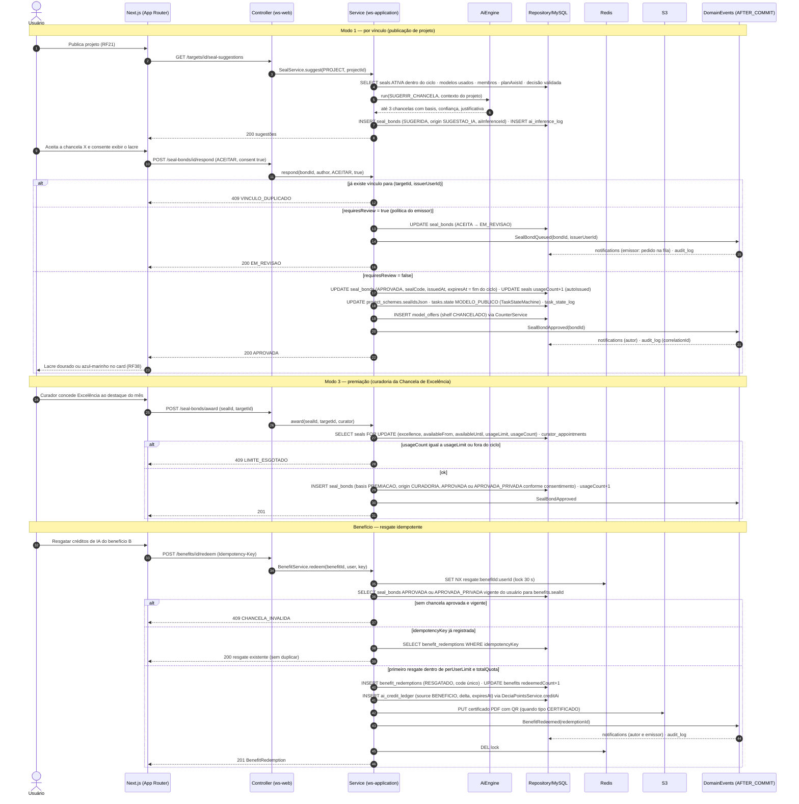
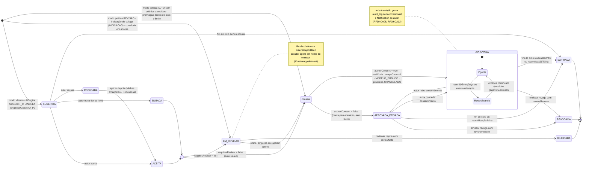
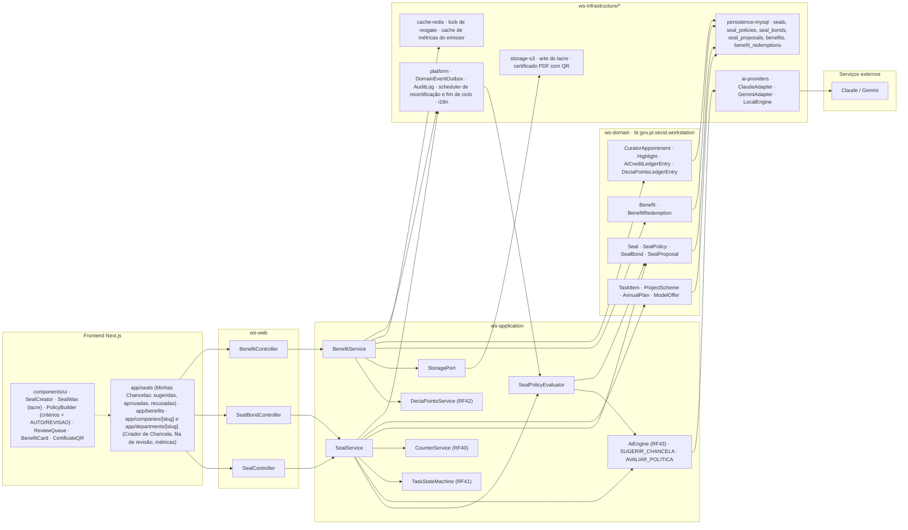

# RF39 — Criar chancelas (EMPRESA / CHEFE DE DEPARTAMENTO) e concedê-las a tarefas, projetos e planos por vínculo sugerido pela IA, por política de critérios ou por premiação; habilitar benefícios resgatáveis
**HU:** HU39 · **Sprint (board Work Station):** Product Backlog (não priorizado — pós-Sprint 4) · **Equivalente FAI:** RF20/RF21 Vínculo com marca/celebridade (SealBond Matcher, revisão opcional, tiers) + RF25 Selos/promoções + RF38 Cupons · **Aba/rota:** Minhas Chancelas (`/seals`), Criador de Chancela (página da empresa/departamento), Benefícios (`/benefits`)
**Critérios de aceite cobertos:** RF39.CA01 · RF39.CA02 · RF39.CA03 · RF39.CA04 · RF39.CA05 · RF39.CA06 · RF39.CA07 · RF39.CA08 · RF39.CA09 · RF39.CA10 · RF39.CA11 · RF39.CA12

> Contexto Chancelas & Benefícios (bounded context 6). Entidade central: `SealBond` (`SealBondStatus` SUGERIDA → ACEITA | EDITADA | RECUSADA → EM_REVISAO → APROVADA | APROVADA_PRIVADA | REJEITADA → REVOGADA | EXPIRADA). Três modos de concessão: **vínculo** (IA sugere até 3, `origin SUGESTAO_IA`), **política** (`SealPolicy` + `SealPolicyEvaluator`, modo AUTO ou REVISAO), **premiação** (Chancela de Excelência, `excellence = true`, `usageLimit` + ciclo, por curadoria). A chancela aprovada habilita `Benefit` → `BenefitRedemption` (idempotente) e leva o item a `MODELO_PUBLICO` + prateleira CHANCELADO do Balcão (RF40).

## 1. Diagrama de classes

```mermaid
classDiagram
  direction LR

  class Seal {
    <<entity>>
    +UUID id
    +UUID issuerUserId
    +String issuerKind
    +UUID companyId
    +UUID departmentId
    +String name
    +SealTier tier
    +SealStatus status
    +String artJson
    +String iconUrl
    +boolean excellence
    +Instant availableFrom
    +Instant availableUntil
    +Integer usageLimit
    +int usageCount
    +boolean autoIssued
    +UUID policyId
    +boolean recertificationRequired
    +String description
  }
  class SealPolicy {
    <<entity>>
    +UUID id
    +UUID sealId
    +PolicyMode mode
    +List~Criterion~ criteriaJson
    +Integer recertifyEveryDays
    +int version
    +Instant validFrom
  }
  class SealBond {
    <<entity>>
    +UUID id
    +UUID sealId
    +UUID issuerUserId
    +String targetType
    +UUID targetId
    +UUID targetOwnerId
    +UUID requestedBy
    +SealBondBasis basis
    +SealBondOrigin origin
    +BigDecimal confidence
    +String justification
    +String criteriaReportJson
    +SealBondStatus status
    +boolean requiresReview
    +Boolean authorConsent
    +UUID aiInferenceId
    +Instant respondedAt
    +Instant reviewedAt
    +UUID reviewedBy
    +String reviewNote
    +String sealCode
    +Instant issuedAt
    +Instant expiresAt
    +String revokeReason
    +Instant lastRecertifiedAt
  }
  class SealProposal {
    <<entity>>
    +UUID id
    +UUID proposerId
    +UUID departmentId
    +String name
    +String rationale
    +String status
    +UUID resultingSealId
    +UUID decidedBy
  }
  class Benefit {
    <<entity>>
    +UUID id
    +UUID sealId
    +UUID issuerUserId
    +BenefitType type
    +String title
    +String rules
    +String valueJson
    +Instant startsAt
    +Instant expiresAt
    +Integer totalQuota
    +int perUserLimit
    +int redeemedCount
    +String status
    +Visibility visibility
  }
  class BenefitRedemption {
    <<entity>>
    +UUID id
    +UUID benefitId
    +UUID sealBondId
    +UUID userId
    +String code
    +String status
    +Instant redeemedAt
    +Instant expiresAt
    +UUID certificateMediaId
    +UUID ledgerEntryId
    +String idempotencyKey
  }
  class CuratorAppointment {
    <<entity>>
    +UUID id
    +UUID departmentId
    +UUID curatorUserId
    +UUID appointedBy
    +Instant revokedAt
    +String scope
  }
  class AiCreditLedgerEntry {
    <<entity>>
    +UUID id
    +UUID userId
    +int delta
    +String source
    +UUID refId
    +Instant expiresAt
  }
  class DeciaPointsLedgerEntry {
    <<entity>>
    +UUID id
    +UUID userId
    +int delta
    +PointsEvent eventCode
    +String idempotencyKey
  }
  class Highlight {
    <<entity>>
    +UUID id
    +String monthKey
    +String targetType
    +UUID targetId
    +String algorithmScoreJson
    +UUID curatedBy
  }
  class TaskItem {
    <<entity>>
    +UUID id
    +UUID ownerId
    +TaskState state
    +String sealIdsJson
    +boolean offeredInCounter
  }
  class ProjectScheme {
    <<entity>>
    +UUID id
    +UUID ownerId
    +ProjectStatus status
    +String sealIdsJson
    +UUID planAxisId
  }
  class AnnualPlan {
    <<entity>>
    +UUID id
    +UUID ownerId
    +String sealIdsJson
  }
  class ModelOffer {
    <<entity>>
    +UUID id
    +String targetType
    +UUID targetId
    +String shelf
    +UUID highlightedBy
  }
  class Notification {
    <<entity>>
    +UUID id
    +UUID recipientId
    +String category
    +String resourceType
    +UUID resourceId
  }
  class AuditLog {
    <<entity>>
    +UUID id
    +UUID actorId
    +String action
    +String resourceType
    +UUID resourceId
    +String correlationId
  }
  class AiInferenceLog {
    <<entity>>
    +UUID id
    +AiCapability capability
    +BigDecimal confidence
    +String correlationId
  }

  class SealTier {
    <<enum>>
    TAREFA
    PROJETO
    PLANO
  }
  class SealStatus {
    <<enum>>
    ATIVA
    PAUSADA
    ENCERRADA
  }
  class PolicyMode {
    <<enum>>
    AUTO
    REVISAO
  }
  class SealCriterion {
    <<enum>>
    CONFORMIDADE_MIN
    RASTRO_COMPLETO
    PRAZO_CUMPRIDO
    REACOES_MIN
    REUTILIZACOES_MIN
    DECISAO_VALIDADA
    SEM_PENDENCIA
  }
  class SealBondBasis {
    <<enum>>
    MODELO_MATCH
    DEPARTAMENTO_MATCH
    PLANO_MATCH
    DECISAO_MATCH
    POLITICA
    INDICACAO
    PREMIACAO
  }
  class SealBondOrigin {
    <<enum>>
    SUGESTAO_IA
    POLITICA
    INDICACAO
    CURADORIA
    MANUAL
  }
  class SealBondStatus {
    <<enum>>
    SUGERIDA
    ACEITA
    EDITADA
    RECUSADA
    EM_REVISAO
    APROVADA
    APROVADA_PRIVADA
    REJEITADA
    REVOGADA
    EXPIRADA
  }
  class BenefitType {
    <<enum>>
    CERTIFICADO
    CREDITOS_IA
    PONTOS_BONUS
    VITRINE_DIRETA
    PRIORIDADE_REVISAO
    CAPACITACAO
    MENCAO_RELATORIO
  }

  class SealController {
    <<controller>>
    +POST seals
    +PUT seals_id
    +GET seals_mine
    +GET seals_issuer_metrics
    +POST seal_proposals
  }
  class SealBondController {
    <<controller>>
    +GET targets_id_seal_suggestions
    +POST seal_bonds
    +POST seal_bonds_id_respond
    +POST seal_bonds_id_review
    +POST seal_bonds_id_revoke
    +POST seal_bonds_nominate
    +POST seal_bonds_award
  }
  class BenefitController {
    <<controller>>
    +POST benefits
    +GET benefits
    +POST benefits_id_redeem
  }
  class SealService {
    <<service>>
    +create(issuer, form) Seal
    +requireIssuerOrCurator(actor, departmentId) void
    +suggest(targetType, targetId) List~SealBond~
    +respond(bondId, author, action, consent) SealBond
    +review(bondId, reviewer, approve, note) SealBond
    +award(sealId, targetId, curator) SealBond
    +nominate(targetId, sealId, employee) SealBond
    +revoke(bondId, issuer, reason) SealBond
    +recertify(bondId) SealBond
    +issuerMetrics(issuerId, period) SealMetrics
  }
  class SealPolicyEvaluator {
    <<service>>
    +evaluate(sealId, targetId) CriteriaReport
    +onRelevantEvent(event) void
    +scheduleRecertification(bondId) void
  }
  class BenefitService {
    <<service>>
    +publish(issuer, sealId, form) Benefit
    +redeem(benefitId, user, idempotencyKey) BenefitRedemption
    +issueCertificate(redemption) MediaObject
  }
  class AiEngine {
    <<service>>
    +run(capability, input, accessClass) AiResult
  }
  class TaskStateMachine {
    <<service>>
    +transition(taskId, toState, actor, reason) TaskStateLog
  }
  class CounterService {
    <<service>>
    +publishChanceled(targetType, targetId, sealBondId) ModelOffer
  }
  class DeciaPointsService {
    <<service>>
    +award(userId, eventCode, refId, idempotencyKey) DeciaPointsLedgerEntry
    +creditAi(userId, amount, refId) AiCreditLedgerEntry
  }

  Seal --> SealTier : tier
  Seal --> SealStatus : status
  Seal "1" --> "0..1" SealPolicy : policyId
  SealPolicy --> PolicyMode : mode
  SealPolicy ..> SealCriterion : criteriaJson
  Seal "1" --> "*" SealBond : sealId
  Seal "1" --> "*" Benefit : sealId
  SealBond --> SealBondBasis : basis
  SealBond --> SealBondOrigin : origin
  SealBond --> SealBondStatus : status
  SealBond ..> TaskItem : targetType TASK
  SealBond ..> ProjectScheme : targetType PROJECT
  SealBond ..> AnnualPlan : targetType PLAN
  SealBond ..> AiInferenceLog : aiInferenceId
  SealProposal ..> Seal : resultingSealId
  Benefit --> BenefitType : type
  Benefit "1" --> "*" BenefitRedemption : benefitId
  BenefitRedemption --> SealBond : sealBondId
  BenefitRedemption ..> AiCreditLedgerEntry : ledgerEntryId CREDITOS_IA
  BenefitRedemption ..> DeciaPointsLedgerEntry : ledgerEntryId PONTOS_BONUS
  CuratorAppointment ..> Seal : opera em nome do emissor
  Highlight ..> SealBond : fonte da premiação
  ModelOffer ..> SealBond : shelf CHANCELADO

  SealController --> SealService
  SealBondController --> SealService
  BenefitController --> BenefitService
  SealService --> AiEngine : SUGERIR_CHANCELA
  SealPolicyEvaluator --> AiEngine : AVALIAR_POLITICA
  SealService --> SealPolicyEvaluator
  SealService --> TaskStateMachine : MODELO_PUBLICO
  SealService --> CounterService : prateleira CHANCELADO
  BenefitService --> DeciaPointsService
  SealService ..> Seal
  SealService ..> SealBond
  SealService ..> SealProposal
  SealService ..> Notification
  SealService ..> AuditLog
  BenefitService ..> Benefit
  BenefitService ..> BenefitRedemption

  note for Seal "tabela seals · issuerKind EMPRESA ou CHEFE · excellence = fita vermelha · janela invertida 400 PERIODO_INVALIDO"
  note for SealBond "tabela seal_bonds · único (targetId, issuerUserId) RF39.CA08 · sealCode único"
  note for SealPolicy "tabela seal_policies · versionada · criteriaJson com threshold por critério"
  note for BenefitRedemption "tabela benefit_redemptions · idempotencyKey e code únicos · 1 por benefício e pessoa"
  note for SealStatus "nomes SealStatus, PolicyMode e SealBondOrigin a confirmar · TAXONOMIA só lista valores"
```

## 2. Diagrama de atividades

```mermaid
flowchart TD
  classDef err fill:#FFE3E3,stroke:#C0392B,color:#5B1A12
  classDef ai fill:#FFF3D6,stroke:#D68910,color:#5C3B00
  classDef store fill:#EEF6FF,stroke:#4A4852,color:#1F2937

  subgraph L_issuer["Ator humano · EMPRESA / CHEFE DE DEPARTAMENTO / CURADOR"]
    M1["Abre o Criador de Chancela na página da empresa ou do departamento"]
    M2["Preenche nome, tier, arte do lacre (catálogo ou upload), ciclo, limite, flag Excelência, política (critérios + AUTO ou REVISAO)"]
    M3["Opera a fila de revisão: aprova ou rejeita com nota"]
    M4["Curadoria de Excelência a partir dos Destaques (RF35) e indicações"]
    M5["Publica Benefício ligado à chancela (tipo, validade, limite por pessoa)"]
    M6["Revoga com motivo"]
  end

  subgraph L_author["Ator humano · EMPREGADO (autor, colega)"]
    A1["Publica projeto ou tarefa"]
    A2["Recebe até 3 sugestões com confiança e justificativa"]
    A3{"Aceita, edita ou recusa?"}
    A4{"Consente exibir o lacre e virar MODELO OFICIAL?"}
    A5["Indica item de colega para chancela"]
    A6["Propõe chancela nova ao chefe"]
    A7["Resgata benefício em /benefits"]
  end

  subgraph L_web["Web/BFF · Next.js /seals · /benefits · página do departamento"]
    W1["POST /seals"]
    W2["GET /targets/id/seal-suggestions"]
    W3["POST /seal-bonds/id/respond (ACEITAR | EDITAR | RECUSAR, consent)"]
    W4["POST /seal-bonds/id/review"]
    W5["POST /seal-bonds/award (sealId, targetId)"]
    W6["POST /seal-bonds/nominate · POST /seal-proposals"]
    W7["POST /benefits · POST /benefits/id/redeem (Idempotency-Key)"]
    W8["Minhas Chancelas › Recusadas (aplicar depois)"]
  end

  subgraph L_app["ws-application · SealService · SealPolicyEvaluator · BenefitService"]
    S1{"Ator é EMPRESA, CHEFE ou CURADOR nomeado?"}
    S2{"availableUntil maior que availableFrom?"}
    S3["Cria Seal (ATIVA) + SealPolicy v1 · audit_log"]
    S4["SealService.suggest: até 3 SealBond SUGERIDA (origin SUGESTAO_IA)"]
    S5{"Já existe vínculo para o par item × emissor?"}
    S6["ACEITA ou EDITADA (tier, itens)"]
    S7["RECUSADA (fica em Minhas Chancelas › Recusadas)"]
    S8{"requiresReview (política do emissor)?"}
    S9["EM_REVISAO → fila do chefe com criteriaReportJson"]
    S10{"authorConsent?"}
    S11["APROVADA · sealCode · usageCount+1 · autoIssued quando sem revisão"]
    S12["APROVADA_PRIVADA (conta para métricas, não exibe lacre)"]
    S13["TaskStateMachine → MODELO_PUBLICO · sealIdsJson · CounterService prateleira CHANCELADO (RF40)"]
    S14["SealPolicyEvaluator.onRelevantEvent: nova reação, conformidade recalculada, decisão validada, prazo cumprido"]
    S15{"Todos os critérios da SealPolicy atendidos?"}
    S16{"Modo AUTO?"}
    S17["Premiação: valida Excelência, ciclo e usageCount menor que usageLimit"]
    S18["Vínculo basis INDICACAO (EM_REVISAO) ou SealProposal PENDENTE · nenhum emite chancela"]
    S19["Recertificação (recertifyEveryDays): critério deixou de valer → EXPIRADA · fim do ciclo → EXPIRADA"]
    S20["REVOGADA com revokeReason · lacre partido"]
    S21{"Possui SealBond APROVADA ou APROVADA_PRIVADA vigente para a chancela do benefício?"}
    S22{"idempotencyKey já usada ou perUserLimit atingido?"}
    S23["Resgate transacional: BenefitRedemption EMITIDO ou RESGATADO · certificado PDF com QR · AiCreditLedgerEntry · DeciaPointsLedgerEntry BENEFICIO_BONUS"]
    S24["Notification ao autor em cada mudança de estado · ao emissor em pedido ou indicação (i18n)"]
    S25["Métricas do emissor: emitidas, pendentes, revogadas, benefícios resgatados por período"]
    E1["403 ACESSO_NEGADO"]
    E2["400 PERIODO_INVALIDO"]
    E3["409 LIMITE_ESGOTADO"]
    E4["409 CHANCELA_INVALIDA"]
    E5["409 VINCULO_DUPLICADO"]
  end

  subgraph L_ai["IA (AiEngine) · SUGERIR_CHANCELA · AVALIAR_POLITICA"]
    I1["Match por base: modelos chancelados usados (MODELO_MATCH), tarefas de membros (DEPARTAMENTO_MATCH), eixo do plano (PLANO_MATCH), decisão DECIA validada (DECISAO_MATCH) → confiança e justificativa"]
    I2["Avalia critérios mensuráveis: conformidade (RF32), rastro (RF29), prazo, reações (RF26), reutilizações (RF23), decisão (RF15), pendência ⛔ → criteriaReportJson"]
    I3["AiInferenceLog com confiança e correlationId"]
  end

  subgraph L_db["Persistência"]
    D1["MySQL seals · seal_policies · curator_appointments"]
    D2["MySQL seal_bonds (único targetId × issuerUserId) · seal_proposals"]
    D3["MySQL tasks.state MODELO_PUBLICO · sealIdsJson · model_offers shelf CHANCELADO · task_state_log"]
    D4["MySQL benefits · benefit_redemptions · ai_credit_ledger · decia_points_ledger"]
    D5["S3 arte do lacre · certificado PDF com QR"]
    D6["audit_log com correlationId · DomainEventOutbox → notifications_by_user"]
    D7["Redis lock resgate:benefitId:userId"]
  end

  M1 --> M2 --> W1 --> S1
  S1 -- "não (EMPREGADO)" --> E1
  S1 -- "sim" --> S2
  S2 -- "não" --> E2
  S2 -- "sim" --> S3 --> D1
  S3 --> D5

  A1 --> W2 --> S4 --> I1 --> I3
  I1 --> S5
  S5 -- "sim" --> E5
  S5 -- "não" --> D2 --> A2 --> A3
  A3 -- "aceita ou edita" --> W3 --> S6 --> S8
  A3 -- "recusa" --> W3 --> S7 --> W8
  W8 -. "aplicar depois" .-> S6
  S8 -- "sim" --> S9 --> M3 --> W4
  W4 -- "rejeita" --> R1["REJEITADA"] --> S24
  W4 -- "aprova" --> S10
  S8 -- "não" --> S10
  S10 -- "sim" --> S11 --> S13 --> D3
  S10 -- "não" --> S12
  S11 --> S24
  S12 --> S24
  S11 --> D2
  S12 --> D2

  S14 --> I2 --> I3
  I2 --> S15
  S15 -- "não" --> S19
  S15 -- "sim" --> S16
  S16 -- "sim" --> S10
  S16 -- "não" --> S9

  M4 --> W5 --> S17
  S17 -- "limite esgotado ou fora do ciclo" --> E3
  S17 -- "ok" --> S10

  A5 --> W6 --> S18 --> S9
  A6 --> W6 --> S18 --> D2

  M6 --> S20 --> D2
  S20 --> S24
  S19 --> D2
  S19 --> S24

  M5 --> W7 --> S1
  A7 --> W7 --> S21
  S21 -- "não" --> E4
  S21 -- "sim" --> D7 --> S22
  S22 -- "sim" --> X1(["Retorna o resgate existente (idempotente)"])
  S22 -- "não" --> S23 --> D4
  S23 --> D5
  S24 --> D6
  S3 --> S25
  S25 --> D6

  class E1,E2,E3,E4,E5 err
  class I1,I2,I3 ai
  class D1,D2,D3,D4,D5,D6,D7 store
```

## 3. Diagrama de sequência

## 4. Máquina de estados

Entidade central: `SealBond.status` (`SealBondStatus`). As três entradas correspondem aos três modos de concessão.

## 5. Diagrama de componentes

## 6. Rastreabilidade

| CA | Elemento do diagrama (classe / passo / mensagem / transição / componente) |
|---|---|
| RF39.CA01 | Classes `Seal.issuerUserId/issuerKind`, `CuratorAppointment`, `SealService.requireIssuerOrCurator`; atividade S1 → E1 (403 ACESSO_NEGADO) e lane L_issuer; componentes `SealCreator` (só renderizado para EMPRESA/CHEFE/CURADOR), `SealController`. |
| RF39.CA02 | Classes `Seal` (name, tier, artJson, iconUrl, availableFrom/Until, usageLimit, excellence), `SealPolicy` (criteriaJson, mode), enums `SealTier`, `SealCriterion` (7 critérios), `PolicyMode`; atividades M1, M2, W1, S2 → E2 (400 PERIODO_INVALIDO), S3; componentes `PolicyBuilder`, `storage-s3` (arte do lacre). |
| RF39.CA03 | Classes `SealService.suggest`, `SealBond` (basis MODELO_MATCH/DEPARTAMENTO_MATCH/PLANO_MATCH/DECISAO_MATCH, confidence, justification, origin SUGESTAO_IA), `AiCapability` SUGERIR_CHANCELA; atividades A1, W2, S4, I1, A2, A3, S6, S7, W8; sequência msgs 1–11; transições `[*] → SUGERIDA`, `SUGERIDA → ACEITA/EDITADA/RECUSADA`, `RECUSADA → ACEITA` (aplicar depois); componente `app/seals` (Recusadas). |
| RF39.CA04 | Classes `SealPolicyEvaluator.onRelevantEvent/evaluate`, `SealBond.criteriaReportJson/requiresReview`, `Seal.autoIssued`, `AiCapability` AVALIAR_POLITICA; atividades S14, I2, S15, S16 → S10 (AUTO) ou S9 (REVISAO); transições `[*] → consent` (AUTO) e `[*] → EM_REVISAO` (REVISAO); componentes `SealPolicyEvaluator`, `platform · scheduler de recertificação`. |
| RF39.CA05 | Classes `Seal.excellence/usageLimit/usageCount/availableFrom/availableUntil`, `Highlight`, `SealService.award`, `SealBondBasis.PREMIACAO`, `SealBondOrigin.CURADORIA`; atividades M4, W5, S17 → E3 (409 LIMITE_ESGOTADO); sequência msgs 24–31 (SELECT FOR UPDATE, 409 LIMITE_ESGOTADO); transição `[*] → consent` (premiação dentro do ciclo e limite). |
| RF39.CA06 | Classes `SealService.nominate`, `SealBondBasis.INDICACAO`, `SealProposal` (status PENDENTE/CRIADA/RECUSADA); atividades A5, A6, W6, S18 (nenhum emite chancela) → S9; transição `[*] → EM_REVISAO` (indicação de colega); componente `SealBondController.POST seal_bonds_nominate`, `SealController.POST seal_proposals`. |
| RF39.CA07 | Classe `SealBond.authorConsent`, estados `APROVADA` e `APROVADA_PRIVADA`; atividades A4, S10, S11, S12; sequência msgs 9–10 (consent true) e 17–23; choice `consent` e transições `APROVADA ⇄ APROVADA_PRIVADA`. |
| RF39.CA08 | Classes `SealBond` (único targetId × issuerUserId, revokeReason, expiresAt, lastRecertifiedAt), `SealPolicy.recertifyEveryDays`, `AuditLog.correlationId`, `SealService.revoke/recertify`; atividades S5 → E5 (409 VINCULO_DUPLICADO), M6, S20, S19; sequência msgs 12 (409 VINCULO_DUPLICADO) e 21 (audit_log correlationId); estado composto `APROVADA` (Vigente ⇄ Recertificando), transições `→ REVOGADA`, `→ EXPIRADA`; componentes `AuditLog`, `scheduler de recertificação e fim de ciclo`. |
| RF39.CA09 | Classes `Benefit` (type, startsAt, expiresAt, totalQuota, perUserLimit), enum `BenefitType` (7 tipos), `BenefitService.publish`; atividades M5, W7 → S1; componentes `BenefitController`, `BenefitCard`, `app/benefits`. |
| RF39.CA10 | Classes `BenefitRedemption` (idempotencyKey, code, status, ledgerEntryId), `AiCreditLedgerEntry` (source BENEFICIO), `DeciaPointsLedgerEntry` (BENEFICIO_BONUS), `BenefitService.redeem`, `DeciaPointsService.creditAi`; atividades A7, S21 → E4 (409 CHANCELA_INVALIDA), D7 (lock Redis), S22, S23; sequência msgs 32–46 (SET NX, 409 CHANCELA_INVALIDA, resgate existente, ai_credit_ledger); componentes `cache-redis · lock de resgate`, `storage-s3 · certificado PDF`. |
| RF39.CA11 | Classes `TaskItem.state` MODELO_PUBLICO, `TaskItem.sealIdsJson`, `ModelOffer.shelf` CHANCELADO, `TaskStateMachine`, `CounterService.publishChanceled`, `SealService.issuerMetrics`; atividades S13, S25; sequência msgs 18–19 e 23 (lacre no card); transição `consent → APROVADA` (MODELO_PUBLICO · prateleira CHANCELADO); componentes `SealWax`, `CounterService (RF40)`, métricas em `app/companies/[slug]`. |
| RF39.CA12 | Classe `Notification` (category CHANCELA); atividade S24 (autor em cada mudança, emissor em pedido/indicação, i18n) → D6; sequência msgs 15, 21, 30, 44 (notifications); nota da máquina de estados (toda transição → Notification + audit_log); componente `platform · DomainEventOutbox · i18n`. |
