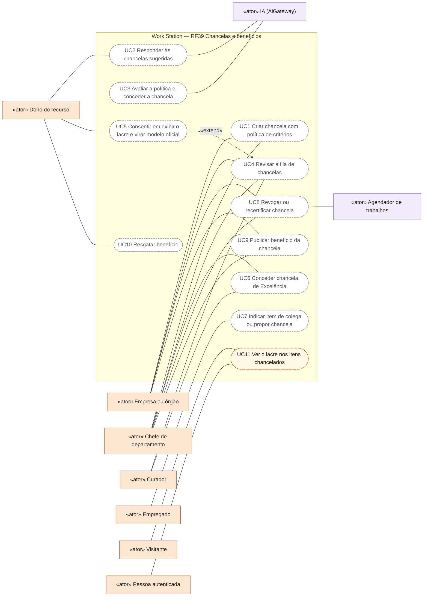
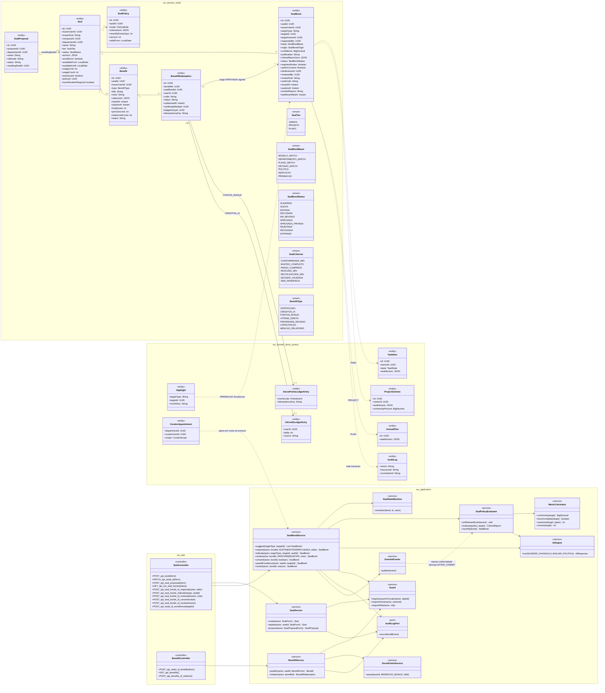
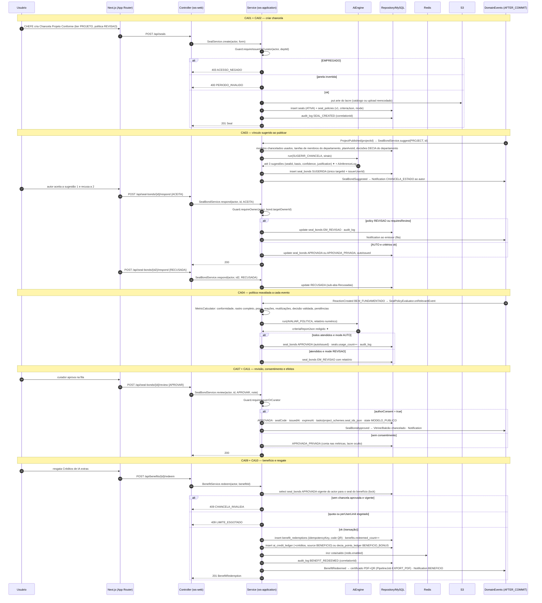
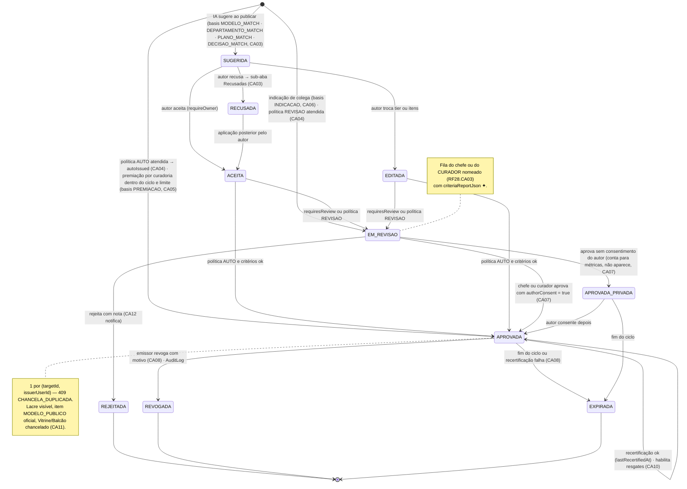
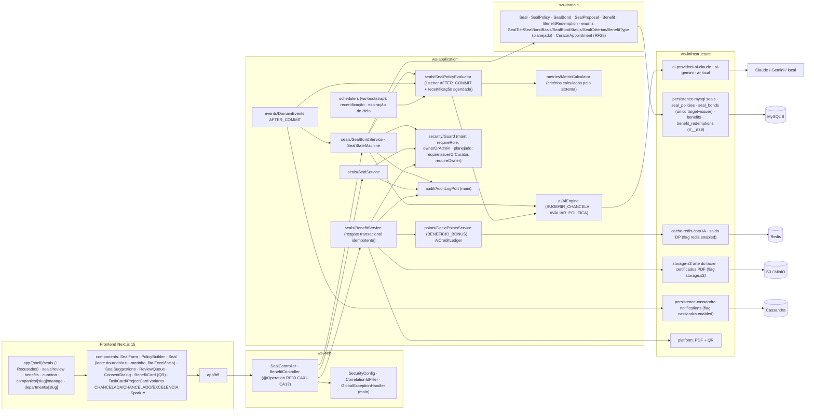

# RF39 — Criar chancelas (EMPRESA / CHEFE DE DEPARTAMENTO) e concedê-las a tarefas, projetos e planos por vínculo sugerido pela IA, por política de critérios ou por premiação; habilitar benefícios resgatáveis
**HU:** HU39 · **Sprint (board Work Station):** Product Backlog (não comprometido na Sprint 4) · **Equivalente FAI:** RF20/RF21 Vínculo com marca/celebridade (SealBond Matcher, revisão opcional, tiers) + RF25 Selos/promoções + RF38 Cupons · **Aba/rota:** Minhas Chancelas (`/seals`, sub-aba Recusadas), fila de revisão (`/seals/review`, CHEFE/CURADOR), Criador de Chancela na página da empresa/departamento (`/companies/[slug]/manage`, `/departments/[slug]`), Benefícios (`/benefits`), curadoria de Excelência (`/curation`)
**Critérios de aceite cobertos:** RF39.CA01 · CA02 · CA03 · CA04 · CA05 · CA06 · CA07 · CA08 · CA09 · CA10 · CA11 · CA12 (corpo do card, inalterado) — regra: o **título do card** define o RF e o corpo traz os próprios CAs. Detalhe no card "WORK AI — Chancelas"; a moeda é DECIA Points (RF42).

Entidades: `Seal` (emissor EMPRESA|CHEFE, `tier` TAREFA|PROJETO|PLANO, `artJson` do lacre, `excellence`, ciclo `availableFrom/Until`, `usageLimit/usageCount`, `autoIssued`), `SealPolicy` (`mode` AUTO|REVISAO, `criteriaJson` com `SealCriterion` CONFORMIDADE_MIN · RASTRO_COMPLETO · PRAZO_CUMPRIDO · REACOES_MIN · REUTILIZACOES_MIN · DECISAO_VALIDADA · SEM_PENDENCIA, `recertifyEveryDays`), `SealBond` (item × emissor, único; `basis` MODELO_MATCH · DEPARTAMENTO_MATCH · PLANO_MATCH · DECISAO_MATCH · POLITICA · INDICACAO · PREMIACAO; `status` `SealBondStatus` SUGERIDA → ACEITA/EDITADA/RECUSADA → EM_REVISAO → APROVADA/APROVADA_PRIVADA/REJEITADA → REVOGADA/EXPIRADA; `authorConsent`; `aiInferenceId`), `SealProposal`, `Benefit` (`BenefitType`), `BenefitRedemption` (idempotente, QR, `ledgerEntryId`). Guards D-14: `requireIssuerOrCurator` (criar/editar/revisar), `requireOwner` (aceitar/editar/recusar/consentir), EMPREGADO → 403 no criador. Os critérios são **calculados pelo sistema** (`MetricCalculator`); a IA (`SUGERIR_CHANCELA`, `AVALIAR_POLITICA`) só sugere/justifica. Tudo em `AuditLog` com `correlationId`.

## 0. Diagrama de casos de uso

Casos de uso derivados dos CAs. Só o lacre nos itens chancelados existe hoje, como DEMO nos cards; criador, fila de revisão, políticas, curadoria e benefícios são planejados (`/seals`, `/seals/review`, `/benefits` e `/curation` são páginas-esqueleto).

| Caso de uso | Ator(es) | CAs | Situação |
|---|---|---|---|
| UC1 Criar chancela com política de critérios | `empresa`, `chefe` | RF39.CA01, RF39.CA02 | planejado (EMPREGADO recebe 403) |
| UC2 Responder às chancelas sugeridas | `dono`, `ia` | RF39.CA03, RF39.CA12 | planejado (aceitar, editar ou recusar) |
| UC3 Avaliar a política e conceder a chancela | `ia` | RF39.CA04 | planejado (critérios calculados pelo sistema; a IA só justifica) |
| UC4 Revisar a fila de chancelas | `empresa`, `chefe`, `curador` | RF39.CA04, RF39.CA07, RF39.CA12 | planejado (curador com escopo FILA_REVISAO) |
| UC5 Consentir em exibir o lacre e virar modelo oficial | `dono` | RF39.CA07, RF39.CA11 | planejado |
| UC6 Conceder chancela de Excelência | `curador`, `chefe` | RF39.CA05 | planejado (a partir dos Destaques do RF35) |
| UC7 Indicar item de colega ou propor chancela | `empregado` | RF39.CA06, RF39.CA12 | planejado |
| UC8 Revogar ou recertificar chancela | `empresa`, `chefe`, `agendador` | RF39.CA08 | planejado |
| UC9 Publicar benefício da chancela | `empresa`, `chefe` | RF39.CA09 | planejado |
| UC10 Resgatar benefício | `dono` | RF39.CA10 | planejado (idempotente; 409 sem chancela válida) |
| UC11 Ver o lacre nos itens chancelados | `visitante`, `autenticado` | RF39.CA11 | DEMO no front, sem API (`Seal` em `TaskSchemeCard` e `ProjectCard`) |

## 1. Diagrama de classes

## 2. Diagrama de atividades

```mermaid
flowchart TD
  subgraph ATOR["Ator (EMPRESA · CHEFE · CURADOR · EMPREGADO autor)"]
    A0([Emissor abre o Criador de Chancela]) --> A1["Nome, tier, arte do lacre, ciclo, limite, Excelência, política (critérios + AUTO/REVISAO)"]
    A2([Autor publica projeto/tarefa]) --> A3["Vê até 3 chancelas sugeridas ✦ com confiança e justificativa"]
    A3 --> A4{"Aceita, edita ou recusa?"}
    A5([Chefe/curador abre a fila]) --> A6{"Aprova ou rejeita com o relatório de critérios?"}
    A7([Autor consente exibir lacre e virar MODELO OFICIAL?])
    A8([Empregado indica item de colega ou propõe chancela nova])
    A9([Curadoria concede Excelência a partir dos Destaques])
    A10([Quem tem chancela aprovada resgata benefício])
    A11([Emissor publica benefício])
  end

  subgraph FE["Next.js / BFF (app/(shell)/seals · seals/review · benefits · curation · companies/[slug]/manage)"]
    F1["SealForm (catálogo + upload de arte, Due do ciclo, Switch Excelência, PolicyBuilder) · POST /api/seals"]
    F2["SealSuggestions (Seal preview, confiança) · POST /seal-bonds/{id}/respond"]
    F3["ReviewQueue (criteriaReportJson) · POST /review"]
    F4["ConsentDialog · POST /consent"]
    F5["POST /seal-bonds/indicate · POST /seal-proposals"]
    F6["Sub-aba Recusadas em /seals · Seal (lacre) nos cards · Vitrine/Balcão chancelado"]
    F7["BenefitForm · POST /seals/{id}/benefits · BenefitCard · POST /benefits/{id}/redeem (QR)"]
  end

  subgraph WEB["ws-web"]
    W1["JWT · CorrelationIdFilter"]
    W2["GlobalExceptionHandler"]
  end

  subgraph APP["ws-application"]
    P1{"Guard.requireIssuerOrCurator?"}
    P1 -->|EMPREGADO| E1["403 ACESSO_NEGADO"]
    P2{"availableFrom menor ou igual a availableUntil?"}
    P2 -->|não| E2["400 PERIODO_INVALIDO"]
    P3["Seal ATIVA + SealPolicy v1 · AuditLog SEAL_CREATED"]
    P4["AFTER_COMMIT ProjectPublished → SealBondService.suggest: base modelos chancelados usados, tarefas de membros do departamento, eixo do plano, decisão DECIA"]
    P5["Até 3 SealBond SUGERIDA (basis, confidence, justification, aiInferenceId)"]
    P6{"Guard.requireOwner(alvo)?"}
    P6 -->|não| E3["403 ACESSO_NEGADO"]
    P7{"Resposta"}
    P7 -->|ACEITA ou EDITADA| P8{"requiresReview ou policy REVISAO?"}
    P7 -->|RECUSADA| P9["RECUSADA → sub-aba Recusadas (aplicável depois)"]
    P8 -->|sim| P10["EM_REVISAO → fila do chefe/curador · Notification ao emissor"]
    P8 -->|não, AUTO e critérios ok| P11["APROVADA (autoIssued) · usageCount++"]
    P12["SealPolicyEvaluator.onRelevantEvent (nova reação, conformidade, decisão validada) → MetricCalculator → criteriaReportJson"]
    P12 --> P13{"Critérios atendidos?"}
    P13 -->|sim e AUTO| P11
    P13 -->|sim e REVISAO| P10
    P13 -->|não, vínculo vigente| P14["Recertificação falhou → EXPIRADA com motivo"]
    P15{"Único por (targetId, issuerUserId)?"}
    P15 -->|já existe| E4["409 CHANCELA_DUPLICADA"]
    P16{"Decisão da revisão"}
    P16 -->|APROVAR| P17{"authorConsent?"}
    P16 -->|REJEITAR com nota| P18["REJEITADA · Notification ao autor"]
    P17 -->|true| P19["APROVADA · lacre visível · item vira MODELO_PUBLICO oficial · Vitrine/Balcão chancelado · sealIdsJson"]
    P17 -->|false ou nulo| P20["APROVADA_PRIVADA (conta para métricas, não aparece)"]
    P21{"Excelência: dentro do ciclo e usageCount menor que usageLimit?"}
    P21 -->|não| E5["409 LIMITE_ESGOTADO"]
    P21 -->|sim| P22["SealBond PREMIACAO origin CURADORIA → APROVADA (Destaques RF35)"]
    P23["indicate: SealBond INDICACAO → EM_REVISAO (não emite) · propose: SealProposal PENDENTE"]
    P24{"Resgate: bond APROVADA e vigente, benefício DISPONIVEL, perUserLimit?"}
    P24 -->|bond inválida| E6["409 CHANCELA_INVALIDA"]
    P24 -->|quota esgotada| E7["409 LIMITE_ESGOTADO"]
    P24 -->|ok| P25["BenefitRedemption idempotente (idempotencyKey) em transação · entrega: certificado PDF+QR, AiCreditLedgerEntry, DP BENEFICIO_BONUS, Vitrine direta, prioridade na fila, vaga · AuditLog"]
    P26["Revogação com motivo → REVOGADA · fim do ciclo → EXPIRADA · AuditLog com correlationId"]
    P27["Notification CHANCELA_ESTADO ao autor em cada transição · INDICACAO ao emissor · i18n"]
  end

  subgraph IA["AiEngine (SUGERIR_CHANCELA · AVALIAR_POLITICA)"]
    I1["Sugere chancelas e justificativa a partir dos sinais do sistema"]
    I2["Redige relatório de critérios sobre números do MetricCalculator"]
    I3["AiInferenceLog"]
  end

  subgraph DB["Persistência"]
    D1[("MySQL seals · seal_policies · seal_bonds · seal_proposals · benefits · benefit_redemptions · decia_points_ledger · ai_credit_ledger · audit_log")]
    D2[("S3 arte do lacre · certificados PDF · flag storage.s3")]
    D3[("Cassandra notifications_by_user · flag cassandra.enabled")]
  end

  A1 --> F1 --> W1 --> P1 -->|ok| P2 -->|sim| P3 --> D1
  P3 --> D2
  A2 --> P4 --> I1 --> I3 --> P5 --> D1 --> F2 --> A3
  A4 --> F2 --> W1 --> P6 -->|sim| P15 -->|ok| P7
  P9 --> F6
  P10 --> D1
  P11 --> P17
  P12 --> I2 --> I3
  A5 --> F3 --> W1 --> P1 -->|ok| P16
  A7 --> F4 --> W1 --> P6 --> P17
  P19 --> D1
  P20 --> D1
  P18 --> D1
  A8 --> F5 --> W1 --> P23 --> D1
  A9 --> W1 --> P1 -->|ok| P21
  P22 --> D1
  A11 --> F7 --> W1 --> P1 -->|ok| D1
  A10 --> F7 --> W1 --> P24
  P25 --> D1
  P25 --> D2
  P14 --> D1
  P26 --> D1
  P19 --> P27 --> D3
  P18 --> P27
  P10 --> P27
  E1 --> W2
  E2 --> W2
  E3 --> W2
  E4 --> W2
  E5 --> W2
  E6 --> W2
  E7 --> W2
```

## 3. Diagrama de sequência

## 4. Máquina de estados

Entidade central: `SealBond.status` (`SealBondStatus`, `SealStateMachine` com tabela de transições testada).

## 5. Diagrama de componentes

## 6. Rastreabilidade

| CA | Classe | Passo | Mensagem | Transição | Componente |
|---|---|---|---|---|---|
| RF39.CA01 | `Guard.requireIssuerOrCurator`, `SealService.create/update`, `CuratorAppointment` | A0 → F1 → P1 (403 ACESSO_NEGADO) | 1–5 | — | `SS`, `GD`, `R1 (criador oculto ao EMPREGADO)` |
| RF39.CA02 | `Seal` (name, tier, artJson, availableFrom/Until, usageLimit, excellence), `SealPolicy` (mode, criteriaJson com `SealCriterion`), 400 PERIODO_INVALIDO | A1 → F1 → P2 (400) → P3 | 6–11 | — | `SealForm`, `PolicyBuilder`, `S3A` |
| RF39.CA03 | `SealBondService.suggest/respond`, `SealBond.basis/confidence/justification/aiInferenceId`, `AiCapability SUGERIR_CHANCELA`, sub-aba Recusadas | A2 → P4 → I1 → P5 → A3 → A4 → P6 → P7 → P8/P9 | 12–30 | `[*] → SUGERIDA → ACEITA / EDITADA / RECUSADA` | `SBS`, `AIE`, `SealSuggestions` |
| RF39.CA04 | `SealPolicyEvaluator.onRelevantEvent/evaluate`, `MetricCalculator`, `criteriaReportJson`, `Seal.autoIssued`, `PolicyMode AUTO/REVISAO` | P12 → I2 → P13 → P10/P11 | 31–38 | `[*] → APROVADA (AUTO)` · `[*] → EM_REVISAO (REVISAO)` | `SPE`, `MC`, `DE` |
| RF39.CA05 | `SealBondService.awardExcellence`, `basis PREMIACAO`, `origin CURADORIA`, `Highlight` (RF35), `usageLimit/usageCount` → 409 LIMITE_ESGOTADO | A9 → P21 (409) → P22 | — (POST /seals/{id}/excellence) | `[*] → APROVADA (PREMIACAO)` | `R1 /curation`, `SBS` |
| RF39.CA06 | `SealBondService.indicate` (basis INDICACAO → EM_REVISAO), `SealService.propose`, `SealProposal` | A8 → F5 → P23 | — (POST /indicate, /seal-proposals) | `[*] → EM_REVISAO (INDICACAO)` | `SBS`, `SS` |
| RF39.CA07 | `SealBond.authorConsent`, `SealBondService.consent/review`, `APROVADA_PRIVADA` | A7 → F4 → P17 → P19/P20 | 39–48 | `EM_REVISAO → APROVADA / APROVADA_PRIVADA → APROVADA` | `ConsentDialog`, `ReviewQueue` |
| RF39.CA08 | único (targetId, issuerUserId) → 409 CHANCELA_DUPLICADA, `SealBondService.revoke`, `SealPolicyEvaluator.recertify`, `REVOGADA/EXPIRADA`, `AuditLog` com correlationId | P15 (409) · P14 · P26 | 10, 36 | `APROVADA → REVOGADA / EXPIRADA` + nota | `AUD`, `SCH`, `MY` |
| RF39.CA09 | `Benefit` (`BenefitType`, startsAt/expiresAt, totalQuota, perUserLimit), `BenefitService.publish` | A11 → F7 → P1 | — (POST /seals/{id}/benefits) | — | `BS`, `BenefitForm` |
| RF39.CA10 | `BenefitService.redeem` (transacional, `idempotencyKey`), `BenefitRedemption`, 409 CHANCELA_INVALIDA, `AiCreditLedgerEntry`, DP `BENEFICIO_BONUS` | A10 → F7 → P24 (409) → P25 | 49–61 | `APROVADA → self (habilita resgates)` | `BS`, `DPS`, `RD`, `PLAT (PDF+QR)` |
| RF39.CA11 | `TaskItem/ProjectScheme/AnnualPlan.sealIdsJson`, `TaskState MODELO_PUBLICO`, Vitrine/Balcão "chancelado" (RF27/RF40), métricas do emissor (RF28.CA06) | P19 → F6 | 43–45 | nota de APROVADA | `Seal (lacre)`, `R2 variants CHANCELADA/CHANCELADO` |
| RF39.CA12 | `Notification CHANCELA_ESTADO/INDICACAO`, i18n das mensagens | P27 | 18, 29, 46, 60 | toda transição | `CASA`, `DE` |
