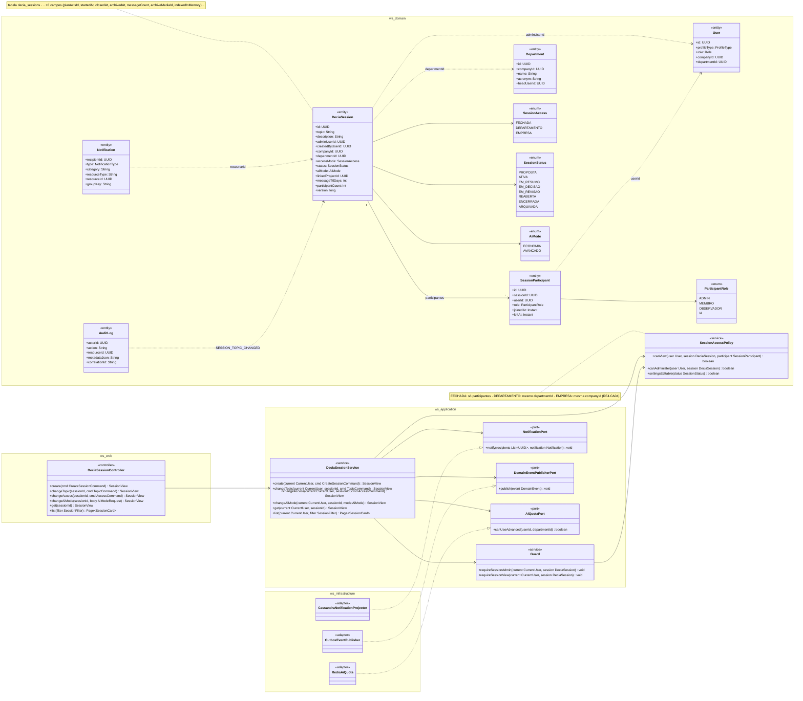
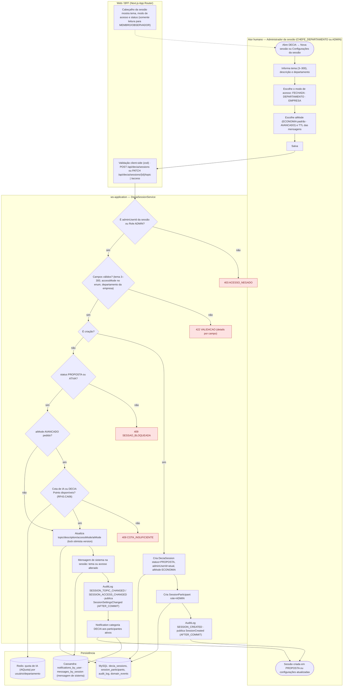
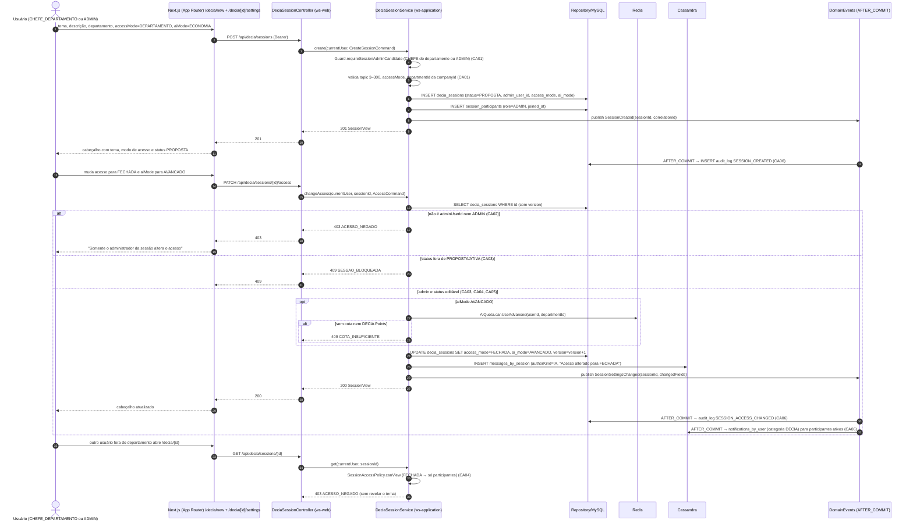
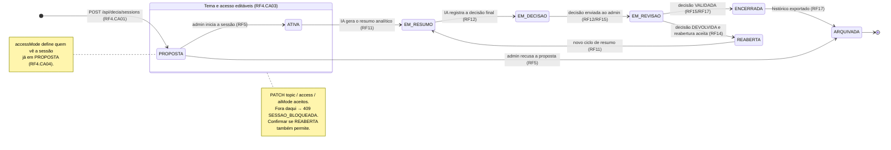
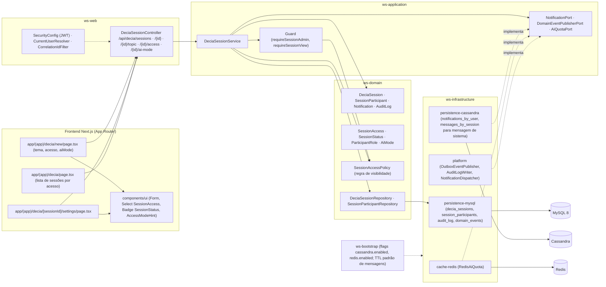

# RF4 — Definir o tema da conversa dentro de uma sessão de conversa do DECIA, assim como definir controle de acesso à conversa.
**HU:** HU4 · **Sprint (board Work Station):** 1 · **Equivalente FAI:** RF10 Copilot (`CopilotService`; o DECIA é o Copilot elevado a hub do app — card "Mapa de equivalência") · **Aba/rota:** DECIA (`/decia/new` para criar, `/decia/[sessionId]/settings` para tema e acesso) — rotas sugeridas
**Critérios de aceite cobertos:** RF4.CA01 … RF4.CA06 (RF1–RF18 não têm CAs no board: derivados da HU4 e marcados "CA a confirmar")

> **HU4** — COMO administrador do sistema POSSO definir o tema de uma sessão de conversa do DECIA e definir o controle de acesso à conversa PARA delimitar o escopo da discussão e garantir que apenas usuários autorizados participem da sessão.

> **Nota de modelagem (a confirmar em `DECISOES.md`):** a HU4 fala em "administrador do sistema", mas a TAXONOMIA (§5.1) define `DeciaSession.adminUserId` como **administrador da sessão** (perfil CHEFE_DEPARTAMENTO do departamento ou `Role ADMIN`). Este RF assume que **o administrador da sessão** (CHEFE ou ADMIN) define tema e acesso.

## Critérios de aceite derivados da HU4 (todos "CA a confirmar")

| CA | Enunciado (Dado / Quando / Então) |
|---|---|
| **RF4.CA01** (CA a confirmar) | Dado um CHEFE_DEPARTAMENTO (ou ADMIN) autenticado, quando cria a sessão informando `topic` (3–300 caracteres), `description` (opcional), `departmentId` e `accessMode` (`SessionAccess` FECHADA · DEPARTAMENTO · EMPRESA), então a `DeciaSession` nasce em `SessionStatus PROPOSTA` com `adminUserId` = ele, `aiMode` padrão ECONOMIA e um `SessionParticipant` com `role ADMIN`; erros voltam como `422 VALIDACAO` por campo. |
| **RF4.CA02** (CA a confirmar) | Dado um usuário que não é o `adminUserId` nem `Role ADMIN`, quando tenta alterar tema ou acesso, então recebe `403 ACESSO_NEGADO`; participantes MEMBRO/OBSERVADOR só leem o tema e o modo de acesso no cabeçalho da sessão. |
| **RF4.CA03** (CA a confirmar) | Dado a sessão em `PROPOSTA` ou `ATIVA`, quando o admin edita `topic`/`description`/`accessMode` (`PATCH /api/decia/sessions/{id}/topic` e `/access`), então a alteração é salva e uma mensagem de sistema registra "tema alterado de X para Y"; em `EM_RESUMO`, `EM_DECISAO`, `EM_REVISAO`, `ENCERRADA` ou `ARQUIVADA` a edição é recusada com `409 SESSAO_BLOQUEADA` (confirmar se `REABERTA` permite). |
| **RF4.CA04** (CA a confirmar) | Dado o `accessMode`, então ele define quem **vê e entra** na sessão: FECHADA → somente `SessionParticipant` ativos (convite, RF9); DEPARTAMENTO → qualquer `User` com `departmentId` igual pode ver e pedir para entrar; EMPRESA → qualquer `User` da mesma `companyId`. Quem está fora do escopo recebe `403 ACESSO_NEGADO` (sem revelar o tema). Tornar o acesso mais restritivo **não remove** participantes já adicionados (a confirmar). |
| **RF4.CA05** (CA a confirmar) | Dado a sessão criada, então o admin pode escolher `aiMode` AVANCADO (cota de IA ou DECIA Points, RF43.CA06) e `messageTtlDays` (TTL das mensagens no Cassandra, padrão da empresa); a lista "Sessões" mostra tema, modo de acesso, status e nº de participantes, respeitando o CA04. |
| **RF4.CA06** (CA a confirmar) | Dado qualquer alteração de tema ou acesso, então ela gera `AuditLog SESSION_TOPIC_CHANGED` / `SESSION_ACCESS_CHANGED` com `correlationId`, o evento `SessionSettingsChanged` (AFTER_COMMIT) notifica os participantes ativos (`Notification` categoria DECIA) e tudo é i18n. |

## 1. Diagrama de classes

## 2. Diagrama de atividades

Raias: Administrador da sessão · Web/BFF · `ws-application` · Persistência (o RF4 não usa o AiEngine).

## 3. Diagrama de sequência

Caminho feliz da criação e da troca do modo de acesso, com os `alt` de erro do CA02 (403) e do CA03 (409).

## 4. Máquina de estados

Entidade central: `DeciaSession.status` (`SessionStatus`). O RF4 cria a sessão em `PROPOSTA` e só permite editar tema/acesso enquanto `PROPOSTA` ou `ATIVA` (CA03); as demais transições pertencem aos RF5, RF11, RF12, RF14, RF15 e RF17 e aparecem para contexto.

## 5. Diagrama de componentes

## 6. Rastreabilidade

| CA | Classe (§1) | Passo da atividade (§2) | Mensagem da sequência (§3) | Transição de estado (§4) | Componente (§5) |
|---|---|---|---|---|---|
| RF4.CA01 | `DeciaSessionService.create`, `DeciaSession.topic/description/accessMode/adminUserId/aiMode`, `SessionParticipant role ADMIN`, `SessionAccess` | `A2`–`A5`, `C2` → `E422`, `C4`, `C5` | 1–11 (`POST /api/decia/sessions`, 201) | `[*] → PROPOSTA` | `FE1`, `W1`, `S1`, `I1 decia_sessions` |
| RF4.CA02 | `Guard.requireSessionAdmin`, `SessionAccessPolicy.canAdminister` | `C1` → `E403`, `B2` | 17–20 (`403 ACESSO_NEGADO`) | — | `S2 Guard`, `D3 SessionAccessPolicy` |
| RF4.CA03 | `DeciaSessionService.changeTopic/changeAccess`, `SessionAccessPolicy.settingsEditable`, `DeciaSession.version` | `C6` → `E409`, `C9`, `C10` | 13–16, 21–22, 29–31 (`PATCH …/access`, `409 SESSAO_BLOQUEADA`) | estado composto `EDITAVEL` (PROPOSTA, ATIVA) | `FE2`, `W1 /topic /access`, `I2` (mensagem de sistema) |
| RF4.CA04 | `SessionAccessPolicy.canView`, `SessionAccess`, `User.departmentId/companyId` | `B2`, `E403` | 37–41 (`GET …/{id}` → 403 sem revelar o tema) | nota em `PROPOSTA` | `D3`, `FE3` (lista filtrada) |
| RF4.CA05 | `DeciaSession.aiMode/messageTtlDays`, `AiQuotaPort`/`RedisAiQuota`, `DeciaSessionService.changeAiMode/list` | `A4`, `C7`, `C8` → `E409b` | 24–28 (`AiQuota.canUseAdvanced`, `409 COTA_INSUFICIENTE`) | — | `W1 /ai-mode`, `I3 cache-redis`, `FE3` |
| RF4.CA06 | `AuditLog`, `Notification`, `NotificationPort`, `DomainEventPublisherPort` | `C11`, `C12`, `C13` | 12, 34–36 (AFTER_COMMIT → audit_log, notifications_by_user) | — | `I4 platform`, `I2 notifications_by_user` |
